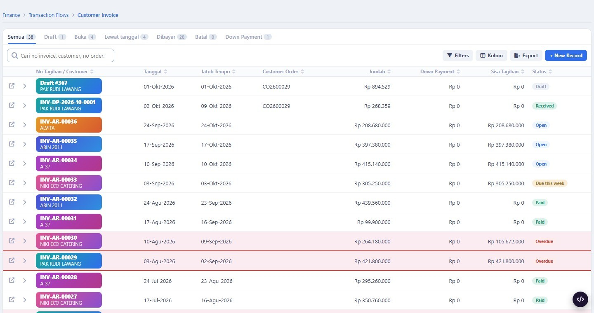
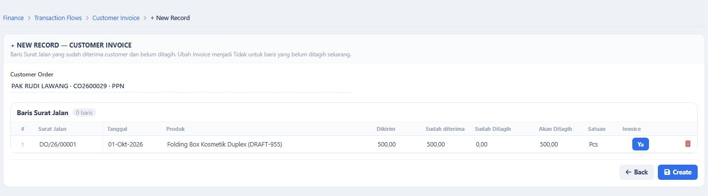
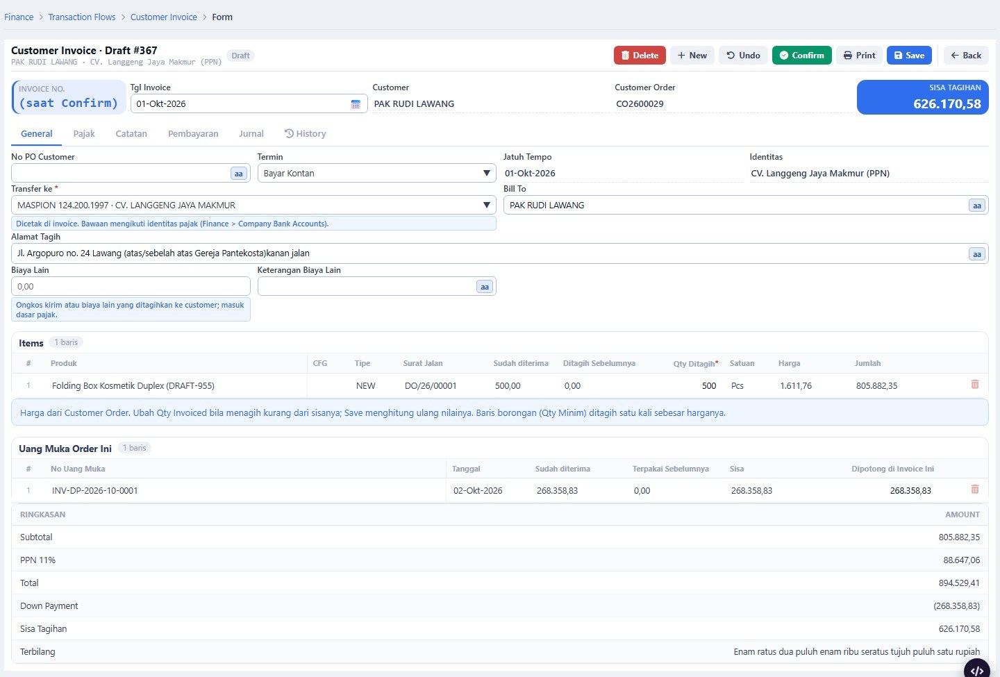
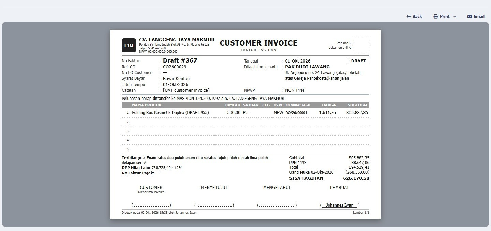

# CUSTOMER INVOICE + UANG MUKA — DOKUMEN REVIEW TAHAP 1

> Untuk direview user. Tanggal: 2026-10-02.
> Yang dibangun: **Tahap 1 (menagih)** dari `customerinvoice_plan.md`, **hanya di database dummy (mockup.test)**.
> tmerp.test belum disentuh: tabel, menu, dan datanya belum ada di sana (bagian 9).
> Ketentuan keuangan dan akuntansinya: `customerinvoice_accounting.md`.

---

## 1. Ringkasan

| Hal | Status |
|---|---|
| Customer Invoice dari Surat Jalan (draft, simpan, Confirm, Cancel, cetak) | jalan di mockup.test |
| Tagihan uang muka (Down Payment) + Record Receipt + Tanda Terima Uang Muka | jalan di mockup.test |
| Potongan uang muka otomatis di invoice | jalan |
| Nomor dari seri, terbit saat Confirm (dua seri invoice + dua seri uang muka) | jalan |
| Jurnal otomatis (invoice, potongan uang muka, penerimaan uang muka, jurnal balik saat Cancel) | jalan |
| Master Company Bank Accounts dan Document Number Series | jalan |
| Qty diterima customer di Proof of Delivery | jalan |
| Help tiga layar baru + terjemahan Indonesia | sudah dimuat |
| Test otomatis | 7 test, 102 pemeriksaan, lulus di database dummy |
| Penerimaan pelunasan invoice (Customer Receipt v2), AR Aging, Statement of Account | **belum** — Tahap 2 |
| Credit Note, pengembalian uang muka, batas kredit, e-Faktur, saldo awal | **belum** — Tahap 3 |

---

## 2. Cara mencoba di mockup.test

Data contoh yang sudah disiapkan: satu Draft invoice (`Draft #367`, order CO2600029, PAK RUDI LAWANG, PPN) dengan
uang muka 30% yang sudah dibayar (INV-DP-2026-10-0001).

**A. Menagih (Draft yang sudah ada)**

1. Finance › Transaction Flows › **Customer Invoice**. Daftar memuat invoice lama, uang muka, dan `Draft #367`.
2. Buka `Draft #367`. Periksa: baris Folding Box 500 pcs dari DO/26/00001, uang muka 268.358,83 sudah diusulkan,
   Sisa Tagihan 626.170,58.
3. Tab **Jurnal**: pratinjau jurnal yang akan terbentuk.
4. **Confirm**. Nomor terbit `1/LJM/X/2026`, status jadi Confirmed, tab Jurnal berisi voucher yang terposting.
5. **Print**: cetakan kop CV. Langgeng Jaya Makmur, uang muka sebagai potongan, Sisa Tagihan tebal.
6. **Cancel** + alasan (bila ingin mencoba): jurnal dibalik, Surat Jalan dan uang muka bisa dipakai lagi, nomor tidak
   dipakai ulang.

**B. Uang muka baru**

1. Customer Invoice › **+ New Record** › **Down Payment** › pilih order (mis. CO2600027) › **Create**.
2. Isi Percent of Order (bawaan 50) atau kosongkan dan isi Bill Amount › **Save** › **Confirm**. Nomor
   `…/UM-LJM/X/2026` terbit; tab Jurnal masih kosong.
3. **Record Receipt** › tanggal, rekening, nilai › **Confirm Receipt**. Status Received, jurnal muncul, tombol
   **Print Receipt** mencetak Tanda Terima Uang Muka.

**C. Dari Surat Jalan sampai invoice**

1. Sales › Delivery › **Proof of Delivery** › buka Surat Jalan › Result = Received (atau Partially received dan isi
   qty per baris) › Save.
2. Customer Invoice › + New Record › Invoice › pilih order › **Next** › biarkan Invoice = Ya pada baris yang
   ditagih › **Create**.
3. Di Draft, kurangi Qty Ditagih bila menagih sebagian › Save › Confirm.

**D. Master**

- Finance › Transaction Flows › **Company Bank Accounts**: lima rekening dari sistem lama.
- Setup › Settings › **Document Number Series**: empat seri (`INV_TM`, `INV_LJM`, `DP_TM`, `DP_LJM`).
- Setup › Constants: `DP_VAT_ON_RECEIPT` (1), `DP_DEFAULT_PERCENT` (50).

---

## 3. Layar (potret dari aplikasi, database dummy)

**Daftar** — satu daftar untuk invoice dan uang muka; baris merah muda = lewat jatuh tempo.



**+ New Record, langkah pilih baris Surat Jalan**



**Form Draft** — potongan uang muka, ringkasan, terbilang.



**Cetakan**



---

## 4. Aturan yang dijaga aplikasi

| Aturan | Yang terjadi di aplikasi |
|---|---|
| Yang ditagih = qty diterima customer | Surat Jalan tanpa Proof of Delivery tidak muncul di pilihan; qty tagih > sisa ditolak saat Confirm |
| Tidak bisa tagih dobel | qty tertagih disimpan di baris Surat Jalan; baris yang habis ditagih hilang dari pilihan |
| Harga tidak diketik | diambil dari baris Surat Jalan (harga Customer Order); kolom Harga tidak bisa diisi |
| Qty Minim = harga borongan | nilai baris = harga; ditagih sekali, invoice berikut untuk baris itu bernilai 0 |
| Nomor terbit saat Confirm | Draft tampil `Draft #id`; nomor dari seri sesuai identitas dan bulan tanggal invoice |
| Nomor tidak dipakai ulang | invoice batal tetap memegang nomornya; invoice pengganti mendapat nomor berikutnya |
| Tagihan uang muka tidak menjurnal | tab Jurnal kosong sampai Record Receipt |
| PPN uang muka saat uang diterima | jurnal penerimaan memisah Uang Muka dan PPN Keluaran (order PPN, `DP_VAT_ON_RECEIPT` = 1) |
| Uang muka dipotong otomatis | diusulkan saat Draft dibuat; boleh dikurangi; tidak bisa melebihi sisa uang mukanya |
| Sesudah Confirm tidak berubah | Save dan Delete ditolak; hanya Cancel dengan alasan |
| Cancel dibatasi | ditolak bila sudah ada pembayaran atau periode buku sudah ditutup |
| Uang muka yang sudah diterima tidak bisa di-Cancel | ditolak (pengembalian uang muka = Tahap 3) |
| Periode buku | Confirm, Cancel, dan Record Receipt ditolak pada tanggal di periode tertutup |
| Rekening sesuai identitas | rekening PPN tidak bisa dipilih di dokumen Non PPN, dan sebaliknya |

---

## 5. Jurnal yang terbentuk

Angka dari `Draft #367` (order PPN, tarif 11%):

| Saat | Jurnal |
|---|---|
| Uang muka diterima (dummy lama, cara lama) | Dr Bank 268.358,83 / Cr Piutang 268.358,83 |
| Confirm invoice | Dr 112100 Piutang 894.529,41 / Cr 411000 Penjualan 805.882,35 / Cr 212100 PPN Keluaran 88.647,06 |
| Potongan uang muka (voucher yang sama) | Dr 213200 Uang Muka 241.764,71 / Dr 212100 PPN Keluaran 26.594,12 / Cr 112100 Piutang 268.358,83 |
| Sisa piutang | 626.170,58 |

Uang muka baru (cara baru): Record Receipt → Dr Bank / Cr 213200 Uang Muka Penjualan (+ Cr 212100 PPN Keluaran
untuk order PPN). Rincian dan contoh lain: `customerinvoice_accounting.md` bagian 5 dan 6.

---

## 6. Yang berbeda dari mockup yang disetujui

| # | Mockup | Aplikasi | Alasan |
|---|---|---|---|
| 1 | pilih Customer, lalu Customer Order | satu pilihan "Customer · CO · PPN" | satu langkah, tanpa memuat ulang layar |
| 2 | tombol **To Invoice** di daftar | belum ada; order yang bisa ditagih tampil di + New Record | daftar kerja terpisah = Tahap 2 |
| 3 | panel kanan Amount / Journal / Faktur Pajak | Ringkasan di bawah baris; Journal dan Pajak jadi tab | mengikuti bentuk form baku DevLib |
| 4 | centang baris Surat Jalan | tombol Ya / Tidak per baris | objek baris DevLib tidak punya kotak centang |
| 5 | Customer Receipt (bagian 5 mockup) | belum dibangun | Tahap 2 |
| 6 | ikon cetak di tiap baris daftar | cetak dari form | menyusul bila diinginkan |
| 7 | rekening di cetakan: tebal | huruf biasa | objek cetak mencetak kalimat pembuka dengan huruf biasa |

---

## 7. Batasan Tahap 1 yang perlu diketahui

1. **Pelunasan invoice** masih dicatat di layar lama **Order to Cash** (tombol terima pembayaran). Invoice baru muncul
   di sana karena memakai tabel yang sama. Customer Receipt v2 = Tahap 2.
2. **Menu Down Payment lama dimatikan** di mockup.test. Layar itu menjurnal piutang saat tagihan uang muka terbit
   (cara lama) dan akan bertentangan dengan keputusan C.
3. **Hak akses** masih per modul (Finance & Accounting). Pemisahan hak buat / Confirm / terima uang / Cancel per orang
   belum ada.
4. **Akun pendapatan** semua baris = 411000. Pemetaan per kategori product belum.
5. **Biaya lain** (ongkos kirim) diketik di invoice; belum mengambil dari biaya eksternal Customer Order.
6. **Akun bank**: di database dummy kelima rekening sementara menunjuk akun 111200 supaya alurnya bisa dicoba. Di
   tmerp.test kolom itu dikosongkan dan penerimaan uang ditolak sampai Finance mengisi akun tiap rekening.
7. **PPh 23**, selisih bayar, dan kelebihan bayar: Tahap 2 (bersama Customer Receipt).
8. **Pesan salah saat Confirm** (yang memuat nomor baris) masih bahasa Inggris.
9. **Draft tidak memesan baris**: dua Draft bisa memuat baris Surat Jalan yang sama; yang kedua ditolak saat Confirm.
10. **E-mail** invoice dari form belum diaktifkan (tombol disembunyikan).
11. **Format cetak belum A** (menunggu koreksi user): Customer Invoice, Down Payment Invoice.

---

## 8. Yang dibuat dan diubah

**Tabel (database dummy):**
`tm2sys.sys_doc_series`, `sys_doc_series_counter` · `tm2acc.fin_company_bank`, `fin_invoice_line` · 21 kolom baru di
`tm2acc.fin_invoice` (nomor boleh kosong selama Draft) · `tm2sdi.do_line.qty_received` · view `v1_fin_ar_aging`
sekarang hanya memuat invoice Confirmed.

**Kode:**

| Bagian | File |
|---|---|
| Aturan dan jurnal | `app/Services/Acc/CustomerInvoiceService.php` |
| Seri nomor | `app/Support/Docs/DocSeries.php`, `app/Models/Sys/SysDocSeries.php` |
| Model | `app/Models/Acc/FinInvoiceLine.php`, `FinCompanyBank.php`, `FinInvoice.php` (kolom + relasi) |
| Layar | `resources/views/v2/screens/customer-invoice.blade.php`, `app/Support/V2/Data/CustomerInvoice.php`, `routes/v2_finance.php` |
| Master | `app/Support/V2/Grid/Acc/CompanyBankLookup.php`, `Setup/DocSeriesLookup.php` |
| Cetakan | `app/Support/V2/Print/CustomerInvoicePrint.php`, `DownPaymentInvoicePrint.php` |
| Proof of Delivery | `app/Services/Sales/DeliveryPromiseService.php`, `resources/views/v2/screens/proof-of-delivery.blade.php` |
| Objek DevLib | cetakan: kalimat pembuka berisi data (`nbRaw`); tabel: kolom angka yang sudah diformat (`raw`) |
| Migrasi | `2026_10_02_000140` (tabel, seri, rekening, konstanta, menu) · `000141` (terjemahan, menu Down Payment lama mati) · `000142` (contoh data, hanya dummy) |
| Help | `resources/data/help/finance.json` (2 topik), `master_setup.json` (1 topik) |
| Test | `tests/Feature/CustomerInvoiceTest.php` |

**Test** (`CustomerInvoiceTest`, dijalankan terhadap database dummy; di database yang belum punya tabelnya test
dilewati): format nomor · invoice Non PPN dengan uang muka + Cancel + nomor tidak dipakai ulang · uang muka PPN
(pisah harga dan PPN, reklas di invoice) · tagih sebagian dan tolak qty lebih · baris borongan · hapus Draft dan tolak
Cancel uang muka yang sudah diterima · alur lengkap lewat layar (buat, simpan, Confirm, terima uang, cetak, Cancel).
Semua data buatan test dihapus dan penghitung nomor dikembalikan; sudah diperiksa ke database.

---

## 9. Menerapkan ke tmerp.test (belum dilakukan)

Dilakukan setelah user selesai mereview dan butir pajak dikonfirmasi:

```bash
php artisan migrate --path=database/migrations/2026_10_02_000140_customer_invoice_module.php
```

```bash
php artisan migrate --path=database/migrations/2026_10_02_000141_dictionary_customer_invoice.php
```

```bash
php artisan help:import --file=finance.json
```

Sesudah itu: Finance mengisi **Ledger Account** tiap rekening di Company Bank Accounts (akun bank per rekening harus
dibuat dulu di Master of Accounts), dan memeriksa kode seri di Document Number Series.

---

## 10. Yang perlu diputuskan saat review

1. **Kode seri**: `LJM`, `UM-TM`, `UM-LJM` — dipakai, atau diganti?
2. **Menu Down Payment lama** dimatikan dan **Order to Cash** lama tetap ada sampai Tahap 2 — setuju?
3. **Tanggal invoice** bawaan = tanggal Surat Jalan terakhir — setuju, atau tanggal hari dibuat?
4. **Format cetak** Customer Invoice dan Down Payment Invoice: koreksi apa sebelum ditandai A?
5. **Penanda tangan** di cetakan invoice (sistem lama tanpa tanda tangan): tetap empat kolom, atau dikurangi?
6. Lanjut **Tahap 2** (Customer Receipt, To Invoice, AR Aging, Statement of Account, tab Billing di Customer Order)?
