# Inventory & Warehouse v2.01 — Rencana Teknis (dengan Preview Mockup)

> **Status: DRAFT rev.1 2026-10-08, dibangun ulang atas permintaan user** ("re-build TECHNICAL PLAN with PREVIEW mockups"; "make sure you have the best references about STOCK, STOCK MOVING and all workflow, data flow").
> **Aturan user:** semua perubahan di-PREVIEW dulu dan disetujui sebelum dibangun. **Stock Card, Stock Summary, dan Warehouse Map yang ada sudah benar dan tidak diubah.**
> Dokumen ini adalah **induk**. Rincian kebutuhan bernomor (I-, W-, B-, Q-, V-): `inventorywarehouse_v201_scope.md`. Langkah Fase 1: `inventorywarehouse_v201_phase1_plan.md`.
> Dasar rujukan (SAP, Odoo, ERPNext, Dynamics 365, NetSuite): `inventorywarehouse_v201_references.md`. Tanda **[R#]** di bawah menunjuk bagian rujukan itu.
> Gambar ada di `docs/mockups/`; status persetujuan tiap gambar di bagian 11.

## 1. Tujuan dan batasan

| Hal | Isi |
|---|---|
| Tujuan | Memperbaiki Inventory dan Warehouse untuk percetakan offset dan packaging: batch dan kedaluwarsa, pemilik stok, booking sejak costing, QC sampling dengan jalur URGENT, kurang kirim, subkon, titipan customer, alokasi gudang, dan nilai Average per item |
| Dua modul | **INVENTORY** (apa, berapa, nilai, pemilik) dan **WAREHOUSE** (di mana, bagaimana fisik); dokumen Transfer dan Opname dimiliki Inventory, eksekusi lapangan di Warehouse (D1) |
| Tidak diubah | Stock Card, Stock Summary, **Warehouse Map**; Stock In / Out / Return / Adjustment per kelas; Inquiry, ProDev, ProCost (zona beku) |
| Dibangun di | `ddt*` (mockup.test) sampai rilis; **tidak menulis ke `tm2*`** |
| Prinsip kode | OO dan modular, objek DevLib (`x-dl::*`), logika di `app/Services/*`, setiap nilai punya layar inputan |

## 2. Modul dan menu

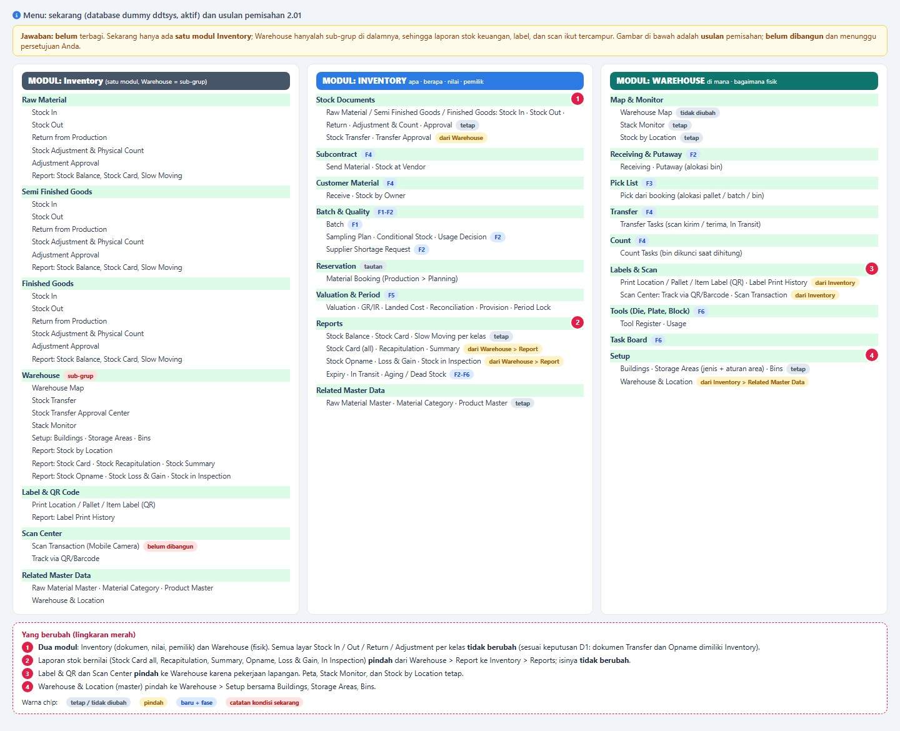

**Kondisi sekarang** (dibaca dari `ddtsys`): satu modul Inventory; Warehouse hanya sub-grup; laporan stok bernilai ada di Warehouse > Report; Label dan Scan ada di Inventory; Scan Transaction (kamera) belum dibangun.

**Usulan:** dua modul. Pemindahan menu bersifat **deviasi** dan menunggu persetujuan gambar di atas. Peta dan Stack Monitor tetap.

## 3. Model stok [R2, R5]

| Lapisan | Isi | Status |
|---|---|---|
| Master | Item, satuan, batch, area, bin, pemilik | batch **baru** |
| **Buku pergerakan** | Kartu stok berantai per posisi (item di satu bin): `qty_bb/in/out/adj/eb`, nilai, `previous_doc_id`, urutan `(doc_date, doc_id)` | ada |
| **Rantai nilai per item** | Satu rantai per item untuk Average: qty total, nilai, Average | **baru** (D15) |
| Saldo | Hasil buku pergerakan; tidak diketik | ada |
| Kuantitas | On hand, Reserved, Blocked/Quarantine, In Transit, Available, ATP | sebagian |

**Status stok per batch** [R5]: Quarantine, Conditional, Released, Rejected, Blocked, masing-masing dengan **bendera**: dihitung Available? boleh dialokasikan booking dan pick? (padanan *Available for Commitment / Allocation* NetSuite).

**Pemilik stok:** Company, Customer, Supplier (padanan special stock SAP K / W / E); stok pemilik pihak lain tidak dinilai dan tidak dijurnal.

**Aturan buku** (semua produk besar [R2]): koreksi lewat dokumen lawan, bukan edit atau hapus; dokumen bertanggal mundur disisipkan dan rantai sesudahnya dihitung ulang (sudah ada); periode tertutup menolak posting (sudah ada, `inv_period`).

## 4. Katalog pergerakan stok [R3]

| # | Pergerakan | Efek qty | Efek nilai | Jurnal | Dokumen |
|---|---|---|---|---|---|
| 1 | Terima dari PO | + di bin / dok | Harga PO + landed cost | Dr Persediaan / Cr GR/IR | PV / Stock In |
| 2 | Terima URGENT | + (Conditional), langsung ke area produksi | sama | sama | PV bertanda URGENT |
| 3 | Retur customer | + (layak pakai) atau afkir | Nilai keluar asli | Dr Persediaan / Cr HPP | Return |
| 4 | Titipan customer | + (pemilik Customer) | **tanpa nilai** | **tanpa jurnal** | PV CUSTOMER |
| 5 | Hasil subkon | + SFG / FG | Nilai kirim + jasa | Dr Persediaan / Cr GR/IR; Dr HPP Jasa Subkon | PV SUBCON |
| 6 | Hasil produksi | + SFG / FG | Bahan + proses | Dr FG / Cr WIP | Stock In dari WO |
| 7 | Issue ke produksi | − RM | Average item | Dr WIP / Cr Persediaan RM | Stock Out |
| 8 | Kirim ke customer | − FG | Average item | Dr HPP / Cr Persediaan FG | Delivery |
| 9 | Kirim ke subkon | − di gudang, + di lokasi vendor | **tidak berubah** | tanpa jurnal | Send Material (baru) |
| 10 | Transfer | − asal, + tujuan (dua langkah via In Transit) | **tidak berubah** | tanpa jurnal | Stock Transfer |
| 11 | Ubah status batch | tidak berubah | tidak berubah | tanpa jurnal | Keputusan QC |
| 12 | Adjustment / opname | ± | Average item | Dr/Cr Selisih Persediaan | Adjustment |
| 13 | Scrap / pemusnahan | − | Average item | Dr Beban Scrap / Cr Persediaan | Berita acara |
| 14 | Retur ke supplier | − | Nilai penerimaan asli | Dr Hutang atau GR/IR / Cr Persediaan | Return supplier |
| 15 | Koreksi kurang kirim | − qty terima | Nilai penerimaan asli | koreksi GR/IR | Permintaan Kirim Kekurangan |
| 16 | Repack | ± | tidak berubah total | tanpa jurnal | P3 |

Reservasi dan alokasi **bukan** pergerakan; keduanya dicatat terpisah dari buku stok.

## 5. Alur kerja [R6 sampai R10]

### 5.1 Penerimaan, QC sampling, dan jalur URGENT

```
PO ──► Warehouse: Receiving (hitung, timbang, label, ambil sampel)
        ├─ NORMAL ─► uji cepat di dok ─► Released ─► Inventory: GRN ─► Putaway (alokasi bin) ─► Available
        │              └─ Rejected ─► retur / klaim (belum masuk stok)
        └─ URGENT (PPIC / Supervisor / Ops Manager, alasan + WO) ─► Inventory: GRN, batch Conditional
                       ─► langsung ke area produksi (dock-to-line); sampling paralel ─► Released / Rejected
                       └─ Rejected ─► telusur maju, tahan WO + FG, klaim supplier
```

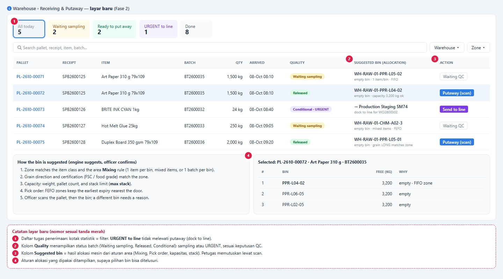

### 5.2 Kurang kirim

```
Selesai produksi: Kebutuhan = Output baik + Waste STANDAR   Kekurangan = Kebutuhan - Qty yang dikeluarkan
 Kekurangan > toleransi PO ─► hitung / timbang ulang (bukti) ─► konfirmasi
  ─► Permintaan Kirim Kekurangan (supplier / subkon / customer) ─► koreksi qty terima + GR/IR ─► baris PO dibuka kembali
  └─ ditolak / lewat 7 hari ─► tutup baris PO di qty terima + debit note atau potong tagihan
```

### 5.3 Booking sejak costing, pick, dan peta

```
ProCost terbit ─► B0 pre-booking (lunak, tidak mengunci)
 Quotation ─► B1 ─► CO Draft ─► B2 ─► CO Confirmed + PPIC Confirm ─► B3 KERAS (mengunci per lokasi)
 WO lahir ─► Pick List (Warehouse): alokasi pallet / batch / bin menurut aturan area (FIFO / FEFO) + syarat serat dan sertifikasi
  ─► scan pallet lalu bin ─► Inventory: issue ke WO ─► sisa dilepas saat WO selesai
```

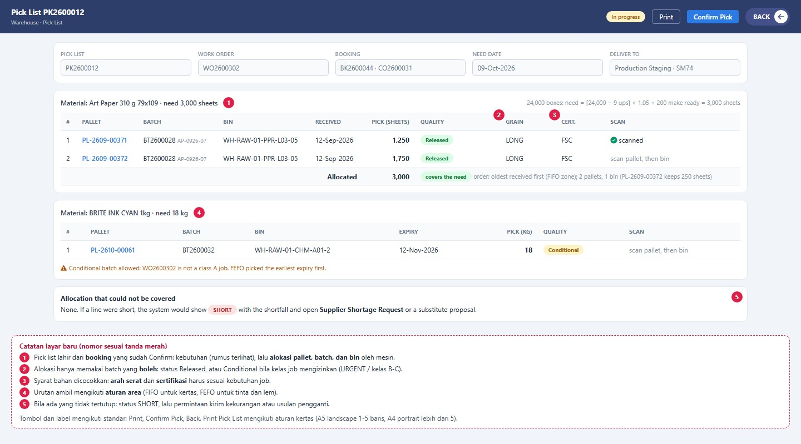

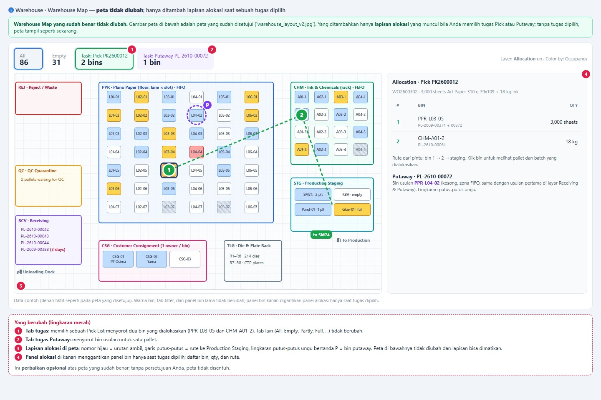

Peta yang disetujui sebagai dasar: 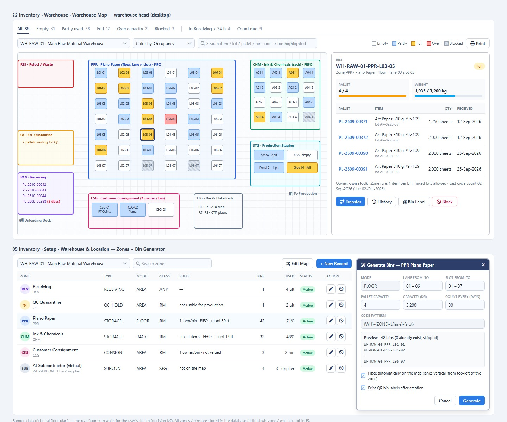

### 5.4 Transfer, subkon, opname

```
Transfer: dokumen (Inventory) ─► kirim (Warehouse, scan) ─► In Transit ─► terima (scan) ─► selisih = Discrepancy ─► tutup
Subkon:   Send Material (referensi PO Subkon) ─► lokasi virtual Vendor ─► hasil kembali (PV SUBCON) ─► QC ─► nilai kirim + jasa; susut vendor dalam toleransi
Opname:   jadwal per area (tiap N hari) ─► bin DIKUNCI ─► hitung scan ─► selisih ─► persetujuan ─► penyesuaian bernomor + jurnal
```

## 6. Aliran data lintas modul [R11]

| Dari | Ke | Isi | Cara |
|---|---|---|---|
| Procurement (PO, PV) | Inventory | Penerimaan, tanda URGENT, kurang kirim | Posting stok oleh `PvPostingService` (diubah: blokir QC hanya untuk jalur normal) |
| Inventory | Accounting | Jurnal tiap pergerakan bernilai, GR/IR, selisih, penyisihan | Jurnal otomatis; rekonsiliasi harian ke GL |
| Production (WO, output) | Inventory | Issue, hasil, return, waste | Dokumen stok |
| Sales (CO, CPDEL) | Planning | Kebutuhan, tanggal butuh | Booking dari **costing terbit**, naik tahap |
| ProCost, layout | Booking | Ukuran plano, ups, gramatur, kode sheet pemasok | **Hanya kolom qty dan ukuran** (harga rahasia Sisi A) |
| Planning (booking) | Warehouse | Kebutuhan per bahan | Pick List |
| Warehouse | Inventory | Bukti scan: qty, bin, batch, pallet | Dasar posting |
| Inventory | Planning | Reserved, Available (RM dan FG, satu sumber) | View `v_rm_available` + padanan FG |

## 7. Booking, QC, dan kurang kirim (ringkas)

Rincian ada di cakupan 2.01 bagian 6 dan 7. Keputusan: booking dimulai sejak costing menghitung (D5), QC sampling dengan URGENT langsung ke produksi (D4), kurang kirim diminta dikirim (D14), pengaman URGENT sesuai saran (D16).

## 8. Nilai dan akuntansi [R11]

**Average berjalan per item.** Rumus: `Avg baru = (Qty saldo x Avg lama + Qty masuk x Harga masuk) / (Qty saldo + Qty masuk)`; keluar = `Qty x Avg`, Avg tidak berubah; qty saldo nol memaksa nilai nol.

Contoh kenaikan harga (kertas art carton):

| # | Kejadian | Saldo qty | Nilai saldo | Avg per kg |
|---|---|---|---|---|
| 1 | Saldo awal 1.000 kg @15.000 | 1.000 | 15.000.000 | 15.000 |
| 2 | Terima 500 kg @16.500 | 1.500 | 23.250.000 | 15.500 |
| 3 | Issue 800 kg = 12.400.000 | 700 | 10.850.000 | 15.500 |
| 4 | Terima 600 kg @18.000 | 1.300 | 21.650.000 | 16.653,85 |
| 5 | Issue 1.000 kg = 16.653.846 | 300 | 4.996.154 | 16.653,85 |

Pemeriksaan: 12.400.000 + 16.653.846 + 4.996.154 = 34.050.000 = 15.000.000 + 8.250.000 + 10.800.000.

Aturan lain (D17, D18): landed cost terlambat ke qty yang ada, bagian yang sudah keluar ke akun Selisih Landed Cost; transaksi mundur membuat satu jurnal koreksi bersusun dan laporan Repost; LIFO tidak dipakai (PSAK 14); FIFO ditunda. **Migrasi ke per item tanpa jurnal:** Avg awal = total nilai / total qty semua bin.

**Laporan yang dijaga:** Stock Card (qty) dan Stock Summary (nilai) harus **identik sebelum dan sesudah** peralihan; Closing per kelas tetap sama.

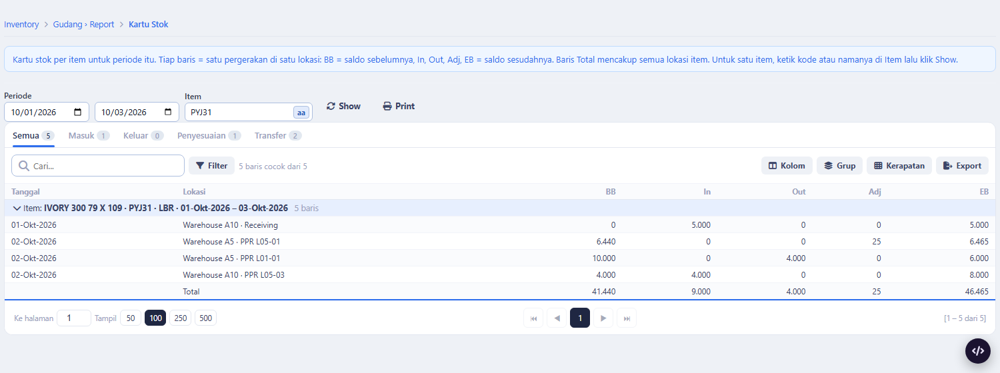

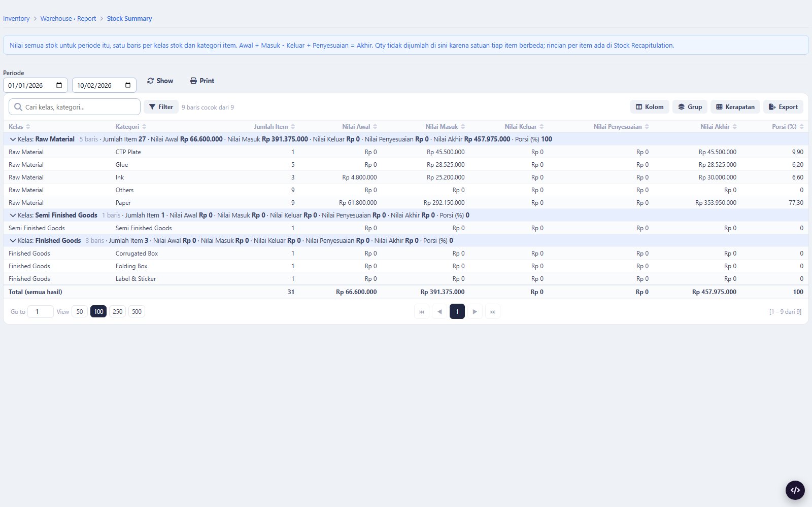

## 9. Skema (ringkas, belum final)

| Entitas | DB | Isi inti |
|---|---|---|
| `inv_batch` | tm2inv | batch_no, item, lot supplier, tanggal produksi / kedaluwarsa / retest, `qc_status`, sertifikasi, food grade, arah serat, COA |
| kolom `batch_id`, `owner_type`, `owner_id` | kartu stok, baris dokumen, `inv_pallet` | batch dan pemilik |
| `inv_item_valuation` | tm2inv | rantai nilai per item: qty dan nilai bb/in/out/adj/eb, Average |
| `wh_zone` tambahan | tm2mst | `is_virtual`, `mix_rule`, `pick_order`, `count_every_days`; jenis area baru WIP, SUBCON, TRANSIT, LOSS |
| `inv_qc_sampling_plan`, `inv_qc_decision`, `inv_qc_first_article` | tm2inv | rencana sampel, keputusan, hasil first article |
| kolom URGENT pada baris penerimaan | tm2pur | `is_urgent`, pemohon, alasan, WO tujuan |
| `inv_shortage_request` | tm2inv / tm2pur | Permintaan Kirim Kekurangan |
| `inv_subcon_issue` | tm2inv | kirim bahan ke subkon (induk: PO Subkon) |
| `wh_task`, `wh_pick_list` | tm2inv | tugas Receive / Putaway / Pick / Move / Count dan pick list |
| `rm_booking` tambahan | tm2inv | `chain_key` (inquiry), `stage` B0..B4, `hold_until` |
| `inv_tool` (+ pemakaian) | tm2inv | die, plat, klise: pemilik, lokasi, impresi, umur |

PK BIGINT auto number, nama English, tanpa FK lintas-DB, nilai batas di pengaturan (aturan 7.12).

## 10. Peran dan hak

| Peran | Boleh |
|---|---|
| Operator gudang | Receive, putaway, pick, hitung (scan) |
| Kepala gudang | Hitung ulang kurang kirim, kunci / buka bin, persetujuan opname awal |
| PPIC | Confirm booking, tandai URGENT, pilih item, minta kirim kekurangan |
| Supervisor Produksi, Ops Manager | Tandai URGENT; Ops Manager: hot job, pelepasan bersyarat |
| Kepala QC | Keputusan sampling, Usage Decision, persetujuan URGENT bahan FSC / food grade |
| Pembelian | Tindak lanjut kurang kirim, PR dari kekurangan |
| Akuntansi | Jurnal koreksi, landed cost, penyisihan, rekonsiliasi |
| Admin | Pengaturan, master |

Hak harga: Sales tidak melihat harga; nilai stok hanya yang berhak membuka laporan bernilai.

## 11. Gambar preview dan status persetujuan

| Gambar | Isi | Status |
|---|---|---|
| `inventory_report_app/1_stock_card.png`, `1c_print_stock_card.png`, `3_stock_summary.png` | Stock Card, cetakan, Stock Summary yang **ada** | **Tidak diubah** (keputusan user) |
| `warehouse_layout_v2.jpg` | Warehouse Map yang disetujui | **Tidak diubah** |
| `menu_v201_split.jpg` | Menu sekarang dan usulan dua modul | **Menunggu persetujuan** |
| `inv_v201_coverage.jpg` | Peta cakupan aspek dan status preview | Informasi |
| `inv_v201_batch_grid.jpg`, `inv_v201_batch_form.jpg` | Master batch (layar baru) | Menunggu persetujuan |
| `inv_v201_stock_in_batch.jpg` | Field Batch di Stock In | Menunggu persetujuan |
| `wh_v201_storage_area.jpg` | Jenis area baru dan aturan area (tiga isian) | **Aturan area disetujui** (D24); jenis area menunggu |
| `wh_v201_receiving_putaway.jpg` | Receiving dan Putaway (Fase 2) | Menunggu persetujuan |
| `wh_v201_pick_allocation.jpg` | Pick List dan alokasi (Fase 3) | Menunggu persetujuan |
| `wh_v201_map_allocation.jpg` | Lapisan alokasi pada peta (opsional) | Menunggu persetujuan |

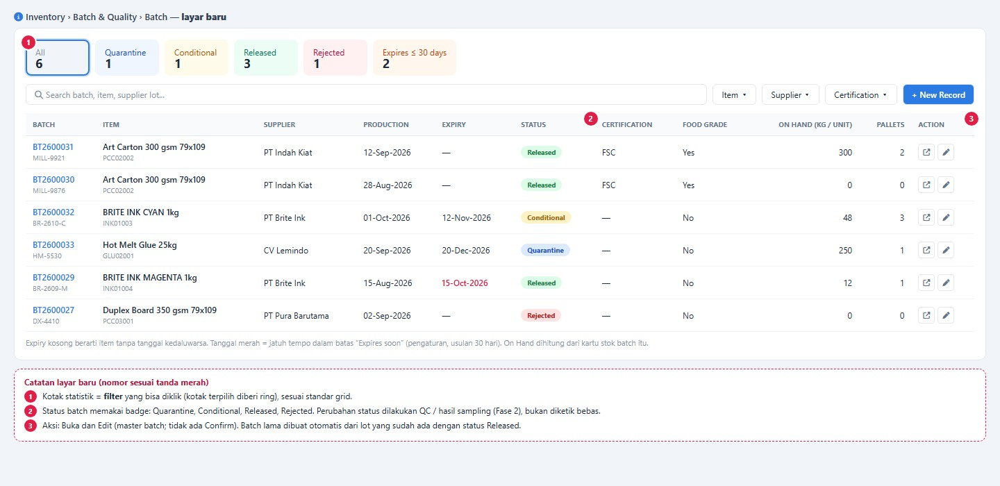

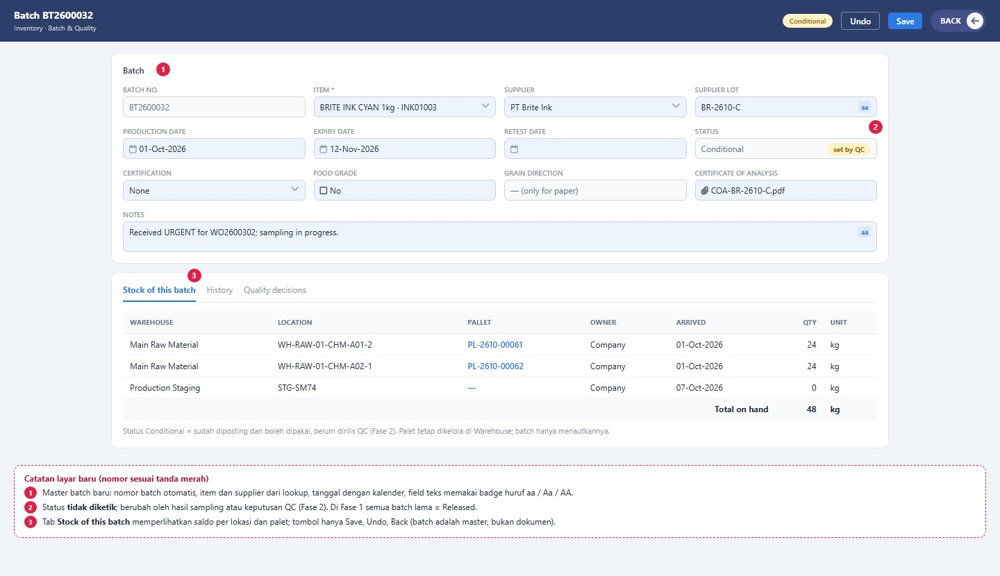

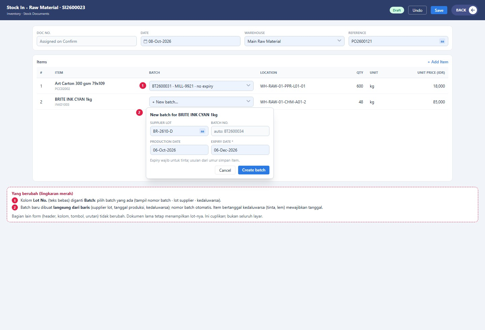

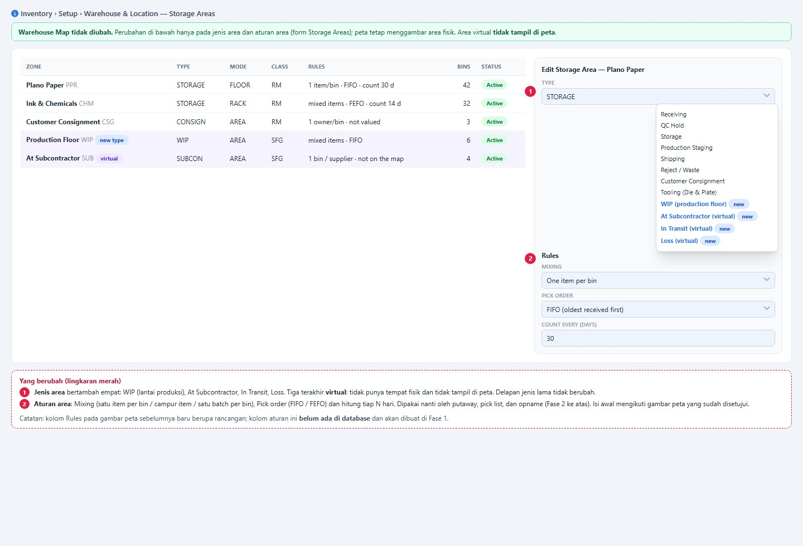

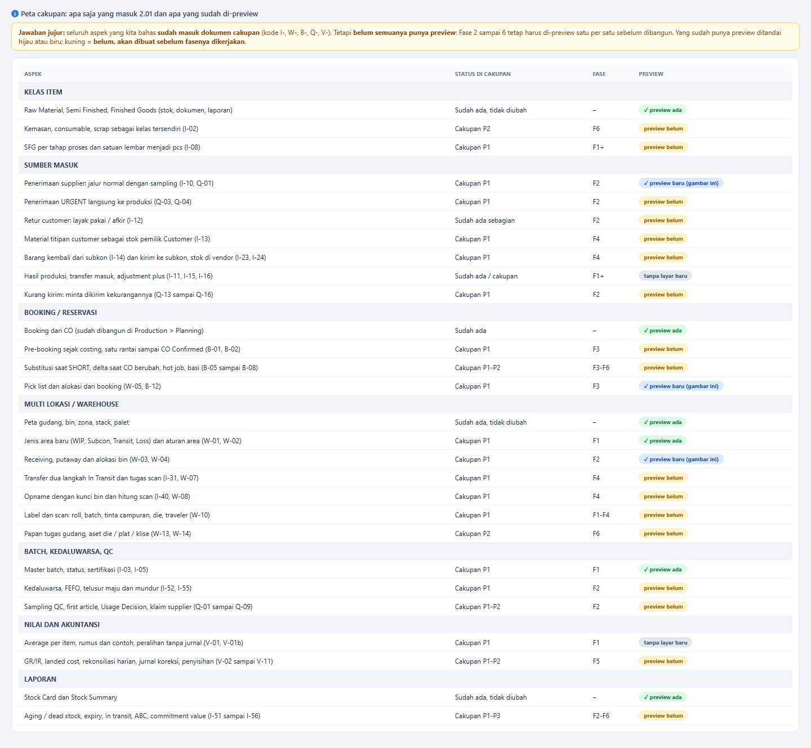

**Belum ada preview** (dibuat sebelum fasenya): penerimaan URGENT dan layar QC / sampling / Usage Decision, Permintaan Kirim Kekurangan, pre-booking dari costing, subkon (kirim, stok di vendor), titipan customer, transfer In Transit, opname dengan kunci bin, layar nilai (landed cost, GR/IR, rekonsiliasi, penyisihan), register die dan plat, papan tugas.

## 12. Fasing

| Fase | Isi | Preview yang dibutuhkan |
|---|---|---|
| F1 Fondasi | Master batch, pemilik, status, Average per item, jenis area, aturan area | Batch, Stock In, Storage Areas (ada) |
| F2 QC dan penerimaan | Sampling, URGENT, dock-to-line, Receiving, Putaway, kurang kirim | Receiving / Putaway (ada); QC, URGENT, kurang kirim (belum) |
| F3 Booking | Pre-booking dari costing, substitusi, Pick List | Pick List dan peta (ada); pre-booking (belum) |
| F4 Subkon, titipan, opname | Send Material, stok vendor, titipan customer, In Transit, kunci bin | semua belum |
| F5 Nilai | Landed cost, GR/IR, rekonsiliasi, jurnal koreksi, penyisihan | belum |
| F6 Penyempurnaan | Hot job, basi, die dan plat, papan tugas, laporan lanjut | belum |

Setiap langkah: satu commit, `php artisan build:catalog --env=mockup`, Help layar baru, uji dengan angka yang diharapkan (T1 sampai T15 di rencana Fase 1).

## 13. Keputusan dan hal terbuka

**Diputuskan user:** D1 sampai D24 (cakupan 2.01 bagian 1), termasuk Stock Card tidak diubah (D23) dan aturan area tiga isian (D24).

**Terbuka:**
1. Persetujuan gambar pada bagian 11 (terutama menu dan Batch).
2. **R-1:** cara menjalankan uji terhadap `ddt*` (uji proyek menulis ke `tm2*`, migrasi Fase 1 hanya ke `ddt*`).
3. Pemetaan item sheet ProCost ke `mat_raw` (dipilih PPIC lewat Pick Item).
4. Kelas risiko awal per kategori material (kepala QC).
5. Metode ukur Average pada kasus berat timbang aktual (satuan ganda) perlu uji.

## 14. Riwayat

| Tanggal | Perubahan |
|---|---|
| 2026-10-08 | Rencana teknis induk dibangun ulang dengan gambar preview dan rujukan; menggantikan penyebaran antar cakupan dan rencana Fase 1 sebagai pintu masuk |
