# Opening Dashboards (layar pembuka dengan widget) — untuk review user

Dibangun 2026-10-02. Keputusan user yang dijalankan:
- *"bisakah disediakan many widget including graphics ... dengan bantuan asisten AI seseorang bisa meminta untuk dipasangkan
  widget-nya"*; *"top management dulu yang diprioritaskan, yang lainnya masih ikut template yang dibuat"*.
- *"pasang saja di tmerp"*; *"dijelaskan saja draft sekian dan confirmed sekian"*; *"boleh dari daily sampai yearly"*.
- *"kerjakan saja widget sebanyak mungkin misal 20 sampai 30 widget, lalu direksi tinggal pilih tickmark widget mana saja yang
  mau terlihat di dashboard secara overall"*; *"dashboard untuk sales, purchasing, AR AP, cashflow, payroll, human resource
  sudah disediakan templatenya"*; *"kumpulan widget yang ada di purchasing, sales dll inilah yang bisa dipilih untuk masuk ke
  dashboard overall"*.
- *"FIND and BUILD IT references from another ERP ..."* → `openingboard_references.md`.
- *"like screen on android, user can add some widgets and easily to add widget"*.
- *"pasang saja nanti juga bisa disempurnakan"* (asisten AI di tmerp) dan *"perlu ada production, quality control and quality
  assurance, inventory and warehousing, payroll, human resource, Work Instruction, job description, SOP. On production, target
  vs result, capacity planning"*.

**Status:** jalan di **mockup.test (ddt)** dan **tmerp.test/v2 (tm2)**. 67 widget, 11 dashboard. Asisten AI terpasang di keduanya.

---

## 1. Cara mencoba

1. Login sebagai top management (yang boleh membuka Laporan Manajemen). mockup.test langsung mendarat di layar pembuka; di
   tmerp.test buka `tmerp.test/v2`.
2. Di bawah salam ada **tab dashboard**: Overall, Sales, Purchasing, Production, Quality Control & Assurance, Inventory &
   Warehousing, AR & AP, Cashflow, Payroll, Human Resource, Work Instruction / JD / SOP. Tab yang dibuka terakhir diingat.
3. **Periode** di sebelah judul: Harian, Mingguan, Bulanan, Kuartalan, Semesteran, Tahunan. Berlaku untuk semua dashboard.
4. **Overall** = dashboard yang Anda susun sendiri:
   - **Choose Widgets** (atau ubin **+ Add widget** di ujung papan) membuka daftar semua widget, dikelompokkan per dashboard
     bidang, dengan **tanda centang**. Centang = tampil, lepas centang = hilang. Ada kotak cari. Langsung tersimpan.
   - **Tekan dan tahan** sebuah widget (atau klik **Customize**) untuk mengatur: **seret** widget ke widget lain untuk
     memindahnya, tombol kecil untuk mempersempit / melebarkan / melepas. **Done** untuk selesai.
   - **Reset to Template** mengembalikan susunan awal.
5. **Dashboard bidang** (Sales dan seterusnya) = template, hanya dibaca. Isinya diatur admin di Setup → Opening Board Templates.
6. **Asisten AI** (mockup.test dan tmerp.test): `pasang widget saldo kas`, `lepas widget kata harian`, `widget apa saja`, `reset widget`,
   `buka dashboard sales`.

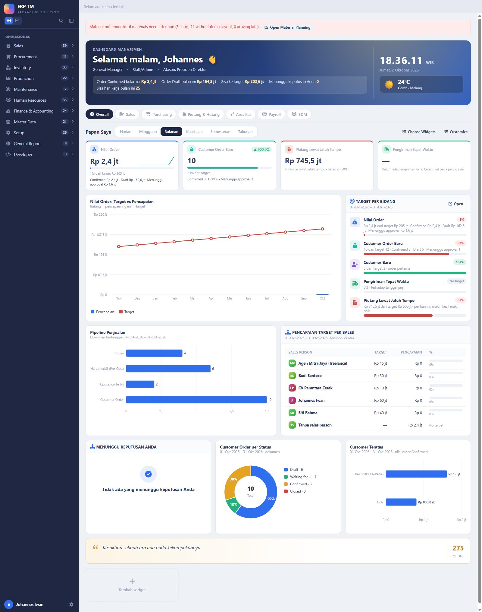

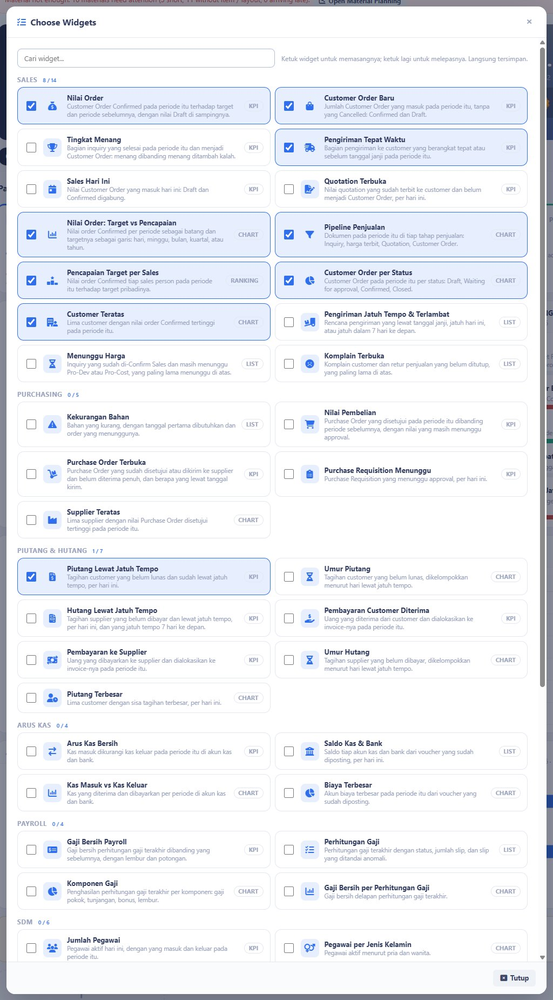

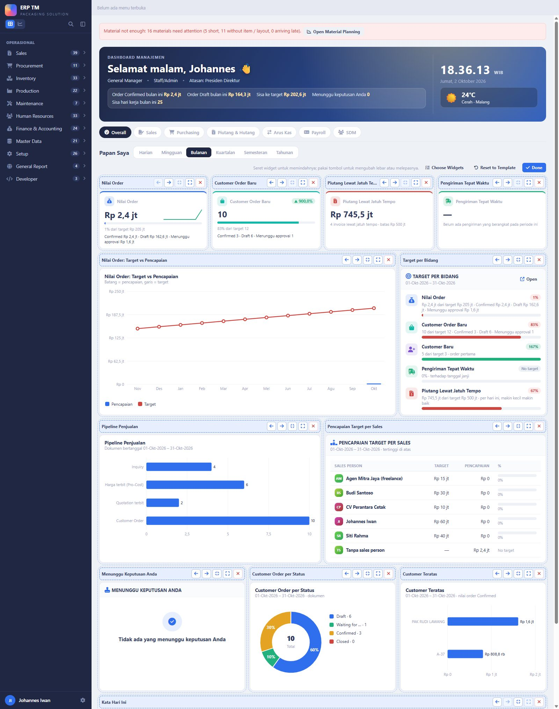

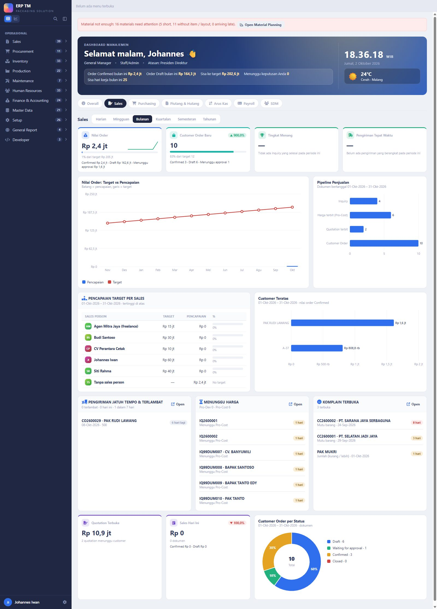

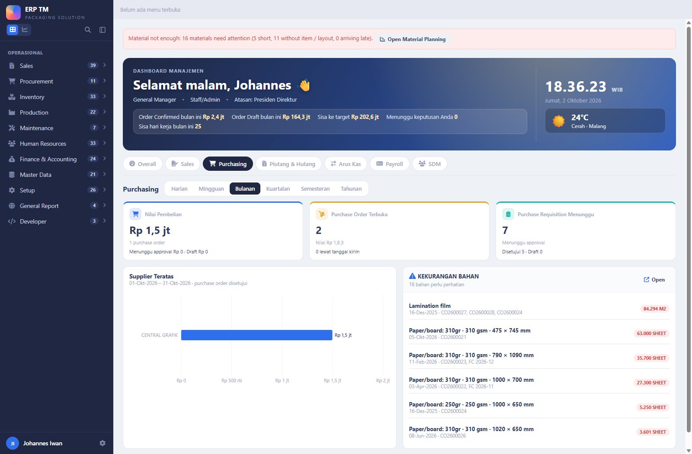

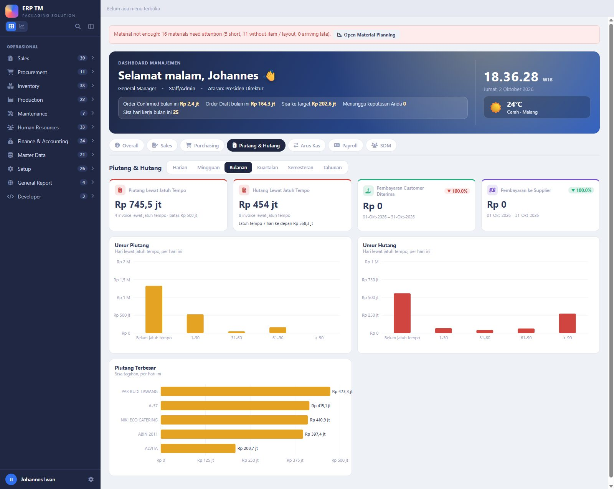

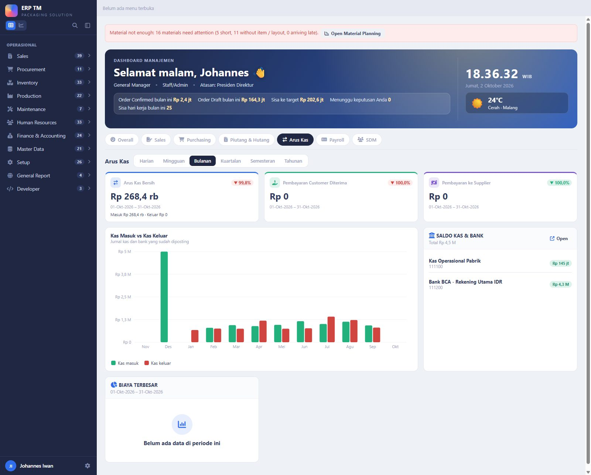

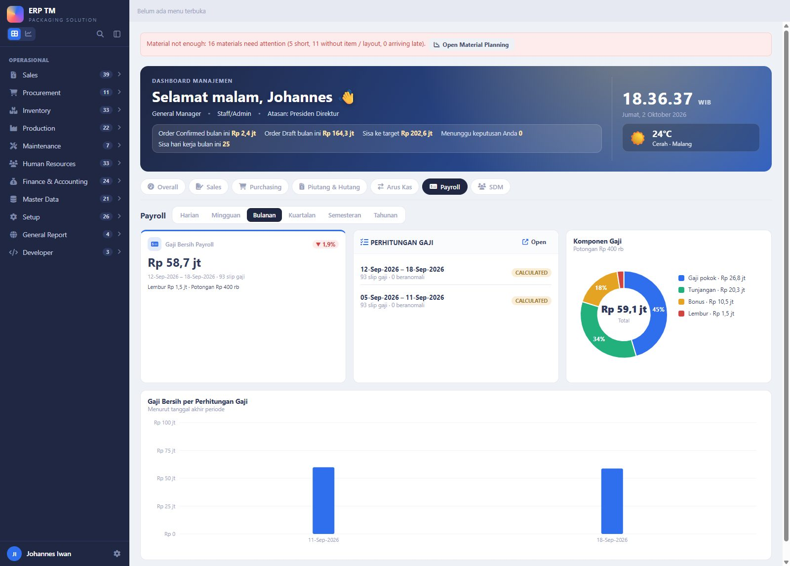

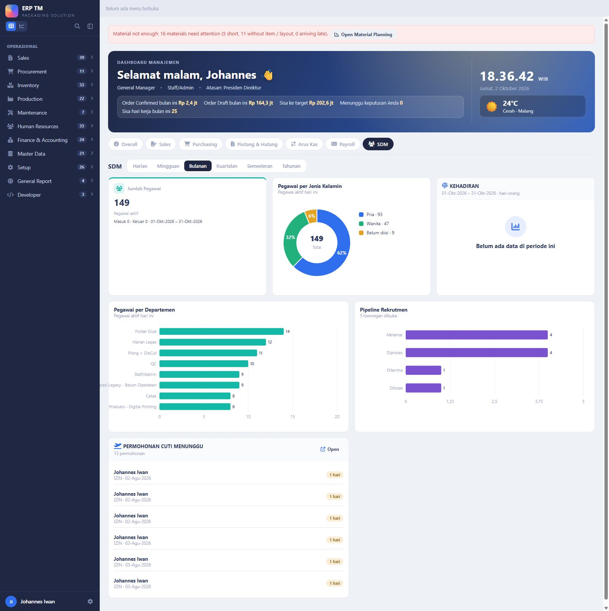

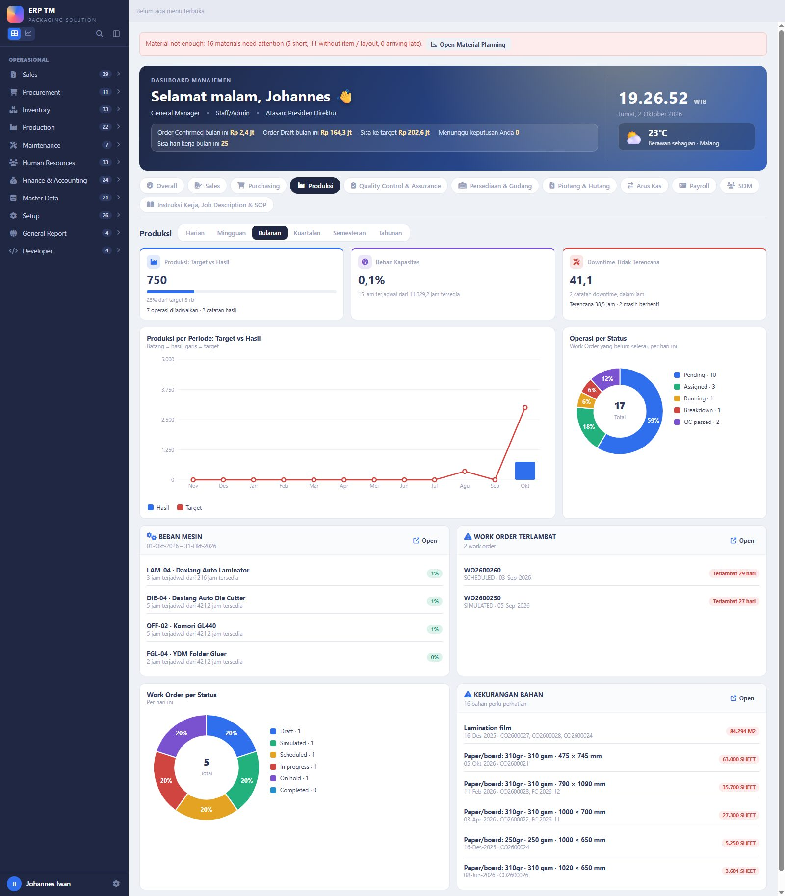

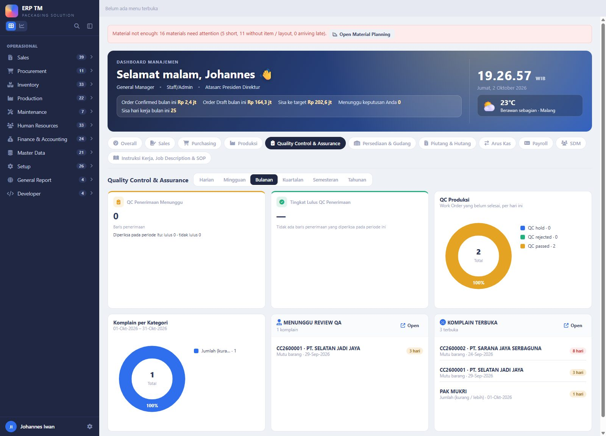

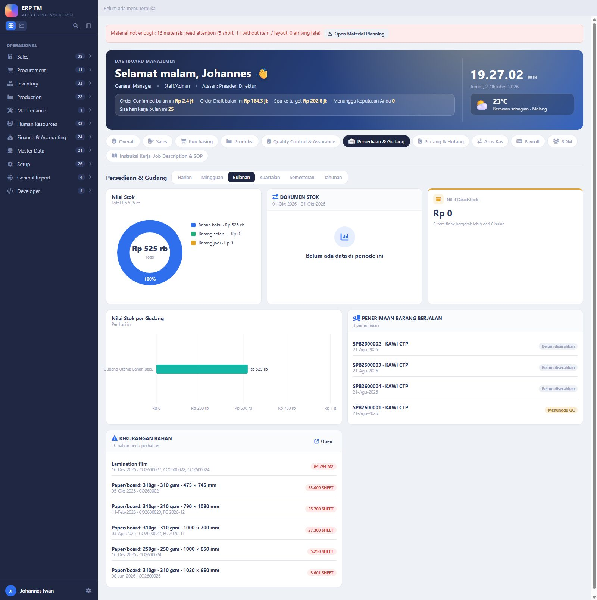

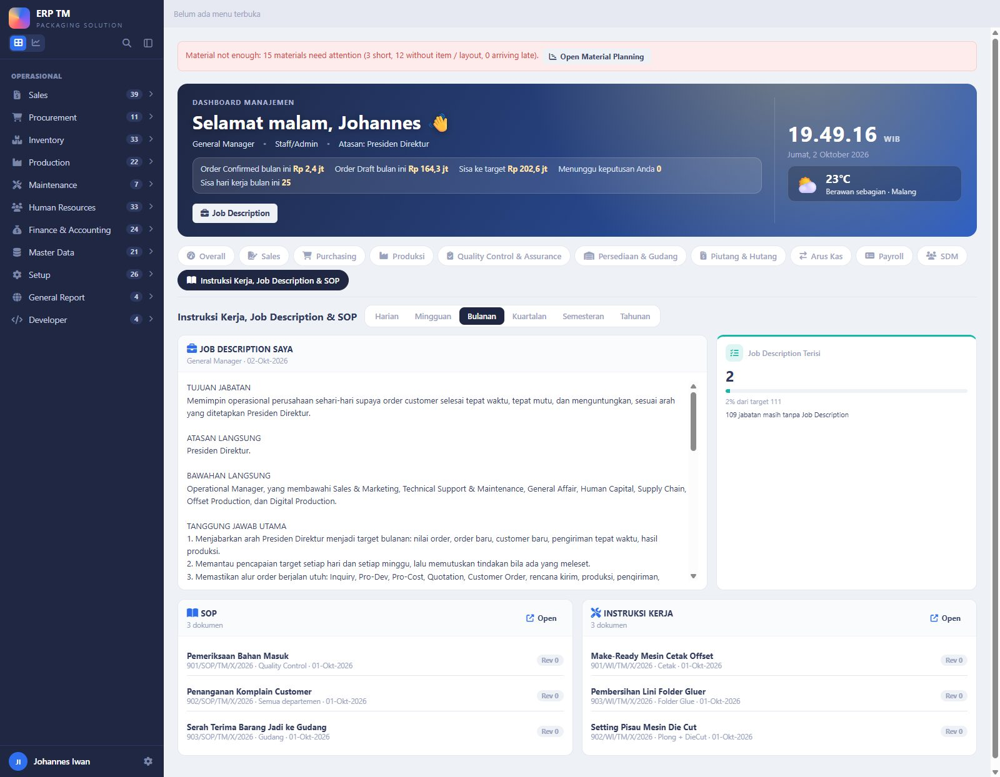

---

## 2. Periode

| Pilihan | Rentang yang dihitung | Pembanding | Target |
|---|---|---|---|
| Harian | hari ini | kemarin | tidak ada (target diisi per bulan) |
| Mingguan | Senin – Minggu minggu ini | minggu lalu | tidak ada |
| Bulanan | bulan ini | bulan lalu | target bulan itu |
| Kuartalan | kuartal kalender ini | kuartal lalu | jumlah target bulan-bulannya |
| Semesteran | Jan–Jun atau Jul–Des | semester lalu | jumlah target bulan-bulannya |
| Tahunan | tahun kalender ini | tahun lalu | jumlah target bulan-bulannya |

Target persen (pengiriman tepat waktu) dan batas piutang memakai target bulan terakhir periode itu. Bila hanya sebagian
bulan yang punya target, yang dijumlah hanya bulan yang terisi. Grafik per periode menampilkan 14 hari, 12 minggu, 12 bulan,
8 kuartal, 6 semester, atau 5 tahun terakhir.

---

## 3. Widget (67)

"Per hari ini" = tidak ikut pilihan periode.

### Sales (14)
| Widget | Bentuk | Arti |
|---|---|---|
| Order Value | KPI | Customer Order **Confirmed / Closed** pada periode itu vs target dan periode lalu; baris bawah **Confirmed · Draft · Menunggu approval** |
| New Customer Orders | KPI | Jumlah dokumen CO pada periode itu (tanpa Cancelled); baris bawah Confirmed / Draft |
| Win Rate | KPI | Inquiry yang menang dibanding menang + kalah pada periode itu (definisi laporan Win-Rate Sales) |
| On-time Delivery | KPI | Delivery Order customer yang berangkat tepat atau sebelum tanggal janji CPDEL |
| Sales Today | KPI | Nilai CO yang masuk hari ini; baris bawah Confirmed / Draft |
| Open Quotations | KPI | Nilai quotation terbit yang belum menjadi Customer Order, per hari ini |
| Order Value: Target vs Actual | Grafik | Order value per periode (batang) dan targetnya (garis) |
| Sales Pipeline | Grafik | Jumlah dokumen pada periode itu: Inquiry, harga terbit, Quotation, Customer Order |
| Target Achievement per Sales | Peringkat | Order value Confirmed per sales person vs target pribadinya |
| Top Customers | Grafik | Lima customer dengan order value Confirmed tertinggi pada periode itu |
| Customer Orders by Status | Donat | CO pada periode itu per status |
| Deliveries Due & Late | Daftar | Baris CPDEL yang lewat janji, jatuh hari ini, dan 7 hari ke depan (per hari ini) |
| Waiting for Price | Daftar | Inquiry yang menunggu Pro-Dev / Pro-Cost, yang paling lama di atas (per hari ini) |
| Open Complaints | Daftar | Komplain dan retur yang belum ditutup (per hari ini) |

### Purchasing (5)
| Widget | Bentuk | Arti |
|---|---|---|
| Purchase Value | KPI | Nilai PO yang sudah disetujui pada periode itu; baris bawah Menunggu approval / Draft |
| Open Purchase Orders | KPI | PO disetujui / dikirim ke supplier yang belum diterima penuh, dan berapa yang lewat tanggal kirim (per hari ini) |
| Purchase Requisitions Waiting | KPI | PR yang menunggu approval (per hari ini) |
| Top Suppliers | Grafik | Lima supplier dengan nilai PO disetujui tertinggi pada periode itu |
| Material Shortage | Daftar | Bahan yang kurang menurut Material Planning (per hari ini) |

### AR & AP (7)
| Widget | Bentuk | Arti |
|---|---|---|
| Overdue Receivables | KPI | Sisa tagihan customer lewat jatuh tempo (per hari ini) |
| Overdue Payables | KPI | Sisa tagihan supplier lewat jatuh tempo, dan yang jatuh tempo 7 hari ke depan (per hari ini) |
| Customer Payments Received | KPI | Uang dari customer yang dialokasikan ke invoice pada periode itu |
| Supplier Payments Made | KPI | Uang ke supplier yang dialokasikan ke invoice pada periode itu |
| Receivables Aging | Grafik | Sisa piutang per umur lewat jatuh tempo |
| Payables Aging | Grafik | Sisa hutang per umur lewat jatuh tempo |
| Top Debtors | Grafik | Lima customer dengan sisa tagihan terbesar |

### Cashflow (4, ditambah Customer Payments dan Supplier Payments)
| Widget | Bentuk | Arti |
|---|---|---|
| Net Cash Flow | KPI | Kas masuk dikurangi kas keluar pada periode itu; baris bawah Masuk / Keluar |
| Cash & Bank Balance | Daftar | Saldo tiap akun kas dan bank dari voucher terposting (per hari ini) |
| Cash In vs Cash Out | Grafik | Kas masuk dan keluar per periode |
| Top Expenses | Donat | Enam akun biaya terbesar pada periode itu |

Kas = akun buku besar yang arus kasnya ditandai CASH. Pindah buku antar akun kas tidak dihitung sebagai masuk / keluar.

### Payroll (4) — hanya untuk yang berhak melihat nilai gaji
| Widget | Bentuk | Arti |
|---|---|---|
| Payroll Net Pay | KPI | Gaji bersih perhitungan gaji terakhir vs yang sebelumnya; baris bawah Lembur / Potongan |
| Payroll Runs | Daftar | Empat perhitungan gaji terakhir: periode, jumlah slip, slip beranomali, status (tanpa rupiah) |
| Payroll Components | Donat | Perhitungan gaji terakhir per komponen: gaji pokok, tunjangan, bonus, lembur |
| Net Pay per Payroll Run | Grafik | Gaji bersih delapan perhitungan gaji terakhir |

### Human Resource (6)
| Widget | Bentuk | Arti |
|---|---|---|
| Headcount | KPI | Pegawai aktif hari ini; baris bawah yang masuk dan keluar pada periode itu |
| Headcount by Gender | Donat | Pegawai aktif pria / wanita |
| Attendance | Donat | Kehadiran periode itu dalam hari-orang: hadir, terlambat, cuti / izin, sakit, alpa |
| Headcount by Department | Grafik | Pegawai aktif per departemen, delapan terbanyak |
| Recruitment Pipeline | Grafik | Lamaran per status, dan jumlah lowongan yang dibuka |
| Leave Requests Waiting | Daftar | Permohonan cuti / izin / sakit yang menunggu keputusan |

### Production (8, ditambah Material Shortage)
| Widget | Bentuk | Arti |
|---|---|---|
| Production: Target vs Result | KPI | **Hasil** = qty baik yang dicatat pada periode itu. **Target** = qty operasi Work Order yang dijadwalkan selesai pada periode itu. Garis capaian + pembanding periode lalu |
| Production per Period: Target vs Result | Grafik | Batang = hasil, garis = target, per periode |
| Capacity Load | KPI | **Capacity planning:** jam operasi terjadwal dibanding jam tersedia semua mesin proses. Jam tersedia = jam per shift x shift per hari x hari kerja periode itu (Master Mesin) |
| Machine Load | Daftar | Per mesin: jam terjadwal dari jam tersedia, persen; merah di atas 100%, kuning mulai 85%. Mesin paling penuh di atas |
| Operations by Status | Grafik | Operasi Work Order yang belum selesai per status (Pending, Assigned, Running, Breakdown, QC ...), per hari ini |
| Unplanned Downtime | KPI | Jam mesin berhenti tanpa rencana pada periode itu; baris bawah = jam perawatan terencana dan berapa yang masih berhenti |
| Work Orders by Status | Grafik | Jumlah Work Order per status, per hari ini |
| Late Work Orders | Daftar | Work Order yang lewat due date dan belum selesai |

### Quality Control & Assurance (5, ditambah Open Complaints)
| Widget | Bentuk | Arti |
|---|---|---|
| Incoming QC Waiting | KPI | Baris penerimaan barang yang masih menunggu pemeriksaan mutu, per hari ini; baris bawah = lulus / tidak lulus pada periode itu |
| Incoming QC Pass Rate | KPI | Persen baris penerimaan yang lulus dari yang diperiksa pada periode itu |
| Production QC | Grafik | Operasi Work Order di gerbang mutu: QC hold, QC rejected, QC passed |
| Complaints by Category | Grafik | Komplain dan retur periode itu per kategori (mutu, jumlah, pengiriman, ...) |
| Waiting for QA Review | Daftar | Komplain yang perlu jawaban QA dan belum punya review yang di-Confirm |

### Inventory & Warehousing (5, ditambah Material Shortage)
| Widget | Bentuk | Arti |
|---|---|---|
| Stock Value | Grafik | Nilai stok bahan baku, setengah jadi, barang jadi, per hari ini |
| Stock Value by Warehouse | Grafik | Nilai stok yang bisa dipakai per gudang, per hari ini |
| Stock Documents | Grafik | Dokumen stok periode itu: barang masuk, barang keluar, penyesuaian / opname, retur |
| Deadstock Value | KPI | Nilai stok yang tidak bergerak lebih dari 6 bulan |
| Goods Receipts in Progress | Daftar | Penerimaan barang yang menunggu QC, atau sudah diposting tetapi belum diserahkan |

### Work Instruction, Job Description & SOP (4) — tab ini terbuka untuk semua yang punya papan
| Widget | Bentuk | Arti |
|---|---|---|
| My Job Description | Teks | Job Description jabatan Anda sendiri, apa adanya seperti ditulis HR di Master Jabatan |
| Job Descriptions Filled | KPI | Jabatan aktif yang Job Description-nya sudah diisi, dari seluruh jabatan aktif (hanya yang boleh membuka HRM) |
| SOP | Daftar | SOP yang berlaku: judul, nomor, departemen, tanggal berlaku, revisi |
| Work Instructions | Daftar | Instruksi Kerja yang berlaku, bentuk yang sama |

**Work Instruction** disimpan di register yang sama dengan SOP (Human Resources → SOP & Work Instruction); form-nya punya
pilihan baru **Document Type**: SOP atau Work Instruction. Grid punya kolom dan saringan Document Type.

### Tanpa dashboard sendiri (5) — bisa dicentang ke Overall
| Widget | Kelompok | Arti |
|---|---|---|
| Net Profit | Finance | Pendapatan dikurangi biaya periode itu dari voucher terposting, dengan margin (level 4 ke atas) |
| Income vs Expense | Finance | Pendapatan dan biaya per periode (level 4 ke atas) |
| Targets by Area | Management | Target perusahaan periode itu dan pencapaiannya |
| Waiting for Your Decision | General | Dokumen di antrian approval yang menunggu keputusan Anda |
| Quote of the Day | General | Kata harian |

Catatan:
- **Data dummy / legacy** mengikuti setelan Setup → Dummy & Legacy Data, sama dengan layar lain.
- Widget tanpa data pada periode itu menampilkan "Belum ada data di periode ini"; satu widget yang gagal tidak menjatuhkan layar.

---

## 4. Yang bisa diatur user (semua lewat layar)

| Layar | Isinya |
|---|---|
| Setup → **Opening Dashboards** | Daftar dashboard: judul, ikon, modul yang harus boleh dibuka user, urutan, aktif |
| Setup → **Opening Board Widgets** | Katalog widget: judul, uraian, dashboard asal, kelompok, modul + level minimum, lebar bawaan, kata asisten, aktif |
| Setup → **Opening Board Templates** | Isi tiap dashboard: widget, urutan, lebar. Baris Overall = papan awal user |
| Setup → **KPI Targets** | Target per bulan: perusahaan atau per sales person |
| Setup → **Daily Quotes** | Kata harian, 366 baris |
| Settings → Constants | `COMPANY_WEATHER_CITY`, `COMPANY_LATITUDE`, `COMPANY_LONGITUDE` |

Hak:
- **Papan** untuk yang boleh membuka Laporan Manajemen. Jabatan lain masih layar pembuka lama.
- **Dashboard bidang** tampil bila user berhak atas modulnya (atau Laporan Manajemen) dan ada widget templatenya yang boleh ia lihat.
- **Widget** = hak modul + level minimum; widget berisi rupiah penjualan butuh hak melihat harga jual; **widget gaji hanya untuk
  yang berhak melihat nilai payroll** (Direksi, Manager Finance & Accounting, Administrator) — tidak ikut kelonggaran Laporan Manajemen.

---

## 5. Keadaan di tmerp.test (database live tm2)

| Hal | mockup.test (ddt) | tmerp.test (tm2) |
|---|---|---|
| 11 dashboard, 67 widget, periode, centang, seret | jalan | jalan di `tmerp.test/v2` |
| Pendaratan login | langsung ke layar pembuka | masih menu lama (belum v2 sampai go-live) |
| Target | target contoh 12 bulan | **kosong** sampai diisi di Setup → KPI Targets |
| Perintah lewat asisten | jalan | **jalan** — asisten AI dipasang di tm2 pada 2026-10-02 (tabel, menu, konstanta); Help sudah ada |
| Capacity Load, Machine Load | 42 mesin punya jam per shift | **"jam per shift belum diisi"** — 45 mesin proses di tm2 belum punya jam per shift dan shift per hari (data nyata, diisi di Master Mesin) |
| Target vs Result | contoh: target 3.000, hasil 750 | target dari Work Order contoh; hasil 0 sampai produksi mencatat output |
| SOP, Work Instructions | 3 + 3 dokumen contoh | kosong — belum ada dokumen yang didaftarkan |
| My Job Description | **General Manager terisi** (draf 2026-10-02, 2 dari 111 jabatan terisi) | teksnya sudah ada di jabatan General Manager, tetapi widget menampilkan "akun belum terhubung ke jabatan" — akun johiwan belum ditautkan ke data pegawai di tm2 |
| Open Complaints | 3 komplain contoh | kosong — belum ada komplain yang terbuka di tm2 |
| Jabatan di salam | General Manager | kosong untuk akun johiwan (belum terhubung ke data pegawai di tm2) |

---

## 6. Belum dibangun / perlu keputusan

1. **Jam per shift dan shift per hari 45 mesin di tm2** belum diisi — tanpa itu Capacity Load tidak bisa menghitung. Ini data
   nyata pabrik, jadi tidak saya isi; mohon diisi di Master Mesin (atau beri angkanya, mis. 7 jam x 2 shift untuk semua).
2. **Target produksi** sekarang = qty operasi Work Order yang dijadwalkan selesai pada periode itu. Bila Anda ingin target
   yang ditetapkan manajemen per bulan (seperti target penjualan), perlu satu kunci target baru di Setup → KPI Targets.
3. **Work Instruction** sekarang berupa teks (seperti SOP). Belum ada: langkah bergambar, lampiran file, kaitan ke proses /
   mesin, tanda "sudah dibaca" per pegawai.
4. **Job Description General Manager** = draf yang saya susun dari bagan pimpinan; mohon dikoreksi di Human Resources → Master
   Posisi. 109 jabatan lain masih kosong (diisi HR). **Akun johiwan di tm2** belum ditautkan ke pegawai — perlu izin Anda.
5. **Jabatan lain** (bukan top management) belum punya layar pembuka baru.
6. Widget dari referensi yang belum bisa dibuat karena datanya belum ada: estimasi vs biaya nyata per job, OEE dan scrap %,
   DSO / DPO, proyeksi arus kas, barang diterima belum ditagih — rinciannya di `openingboard_references.md`.
7. **Layar HP:** papan satu kolom di layar sempit; laci menu untuk HP belum dipasang.

---

## 7. Teknis (untuk developer)

- **DevLib:** `x-dl::widget-board` (tab dashboard, periode, daftar centang + cari, ubin tambah, tekan-tahan, seret, Customize);
  `x-dl::kpi` prop `note`; jenis widget `text` (teks panjang apa adanya). Contoh: devlib.test → Opening Dashboard → nomor 4.
- **ERP:** `app/Support/V2/Board/` — `Board` (dashboard, susunan, periode, aksi), `WidgetCatalog`, `Numbers` (satu tempat
  hitung), `Widget` (induk; kelas baru cukup `meta()` + `build()`), `Widgets/*` (67 kelas). Route `v2.board`.
- **Angka produksi / mutu / gudang** di `Numbers`: `production()`, `workDays()`, `capacity()`, `downtime()`, `operationStatus()`,
  `incomingQc()`, `qaWaiting()`, `complaintsByCategory()`, `stockByWarehouse()`, `stockDocuments()`, `receiptsWaiting()`,
  `documents()`, `jobDescriptionCoverage()`.
- **Asisten:** `app/Assistant/Metrics/BoardWidgets.php` (`Assistant\Contracts\Command`).
- **Tabel (tm2sys):** `sys_dashboard`, `sys_widget` (+ `dashboard_code`), `sys_board_template`, `sys_user_board`
  (+ `period_code`, `dashboard_code`), `sys_user_widget`, `sys_kpi_target`, `sys_daily_quote`. Migrasi `2026_10_02_000160` – `000164`.
  `tm2mst.sop_document.doc_type` (SOP | WI) dari migrasi `000164`.
- **Widget baru** = satu kelas turunan `Widget` + satu baris di `WidgetCatalog::CLASSES`; masuk dashboard lewat Setup →
  Opening Board Templates.
- **Test:** `tests/Feature/OpeningBoardTest.php` (14 test): setiap widget dibangun untuk setiap periode, konsistensi angka kas
  dan laba rugi, konsistensi angka produksi / kapasitas / stok / dokumen, dashboard bidang, hak, seret, perintah asisten.
