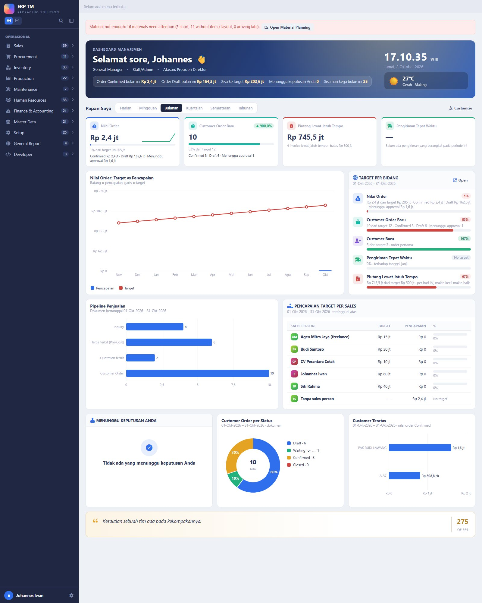
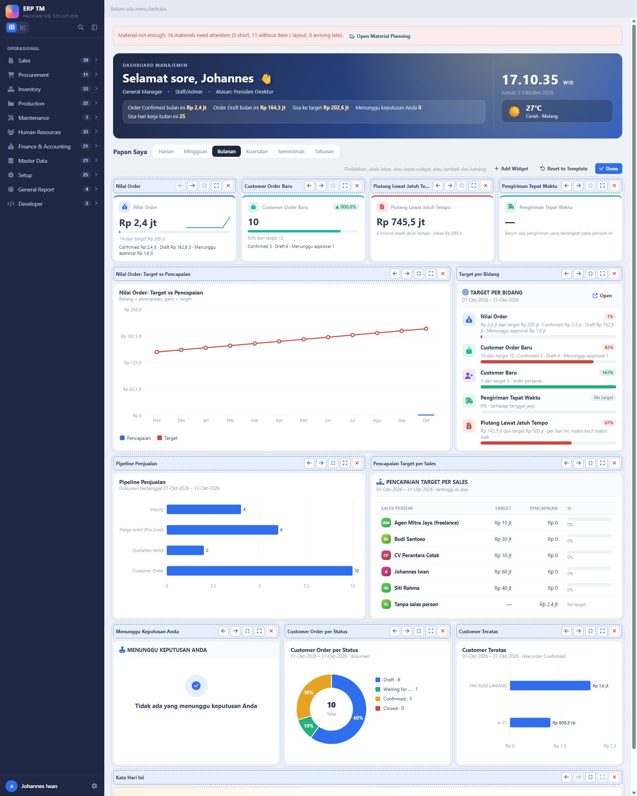
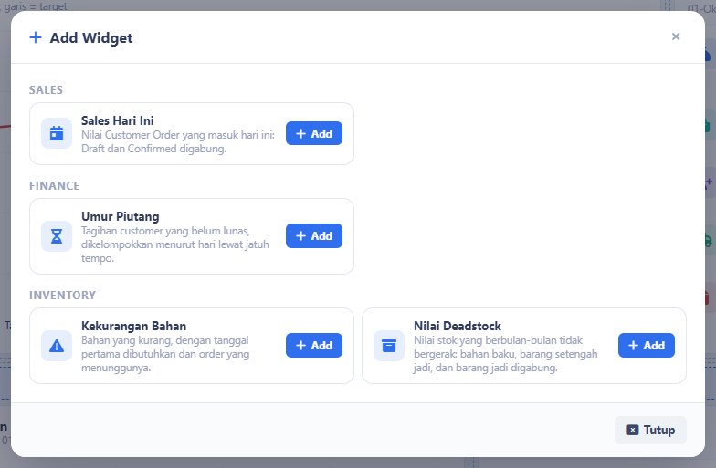
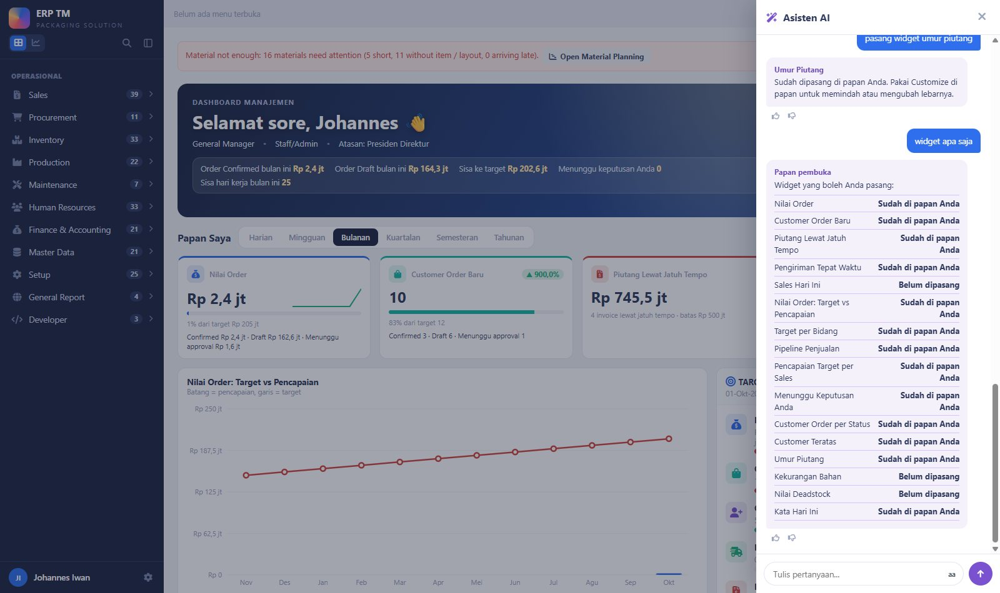

# Opening Board (papan widget layar pembuka) — untuk review user

Dibangun 2026-10-02 atas permintaan user: *"bisakah disediakan many widget including graphics dan lain-lainnya, lalu dengan
bantuan asisten AI seseorang bisa meminta untuk dipasangkan widget-nya — jadi opening screen menjadi lebih fleksibel"* dan
*"top management dulu yang diprioritaskan, yang lainnya masih ikut template yang dibuat"*.

Keputusan user sesudah review pertama (2026-10-02):
1. **"pasang saja di tmerp"** — sudah dipasang di database live (tm2), lihat bagian 5.
2. **"dijelaskan saja draft sekian dan confirmed sekian"** — angka besar tetap Confirmed, di bawahnya rincian Draft.
3. **"boleh dari daily sampai yearly"** — pilihan periode di kepala papan.
4. **Widget berikutnya: user minta usulan** — bagian 6.

**Status:** jalan di **mockup.test (ddt)** dan **tmerp.test/v2 (tm2)**.

---

## 1. Cara mencoba

1. Login sebagai top management (yang boleh membuka Laporan Manajemen: Presiden Direktur, Direktur, General Manager,
   Operational Manager). Di mockup.test sesudah login langsung tampil layar pembuka sendiri; di tmerp.test buka `tmerp.test/v2`
   (tmerp.test masih mendarat di menu lama sampai go-live).
2. Bagian atas: salam, jabatan, atasan, ringkasan bulan ini (order Confirmed, order Draft, sisa ke target, menunggu keputusan
   Anda, sisa hari kerja), jam, cuaca kantor.
3. **Papan Saya**: 12 widget bawaan profil Management.
4. **Periode** di sebelah judul papan: Harian, Mingguan, Bulanan, Kuartalan, Semesteran, Tahunan. Pilihan tersimpan per user.
5. **Customize** → tiap widget mendapat tombol pindah lebih awal / akhir, lebih sempit / lebar, lepas. **Add Widget** membuka
   katalog. **Reset to Template** mengembalikan susunan bawaan. **Done** menutup mode atur. Tiap perubahan langsung tersimpan.
6. **Asisten AI** (mockup.test): `pasang widget umur piutang`, `lepas widget kata harian`, `widget apa saja`, `reset widget`.
   Papan berubah saat itu juga, tanpa memuat ulang halaman.

---

## 2. Periode

| Pilihan | Rentang yang dihitung | Pembanding (panah naik / turun) | Target |
|---|---|---|---|
| Harian | hari ini | kemarin | tidak ada (target diisi per bulan) |
| Mingguan | Senin – Minggu minggu ini | minggu lalu | tidak ada |
| Bulanan | bulan ini | bulan lalu | target bulan itu |
| Kuartalan | kuartal kalender ini | kuartal lalu | jumlah target bulan-bulannya |
| Semesteran | Jan–Jun atau Jul–Des | semester lalu | jumlah target bulan-bulannya |
| Tahunan | tahun kalender ini | tahun lalu | jumlah target bulan-bulannya |

- Target yang dijumlah: nilai order, order baru, customer baru. Target persen (pengiriman tepat waktu) dan batas piutang
  memakai target bulan terakhir periode itu.
- Bila hanya sebagian bulan dalam periode itu yang punya target, yang dijumlah hanya bulan yang terisi.
- Periode berjalan dibandingkan dengan periode sebelumnya yang sudah penuh, jadi di awal periode panahnya wajar turun.
- **Tidak ikut periode:** Sales Today (selalu hari ini), Overdue Receivables dan Receivables Aging (per hari ini), Material
  Shortage, Waiting for Your Decision, Deadstock Value, Quote of the Day, dan ringkasan di salam (selalu bulan ini).
- Grafik Order Value menampilkan 14 hari, 12 minggu, 12 bulan, 8 kuartal, 6 semester, atau 5 tahun terakhir.

---

## 3. Widget yang tersedia (16)

| Widget | Bentuk | Arti angkanya | Sumber |
|---|---|---|---|
| Order Value | KPI | Angka besar = subtotal baris Customer Order **Confirmed / Closed** pada periode itu, dibanding target dan periode lalu. Baris bawah: **Confirmed sekian · Draft sekian · Menunggu approval sekian** | `co_order`, `co_order_item`, target `REVENUE` |
| New Customer Orders | KPI | Jumlah dokumen Customer Order pada periode itu, semua status kecuali Cancelled; baris bawah Confirmed / Draft | `co_order`, target `NEW_ORDERS` |
| Overdue Receivables | KPI | Sisa tagihan customer yang sudah lewat jatuh tempo, per hari ini | `v1_fin_ar_aging`, batas `OVERDUE_RECEIVABLES` |
| On-time Delivery | KPI | Persen Delivery Order customer yang berangkat pada periode itu tepat atau sebelum tanggal janji CPDEL | `do_delivery`, `do_line`, `co_order_delivery`, target `ONTIME_DELIVERY` |
| Sales Today | KPI | Nilai Customer Order yang masuk hari ini; baris bawah Confirmed / Draft | `co_order`, `co_order_item` |
| Order Value: Target vs Actual | Grafik batang + garis | Order value Confirmed per periode (batang) dan targetnya (garis) | sama dengan Order Value |
| Targets by Area | Daftar pencapaian | Target perusahaan periode itu: nilai order (dengan rincian Draft), order baru, customer baru, pengiriman tepat waktu, piutang lewat jatuh tempo | `sys_kpi_target` + sumber tiap angka |
| Sales Pipeline | Grafik batang mendatar | Jumlah dokumen bertanggal pada periode itu: Inquiry, harga terbit (Pro-Cost), Quotation terbit, Customer Order | `iqp_inquiry`, `iqp_costing`, `quo_quotation`, `co_order` |
| Target Achievement per Sales | Tabel peringkat | Order value Confirmed periode itu per sales person terhadap target pribadinya | `co_order`, `sales_person`, target `REVENUE` per orang |
| Waiting for Your Decision | Daftar | Dokumen di antrian approval yang menunggu keputusan user login | flow engine (sama dengan Approval Center) |
| Customer Orders by Status | Donat | Customer Order periode itu per status | `co_order` |
| Top Customers | Grafik batang mendatar | Lima customer dengan order value Confirmed tertinggi pada periode itu | `co_order`, `cust_customer` |
| Receivables Aging | Grafik batang | Sisa tagihan per umur lewat jatuh tempo (belum jatuh tempo, 1-30, 31-60, 61-90, > 90 hari) | `v1_fin_ar_aging` |
| Material Shortage | Daftar | Bahan yang kurang menurut Material Planning (angka yang sama dengan popup merah) | Material Planning |
| Deadstock Value | KPI | Nilai stok yang tidak bergerak lebih dari 6 bulan (sama dengan jawaban asisten "deadstock") | stok on hand RM / SFG / FG |
| Quote of the Day | Kata harian | Satu baris per hari dalam setahun | `sys_daily_quote` |

Catatan definisi:
- **Draft** = Customer Order yang belum Confirmed dan belum diajukan; **Menunggu approval** = sudah diajukan, belum disetujui
  (disebut terpisah hanya bila ada). Cancelled tidak dihitung di mana pun.
- **Sales Pipeline bukan corong.** Customer Order boleh masuk langsung tanpa Quotation, jadi jumlahnya tidak selalu mengecil.
- **On-time Delivery** menampilkan tanda strip bila belum ada Delivery Order yang berangkat pada periode itu.
- **Data dummy / legacy** mengikuti setelan Setup → Dummy & Legacy Data, sama dengan layar lain: bila data dummy disembunyikan
  di sana, papan juga tidak menghitungnya.

---

## 4. Yang bisa diatur user (semua lewat layar, tidak ada yang hardcode)

| Layar | Isinya |
|---|---|
| Setup → **Opening Board Widgets** | Katalog widget: judul, uraian, kelompok, modul + level minimum yang boleh memasang, lebar bawaan, kata yang didengar asisten, aktif |
| Setup → **Opening Board Templates** | Susunan bawaan per profil (sekarang: Management): widget, urutan, lebar |
| Setup → **KPI Targets** | Target per bulan: perusahaan (Sales Person = Company) atau per sales person untuk nilai order |
| Setup → **Daily Quotes** | Kata harian, 366 baris |
| Settings → Constants | `COMPANY_WEATHER_CITY`, `COMPANY_LATITUDE`, `COMPANY_LONGITUDE` (lokasi cuaca) |

Job Description dan SOP di salam diambil dari master jabatan (Position) dan SOP departemen; tombolnya tampil bila datanya ada.

Aturan yang dipakai:
- **Siapa yang mendapat papan:** yang boleh membuka modul Laporan Manajemen. Jabatan lain: layar pembuka lama, sampai
  templatenya dibuat.
- **Siapa yang boleh memasang widget apa:** hak modul widget (atau Laporan Manajemen) + level minimum + hak melihat harga
  jual untuk widget berisi rupiah penjualan. Memakai security yang sudah ada.
- **Asisten tidak menghitung apa pun.** Ia mencocokkan nama widget dari katalog lalu memanggil aturan papan yang sama dengan
  tombol Customize. Kata "widget" selalu berarti perintah papan.
- **Papan pertama** = salinan template. Mengubah template tidak mengubah papan yang sudah diatur pemiliknya.
- Satu widget yang gagal dimuat tampil sebagai kartu kosong; layar pembuka tetap terbuka.

---

## 5. Keadaan di tmerp.test (database live tm2)

Dipasang 2026-10-02: tabel papan, 12 baris template Management, 366 kata harian, 3 konstanta lokasi, 4 menu Setup,
terjemahan Indonesia, 5 topik Help.

| Hal | mockup.test (ddt) | tmerp.test (tm2) |
|---|---|---|
| Papan + Customize + periode | jalan | jalan di `tmerp.test/v2` |
| Pendaratan login | langsung ke papan | masih menu lama (tmerp.test belum v2 sampai go-live) |
| Target | target contoh 12 bulan | **kosong** — widget menampilkan "Target periode ini belum diisi" sampai diisi di Setup → KPI Targets |
| Perintah lewat asisten | jalan | **belum** — asisten AI belum dipasang di tm2 (masih menunggu uji user); Customize tetap jalan |
| Data yang terhitung | data dummy | data yang ada di tm2, termasuk data contoh selama setelan Dummy & Legacy Data menampilkannya |
| Jabatan di salam | General Manager | kosong untuk akun johiwan — data pegawai / jabatan akun itu belum terhubung di tm2 |

---

## 6. Usulan widget berikutnya

Urutan = usulan prioritas untuk top management. Semua yang di kelompok A datanya sudah ada.

**A. Bisa langsung dibuat (data sudah ada)**

| Widget | Menjawab pertanyaan | Sumber |
|---|---|---|
| Deliveries Due & Late | Pengiriman mana yang lewat janji, jatuh hari ini, dan 7 hari ke depan? | CPDEL (`co_order_delivery`) |
| Payables Due | Berapa hutang supplier yang lewat jatuh tempo dan jatuh tempo minggu ini? | `v1_fin_ap_aging` |
| Work Order Status | Berapa WO berjalan, tertahan, terlambat dari due date? | `prd_wo` |
| Waiting for Price | Inquiry yang menunggu Pro-Dev / Pro-Cost, dan sudah berapa hari? | `iqp_inquiry` (tiga tanda tahap) |
| Stock Value | Nilai stok bahan baku, setengah jadi, barang jadi | stok on hand |
| Open Purchase Orders | PO yang belum diterima penuh dan nilainya | `po_order` |
| Open Complaints | Komplain customer yang belum ditutup | `crm_complaint` |
| Quotation Win Rate | Persen quotation yang menang pada periode itu | sama dengan laporan Win-Rate Sales |
| Production Output | Hasil produksi periode itu dan persen reject | `prd_wo_operation_output` |

**B. Perlu keputusan dulu**

| Widget | Yang perlu diputuskan |
|---|---|
| Gross Margin | Siapa yang boleh melihat (HPP rahasia: Costing + Direksi), dan margin dari costing terbit atau dari biaya nyata |
| Cash & Bank Balance | Rekening bank belum punya akun buku besar di tm2 |
| Attendance Today | Sumber absensi yang dipakai (mesin finger / roster) |
| Maintenance Due / Downtime | Modul Maintenance v2 baru ada di ddt |

---

## 7. Yang belum / perlu keputusan user

1. **Asisten AI di tmerp.test** — dipasang sekarang supaya perintah widget jalan di sana, atau menunggu uji asisten selesai?
2. **Widget berikutnya** — pilih dari bagian 6 (usulan: lima teratas kelompok A).
3. **Jabatan lain** (Sales, umum): template `x-dl::dashboard` sudah ada di DevLib dengan data contoh, belum dipasang dengan
   data database.
4. **Target di tm2** — perlu diisi di Setup → KPI Targets.
5. **Layar HP:** papan sudah satu kolom di layar sempit, tetapi laci menu untuk HP belum dipasang.

---

## 8. Teknis (untuk developer)

- **DevLib:** `x-dl::widget-board` (`packages/devlib/src/Components/WidgetBoard.php`, view `widget-board.blade.php`, skrip
  `widget-board.js`; prop `periods` / `period`); `x-dl::kpi` prop `note`; `x-dl::dashboard` menampilkan papan bila datanya
  memuat kunci `widgets`. Contoh: devlib.test → Opening Dashboard → nomor 4 (`devlib/app/Support/BoardDemo.php`).
- **ERP:** `app/Support/V2/Board/` — `Board` (profil, susunan, periode, aksi, isi layar), `WidgetCatalog`, `Numbers` (satu
  tempat hitung + periode kalender + target periode + rincian tahap order), `Widget`, `Widgets/*` (16 kelas). Route
  `v2.board` (GET = HTML papan, POST = aksi termasuk `period`).
- **Asisten:** `app/Assistant/Metrics/BoardWidgets.php` (`Assistant\Contracts\Command`); `Reply::$refresh` → `dl:refresh`.
- **Tabel (tm2sys):** `sys_widget`, `sys_board_template`, `sys_user_board` (+ `period_code`), `sys_user_widget`,
  `sys_kpi_target`, `sys_daily_quote`. Migrasi `2026_10_02_000160` – `000162`.
- **Widget baru** = satu kelas turunan `Widget` + satu baris di `WidgetCatalog::CLASSES`; baris katalognya lahir sendiri.
- **Test:** `tests/Feature/OpeningBoardTest.php` (9 test). User uji tidak disimpan; baris papan dan target tahun 2099 dihapus
  di akhir (diperiksa ke database).
