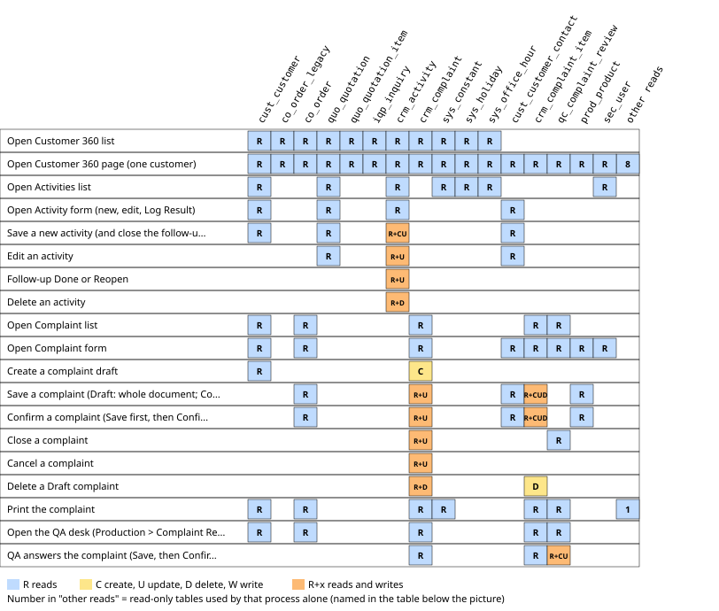
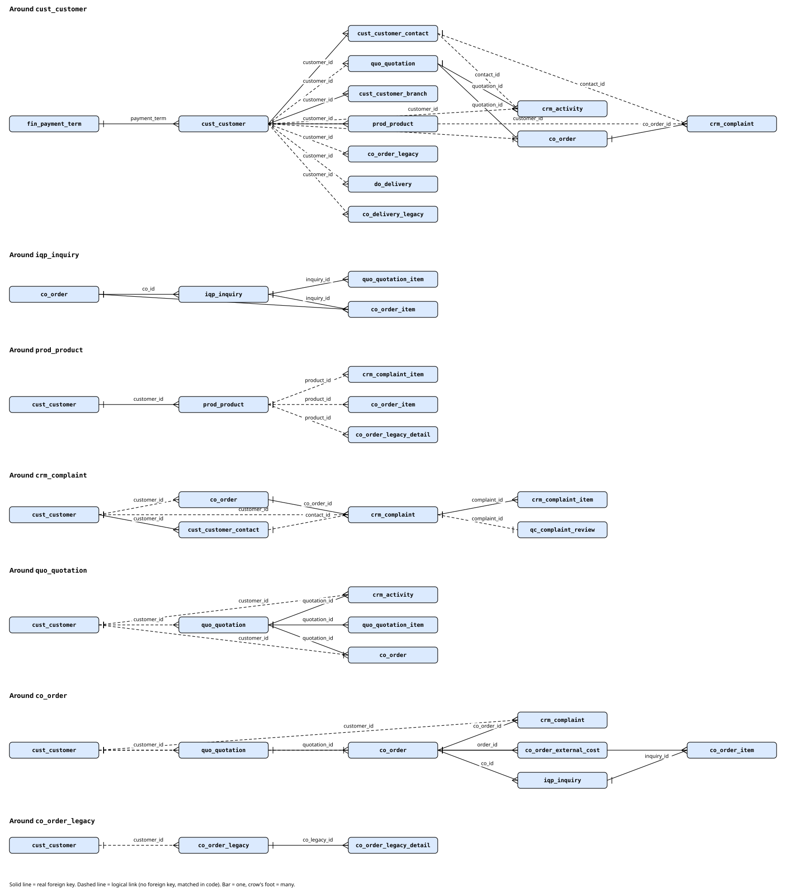

# Sub-module: CRM (Customer 360, Activities, Complaint)

> Written 2026-10-16 (group A). This page only summarizes and links; table/column facts are in the cards.

- **Module**: Sales > CRM (`SALES_CRMGRP`). Menu (FACT, `sys_app_menu` mockup, active): Customer 360 (`v2:crm-customer`), Activities & Follow-up (`v2:crm-activity`), Complaint & Return (`v2:crm-complaint`), group Master Data (Master Customer `v2:md-customer`, Sales Person `v2:md-sales-person`), group Report (Win-Rate Sales `v2:sales-win-rate`). The quality answer to a complaint is in the Production menu: Complaint Review (QA) (`v2:qc-complaint-review`).
- **Purpose**: build the relationship with the customer: summarize history (Customer 360, read-only), record contacts and follow-ups, and receive complaints/returns whose quality is answered by QA.
- **Frozen zone**: no CRM-specific frozen zone besides the document flow (the rule freezes all flows).
- **Rules**: A.21b (Sales is one big group; `crm_activity` per customer; complaints: information to Sales, quality to QA; Customer 360 is read-only, FROM DOCUMENT short index); A.9 (rupiah values only for holders of the price right); A.12 (Confirmed/Cancelled/Closed cycle, fulfilled by Complaint).

## Relations
- **source**: Master Customer and contacts, Quotation, CO (new and archive), DO/Surat Jalan (new and archive), Production (QA answer).
- **used_by**: Sales (daily work), QA (complaint desk), Win-Rate Sales (NOT checked whether it uses activities).
- **flags**: Complaint uses `stat_confirm/_close/_cancel`; Activity has no document status (`next_done`); Customer 360 has no table.

## Cards and engines in this sub-module
| Type | File | Content |
|---|---|---|
| Concept | `10_card_crm-activity.md` | `crm_activity`, follow-up, due-date color, edit right |
| Concept | `11_card_crm-complaint.md` | `crm_complaint`, `crm_complaint_item`, QA, Confirm/Close/Cancel |
| Concept | `12_card_customer-360.md` | read-only summary, segments Active/Sleeping/Prospect/No order |
| ENGINE | None | CRM has no engine, schedule, or background job (searched: `routes/console.php`, `app/Services`, registry; zero) |

## Diagram
Not needed (no engine).

## Existing user guides (UG)
There is no CRM file yet in `docs/guides/sales/` (folder content: 00 to 04, no CRM). Noted; not created in this task.

## Cross-card findings (short; details in the cards)
Table `quo_activity` no longer exists but class `QuoActivity` and comments still mention it; Cancel Complaint has no `cancelled_at/by`; the Customer 360 segment counts archive DRAFT/UNKNOWN as orders and REJECTED CO is not excluded; Customer 360 tabs are silently cut at 100/200 rows.

## Read/Write map

 Click the picture to open it full size.
Every process of the CRM sub-module (menu Customer 360, Activities & Follow-up, Complaint & Return, plus the QA answer in Production > Complaint Review) with the tables it reads and writes (C create, U update, D delete), checked in code on 2026-10-18 against the dummy DBs (ddtsdi, ddtmst, ddtsys, ddtprd: all table names exist; no DB triggers found in ddtsdi, ddtmst, ddtprd, ddtsys, ddtacc). The Master Customer and Sales Person shortcuts in the CRM menu, and Win-Rate Sales, are mapped on the sub-module pages that own them (Master Data, Quotation). No CRM process writes a file to disk.

| Process | Trigger | Reads | Writes | Evidence |
|---|---|---|---|---|
| Open Customer 360 list | Menu Customer 360, GET v2.screen crm-customer (no id) | `cust_customer`, `co_order_legacy`, `co_order`, `quo_quotation`, `quo_quotation_item`, `iqp_inquiry`, `crm_activity`, `crm_complaint`, `sys_constant`, `sys_holiday`, `sys_office_hour` | - | `resources/views/v2/screens/crm-customer.blade.php:29`, `app/Support/V2/Grid/Sales/CustomerListGrid.php:36-38`, `app/Support/V2/Data/Crm.php:38-73`, `app/Support/V2/Data/Crm.php:85-89`, `app/Support/V2/Data/CrmActivities.php:48-74` |
| Open Customer 360 page (one customer) | Customer 360 list, open a row (GET v2.screen crm-customer ?id) | `cust_customer`, `cust_customer_contact`, `cust_customer_branch`, `fin_payment_term`, `quo_quotation`, `quo_quotation_item`, `iqp_inquiry`, `co_order`, `co_order_item`, `co_order_external_cost`, `co_order_legacy`, `co_order_legacy_detail`, `do_delivery`, `co_delivery_legacy`, `crm_activity`, `crm_complaint`, `crm_complaint_item`, `qc_complaint_review`, `prod_product`, `sec_user`, `fin_tax_rate`, `sys_constant`, `sys_holiday`, `sys_office_hour` | - | `resources/views/v2/screens/crm-customer.blade.php:15`, `resources/views/v2/screens/crm-customer.blade.php:32`, `app/Support/V2/Data/Crm.php:91-94`, `app/Support/V2/Data/Crm.php:97-149`, `app/Support/V2/Data/Crm.php:152-188`, `app/Support/V2/Data/Crm.php:193-243`, `app/Support/V2/Data/CrmActivities.php:29-44`, `app/Support/V2/Data/CrmComplaints.php:35-53`, `app/Models/Sdi/QuoQuotation.php:94-110`, `app/Models/Sdi/CoOrder.php:193-215`, `app/Support/Finance/TaxRate.php:26-31` |
| Open Activities list | Menu Activities & Follow-up, GET v2.screen crm-activity (no id) | `crm_activity`, `quo_quotation`, `cust_customer`, `sec_user`, `sys_constant`, `sys_holiday`, `sys_office_hour` | - | `resources/views/v2/screens/crm-activity.blade.php:29`, `app/Support/V2/Grid/Sales/CrmActivityListGrid.php:27-29`, `app/Support/V2/Data/CrmActivities.php:29-44`, `app/Support/V2/Data/CrmActivities.php:76-79` |
| Open Activity form (new, edit, Log Result) | Activities list, + New Record or open a row or Log Result (GET v2.screen crm-activity ?id, ?new, ?from, ?customer_id) | `crm_activity`, `cust_customer`, `cust_customer_contact`, `quo_quotation` | - | `resources/views/v2/screens/crm-activity.blade.php:17-20`, `resources/views/v2/screens/crm-activity.blade.php:46-50`, `resources/views/v2/screens/crm-activity.blade.php:76`, `app/Support/V2/Data/CrmActivities.php:24-27`, `app/Support/V2/Data/CrmActivities.php:86-97`, `app/Support/V2/Data/CrmActivities.php:100-104` |
| Save a new activity (and close the follow-up it answers) | Activity form, Save (POST v2.crm.activity.store, optional from) | `cust_customer`, `cust_customer_contact`, `quo_quotation`, `crm_activity` | `crm_activity` (CU) | `routes/v2.php:1112-1118`, `app/Support/V2/Data/CrmActivities.php:114-148`, `app/Models/Sdi/CrmActivity.php:36-40` |
| Edit an activity | Activity form, Save (POST v2.crm.activity.save, action=save) | `crm_activity`, `cust_customer_contact`, `quo_quotation` | `crm_activity` (U) | `routes/v2.php:1120-1138`, `app/Support/V2/Data/CrmActivities.php:106-111`, `app/Support/V2/Data/CrmActivities.php:114-148` |
| Follow-up Done or Reopen | Activity form, Follow-up Done / Reopen (POST v2.crm.activity.save, action=done or reopen) | `crm_activity` | `crm_activity` (U) | `routes/v2.php:1129-1132`, `app/Support/V2/Data/CrmActivities.php:150-154` |
| Delete an activity | Activity form, Delete (POST v2.crm.activity.save, action=delete) | `crm_activity` | `crm_activity` (D) | `routes/v2.php:1124-1127`, `app/Support/V2/Data/CrmActivities.php:156-160` |
| Open Complaint list | Menu Complaint & Return, GET v2.screen crm-complaint (no id) | `crm_complaint`, `crm_complaint_item`, `cust_customer`, `qc_complaint_review`, `co_order` | - | `resources/views/v2/screens/crm-complaint.blade.php:32`, `app/Support/V2/Grid/Sales/CrmComplaintListGrid.php:27-29`, `app/Support/V2/Data/CrmComplaints.php:35-53` |
| Open Complaint form | Complaint list, open a row (GET v2.screen crm-complaint ?id) | `crm_complaint`, `crm_complaint_item`, `cust_customer`, `qc_complaint_review`, `co_order`, `cust_customer_contact`, `prod_product`, `sec_user` | - | `resources/views/v2/screens/crm-complaint.blade.php:22`, `resources/views/v2/screens/crm-complaint.blade.php:52`, `resources/views/v2/screens/crm-complaint.blade.php:75`, `resources/views/v2/screens/crm-complaint.blade.php:79`, `app/Support/V2/Data/CrmComplaints.php:30-33`, `app/Support/V2/Data/CrmComplaints.php:55-64`, `app/Support/V2/Data/CrmComplaints.php:210-221` |
| Create a complaint draft | Complaint list, + New Record, Create (POST v2.crm.complaint.create) | `cust_customer` | `crm_complaint` (C) | `routes/v2.php:1142-1147`, `app/Support/V2/Data/CrmComplaints.php:66-73` |
| Save a complaint (Draft: whole document; Confirmed: resolution only) | Complaint form, Save (POST v2.crm.complaint.save, action=save) | `crm_complaint`, `crm_complaint_item`, `cust_customer_contact`, `co_order`, `prod_product` | `crm_complaint` (U), `crm_complaint_item` (CUD) | `routes/v2.php:1149-1173`, `app/Support/V2/Data/CrmComplaints.php:76-134` |
| Confirm a complaint (Save first, then Confirm) | Complaint form, Confirm (POST v2.crm.complaint.save, action=confirm) | `crm_complaint`, `crm_complaint_item`, `cust_customer_contact`, `co_order`, `prod_product` | `crm_complaint` (U), `crm_complaint_item` (CUD) | `routes/v2.php:1165-1170`, `app/Support/V2/Data/CrmComplaints.php:136-157`, `app/Support/V2/Data/CrmComplaints.php:163-174`, `app/Models/Sdi/CrmComplaint.php:70-76` |
| Close a complaint | Complaint form, Close (POST v2.crm.complaint.save, action=close) | `crm_complaint`, `qc_complaint_review` | `crm_complaint` (U) | `routes/v2.php:1165-1170`, `app/Support/V2/Data/CrmComplaints.php:175-187`, `app/Models/Sdi/CrmComplaint.php:65-68` |
| Cancel a complaint | Complaint form, Cancel with reason (POST v2.crm.complaint.save, action=cancel) | `crm_complaint` | `crm_complaint` (U) | `routes/v2.php:1158-1162`, `app/Support/V2/Data/CrmComplaints.php:175-177`, `app/Support/V2/Data/CrmComplaints.php:189-193` |
| Delete a Draft complaint | Complaint form, Delete (POST v2.crm.complaint.save, action=delete) | `crm_complaint` | `crm_complaint` (D), `crm_complaint_item` (D) | `routes/v2.php:1153-1157`, `app/Support/V2/Data/CrmComplaints.php:198-202` |
| Print the complaint | Complaint form, Print (GET v2.print type customer-complaint) | `crm_complaint`, `crm_complaint_item`, `cust_customer`, `qc_complaint_review`, `co_order`, `org_company`, `sys_constant` | - | `routes/v2.php:204-213`, `app/Support/V2/Print/PrintDocs.php:45`, `app/Support/V2/Print/CustomerComplaintPrint.php:42-47`, `app/Support/V2/Print/PrintDocs.php:106-109`, `app/Support/V2/Print/PrintDocs.php:121-124` |
| Open the QA desk (Production > Complaint Review) | Menu Complaint Review (QA), GET v2.screen qc-complaint-review (list or ?id) | `crm_complaint`, `crm_complaint_item`, `cust_customer`, `qc_complaint_review`, `co_order` | - | `app/Support/V2/Grid/Prod/QcComplaintReviewListGrid.php:26-29`, `resources/views/v2/screens/qc-complaint-review.blade.php:17`, `app/Support/V2/Data/CrmComplaints.php:225-240` |
| QA answers the complaint (Save, then Confirm) | QA form, Save or Confirm (POST v2.qc.complaint-review.save) | `crm_complaint`, `crm_complaint_item`, `qc_complaint_review` | `qc_complaint_review` (CU) | `routes/v2.php:1177-1185`, `app/Support/V2/Data/CrmComplaints.php:242-271`, `app/Models/Prd/QcComplaintReview.php:15-17` |

Notes for debugging
- Activities have no transaction anywhere. Log Result saves the new activity first (`app/Support/V2/Data/CrmActivities.php:142`) and only then closes the follow-up it answers (`app/Support/V2/Data/CrmActivities.php:143-145`): a failure between the two leaves the old follow-up open. The contact and the quotation of a saved activity are filtered against the lists of that customer, a foreign id is silently turned into empty (`app/Support/V2/Data/CrmActivities.php:119-130`). A quotation-only activity (from the Quotation screen) gets its customer from the quotation in the `creating` hook (`app/Models/Sdi/CrmActivity.php:36-40`).
- Edit right: only the creator or an admin may Save or Delete an activity (`app/Support/V2/Data/CrmActivities.php:106-111`, enforced inside `save()` and `delete()`), but the route for Follow-up Done and Reopen calls `done()` directly with no such check (`routes/v2.php:1129-1132`, `app/Support/V2/Data/CrmActivities.php:150-154`): any user who passes the SALES module gate can close or reopen another person's follow-up. Seen in code, not tried on screen.
- Complaint Save writes the header and all lines in ONE tm2sdi transaction (`app/Support/V2/Data/CrmComplaints.php:105-133`); lines flagged for removal are deleted one by one, lines missing from the form are never deleted. Confirm is a SECOND, separate transaction after Save (`app/Support/V2/Data/CrmComplaints.php:170-171`): if Confirm is refused (error list, `app/Support/V2/Data/CrmComplaints.php:167-169`) the Save has already been kept as a Draft. The number `CCyyNNNNN` is born only there, inside that transaction, with `lockForUpdate` on the last number (`app/Models/Sdi/CrmComplaint.php:70-76`).
- After Confirm the complaint is locked: Save only takes `resolution` and `resolution_note` (`app/Support/V2/Data/CrmComplaints.php:80-84`); a Closed or Cancelled one is refused with 422 (`app/Support/V2/Data/CrmComplaints.php:85`). Close and Cancel are plain `forceFill()->save()` with no transaction, and no code in `app/` mentions the table `doc_state_log` (grep), so these transitions leave no log row; Cancel keeps its time and actor in `updated_at` and `updated_by` only. Delete is allowed on a Draft only and takes the lines with it through the CASCADE foreign key (checked in ddtsdi).
- The QA answer lives in another database (tm2prd) with no foreign key to `crm_complaint`; only a UNIQUE index on `qc_complaint_review.complaint_id` keeps one answer per complaint (checked in ddtprd). The first QA Save, even a Confirm that fails validation, already creates the row (`app/Support/V2/Data/CrmComplaints.php:257`, `app/Support/V2/Data/CrmComplaints.php:262`), so an answer row with empty fields can exist and the complaint then shows the stage WAITING (`app/Models/Sdi/CrmComplaint.php:65-68`). A Confirmed answer cannot be changed (`app/Support/V2/Data/CrmComplaints.php:246-248`). Cancelling a complaint does not touch an existing answer row.
- Not checked: which tables `hasGroup` and `maxMgmtLevel` behind the price test read (`app/Models/Sys/SecUser.php:279-282`); the Customer 360 page object `x-mp::sales.customer-card` (view only, not opened); the board widgets that count complaints (`app/Support/V2/Board/Widgets/OpenComplaints.php`) and `app/Support/V2/Board/Numbers.php` (read only, not traced); the dummy builder `app/Support/Dummy/StageBuilder.php` (no CRM write found in the lines read); other readers of `qc_complaint_review` in Production; access gates (`module:SALES`, `canAccessModule`) and screen chrome (menu, QC bar, dictionary register) are not mapped.

## Table relations

Relations of the tables this sub-module uses. Solid line = real foreign key (database `tm2sdi` or `tm2mst`). Dashed line = logical link without foreign key (cross-database or matched in code). Facts: foreign keys read from `information_schema` of ddtsdi, ddtmst, ddtprd and ddtsys in the mockup database; the logical links from the columns and the code read for this page (the target table of a logical link is taken from the code that matches it, for example `app/Support/V2/Data/Crm.php:42-50`). No foreign key crosses a database (checked: no cross-schema foreign key in any `ddt*` schema).

 Click the picture to open it full size.

| Parent | Child | Cardinality | Column | Link |
|---|---|---|---|---|
| `quo_quotation` | `crm_activity` | 1:N | `quotation_id` | FK |
| `co_order` | `crm_complaint` | 1:N | `co_order_id` | FK |
| `crm_complaint` | `crm_complaint_item` | 1:N | `complaint_id` | FK |
| `quo_quotation` | `quo_quotation_item` | 1:N | `quotation_id` | FK |
| `iqp_inquiry` | `quo_quotation_item` | 1:N | `inquiry_id` | FK |
| `quo_quotation` | `co_order` | 1:1 | `quotation_id` | FK |
| `co_order` | `co_order_item` | 1:N | `order_id` | FK |
| `co_order` | `co_order_external_cost` | 1:N | `order_id` | FK |
| `iqp_inquiry` | `co_order_item` | 1:N | `inquiry_id` | FK |
| `co_order` | `iqp_inquiry` | 1:N | `co_id` | FK |
| `co_order_legacy` | `co_order_legacy_detail` | 1:N | `co_legacy_id` | FK |
| `cust_customer` | `cust_customer_contact` | 1:N | `customer_id` | FK |
| `cust_customer` | `cust_customer_branch` | 1:N | `customer_id` | FK |
| `fin_payment_term` | `cust_customer` | 1:N | `payment_term` | FK |
| `cust_customer` | `prod_product` | 1:N | `customer_id` | FK |
| `cust_customer` | `crm_activity` | 1:N | `customer_id` | logical |
| `cust_customer_contact` | `crm_activity` | 1:N | `contact_id` | logical |
| `cust_customer` | `crm_complaint` | 1:N | `customer_id` | logical |
| `cust_customer_contact` | `crm_complaint` | 1:N | `contact_id` | logical |
| `prod_product` | `crm_complaint_item` | 1:N | `product_id` | logical |
| `crm_complaint` | `qc_complaint_review` | 1:1 | `complaint_id` | logical |
| `cust_customer` | `quo_quotation` | 1:N | `customer_id` | logical |
| `cust_customer` | `co_order` | 1:N | `customer_id` | logical |
| `cust_customer` | `co_order_legacy` | 1:N | `customer_id` | logical |
| `cust_customer` | `do_delivery` | 1:N | `customer_id` | logical |
| `cust_customer` | `co_delivery_legacy` | 1:N | `customer_id` | logical |
| `prod_product` | `co_order_item` | 1:N | `product_id` | logical |
| `prod_product` | `co_order_legacy_detail` | 1:N | `product_id` | logical |

- Re-checked 2026-10-18 after the duplicate-module cleanup (v1 Scheduling Board, Rule Library and Master Crew removed): cited line numbers of `app/Models/Sys/SecUser.php` re-read (REMARK block added at the top, `isProdManagerOrAbove` removed) and corrected; `StageBuilder.php` has no line number here, the "no CRM write found" statement is unchanged.
- Re-checked 2026-10-18 after the SOP register merge (sop_document folded into mnt_document): citations of `app/Models/Sys/SecUser.php` (comment only, lines unchanged) and `app/Support/V2/Board/Numbers.php` (not cited by line) still correct.
- Re-checked 2026-10-18 after `app/Support/V2/Data/Crm.php` line 216 changed (the Customer 360 button "Master Customer" now opens the v2 form `md-customer-form?id=` instead of the v1 page); no line was added or removed, so every cited line number is unchanged, content still true.
- Re-checked 2026-10-20 after `app/Support/V2/Print/PrintDocs.php` got one more entry in `MAP` (`'payslip' => [PayslipPrint::class, 'hrm-payslip-form', null]`, appended on the existing `cash-roster` line, T8 Payroll): no line was added or removed, so every cited line number is unchanged, and this card does not depend on the new entry; its content is still true.
- Re-checked 2026-10-20 after the leading comment of `app/Support/V2/Print/PrintDocs.php` and `app/Support/V2/Screens.php` was rewritten as a REMARK block (same number of lines, code untouched): every cited line number of both files is unchanged and this card's content is still true.
- Re-checked 2026-10-20 after the v1 duplicate pass (rule D.25, Jo decision T9): `routes/web.php` replaced the v1 list/print/entry routes of Purchase, Delivery, Win-Rate, Org Chart, Bank Transfer, Setup, Help and the dead frozen-zone lists (Inquiry hub/recalc/revise, Quotation list, CO list, ProDev list) by redirects on the same lines (no line added or removed); `app/Support/Menu/MenuRoutes.php` and `app/Support/V2/Screens.php` changed values on the same lines (no line shift), `ProcurementBridge` links to the v2 PR screen with its leading comment rewritten as a REMARK of the same length. Every cited line number is unchanged and this card's content is still true. 
- Re-checked 2026-10-20 after the Management Reports moved to v2 (rule D.25, T9): `routes/web.php` replaced the eight v1 `/laporan/*` routes by redirects on the same lines (no line added or removed), `app/Support/Menu/MenuRoutes.php` maps `MGMT_*` to the v2 screens on the same lines and `app/Support/V2/Screens.php` gained the `mgmt-*` items on the existing `mgmt-executive` line (no line shift). Every cited line number is unchanged and this card's content is still true.
- Re-checked 2026-10-20 after Notification Center and Localization moved to v2 (rule D.25, T9): `routes/web.php` replaced the v1 `/notifications` and `/setup/localization` routes by redirects on the same lines (no line added or removed), `app/Support/Menu/MenuRoutes.php` maps `SET_LOCALIZATION` to the v2 screen on the same line, `app/Support/V2/Grid/Grids.php` lists `LocalizationLookup` on the existing `LanguageLookup` line and `app/Support/V2/Grid/DbLookup.php` gained the method `addRows()` after the last method (props() only passes it on). Every cited line number is unchanged and this card's content is still true.
- Re-checked 2026-10-20 after the roster print, the Work Order print and Process Rate moved to v2 (rule D.25, T9): `routes/web.php` replaced the v1 `/hrm/shift-roster/print`, `/production/wo/{wo}/print` and `/production/process-rate` routes by redirects on the same lines (no line added or removed), `app/Support/Menu/MenuRoutes.php` maps `PROD_PROCESS_RATE` to the v2 screen on the same line, `app/Support/V2/Grid/Grids.php` and `app/Support/V2/Screens.php` list the new rate sheets and the `production-process-rate` screen on existing lines, `routes/v2_hrm.php` and `routes/v2_production.php` gained one route each at the end of the file, and the v2 Work Order screen shows a Print button on the same line as Back (no line shift). Every cited line number is unchanged and this card's content is still true.
- Re-checked 2026-10-20 after the Work Order execution moved to v2 (rule D.25, T9): `routes/web.php` replaced the v1 `/production/wo`, `/production/wo/new` and `/production/wo/{wo}` routes by redirects on the same lines (no line added or removed), `app/Support/Menu/MenuRoutes.php` maps `PROD_WO_LIST` and `PROD_OUTPUT` to the v2 screen on the same lines, `app/Support/V2/Lookups.php` registers two lookups on the existing `material` line and two private helpers after the last method, `routes/v2_production.php` gained the execution routes at the end of the file and the v2 Work Order screen includes two partials (QC / breakdown / subcontract card and material substitution card; the card line numbers of the screen are unchanged). The v1 component `pages::production.wo-entry` no longer exists: its rules now live in `WoQcGateService`, `WoBreakdownService` and `WoMaterialSubstitutionService`. Every cited line number is unchanged and this card's content is still true.
- Re-checked 2026-10-20 after the Quotation and Customer Order entry rules moved from the v1 components to services (rule D.25, T10): `routes/web.php` replaced the v1 routes `/quotation/new`, `/quotation/{quotation}/edit`, `/quotation/{quotation}/print`, `/co/{order}/edit` and `/co/{order}/print` by redirects on the same lines (no line added or removed), `routes/v2.php` changed only two comment lines, `app/Support/V2/Screens.php` changed the description text of the `quotation` and `customer-order` rows on the same lines, and `app/Support/V2/Data/Quotation.php` and `CustomerOrder.php` now call `QuotationEntryService` and `CoEntryService` instead of the v1 Livewire components (the `component()` helper is gone; cards that cite lines of those two files were remapped from the diff). The v1 pages `pages::quotation.entry`, `pages::co.entry` and the two v1 prints are archived in `tmerp_unused/`. Every other cited line number is unchanged and this card's content is still true.
- Re-checked 2026-10-20 after Imposition and Inquiry Nota moved off v1 (rule D.25, T10 stage 2): `routes/web.php` replaced the v1 routes `/inquiry/imposition`, `/inquiry/{inquiry}/imposition` and `/inquiry/{inquiry}/nota` by redirects (to ProDev v2 `/v2/s/prodev-new`, `/v2/prodev/open/{id}` and the v2 print `/v2/print/inquiry-note/{id}`) on the same lines (no line added or removed), `app/Support/V2/Print/PrintDocs.php` registered the `inquiry-note` print type on the existing `inquiry` line, and `app/Support/V2/Screens.php` changed the description text of the `nota-inquiry` row on the same line. The v1 pages `pages::inquiry.imposition`, `imposition-list` and `nota` are archived in `tmerp_unused/`; `ImpositionEngine` is unchanged. Every other cited line number is unchanged and this card's content is still true.
- Re-checked 2026-10-20 after the Developer menu got the admin-only group "Comparison · Special Forms" (rule D.25): `routes/v2.php` loads the new `routes/v2_compare.php` on the existing `v2_quality.php` line (no line added or removed), and `app/Support/V2/AppMenu.php` gained the group on one new line after the Engines group (the Developer menu lines 75-79 cited by cards are unchanged). The new route `GET /v2/compare/{slug}` only renders static sample data for admins and does not touch what this card describes. Every cited line number is unchanged and this card's content is still true.
- Re-checked 2026-10-21 after ProCost moved off v1 (rule D.25, T10 stage 3): `routes/web.php` replaced the v1 routes `/inquiry/costing`, `/inquiry/{inquiry}/costing`, `/costing/instant` and `/costing/instant/{costing}` by redirects (to `/v2/s/sales-procost`, `/v2/s/procost?inquiry={id}`, `/v2/s/sales-procost-instant`, `/v2/s/procost-instant?id={id}`) on the same lines and extended the `require` line of the v2 route files with `routes/v2_procost.php` (no line added or removed); `routes/v2.php` changed the comment and redirect target of `procost-instant.new` on the same lines; `app/Support/V2/Screens.php` and `app/Support/Menu/MenuRoutes.php` changed row text and two menu targets on the same lines; `CostingAdvisor.php` changed one REMARK line. The v1 pages `pages::inquiry.costing`, `costing-list`, `costing-instant` and `costing-instant-list` are archived in `tmerp_unused/`; the engines are unchanged. Every other cited line number is unchanged and this card's content is still true.
- Re-checked 2026-10-21 after the Inquiry form moved off v1 (rule D.25, T10 stage 4): `routes/web.php` replaced the v1 route `/inquiry/new` by a redirect to `/v2/s/inquiry-new` on the same line and loads `routes/v2_inquiry.php` on the existing `require` line (no line added or removed); `routes/v2.php` changed one validation line of the Inquiry save route in place (`InquiryPayload::rules($old)`); `app/Support/V2/Screens.php` and `app/Support/Menu/MenuRoutes.php` changed one text each on the same line; `InquiryWriter.php` only got a different header comment of the same length and the new method `removeArtwork` appended at the end of the class; `InquiryPayload.php` changed the `rules()` signature, the customer rule and three header values in place; `inquiry-new.blade.php` changed three REMARK lines and the Customer field lines in place; the tests `CostingAdvisorScreenTest` and `CostingEngineTest` now create their Inquiry through `tests/Support/InquiryDriver.php`. The v1 page `pages::inquiry.form` is archived in `tmerp_unused/`. Every other cited line number is unchanged and this card's content is still true.
- Re-checked 2026-10-21 after ProDev moved off v1 (rule D.25 and D.26, T10 stage 5): `routes/web.php` replaced the four v1 routes `/production/prodev/{part?}`, `/production/old-prodev-list`, `/production/old-prodev/{part?}` and `/production/old-prodev/{part}/print` by redirects to `/v2/s/prodev` on the same lines (no line added or removed); `routes/v2.php` changed one comment line; `app/Support/V2/Screens.php` changed the text of two rows on the same lines; `app/Support/V2/Data/Prodev.php` keeps its line numbers except the last method `uploadArtwork` (now `:145-153`), because `component()` became `service()` of the same length; `StageBuilder.php` and `MasterCardDummyEngine.php` only renamed that call in place. The workbench rules moved unchanged from the v1 component `pages::production.prodev` to `app/Services/ProDev/ProdevWorkbenchService.php`; the v1 pages (`prodev`, `old_prodev`, `old_prodev_print`, `old_prodev_list`) and `x-prodev.wizard-bar` are archived in `tmerp_unused/arsip_v1_2026-10-21.zip`. Every other cited line number is unchanged and this card's content is still true.
- Re-checked 2026-10-21 after the auth pages and the v1 Pipeline Board moved off v1 (rule D.25 and D.26, T10 stage 6a and 6d): `routes/web.php` replaced the Livewire routes `/login`, `/register`, `/forgot-password`, `/password/change` and `/security/setup` by controller routes on the same lines (the guest group now also has the `locale` middleware; no line added or removed); `tests/Feature/PurchaseReturnServiceTest.php` only checks the archived v1 file inside the ZIP (`assertArchived`). The pages are now DevLib objects (`x-dl::login-box`, `x-dl::register-box`, `x-mp::auth.box` inside `x-dl::frame`) with the rules in `app/Services/Auth/*` and `app/Http/Controllers/Auth/*`; the v1 pages, `AuthText`, the guest layout, the v1 Pipeline Board and the Filament `PipelineBoard` page are archived in `tmerp_unused/arsip_v1_2026-10-21.zip`. Every other cited line number is unchanged and this card's content is still true.
- Re-checked 2026-10-21 after the careers portal moved to v2 (rule D.25, Master T10 stage 6b): `routes/web.php` replaced the 26-line careers route block by 26 lines (controller routes plus comments; no line before or after it moved), and the cited lines of this card are unchanged; this card does not depend on the careers routes and its content is still true.
- Re-checked 2026-10-21 after the v1 shell was archived (rule D.25, Master T10 stage 6c): `routes/web.php` replaced the 4-line /menu block by 4 lines and `routes/v2.php` changed one comment line (no line before or after them moved), `app/Support/Menu/MenuRoutes.php` and `app/Support/V2/AppMenu.php` lost only v1 entries and comments (this card cites them by file, not by line), and `resources/js/app.js` lost two imports; this card does not depend on the changed lines and its content is still true.
