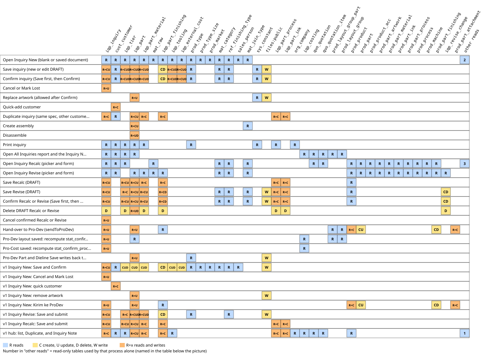
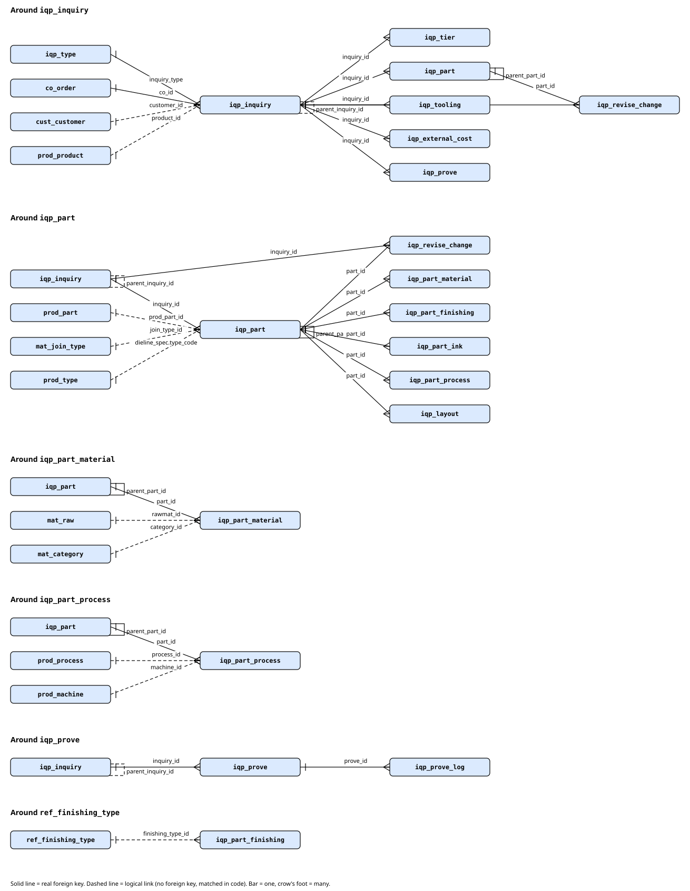

# Sub-module: Inquiry Product

> Group B, 2026-10-16. The sub-module page only summarises and links; table/column facts are in the cards. FACT = seen directly (menu: `sys_app_menu` mockup; code with lines).

- **Module**: Sales > Inquiry & Quotation > Inquiry Product (menu group id 1161). Menu (FACT, `sys_app_menu` mockup): Inquiry New (`v2:inquiry-list-new`, grid), Inquiry Revise (`v2:inquiry-revise`), Inquiry Recalc (`v2:inquiry-recalc`), heading "Reports" then All Inquiries (`v2:inquiry`). Document form: `v2:inquiry-new` (opened from the grid; not a menu item of its own). Item "Inquiry Note" (id 931) is inactive and has no target.
- **Purpose**: Sales records the customer request as a product specification (part, dieline size, material, finishing, qty tier), then Confirms; Inquiry becomes the upstream source of the whole chain (ProDev, ProCost, Quotation, CO).
- **Three types** (A.5): NEW, REVISE (spec changes), RECALC (same spec, material price changes). RECALC goes straight to Pro-Cost (A.20).
- **Frozen zone**: Inquiry Product, ProDev, ProCost. Read `docs/claude_vital_flows.md` before touching.

## Relations
- **source**: Sales (form), Master Card Collection, Duplicate, Master Product (Revise/Recalc), Reverse costing.
- **used_by**: ProDev (card `../prodev/10_card_prodev-interface.md`), ProCost (`../product-costing/11_card_procost-interface.md`), Quotation (`../quotation/10_card_quotation.md`).
- **flags**: three flags `stat_confirm_sales/_prodev/_procost` in `iqp_inquiry` (A.20). Cross-module flag cards are written by other groups; only a link here.

## Concept cards in this sub-module
| Card | Content |
|---|---|
| `10_card_product-type.md` | Product type (`prod_type`), created earlier |
| `11_card_inquiry-and-part.md` | Inquiry, Part, Qty tier, types NEW/REVISE/RECALC, flags |
| `12_card_inquiry-source.md` | Source (origin of the request) |
| `13_card_material-source.md` | Material Source (own material / customer-supplied) |
| `14_card_dieline-and-master-card.md` | Dieline, dieline snapshot, Master Card on the Sales side |
| `15_card_inquiry-supporting-masters.md` | Product Market, market sizes, material category, finishing, join type |
| `../master-data/10_card_customer.md` | Customer on the Sales side |
| `../master-data/11_card_sales-pic.md` | Sales PIC |

## Engines in this sub-module
No engine writes Inquiry itself. Engines that touch Inquiry data: `SpecEngine` (ProDev; writes back `iqp_part_process/_material/_ink`), `InquiryStage` (computes the flags). ENGINE cards: `20_engine_dieline.md` (engine group), `../prodev/20_engine_spec.md`; open items in `docs/ENGINE-ATTENTION.md`.

## Findings across cards (summary; detail in the cards)
- The Source choices do not include `MASTER CARD` and `REVERSE` that the code writes; the channel list has no master.
- `pic_sales` is free text; 0 of 19 match the Sales Person master.
- Customer target price per tier and discounts have no input on the v2 screen; column `iqp_tier.price_excl` has a double meaning.
- The next Inquiry number will jump because of seeder numbers (computed from code, not run).
- Finishing master, join type, product type have no input screen; constant `INQUIRY_ARTWORK_MAX_MB` has no row.

## Diagram
Not made yet (next Phase). The text flow is in the Inquiry card and the interface card.

## User's Guide (UG) already existing
`docs/guides/sales/01_inquiry_product.md`; data flow: `docs/guides/sales/00_alur_data_dan_sistem.md` (FROM DOCUMENT, not opened in this session). TG does not repeat its content.

> Checked 2026-10-16 after the SpecEngine / MaterialPlanningEngine change (Jo agreed): this card only names or links the changed cards; nothing in it needs to change.

> Checked 2026-10-16 after the ProCost BOM panel change (Jo agreed): this card only names or links the changed cards; nothing in it needs to change.

> Checked 2026-10-16 after the ProCost Book button (Jo agreed): this card only names or links the changed cards; nothing in it needs to change.

## Read/Write map

 Click the picture to open it full size.
Every process of the Inquiry Product sub-module with the tables it reads and writes (C create, U update, D delete), checked in code on 2026-10-17 against the dummy DBs (ddtsdi, ddtmst, ddtsys: all table names exist; no DB triggers in ddtsdi or ddtmst).

| Process | Trigger | Reads | Writes | Evidence |
|---|---|---|---|---|
| Open Inquiry New (blank or saved document) | Inquiry New screen, GET v2.screen inquiry-new (optional ?id) | `iqp_inquiry`, `cust_customer`, `iqp_tier`, `iqp_part`, `iqp_part_material`, `mat_raw`, `iqp_part_finishing`, `iqp_tooling`, `iqp_external_cost`, `prod_type`, `prod_type_param`, `prod_type_size`, `prod_type_size_val`, `prod_market`, `mat_category`, `ref_finishing_type`, `sales_person`, `mat_join_type` | - | `resources/views/v2/screens/inquiry-new.blade.php:10-27`, `resources/views/v2/screens/inquiry-new.blade.php:144-150`, `resources/views/v2/screens/inquiry-new.blade.php:177`, `app/Support/V2/Data/Sales.php:43-58`, `app/Support/V2/Data/Sales.php:61-91`, `app/Support/V2/Data/Sales.php:112-127`, `app/Support/V2/Data/Sales.php:135-148`, `app/Support/V2/Data/Sales.php:151-195`, `app/Support/V2/Lookups.php:15-17`, `app/Services/Sales/InquiryAssembly.php:22-33`, `routes/v2.php:186-200` |
| Save inquiry (new or edit DRAFT) | Inquiry New, Save (POST v2.inquiry.save, action not confirm) | `iqp_inquiry`, `sys_constant`, `cust_customer`, `prod_type`, `mat_category`, `ref_finishing_type`, `iqp_tier`, `iqp_part`, `iqp_part_material`, `iqp_tooling`, `iqp_external_cost` | `iqp_inquiry` (CU), `iqp_tier` (CUD), `iqp_part` (CUD), `iqp_part_material` (CUD), `iqp_part_finishing` (CD), `iqp_tooling` (CUD), `iqp_external_cost` (CUD), `files:public` | `routes/v2.php:416-431`, `app/Support/V2/InquiryPayload.php:13-27`, `app/Support/V2/InquiryPayload.php:110-141`, `app/Services/Sales/InquiryWriter.php:27-55`, `app/Services/Sales/InquiryWriter.php:199-225`, `app/Services/Sales/InquiryWriter.php:227-245`, `app/Services/Sales/InquiryWriter.php:247-289`, `app/Services/Sales/InquiryWriter.php:291-322`, `app/Services/Sales/InquiryWriter.php:325-340`, `app/Services/Sales/InquiryWriter.php:342-360`, `app/Services/Sales/InquiryWriter.php:362-379`, `app/Services/Sales/InquiryWriter.php:382-388`, `app/Models/Sdi/IqpInquiry.php:163-174` |
| Confirm inquiry (Save first, then Confirm) | Inquiry New, Confirm (POST v2.inquiry.save, action=confirm) | `iqp_inquiry`, `sys_constant`, `cust_customer`, `prod_type`, `mat_category`, `ref_finishing_type`, `iqp_tier`, `iqp_part`, `iqp_part_material`, `iqp_tooling`, `iqp_external_cost` | `iqp_inquiry` (CU), `iqp_tier` (CUD), `iqp_part` (CUD), `iqp_part_material` (CUD), `iqp_part_finishing` (CD), `iqp_tooling` (CUD), `iqp_external_cost` (CUD), `files:public` | `routes/v2.php:416-431`, `app/Services/Sales/InquiryWriter.php:27-55`, `app/Services/Sales/InquiryWriter.php:57-60`, `app/Models/Sdi/IqpInquiry.php:96-104` |
| Cancel or Mark Lost | Inquiry New (confirmed document), Cancel Inquiry / Mark Lost (POST v2.inquiry.end) | `iqp_inquiry` | `iqp_inquiry` (U) | `routes/v2.php:433-440`, `app/Services/Sales/InquiryWriter.php:62-79` |
| Replace artwork (allowed after Confirm) | Inquiry New, artwork upload on a saved part (POST v2.inquiry.artwork) | `iqp_part`, `sys_constant` | `iqp_part` (U), `files:public` | `routes/v2.php:442-451`, `app/Services/Sales/InquiryWriter.php:83-94` |
| Quick-add customer | Inquiry New, Customer lookup create (POST v2.inquiry.customer) | `cust_customer` | `cust_customer` (C) | `routes/v2.php:453-461`, `app/Services/Sales/InquiryWriter.php:158-179` |
| Duplicate inquiry (same spec, other customer) | Duplicate button on Inquiry New / Recalc / Revise, modal dup-modal (POST v2.inquiry.duplicate) | `iqp_inquiry`, `cust_customer`, `iqp_part`, `iqp_part_material`, `iqp_part_process`, `iqp_part_finishing`, `iqp_part_ink` | `iqp_inquiry` (C), `iqp_part` (CU), `iqp_part_material` (C), `iqp_part_process` (C), `iqp_part_finishing` (C), `iqp_part_ink` (C) | `routes/v2.php:393-404`, `resources/views/v2/screens/_inquiry-duplicate.blade.php:10-12`, `app/Services/Sales/InquiryDuplicator.php:13-46`, `app/Models/Sdi/IqpInquiry.php:163-174`, `app/Models/Sdi/IqpInquiry.php:180-264` |
| Create assembly | Inquiry New, Assembly card, Create Assembly (POST v2.inquiry.assembly.store) | `iqp_part`, `mat_join_type` | `iqp_part` (CU) | `routes/v2.php:499-512`, `app/Services/Sales/InquiryAssembly.php:35-52` |
| Disassemble | Inquiry New, Assembly card, Disassemble (POST v2.inquiry.assembly.delete) | `iqp_part` | `iqp_part` (UD) | `routes/v2.php:513-517`, `app/Services/Sales/InquiryAssembly.php:55-63` |
| Print inquiry | Inquiry New, Print (GET v2.print type=inquiry) | `iqp_inquiry`, `cust_customer`, `iqp_tier`, `iqp_part`, `iqp_part_material`, `iqp_part_process`, `prod_type`, `org_company`, `sys_constant` | - | `routes/v2.php:204-213`, `app/Support/V2/Print/InquiryPrint.php:46-80`, `app/Support/V2/Print/PrintDocs.php:106-117`, `app/Support/V2/Print/PrintDocs.php:119-124` |
| Open All Inquiries report and the Inquiry New / Revise / Recalc worklists | Menu All Inquiries (v2:inquiry); worklist grids inquiry-list-new, inquiry-revise, inquiry-recalc | `iqp_inquiry`, `cust_customer`, `iqp_tier`, `iqp_part`, `iqp_costing`, `quo_quotation`, `quo_quotation_item`, `prod_layout_group_part`, `prod_layout_group` | - | `resources/views/v2/screens/inquiry.blade.php:8-29`, `app/Support/V2/Data/Sales.php:229-301`, `app/Support/V2/Data/Sales.php:318-332`, `app/Support/V2/Grid/Sales/InquiryDeskGrid.php:63-72`, `app/Services/Sales/InquiryStage.php:23-33`, `app/Services/Sales/QuotationBuilder.php:46-57` |
| Open Inquiry Recalc (picker and form) | Inquiry Recalc screen, GET v2.screen inquiry-recalc (?product, ?source_id, ?id) | `iqp_inquiry`, `iqp_tier`, `prod_product`, `cust_customer`, `prod_part`, `mat_join_type`, `prod_product_acc`, `prod_part_artwork`, `prod_part_material`, `mat_raw`, `mat_category`, `prod_part_ink`, `prod_part_process`, `prod_process`, `prod_machine`, `prod_part_finishing`, `ref_finishing_type`, `quo_quotation`, `quo_quotation_item`, `co_order`, `co_order_item`, `co_order_delivery` | - | `resources/views/v2/screens/inquiry-recalc.blade.php:10-31`, `resources/views/v2/screens/inquiry-recalc.blade.php:45`, `app/Support/V2/Data/ProductMaster.php:33-53`, `app/Support/V2/Data/ProductMaster.php:55-79`, `app/Support/V2/Data/ProductMaster.php:86-115`, `app/Support/V2/Data/ProductMaster.php:117-153` |
| Open Inquiry Revise (picker and form) | Inquiry Revise screen, GET v2.screen inquiry-revise (?product, ?source_id, ?id) | `iqp_inquiry`, `iqp_part`, `iqp_part_material`, `iqp_part_finishing`, `iqp_revise_change`, `prod_product`, `cust_customer`, `prod_part`, `mat_join_type`, `prod_product_acc`, `prod_part_artwork`, `prod_part_material`, `mat_raw`, `mat_category`, `prod_part_ink`, `prod_part_process`, `prod_process`, `prod_machine`, `prod_part_finishing`, `ref_finishing_type` | - | `resources/views/v2/screens/inquiry-revise.blade.php:10-38`, `resources/views/v2/screens/inquiry-revise.blade.php:52`, `app/Services/Sales/InquiryDerivedWriter.php:31-36`, `app/Support/V2/Data/ProductMaster.php:33-53`, `app/Support/V2/Data/ProductMaster.php:55-79`, `app/Support/V2/Data/ProductMaster.php:86-115`, `app/Support/V2/Data/ProductMaster.php:166-187` |
| Save Recalc (DRAFT) | Inquiry Recalc, Save (POST v2.derived.save type=recalc) | `prod_product`, `iqp_inquiry`, `iqp_part`, `iqp_part_material`, `iqp_part_process`, `iqp_part_finishing`, `iqp_part_ink`, `iqp_tier` | `iqp_inquiry` (CU), `iqp_part` (CU), `iqp_part_material` (C), `iqp_part_process` (C), `iqp_part_finishing` (C), `iqp_part_ink` (C), `iqp_tier` (CU) | `routes/v2.php:1844-1866`, `app/Services/Sales/InquiryDerivedWriter.php:38-51`, `app/Services/Sales/InquiryDerivedWriter.php:121-148`, `app/Models/Sdi/IqpInquiry.php:163-174`, `app/Models/Sdi/IqpInquiry.php:180-264` |
| Save Revise (DRAFT) | Inquiry Revise, Save (POST v2.derived.save type=revise) | `prod_product`, `iqp_inquiry`, `iqp_part`, `iqp_part_material`, `iqp_part_process`, `iqp_part_finishing`, `iqp_part_ink`, `iqp_tier`, `mat_category`, `ref_finishing_type`, `mat_join_type` | `iqp_inquiry` (CU), `iqp_part` (CU), `iqp_part_material` (CU), `iqp_part_process` (C), `iqp_part_finishing` (CD), `iqp_part_ink` (C), `iqp_tier` (C), `iqp_revise_change` (CD), `files:public` | `routes/v2.php:1844-1866`, `app/Services/Sales/InquiryDerivedWriter.php:53-85`, `app/Services/Sales/InquiryDerivedWriter.php:121-148`, `app/Services/Sales/InquiryDerivedWriter.php:150-189`, `app/Services/Sales/InquiryDerivedWriter.php:191-222`, `app/Services/Sales/InquiryWriter.php:83-94`, `app/Models/Sdi/IqpInquiry.php:180-264` |
| Confirm Recalc or Revise (Save first, then Confirm) | Inquiry Recalc / Revise, Confirm (POST v2.derived.save, action=confirm) | `prod_product`, `iqp_inquiry`, `iqp_part`, `iqp_part_material`, `iqp_part_process`, `iqp_part_finishing`, `iqp_part_ink`, `iqp_tier`, `mat_category`, `ref_finishing_type`, `mat_join_type` | `iqp_inquiry` (CU), `iqp_part` (CU), `iqp_part_material` (CU), `iqp_part_process` (C), `iqp_part_finishing` (CD), `iqp_part_ink` (C), `iqp_tier` (CU), `iqp_revise_change` (CD), `files:public` | `routes/v2.php:1844-1866`, `app/Services/Sales/InquiryDerivedWriter.php:87-94`, `app/Models/Sdi/IqpInquiry.php:96-104` |
| Delete DRAFT Recalc or Revise | Inquiry Recalc / Revise, Delete (POST v2.derived.delete) | `iqp_part` | `iqp_part_material` (D), `iqp_part_finishing` (D), `iqp_part_process` (D), `iqp_part_ink` (D), `iqp_revise_change` (D), `iqp_part` (UD), `iqp_tier` (D), `iqp_inquiry` (D) | `routes/v2.php:1868-1874`, `app/Services/Sales/InquiryDerivedWriter.php:97-111`, `app/Services/Sales/InquiryDerivedWriter.php:113-118` |
| Cancel confirmed Recalc or Revise | Inquiry Recalc / Revise, Cancel (POST v2.derived.cancel) | `iqp_inquiry` | `iqp_inquiry` (U) | `routes/v2.php:1876-1883`, `app/Services/Sales/InquiryWriter.php:62-69` |
| Hand-over to Pro-Dev (sendToProDev) | Pro-Dev New / Revise worklist, open a row (GET v2.prodev.open); also dummy builders StageBuilder and MasterCardDummyEngine | `iqp_inquiry`, `iqp_part`, `iqp_part_finishing`, `prod_product`, `prod_part_attachment`, `prod_layout_group_part`, `prod_layout_group` | `prod_product` (C), `iqp_inquiry` (U), `prod_part` (CU), `iqp_part` (U), `prod_part_finishing` (CD), `prod_part_attachment` (C) | `routes/v2.php:1800-1807`, `app/Services/Sales/InquiryStage.php:73-87`, `app/Services/Sales/InquiryWriter.php:97-155`, `app/Models/Sdi/IqpInquiry.php:132-153` |
| Pro-Dev layout saved: recompute stat_confirm_prodev | Pro-Dev workbench call (POST v2.prodev.call) and ProdLayoutGroup saved event from any caller | `iqp_part`, `iqp_inquiry`, `iqp_costing`, `prod_layout_group_part`, `prod_layout_group` | `iqp_inquiry` (U) | `routes/v2.php:1811-1818`, `app/Services/Sales/InquiryStage.php:23-57`, `app/Services/Sales/InquiryStage.php:89-96`, `app/Services/Sales/InquiryStage.php:99-103`, `app/Providers/AppServiceProvider.php:75` |
| Pro-Cost saved: recompute stat_confirm_procost | IqpCosting saved event from any caller (Pro-Cost screens) | `iqp_inquiry`, `iqp_costing` | `iqp_inquiry` (U) | `app/Services/Sales/InquiryStage.php:59-69`, `app/Services/Sales/InquiryStage.php:89-96`, `app/Services/Sales/InquiryStage.php:104`, `app/Providers/AppServiceProvider.php:75` |
| Pro-Dev Part and Dieline Save writes back to the Inquiry part | Pro-Dev workbench, Part and Dieline panel, Save (POST v2.prodev.dieline) | `iqp_part`, `prod_type` | `iqp_part` (U), `files:public` | `routes/v2.php:1826-1835`, `app/Services/ProDev/PartDieline.php:22-25`, `app/Services/ProDev/PartDieline.php:43`, `app/Services/ProDev/PartDieline.php:63-65`, `app/Services/Sales/InquiryWriter.php:83-94` |
| v1 Inquiry New: Save and Confirm | Old page /inquiry/new (pages::inquiry.form), Save / Confirm | `iqp_inquiry`, `cust_customer`, `sales_person`, `mat_category`, `prod_market`, `prod_type`, `prod_type_size`, `ref_finishing_type` | `iqp_inquiry` (CU), `iqp_tier` (CUD), `iqp_part` (CUD), `iqp_part_material` (CUD), `iqp_part_finishing` (CD), `iqp_tooling` (CUD), `iqp_external_cost` (CUD), `files:public` | `routes/web.php:146`, `resources/views/pages/inquiry/form.blade.php:2331-2371`, `resources/views/pages/inquiry/form.blade.php:2373-2402`, `resources/views/pages/inquiry/form.blade.php:2134-2160`, `resources/views/pages/inquiry/form.blade.php:2162-2216`, `resources/views/pages/inquiry/form.blade.php:2218-2236`, `resources/views/pages/inquiry/form.blade.php:2238-2291`, `resources/views/pages/inquiry/form.blade.php:2293-2329`, `resources/views/pages/inquiry/form.blade.php:1615-1646` |
| v1 Inquiry New: Cancel and Mark Lost | Old page /inquiry/new, Cancel / Mark Lost | `iqp_inquiry` | `iqp_inquiry` (U) | `resources/views/pages/inquiry/form.blade.php:2498-2517`, `resources/views/pages/inquiry/form.blade.php:2533-2551` |
| v1 Inquiry New: quick customer | Old page /inquiry/new, new customer modal | `cust_customer` | `cust_customer` (C) | `resources/views/pages/inquiry/form.blade.php:598-645`, `resources/views/pages/inquiry/form.blade.php:647-660` |
| v1 Inquiry New: remove artwork | Old page /inquiry/new, remove artwork | `iqp_part` | `iqp_part` (U), `files:public` | `resources/views/pages/inquiry/form.blade.php:1586-1608` |
| v1 Inquiry New: Kirim ke ProDev | Old page /inquiry/new, Kirim ke ProDev button | `iqp_part`, `iqp_part_finishing`, `iqp_inquiry`, `prod_product`, `prod_part_attachment` | `prod_product` (C), `iqp_inquiry` (U), `prod_part` (CU), `iqp_part` (U), `prod_part_finishing` (CD), `prod_part_attachment` (C) | `resources/views/pages/inquiry/form.blade.php:2411-2485` |
| v1 Inquiry Revise: Save and submit | Old page /inquiry/revise (pages::inquiry.revise), Save / Submit | `iqp_inquiry`, `iqp_tier`, `iqp_part`, `iqp_part_material`, `ref_finishing_type`, `prod_type` | `iqp_inquiry` (CU), `iqp_part` (CUD), `iqp_part_material` (CUD), `iqp_part_finishing` (CD), `iqp_tier` (C), `files:public` | `routes/web.php:148`, `resources/views/pages/inquiry/revise.blade.php:407-440`, `resources/views/pages/inquiry/revise.blade.php:442-460`, `resources/views/pages/inquiry/revise.blade.php:462-516`, `resources/views/pages/inquiry/revise.blade.php:518-555`, `resources/views/pages/inquiry/revise.blade.php:557-654`, `resources/views/pages/inquiry/revise.blade.php:286-308` |
| v1 Inquiry Recalc: Save and submit | Old page /inquiry/recalc (pages::inquiry.recalc), Save / Submit | `iqp_inquiry`, `iqp_tier`, `iqp_part`, `iqp_part_material`, `iqp_part_process`, `iqp_part_finishing`, `iqp_part_ink` | `iqp_inquiry` (CU), `iqp_part` (CU), `iqp_part_material` (C), `iqp_part_process` (C), `iqp_part_finishing` (C), `iqp_part_ink` (C), `iqp_tier` (CU) | `routes/web.php:147`, `resources/views/pages/inquiry/recalc.blade.php:129-203`, `resources/views/pages/inquiry/recalc.blade.php:205-220` |
| v1 hub: list, Duplicate, and Inquiry Note | Old pages /inquiry (pages::inquiry.hub) and /inquiry/{id}/nota (pages::inquiry.nota) | `iqp_inquiry`, `cust_customer`, `iqp_tier`, `iqp_part`, `iqp_costing`, `quo_quotation`, `quo_quotation_item`, `iqp_part_material`, `iqp_part_process`, `iqp_part_finishing`, `iqp_part_ink`, `iqp_costing_price_tier`, `iqp_tooling`, `prod_product`, `org_company` | `iqp_inquiry` (C), `iqp_part` (CU), `iqp_part_material` (C), `iqp_part_process` (C), `iqp_part_finishing` (C), `iqp_part_ink` (C) | `routes/web.php:145`, `resources/views/pages/inquiry/hub.blade.php:194-212`, `resources/views/pages/inquiry/hub.blade.php:361-371`, `resources/views/pages/inquiry/nota.blade.php:34-46`, `resources/views/pages/inquiry/nota.blade.php:48-51`, `app/Services/Sales/InquiryDuplicator.php:13-46` |

Notes for debugging
- Save and Confirm: `InquiryWriter::save` runs header, tiers, parts, toolings and external costs in ONE tm2sdi transaction (`app/Services/Sales/InquiryWriter.php:35-54`), but the artwork files are stored inside that transaction (`app/Services/Sales/InquiryWriter.php:280`, `app/Services/Sales/InquiryWriter.php:87`) and a rollback does not delete them. Confirm is a separate update after the transaction commits (`routes/v2.php:423-425`), so a failed Confirm leaves a saved DRAFT. After `stat_confirm_sales` is true, `save()` throws (`app/Services/Sales/InquiryWriter.php:29-31`); the same lock stops Create/Remove assembly (`app/Services/Sales/InquiryAssembly.php:37`, `app/Services/Sales/InquiryAssembly.php:57`) and Recalc/Revise save, confirm and delete (`app/Services/Sales/InquiryDerivedWriter.php:113-118`). Still allowed after Confirm: replace artwork, Cancel, Mark Lost, Duplicate, Print. The route `v2.inquiry.save` does not filter `inquiry_type` (`routes/v2.php:418`).
- What Save deletes: every Save deletes tiers, toolings, external costs, MANUAL materials and parts that are missing from the form, by whereNotIn on the kept ids (`app/Services/Sales/InquiryWriter.php:244`, `app/Services/Sales/InquiryWriter.php:288`, `app/Services/Sales/InquiryWriter.php:321`, `app/Services/Sales/InquiryWriter.php:359`, `app/Services/Sales/InquiryWriter.php:378`). ASSEMBLY parts are never deleted by Save (`app/Services/Sales/InquiryWriter.php:288`). The `materials()` relation only sees rows with source MANUAL (`app/Models/Sdi/IqpPart.php:69-72`), but ALL `iqp_part_finishing` rows of each part are deleted and re-created on every Save (`app/Services/Sales/InquiryWriter.php:327`), so `id_part_finishing` changes each time. Verified in ddtsdi: FK `iqp_part` to `iqp_inquiry` is CASCADE, and `iqp_part_material`, `iqp_part_process`, `iqp_part_ink`, `iqp_part_finishing`, `iqp_layout`, `iqp_revise_change` cascade from `iqp_part`; `iqp_tier` to `iqp_inquiry` is RESTRICT (tiers must go first, as `InquiryDerivedWriter::delete` does); deleting an inquiry also cascades `iqp_costing` (and its children), `iqp_prove`, `iqp_tooling`, `iqp_external_cost` and sets NULL on `co_order_item`, `quo_quotation_item`, `iqp_costing_part.part_id`.
- Recalc, Revise, Duplicate: the first Save creates the document and copies the structure with `cloneStructureFrom` (`app/Models/Sdi/IqpInquiry.php:180-264`): only MANUAL materials, all processes, finishings and inks are copied, cloned rows get created_by and updated_by = web, and the artwork columns are NOT copied there. `InquiryDerivedWriter::create` copies the artwork paths afterwards (`app/Services/Sales/InquiryDerivedWriter.php:135-140`, same file path shared with the source, no file copy) and, for RECALC only, also `prod_part_id`; Duplicate gets no artwork. Revise clears a shared artwork path before `storeArtwork`, so the source file is not deleted (`app/Services/Sales/InquiryDerivedWriter.php:73-78`); Delete draft leaves artwork files on disk (`app/Services/Sales/InquiryDerivedWriter.php:97-111`). Revise rewrites ALL `iqp_revise_change` rows on every Save (`app/Services/Sales/InquiryDerivedWriter.php:194`). The v2 Revise does not touch the source inquiry, while old v1 Revise cancels the source on first save (`resources/views/pages/inquiry/revise.blade.php:628-635`).
- Hand-over and transactions: the only caller of `sendToProDev` in v2 code is `InquiryStage::openInProdev` (grep of app, routes, resources; the old v1 form has its own button), which runs it for every part without `prod_part_id` when a row is opened from the Pro-Dev New/Revise worklist (`app/Services/Sales/InquiryStage.php:80-82`). `openInProdev`, `sendToProDev`, `ensureDraftProduct`, `storeArtwork`, `quickCustomer`, `confirm`, `cancel`, `markLost` and `InquiryStage::set` have NO transaction, and sendToProDev writes tm2sdi and tm2mst separately. Recalc is not a Pro-Dev type (`app/Services/Sales/InquiryStage.php:20`, `app/Services/Sales/InquiryStage.php:75-76`); it takes `product_id` and `prod_part_id` from its source (`app/Services/Sales/InquiryDerivedWriter.php:43`, `app/Services/Sales/InquiryDerivedWriter.php:139`).
- Stage flags: `stat_confirm_prodev` and `stat_confirm_procost` are written with the query builder, so `updated_at` and `updated_by` are not touched and the `IqpInquiry` saving hook does not run (`app/Services/Sales/InquiryStage.php:89-96`). `syncProdev` only acts on NEW/REVISE documents already confirmed by Sales, and may set the flag back to 0 only while no `iqp_costing` row exists (`app/Services/Sales/InquiryStage.php:40-42`, `app/Services/Sales/InquiryStage.php:47`). Both listeners are registered once at boot (`app/Providers/AppServiceProvider.php:75`).
- Not checked or not in this map: the source of the Riwayat tab (no write to `doc_state_log` was found in these classes); v1 Reads were taken from model imports and queries seen, not fully traced; the v2 Inquiry Note slug nota-inquiry has no blade file in `resources/views/v2/screens`, so it shows the placeholder card (`app/Support/V2/Screens.php:42`); screen chrome (menu, QC bar, dictionary register) and access checks (canAccessModule) are not mapped; other creators of `iqp_inquiry` outside the menu are `app/Services/MasterCard/MasterCardService.php:340` (source MASTER CARD) and `app/Services/Costing/ReverseCostingService.php:71-99` (source REVERSE), and the dummy builders call the same writer methods, their other writes are not checked; Pro-Dev internals behind Part and Dieline (`prod_part`, `prod_product`, artwork analysis) are not mapped.

## Table relations

Relations of the tables this sub-module uses. Solid line = real foreign key (database `tm2sdi`). Dashed line = logical link without foreign key (cross-database or JSON key, matched in code). Facts: foreign keys read from `information_schema` in the mockup database; the logical links from the columns and the cards of this sub-module (the target table of a logical link is taken from the card, not re-read from each lookup).

 Click the picture to open it full size.

| Parent | Child | Cardinality | Column | Link |
|---|---|---|---|---|
| `iqp_type` | `iqp_inquiry` | 1:N | `inquiry_type` | FK |
| `co_order` | `iqp_inquiry` | 1:N | `co_id` | FK |
| `iqp_inquiry` | `iqp_tier` | 1:N | `inquiry_id` | FK |
| `iqp_inquiry` | `iqp_part` | 1:N | `inquiry_id` | FK |
| `iqp_inquiry` | `iqp_tooling` | 1:N | `inquiry_id` | FK |
| `iqp_inquiry` | `iqp_external_cost` | 1:N | `inquiry_id` | FK |
| `iqp_inquiry` | `iqp_prove` | 1:N | `inquiry_id` | FK |
| `iqp_inquiry` | `iqp_revise_change` | 1:N | `inquiry_id` | FK |
| `iqp_prove` | `iqp_prove_log` | 1:N | `prove_id` | FK |
| `iqp_part` | `iqp_part` | 1:N | `parent_part_id` | FK |
| `iqp_part` | `iqp_part_material` | 1:N | `part_id` | FK |
| `iqp_part` | `iqp_part_finishing` | 1:N | `part_id` | FK |
| `iqp_part` | `iqp_part_ink` | 1:N | `part_id` | FK |
| `iqp_part` | `iqp_part_process` | 1:N | `part_id` | FK |
| `iqp_part` | `iqp_layout` | 1:N | `part_id` | FK |
| `iqp_part` | `iqp_revise_change` | 1:N | `part_id` | FK |
| `cust_customer` | `iqp_inquiry` | 1:N | `customer_id` | logical |
| `prod_product` | `iqp_inquiry` | 1:N | `product_id` | logical |
| `iqp_inquiry` | `iqp_inquiry` | 1:N | `parent_inquiry_id` | logical |
| `prod_part` | `iqp_part` | 1:N | `prod_part_id` | logical |
| `mat_join_type` | `iqp_part` | 1:N | `join_type_id` | logical |
| `prod_type` | `iqp_part` | 1:N | `dieline_spec.type_code` | logical |
| `mat_raw` | `iqp_part_material` | 1:N | `rawmat_id` | logical |
| `mat_category` | `iqp_part_material` | 1:N | `category_id` | logical |
| `ref_finishing_type` | `iqp_part_finishing` | 1:N | `finishing_type_id` | logical |
| `prod_process` | `iqp_part_process` | 1:N | `process_id` | logical |
| `prod_machine` | `iqp_part_process` | 1:N | `machine_id` | logical |

- Re-checked 2026-10-18 after the `routes/web.php` edit (v1 `/self-service` route replaced by a redirect to `v2.profile`, rule D.25); the block keeps its 4 lines so every cited line number is unchanged, content still true.

- Re-checked 2026-10-18 after the duplicate-module cleanup (v1 Scheduling Board, Rule Library and Master Crew removed): the `routes/web.php` lines cited here (145-148) are before the removed routes and unchanged.
> Label pass 2026-10-18 (Jo): the visible texts of the screens this card cites (labels, columns, tabs, buttons, messages) are English now. Tables, fields, flow and stored values are unchanged, so nothing else in this card changed. Verified: 2026-10-18.
