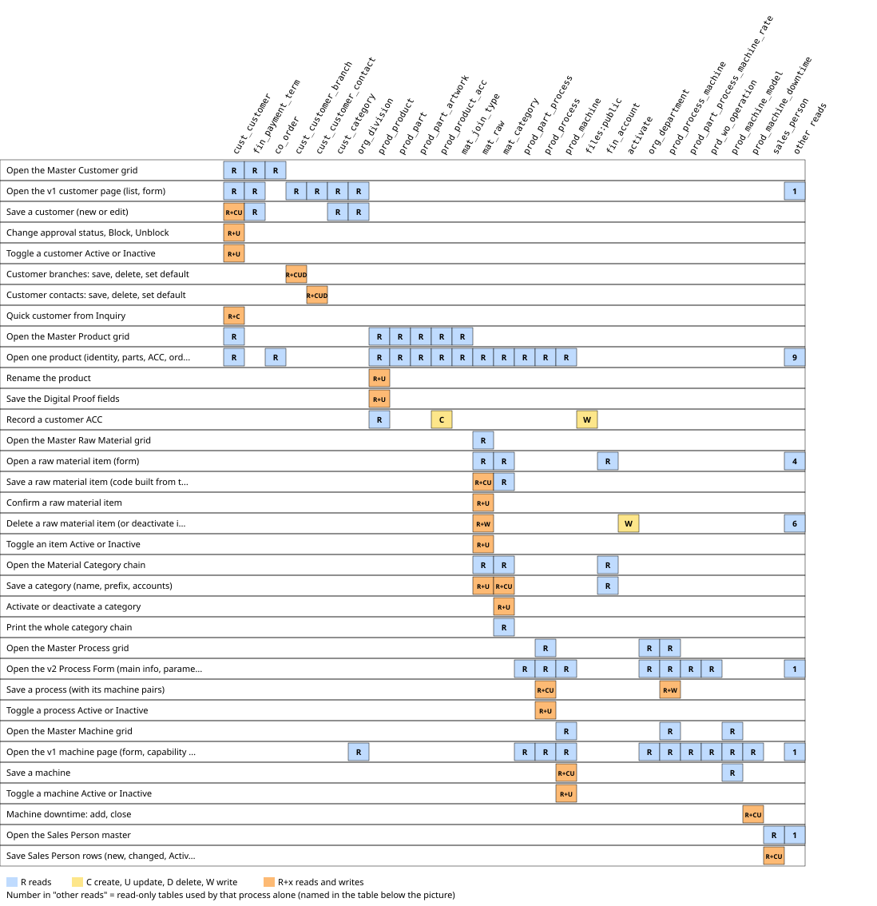
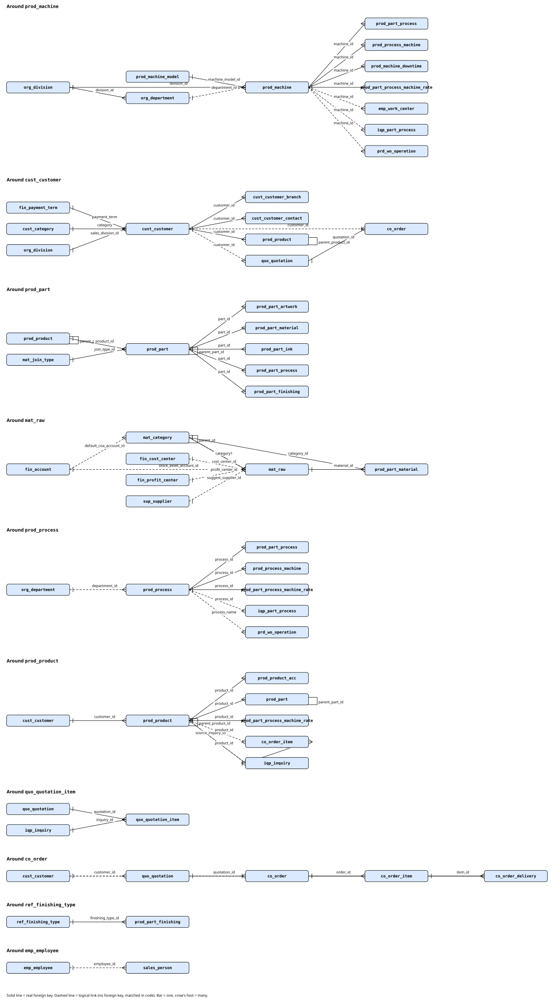

# Sub-module: Master Data (Sales > Inquiry & Quotation)

> Written 2026-10-18 (group B, read/write and relation sections). This page only summarizes and links; table/column facts are in the cards. FACT = seen directly (menu `sys_app_menu` mockup; code with lines).

> Re-checked 2026-10-18 after `app/Support/V2/Grid/DbLookup.php` changed (rows read the sheet columns once per screen; a REMARK header was added): the cited save() lines 98-131 and 104-131 still match. Verified: 2026-10-18.

- **Module**: Sales > Inquiry & Quotation > Master Data (menu group id 1142). Menu (FACT, `sys_app_menu` mockup, active): Master Customer (`v2:md-customer`), Master Product (`v2:master-product`), Master Raw Material (`v2:md-raw`), Master Raw Material Category (`v2:md-matcat`), Master Process (`v2:prod-process`), Master Machine (`v2:prod-machine`). The Sales Person master (`v2:md-sales-person`) is NOT in this group: it sits in Sales > CRM > Master Data (id 1192) and in the module Master Data (id 1182); it is mapped on this page because the folder holds its card.
- **Purpose**: the master data that Sales picks from while it builds Inquiry, Quotation and Customer Order: who the customer is, which product exists, which raw material and category build the item code, and which process and machine the plant has.
- **Real masters**: Master Process and Master Machine are REAL plant data (`prod_process`, `prod_machine`, `prod_process_machine`); only a user changes them and this page only describes what the code can do. Nothing here was run against them.
- **Access gate differs per screen** (FACT, `routes/v2.php:186-200` takes the module of the screen, not of the menu group): Master Customer, Raw Material, Raw Material Category and Sales Person are module MDATA, Master Product is SALES, Process and Machine are PROD. A Sales user without PROD or MDATA gets 403 on those items although they sit in the Sales menu. Not tried on screen.

## Relations
- **source**: users of Master Data (Sales, Finance, Production), legacy migration, quick customer from Inquiry, Quotation WIN (creates the Master Product, see the Quotation page).
- **used_by**: Inquiry, Quotation, Customer Order, ProDev, Pro-Cost, Procurement, Inventory (see the cards).

## Concept cards in this sub-module
| Card | Content |
|---|---|
| [10_card_customer.md](10_card_customer.md) | Customer on the Sales side (`cust_customer`, quick customer, approval pipeline) |
| [11_card_sales-pic.md](11_card_sales-pic.md) | Sales PIC (`sales_person`, text name in Inquiry and Quotation, id in CO) |

There is no card yet for Master Product, Raw Material, Raw Material Category, Process and Machine; this page maps their processes only.

## Engines in this sub-module
None. The raw material code is built by `App\Services\Master\MaterialMasterService` (`app/Services/Master/MaterialMasterService.php:208-228`) and the category rules by `App\Services\Master\MaterialCategoryService`; neither is registered as an engine in these files (registry not checked).

## Read/Write map

 Click the picture to open it full size.
Every process of the six menu items and the Sales Person master with the tables it reads and writes (C create, U update, D delete), checked in code on 2026-10-18 against the dummy DBs (ddtmst, ddtsdi, ddtacc, ddtprd, ddtsys: all table names exist; `v_geo_full_address` is a view; no DB triggers found in ddtmst, ddtsdi, ddtacc, ddtprd, ddtsys). Grid screens read their rows through `App\Support\V2\Grid\DbGrid::rows` (`app/Support/V2/Grid/DbGrid.php:359-372`); opening a row or New Record on Raw Material goes to the v2 form `md-raw-form` (rule D.25, 2026-10-18), while on Customer, Process and Machine it leaves the v2 grid for the v1 Livewire page, so the v1 component is the evidence for those writes. Processes on Process and Machine are described, not run.

| Process | Trigger | Reads | Writes | Evidence |
|---|---|---|---|---|
| Open the Master Customer grid | Menu Master Customer, GET v2.screen md-customer | `cust_customer`, `fin_payment_term`, `co_order` | - | `routes/v2.php:186-200`, `app/Support/V2/Grid/Master/CustomerGrid.php:47-56` |
| Open the v1 customer page (list, form) | Grid row, or + New Record (GET /master/customer ?open or ?new) | `cust_customer`, `cust_customer_branch`, `cust_customer_contact`, `fin_payment_term`, `cust_category`, `org_division`, `v_geo_full_address` | - | `routes/web.php:210`, `resources/views/pages/master/customer.blade.php:216-229`, `resources/views/pages/master/customer.blade.php:255-280`, `app/Models/Master/CustCustomer.php:153-168` |
| Save a customer (new or edit) | v1 customer form, Save | `cust_customer`, `cust_category`, `fin_payment_term`, `org_division` | `cust_customer` (CU) | `resources/views/pages/master/customer.blade.php:665-749` |
| Change approval status, Block, Unblock | v1 customer form, status buttons, Block, Unblock | `cust_customer` | `cust_customer` (U) | `resources/views/pages/master/customer.blade.php:645-662`, `resources/views/pages/master/customer.blade.php:764-783`, `resources/views/pages/master/customer.blade.php:793-820` |
| Toggle a customer Active or Inactive | Grid switch (POST v2.grid.toggle) or v1 list action | `cust_customer` | `cust_customer` (U) | `routes/v2.php:226-231`, `app/Support/V2/Grid/DbGrid.php:375-390`, `resources/views/pages/master/customer.blade.php:751-757` |
| Customer branches: save, delete, set default | v1 customer form, Branch tab | `cust_customer_branch` | `cust_customer_branch` (CUD) | `resources/views/pages/master/customer.blade.php:353-413` |
| Customer contacts: save, delete, set default | v1 customer form, Contact tab | `cust_customer_contact` | `cust_customer_contact` (CUD) | `resources/views/pages/master/customer.blade.php:444-503` |
| Quick customer from Inquiry | Inquiry New, Customer lookup create (POST v2.inquiry.customer) | `cust_customer` | `cust_customer` (C) | `routes/v2.php:453-461`, `app/Services/Sales/InquiryWriter.php:178-199` |
| Open the Master Product grid | Menu Master Product, GET v2.screen master-product (no id) | `prod_product`, `cust_customer`, `prod_part`, `prod_part_artwork`, `prod_product_acc`, `mat_join_type` | - | `resources/views/v2/screens/master-product.blade.php:25`, `app/Support/V2/Grid/Sales/ProductMasterListGrid.php:31-33`, `app/Support/V2/Data/ProductMaster.php:33-52` |
| Open one product (identity, parts, ACC, order history) | Product grid, open a row (GET v2.screen master-product ?id) | `prod_product`, `cust_customer`, `prod_part`, `mat_join_type`, `prod_part_artwork`, `prod_part_material`, `mat_raw`, `mat_category`, `prod_part_ink`, `prod_part_process`, `prod_process`, `prod_machine`, `prod_part_finishing`, `ref_finishing_type`, `prod_product_acc`, `iqp_inquiry`, `quo_quotation_item`, `quo_quotation`, `co_order`, `co_order_item`, `co_order_delivery` | - | `resources/views/v2/screens/master-product.blade.php:16`, `resources/views/v2/screens/master-product.blade.php:29`, `app/Support/V2/Data/ProductMaster.php:55-79`, `app/Support/V2/Data/ProductMaster.php:86-115`, `app/Support/V2/Data/ProductMaster.php:117-153` |
| Rename the product | Product page, Product name Save (POST v2.product.name) | `prod_product` | `prod_product` (U) | `routes/v2.php:466-476` |
| Save the Digital Proof fields | Product page, Digital Proof Save (POST v2.product.proof) | `prod_product` | `prod_product` (U) | `routes/v2.php:477-482` |
| Record a customer ACC | Product page, ACC form with evidence file (POST v2.product.acc) | `prod_product` | `prod_product_acc` (C), `files:public` | `routes/v2.php:483-495` |
| Open the Master Raw Material grid | Menu Master Raw Material, GET v2.screen md-raw | `mat_raw` | - | `app/Support/V2/Grid/Master/RawMaterialGrid.php:57-60`, `app/Support/V2/Grid/DbGrid.php:359-372` |
| Open a raw material item (form) | Grid row or + New Record (GET v2.screen md-raw-form ?id or ?new=1; old v1 URLs /master/raw-material redirect here) | `mat_raw`, `mat_category`, `uom_unit`, `sup_supplier`, `fin_account`, `fin_cost_center`, `fin_profit_center`, and the usage counts of `MaterialGuardService` | - | `app/Support/V2/Grid/Master/RawMaterialGrid.php:37-45`, `resources/views/v2/screens/md-raw-form.blade.php:41-53`, `app/Services/Master/MaterialMasterService.php:144-160`, `app/Services/Master/MaterialGuardService.php:36-50`, `routes/web.php:215-217` |
| Save a raw material item (code built from the category chain) | Item form, Save (POST v2.md.raw.save) | `mat_raw`, `mat_category` | `mat_raw` (CU) | `routes/v2_master.php:150-179`, `app/Services/Master/MaterialMasterService.php:35-95`, `app/Services/Master/MaterialMasterService.php:208-228` |
| Confirm a raw material item | Item form, Confirm (POST v2.md.raw.save, action=confirm) | `mat_raw` | `mat_raw` (U) | `app/Services/Master/MaterialMasterService.php:98-109` |
| Delete a raw material item (or deactivate it when in use) | Item form, Delete (POST v2.md.raw.save, action=delete) | `mat_raw`, and every table `MaterialGuardService` checks (`tm2pur`, `tm2inv`, `tm2prd`, `tm2sdi`, `tm2mst`, `tm2mnt`) | `mat_raw` (D, or U `activate` = 0) | `app/Services/Master/MaterialMasterService.php:121-135`, `app/Services/Master/MaterialGuardService.php:21-33` |
| Toggle an item Active or Inactive | Item form Activate / Deactivate (POST v2.md.raw.save) or grid switch (POST v2.grid.toggle) | `mat_raw` | `mat_raw` (U) | `app/Services/Master/MaterialMasterService.php:111-114`, `routes/v2.php:226-231` |
| Open the Material Category chain | Menu Master Raw Material Category, GET v2.screen md-matcat (?id, ?new, ?parent) | `mat_category`, `fin_account`, `mat_raw` | - | `app/Support/V2/Grid/Master/MatCategoryGrid.php:52-66`, `app/Support/V2/Grid/Master/MatCategoryGrid.php:107-123`, `resources/views/v2/screens/md-matcat.blade.php:52-53`, `app/Services/Master/MaterialCategoryService.php:100-113` |
| Save a category (name, prefix, accounts) | Category form, Save (POST v2.matcat.save) | `mat_category`, `fin_account`, `mat_raw` | `mat_category` (CU), `mat_raw` (U) | `routes/v2.php:1725-1738`, `app/Services/Master/MaterialCategoryService.php:115-232` |
| Activate or deactivate a category | Category form or grid switch (POST v2.matcat.save, action=activate or deactivate; POST v2.grid.toggle) | `mat_category` | `mat_category` (U) | `routes/v2.php:1730-1734`, `app/Support/V2/Grid/Master/MatCategoryGrid.php:125-130`, `app/Services/Master/MaterialCategoryService.php:236-243` |
| Print the whole category chain | Category grid, Print (GET v2.report.print md-matcat) | `mat_category` | - | `routes/v2.php:216-223`, `app/Support/V2/Grid/Master/MatCategoryGrid.php:160-184` |
| Open the Master Process grid | Menu Master Process, GET v2.screen prod-process | `prod_process`, `org_department`, `prod_process_machine` | - | `app/Support/V2/Grid/Prod/ProcessGrid.php:45-48`, `app/Support/V2/Grid/DbGrid.php:359-372` |
| Open the v2 Process Form (main info, parameters, cost, executing machines, where used) | Grid row or + New Record (GET /v2/s/prod-process-form with id or new=1; the old /production/master-process URL redirects) | `prod_process`, `org_department`, `prod_process_machine`, `prod_machine`, `prod_part_process`, `prod_part_process_machine_rate`, `iqp_part_process`, `prd_wo_operation` | - | `routes/web.php:320`, `app/Support/V2/Grid/Prod/ProcessGrid.php:30-38`, `app/Services/Production/ProcessMachineMatrixService.php:34-79`, `app/Services/Production/ProcessMasterService.php:110-120`, `app/Services/Production/MachineCapabilityService.php:208-222` |
| Save a process (with its machine pairs) | Process Form, Save (POST v2.prod.process.save) | `prod_process`, `prod_process_machine` | `prod_process` (CU), `prod_process_machine` (CU, never deleted) | `routes/v2_production.php:92-107`, `app/Services/Production/ProcessMasterService.php:34-96`, `app/Services/Production/ProcessMachineMatrixService.php:81-153` |
| Toggle a process Active or Inactive | Grid switch (POST v2.grid.toggle) or Process Form Deactivate / Activate | `prod_process` | `prod_process` (U) | `routes/v2.php:226-231`, `routes/v2_production.php:99-103`, `app/Services/Production/ProcessMasterService.php:98-101` |
| Open the Master Machine grid | Menu Master Machine, GET v2.screen prod-machine | `prod_machine`, `prod_machine_model`, `prod_process_machine` | - | `app/Support/V2/Grid/Prod/MachineGrid.php:45-48`, `app/Support/V2/Grid/DbGrid.php:359-372` |
| Open the v2 Machine Form (identity, specifications, capacity, cost, maintenance and OEE, processes, where used) | Grid row or + New Record (GET /v2/s/prod-machine-form with id or new=1; the old /master/machine URL redirects) | `prod_machine`, `prod_machine_model`, `org_division`, `org_department`, `prod_process_machine`, `prod_process`, `prod_machine_downtime`, `emp_work_center`, `prod_part_process`, `prod_part_process_machine_rate`, `prd_wo_operation` | - | `routes/web.php:212`, `app/Support/V2/Grid/Prod/MachineGrid.php:30-38`, `app/Services/Production/MachineMasterService.php:253-284`, `app/Services/Production/MachineCapabilityService.php:224-237` |
| Save a machine (with its process pairs and stop log) | Machine Form, Save (POST v2.prod.machine.save) | `prod_machine`, `prod_machine_model`, `prod_process_machine`, `prod_machine_downtime` | `prod_machine` (CU), `prod_process_machine` (CU, never deleted), `prod_machine_downtime` (CU) | `routes/v2_production.php:113-128`, `app/Services/Production/MachineMasterService.php:44-157` |
| Toggle a machine Active or Inactive | Grid switch (POST v2.grid.toggle) or Machine Form Deactivate / Activate | `prod_machine` | `prod_machine` (U) | `routes/v2.php:226-231`, `routes/v2_production.php:113-128`, `app/Services/Production/MachineMasterService.php:235-238` |
| Machine downtime: add, close | Machine Form, tab Maintenance and OEE (stop log table; fill End to close) | `prod_machine_downtime` | `prod_machine_downtime` (CU) | `app/Services/Production/MachineMasterService.php:159-233`, `app/Observers/MachineDowntimeObserver.php:15-28` |
| Process and machine capability: add, remove, restore, primary, certified, parameters | Process Form tab Executing machines, or Machine Form tab Processes (one table, saved with Save) | `prod_process_machine`, `prod_process`, `prod_machine` | `prod_process_machine` (CU) | `app/Services/Production/ProcessMachineMatrixService.php:81-153` |
| Open the Sales Person master | Menu Sales Person, GET v2.screen md-sales-person | `sales_person`, `emp_employee` | - | `app/Support/V2/Grid/Master/SalesPersonLookup.php:42-53`, `app/Support/V2/Grid/DbGrid.php:359-372` |
| Save Sales Person rows (new, changed, Active) | Sales Person sheet, Save (POST v2.lookup.save) | `sales_person` | `sales_person` (CU) | `routes/v2.php:234-242`, `app/Support/V2/Grid/DbLookup.php:98-131`, `app/Support/V2/Grid/Master/SalesPersonLookup.php:55-85` |

Notes for debugging
- Customer: the form Save is a plain `create` or `update` of the header with no transaction (`resources/views/pages/master/customer.blade.php:738-743`); branch and contact are separate saves, so a new customer can exist without them. The unique customer code is checked by validation only (`resources/views/pages/master/customer.blade.php:666-669`). Unblock needs an admin or module FINACC (`resources/views/pages/master/customer.blade.php:794`), but Block and the approval-status buttons have no such check (`resources/views/pages/master/customer.blade.php:645-662`, `resources/views/pages/master/customer.blade.php:764-783`). There is no delete of a customer in the page; the toggle is the only way out. The Active switch in the grid goes through the v1 `toggleActive` (`app/Support/V2/Grid/DbGrid.php:378-381`). A customer row deleted directly in the database would CASCADE to its branches and contacts and SET NULL on `prod_product.customer_id` (rules read in ddtmst); the transaction tables (Inquiry, Quotation, Customer Order, CRM) hold the id without any foreign key, so nothing stops it there.
- Master Product: a product is not created on this screen; it is born at Quotation WIN or as a DRAFT at hand-over to ProDev (see the Quotation and Inquiry Product pages). The three posts here (name, proof, ACC) each update or create one row with no transaction (`routes/v2.php:471-495`); the ACC evidence file is stored under `product/{id}/acc` on the public disk before the row is created (`routes/v2.php:489-492`), so a failed insert leaves the file. The name is taken from the inquiry only at the first official sync, so a rename by Sales stays afterwards (`app/Services/Sales/ProductMasterSync.php:33-34`).
- Raw material: the item code is rebuilt from the prefixes of the chosen category chain until the item is Confirmed, with a numeric suffix when the code is taken (`app/Services/Master/MaterialMasterService.php:208-228`); an item whose chain is left unchanged keeps its code and category names as they are, so the 5,506 legacy items without a category stay intact, and clearing the chain of an item that has one is refused (`app/Services/Master/MaterialMasterService.php:208-217`). After Confirm the category and code are locked and the form ignores a posted category (`app/Services/Master/MaterialMasterService.php:81-83`); Confirm saves the form and then needs the three accounts (Inventory Asset, COGS, GR/IR) inside one `tm2mst` transaction (`app/Services/Master/MaterialMasterService.php:98-109`). The categories are stored on the item as NAMES (`category1` to `category5`), not ids; the form finds the chain again by those names (`app/Services/Master/MaterialMasterService.php:144-160`). Delete (2026-10-18, Jo) removes the item only when the stock is zero and no row points to it; otherwise the item is deactivated and the reasons are shown (`app/Services/Master/MaterialMasterService.php:121-135`). The guard counts about 40 reference columns across `tm2pur`, `tm2inv`, `tm2prd`, `tm2sdi`, `tm2mst`, `tm2mnt` (stock-class tables only where `stock_class` = RM; the purchase-line source `MASTER_ITEM` for PR lines) because only the Master Product part material has a foreign key (`app/Services/Master/MaterialGuardService.php:21-33`). The v1 bulk delete of unconfirmed items and the per-user grid column preferences of the v1 list were not carried over.
- Material category: Save and rename run in ONE tm2mst transaction and a rename rewrites the category NAME on every raw material that uses the chain (`app/Services/Master/MaterialCategoryService.php:200-231`); the prefix is locked once entries below it or items use it (`app/Services/Master/MaterialCategoryService.php:175-181`). A category cannot be activated under an inactive parent (`app/Services/Master/MaterialCategoryService.php:236-239`). Deactivating does not touch items that already use the chain. The grid and its toggle go through the same service (`app/Support/V2/Grid/Master/MatCategoryGrid.php:125-130`).
- Process and Machine (REAL data): `toggleActive` flips the flag at once and, for a machine, also sets `machine_status` to RETIRED or READY (`app/Services/Production/MachineMasterService.php:235-238`); the "where used" counts (`app/Services/Production/MachineCapabilityService.php:208-237`) are only displayed, no code path found that blocks a toggle or a save because of them. Removing a capability is a soft removal (`activate` = 0), never a delete (`app/Services/Production/ProcessMachineMatrixService.php:81-153`), and the pair is unique in the database, so adding the same pair again re-activates the old row (`app/Services/Production/ProcessMachineMatrixService.php:106-115`). Creating a new process or machine saves the header and the pair rows in one Save (`app/Services/Production/MachineMasterService.php:124-152`). The `prod_process_machine` rows carry their own speed, setup and waste parameters, so they are not a plain link table.
- Sales Person: a whole sheet is saved in ONE transaction, all rows or none (`app/Support/V2/Grid/DbLookup.php:104-131`); a saved name cannot be changed (`lockSaved`, `app/Support/V2/Grid/Master/SalesPersonLookup.php:57`) and an EXTERNAL person cannot be linked to an employee (`app/Support/V2/Grid/Master/SalesPersonLookup.php:81-84`). The table has no unique index on `sales_name` (index list checked in ddtmst); uniqueness is only the validation rule of the sheet. Documents store the NAME as text (see the Sales PIC card), so changing or deleting a row in the database directly does not break any foreign key.
- Not checked: `MachineOeeService` (OEE and reliability on the machine page) and the tables it reads; the object `x-mp::sales.product-master` and the x-dl form components; the Customer Order, Inquiry and ProDev writers of the same master tables; the Excel/print routes of the grids other than the category print; the unit-of-measure and supplier lookups beyond the reads listed; access gates beyond the screen-route module check; screen chrome (menu, QC bar, dictionary register).

## Table relations

Relations of the tables this sub-module uses. Solid line = real foreign key (databases `tm2mst` and `tm2sdi`). Dashed line = logical link without foreign key (cross-database, matched in code, or a name matched as text). Facts: foreign keys read from `information_schema` of ddtmst and ddtsdi in the mockup database; the logical links from the columns and the code read for this page (the target table of a logical link is taken from the code, for example `app/Services/Master/MaterialCategoryService.php:105-113` for the category names). No foreign key crosses a database (checked in every `ddt*` schema). `mat_raw.category1` to `mat_raw.category5` hold the category NAMES of the chain level by level; the row below shows the first one. `prod_process_machine` carries its own parameters, so it is written as two 1:N rows and no N:M row.

 Click the picture to open it full size.

| Parent | Child | Cardinality | Column | Link |
|---|---|---|---|---|
| `fin_payment_term` | `cust_customer` | 1:N | `payment_term` | FK |
| `cust_category` | `cust_customer` | 1:N | `category` | FK |
| `org_division` | `cust_customer` | 1:N | `sales_division_id` | FK |
| `cust_customer` | `cust_customer_branch` | 1:N | `customer_id` | FK |
| `cust_customer` | `cust_customer_contact` | 1:N | `customer_id` | FK |
| `cust_customer` | `prod_product` | 1:N | `customer_id` | FK |
| `prod_product` | `prod_product` | 1:N | `parent_product_id` | FK |
| `prod_product` | `prod_product_acc` | 1:N | `product_id` | FK |
| `prod_product` | `prod_part` | 1:N | `product_id` | FK |
| `prod_part` | `prod_part` | 1:N | `parent_part_id` | FK |
| `mat_join_type` | `prod_part` | 1:N | `join_type_id` | FK |
| `prod_part` | `prod_part_artwork` | 1:N | `part_id` | FK |
| `prod_part` | `prod_part_material` | 1:N | `part_id` | FK |
| `prod_part` | `prod_part_ink` | 1:N | `part_id` | FK |
| `prod_part` | `prod_part_process` | 1:N | `part_id` | FK |
| `prod_part` | `prod_part_finishing` | 1:N | `part_id` | FK |
| `ref_finishing_type` | `prod_part_finishing` | 1:N | `finishing_type_id` | FK |
| `mat_raw` | `prod_part_material` | 1:N | `material_id` | FK |
| `mat_category` | `prod_part_material` | 1:N | `category_id` | FK |
| `mat_category` | `mat_category` | 1:N | `parent_id` | FK |
| `mat_category` | `mat_raw` | 1:N | `prefix5_id` | FK |
| `prod_process` | `prod_part_process` | 1:N | `process_id` | FK |
| `prod_machine` | `prod_part_process` | 1:N | `machine_id` | FK |
| `prod_process` | `prod_process_machine` | 1:N | `process_id` | FK |
| `prod_machine` | `prod_process_machine` | 1:N | `machine_id` | FK |
| `prod_machine_model` | `prod_machine` | 1:N | `machine_model_id` | FK |
| `org_division` | `prod_machine` | 1:N | `division_id` | FK |
| `org_division` | `org_department` | 1:N | `division_id` | FK |
| `prod_machine` | `prod_machine_downtime` | 1:N | `machine_id` | FK |
| `prod_process` | `prod_part_process_machine_rate` | 1:N | `process_id` | FK |
| `prod_machine` | `prod_part_process_machine_rate` | 1:N | `machine_id` | FK |
| `prod_product` | `prod_part_process_machine_rate` | 1:N | `product_id` | FK |
| `quo_quotation` | `quo_quotation_item` | 1:N | `quotation_id` | FK |
| `iqp_inquiry` | `quo_quotation_item` | 1:N | `inquiry_id` | FK |
| `quo_quotation` | `co_order` | 1:1 | `quotation_id` | FK |
| `co_order` | `co_order_item` | 1:N | `order_id` | FK |
| `co_order` | `co_order_delivery` | 1:N | `order_id` | FK |
| `co_order_item` | `co_order_delivery` | 1:N | `item_id` | FK |
| `iqp_inquiry` | `co_order_item` | 1:N | `inquiry_id` | FK |
| `emp_employee` | `sales_person` | 1:N | `employee_id` | logical |
| `fin_account` | `mat_category` | 1:N | `default_coa_account_id` | logical |
| `fin_account` | `mat_raw` | 1:N | `stock_asset_account_id` | logical |
| `fin_cost_center` | `mat_raw` | 1:N | `cost_center_id` | logical |
| `fin_profit_center` | `mat_raw` | 1:N | `profit_center_id` | logical |
| `sup_supplier` | `mat_raw` | 1:N | `suggest_supplier_id` | logical |
| `mat_category` | `mat_raw` | 1:N | `category1` | logical |
| `org_department` | `prod_process` | 1:N | `department_id` | logical |
| `org_department` | `prod_machine` | 1:N | `department_id` | logical |
| `prod_machine` | `emp_work_center` | 1:N | `machine_id` | logical |
| `prod_process` | `iqp_part_process` | 1:N | `process_id` | logical |
| `prod_machine` | `iqp_part_process` | 1:N | `machine_id` | logical |
| `prod_machine` | `prd_wo_operation` | 1:N | `machine_id` | logical |
| `prod_process` | `prd_wo_operation` | 1:N | `process_name` | logical |
| `cust_customer` | `quo_quotation` | 1:N | `customer_id` | logical |
| `cust_customer` | `co_order` | 1:N | `customer_id` | logical |
| `iqp_inquiry` | `prod_product` | 1:N | `source_inquiry_id` | logical |
| `prod_product` | `iqp_inquiry` | 1:N | `product_id` | logical |
| `prod_product` | `co_order_item` | 1:N | `product_id` | logical |

- Re-checked 2026-10-18 after the `routes/web.php` edit (v1 `/self-service` route replaced by a redirect to `v2.profile`, rule D.25); the block keeps its 4 lines so every cited line number is unchanged, content still true.

- Re-checked 2026-10-18 after the duplicate-module cleanup (v1 Scheduling Board, Rule Library and Master Crew removed): the master-process route moved from `routes/web.php:322` to `:320`; the other cited lines (210-217) are unchanged.
> Label pass 2026-10-18 (Jo): the visible texts of the screens this card cites (labels, columns, tabs, buttons, messages) are English now. Tables, fields, flow and stored values are unchanged, so nothing else in this card changed. Verified: 2026-10-18.

- Re-checked 2026-10-18 after the `routes/web.php` edit (v1 `/finance/coa` route replaced by a one-line redirect to `/v2/s/acc-coa`, rule D.25); the block keeps its line count so every cited line number is unchanged, content still true.
- Re-checked 2026-10-18 after the `routes/web.php` edit (v1 `/finance/journals` route replaced by a one-line redirect to `/v2/s/acc-journal`, rule D.25); the block keeps its line count so every cited line number is unchanged, content still true.
- Re-checked 2026-10-18 after the `routes/web.php` edit (v1 `/finance/cash-bank` route replaced by a one-line redirect to `/v2/s/acc-cash-bank`, rule D.25); the block keeps its line count so every cited line number is unchanged, content still true.
- Re-checked 2026-10-18 after the `routes/web.php` edit (v1 `/finance/payables` route replaced by a one-line redirect to `/v2/s/acc-payables`, rule D.25); the block keeps its line count so every cited line number is unchanged, content still true.
- Re-checked 2026-10-18 after the `routes/web.php` edit (v1 `/finance/assets` route replaced by a one-line redirect to `/v2/s/acc-fixed-asset`, rule D.25); the block keeps its line count so every cited line number is unchanged, content still true.
- Re-checked 2026-10-18 after the `routes/web.php` edit (v1 `/finance/amortization` route replaced by a one-line redirect to `/v2/s/acc-amortization`, rule D.25); the block keeps its line count so every cited line number is unchanged, content still true.
- Re-checked 2026-10-18 after the `routes/web.php` edit (v1 `/master/customer` route replaced by a one-line redirect to `/v2/s/md-customer`, and `routes/v2_master.php` required on the same line as `v2_finance.php`, rule D.25); no line was added or removed so every cited line number is unchanged, content still true.
- Re-checked 2026-10-18 after the `routes/web.php` edit (v1 `/master/supplier` route replaced by a one-line redirect to `/v2/s/md-supplier`, rule D.25); the block keeps its line count so every cited line number is unchanged, content still true.
- Re-checked 2026-10-18 after Master Raw Material moved to the v2 form `md-raw-form` (rule D.25): `routes/web.php` replaced the three v1 raw-material routes by redirects on the same lines (no line added or removed), `routes/v2_master.php` gained the raw-material block at its end, `app/Support/V2/Screens.php` gained one group entry far below line 65 and only the text of its line 16 changed, `app/Support/Menu/MenuRoutes.php` lost the three raw-material entries; this card does not depend on the removed lines and its content is still true.
- Re-checked 2026-10-19 after the Master Warehouse v1 pages were removed (rule D.25): `routes/web.php` replaced the four v1 warehouse routes by redirects on the same lines (no line added or removed), `app/Support/V2/Grid/Grids.php` lost the `WarehouseGrid` entry (a line cited after line 37 moved up by one and the citations in this card were shifted accordingly), `app/Support/Menu/MenuRoutes.php` lost the `MD_WH` and `INV_REF_WH` entries; this card does not depend on the removed lines and its content is still true.
- Re-checked 2026-10-19 after the Master Shift v1 page was removed (rule D.25): `routes/web.php` replaced the v1 `/master/shift` route by a one-line redirect on the same line (no line added or removed), `routes/v2_master.php` gained the shift block at its end, `app/Support/V2/Screens.php` gained one group entry far below line 65, `app/Support/Menu/MenuRoutes.php` lost the `MD_SHIFT` entry; this card does not depend on the removed lines and its content is still true.
- Re-checked 2026-10-19 after Master Product Market moved to the v2 form `sales-market-form` (rule D.25): `routes/web.php` replaced the three v1 `/lookup/product-market*` routes by redirects on the same lines (no line added or removed), `routes/v2_master.php` gained the product-market block at its end, `app/Support/V2/Screens.php` gained one group entry after the Sales Flow group (lines 40, 42 and 65 are unchanged), `app/Support/Menu/MenuRoutes.php` lost the `SALES_PMKT` entry; this card does not depend on the removed lines and its content is still true.
- Re-checked 2026-10-19 after Stock In moved to the v2 form `inv-stock-in-form` (rule D.25, Master T5): `routes/web.php` replaced the v1 `/inventory/stock-in/{category}` route by a redirect on the same line (no line added or removed) and now also requires `routes/v2_stockdocs.php` on the line that requires `v2_finance.php`, `app/Support/V2/Screens.php` gained one group entry far below line 65, `app/Support/Menu/MenuRoutes.php` lost the three Stock In entries, `app/Support/V2/Lookups.php` gained the stock lookups and a REMARK block (cited lines shifted by 10 and corrected in the cards that cite them) and `app/Support/V2/Grid/Inv/StockDocGrid.php` gained the v2 form hook (cited lines corrected); this card does not depend on the changed lines and its content is still true.
- Re-checked 2026-10-19 after Stock Out moved to the v2 form and the Stock In form became the shared stock document form `inv-stock-doc-form` (rule D.25, Master T5): `routes/web.php` replaced the v1 `/inventory/stock-out/{category}` route by a redirect on the same line (no line added or removed), `routes/v2_stockdocs.php` was rewritten around `v2.inv.stockdoc.*`, `app/Support/V2/Screens.php` renamed one entry far below line 65, `app/Support/Menu/MenuRoutes.php` lost the two Stock Out entries and `app/Support/V2/Grid/Inv/StockDocGrid.php` now opens the form for Stock In and Stock Out (cited lines corrected in the cards that cite them); this card does not depend on the changed lines and its content is still true.
- Re-checked 2026-10-19 after Return from Production moved to the v2 form `inv-stock-doc-form` (rule D.25, Master T5c): `routes/web.php` replaced the v1 `/inventory/stock-return/{category}` route by a redirect on the same line (no line added or removed), `app/Support/Menu/MenuRoutes.php` lost the two Return entries, `app/Support/V2/Lookups.php` gained the `stock_return_bin` lookup (lines after 68 moved by two), `app/Services/Inventory/StockPostingService.php` gained the `addReturned` call on an existing line and one method at the end of the file, and `routes/v2_stockdocs.php`, `StockDocGrid.php` and the screen got the Return kind; this card does not depend on the changed lines and its content is still true.
- Re-checked 2026-10-19 after Stock Adjustment and Opname moved to the v2 form `inv-stock-adj-form` (rule D.25, Master T5d): `routes/web.php` replaced the v1 `/inventory/stock-adjustment/{category}/{doc?}` route by a redirect on the same line (no line added or removed), `app/Support/Menu/MenuRoutes.php` lost the three Adjustment entries, `app/Support/V2/Screens.php` got one item appended on an existing line, `app/Support/V2/Grid/Inv/StockDocGrid.php` and `app/Support/V2/Data/ApprovalCenter.php` changed in the inventory and approval parts, and `routes/v2_stockdocs.php` got a second route group at the end; this card does not depend on the changed lines and its content is still true.
- Re-checked 2026-10-19 after Purchase Return moved to the v2 form `pur-return-form` (rule D.25, Master T6): `routes/web.php` replaced the v1 `/purchasing/prt` and `/purchasing/prt/{prt}/edit` routes by redirects on the same lines and now also requires `routes/v2_purchase_return.php` on the line that requires `v2_finance.php`, `app/Support/Menu/MenuRoutes.php` lost `PROC_RET`, `app/Support/V2/Screens.php` got one item appended on an existing line, and `app/Support/V2/Data/ApprovalCenter.php` and `PurchaseReturnGrid.php` changed in the Purchase Return parts; this card does not depend on the changed lines and its content is still true.
- Re-checked 2026-10-19 after Purchase Return moved to the v2 form `pur-return-form` (rule D.25, Master T6): `routes/web.php` replaced the v1 `/purchasing/prt` and `/purchasing/prt/{prt}/edit` routes by redirects on the same lines and now also requires `routes/v2_purchase_return.php` on the line that requires `v2_finance.php`, `app/Support/Menu/MenuRoutes.php` lost `PROC_RET`, `app/Support/V2/Screens.php` got one item appended on an existing line, and `app/Support/V2/Data/ApprovalCenter.php` and `PurchaseReturnGrid.php` changed in the Purchase Return parts; this card does not depend on the changed lines and its content is still true.
- Re-checked 2026-10-19 after Routing Template moved to the v2 form `prod-routing-form` (rule D.25, Master T6b): `routes/web.php` replaced the v1 `/production/routing-template` route by a redirect on the same line (no line added or removed), `app/Support/Menu/MenuRoutes.php` lost `PROD_ROUTING_TPL`, `app/Support/V2/Screens.php` got one item appended on an existing line, `app/Support/V2/Lookups.php` gained the `prod_process` and `prod_machine` lookups after the stock lookups (cited lines before them did not move), and `routes/v2_production.php` and `RoutingTemplateGrid.php` serve the new form; this card does not depend on the changed lines and its content is still true.
- Re-checked 2026-10-19 after BOP Rule moved to the v2 form `prod-bop-form` (rule D.25, Master T6b): `routes/web.php` replaced the v1 `/production/bop-rule` route by a redirect on the same line (no line added or removed), `app/Support/Menu/MenuRoutes.php` lost `PROD_MST_BOP_RULE`, `app/Support/V2/Screens.php` got one item appended on an existing line, and `routes/v2_production.php` and `BopRuleGrid.php` serve the new form; this card does not depend on the changed lines and its content is still true.
- Re-checked 2026-10-19 after Master Process moved to the v2 form `prod-process-form` (rule D.25, Master T6b): `routes/web.php:320` is now a redirect on the same line, `MenuRoutes.php` lost `PRE_MD_PROCESS` and `PROD_MST_PROCESS`, `ProcessGrid` opens the form, and the rows above for the process page, Save and the Active toggle now cite `routes/v2_production.php`, `ProcessMasterService` and `ProcessMachineMatrixService`; the other cited lines are unchanged.
- Re-checked 2026-10-19 after Master Machine moved to the v2 form `prod-machine-form` (rule D.25, Master T6b): `routes/web.php:212` is now a redirect on the same line, `MenuRoutes.php` lost `PRE_MD_MACHINE` and `MD_MACHINE`, `MachineGrid` opens the form, the v1 trait `ManagesProcessMachineCapability` is archived (the pair matrix is `ProcessMachineMatrixService`), and the rows above for the machine page, Save, the Active toggle, downtime and capability now cite `routes/v2_production.php`, `MachineMasterService` and `ProcessMachineMatrixService`; the other cited lines are unchanged.
- Re-checked 2026-10-19 after GPS Location Approval moved to the v2 form `hrm-gps-form` (rule D.25, T7 HRM): `routes/web.php` replaced the v1 `/hrm/gps-approval` route by a redirect on the same line (no line added or removed) and `v2_hrm.php` is loaded on the same line as the other v2 route files, `app/Support/Menu/MenuRoutes.php` lost `HRM_GPS_APPROVAL`, and `app/Support/V2/Screens.php` got one item appended on an existing line; this card does not depend on the changed lines and its content is still true.
- Re-checked 2026-10-19 after Employee Bank moved into the Master Employee form (rule D.25, T7b HRM): `routes/web.php` replaced the v1 `/hrm/payroll/employee-bank` route by a redirect on the same line (no line added or removed) and `app/Support/Menu/MenuRoutes.php` lost `HRM_PAYROLL_BANK`; this card does not depend on the changed lines and its content is still true.
- Re-checked 2026-10-19 after Employee Data Correction moved to the v2 form `hrm-correction-form` (rule D.25, T7c HRM): `routes/web.php` replaced the v1 `/hrm/correction-requests` route by a redirect on the same line (no line added or removed), `app/Support/Menu/MenuRoutes.php` lost `HRM_CORRECTION`, `app/Support/V2/Screens.php` got one item appended on an existing line, and `routes/v2_hrm.php` got the `v2.hrm.correction.decide` group at the end of the file; this card does not depend on the changed lines and its content is still true.
- Re-checked 2026-10-19 after Leave / Sick / Permit Approval moved to the v2 form `hrm-leave-form` (rule D.25, T7d HRM): `routes/web.php` replaced the v1 `/hrm/leave-requests` route by a redirect on the same line (no line added or removed), `app/Support/Menu/MenuRoutes.php` lost `HRM_LEAVE_APPROVAL`, `app/Support/V2/Screens.php` got one item appended on an existing line, and `routes/v2_hrm.php` got the `v2.hrm.leave.decide` group at the end of the file; this card does not depend on the changed lines and its content is still true.
- Re-checked 2026-10-19 after Daily Attendance moved to the v2 form `hrm-attendance-form` (rule D.25, T7e HRM): `routes/web.php` replaced the v1 `/hrm/attendance-daily` route by a redirect on the same line (no line added or removed), `app/Support/Menu/MenuRoutes.php` lost `HRM_ATTENDANCE`, `app/Support/V2/Screens.php` got one item appended on an existing line, and `routes/v2_hrm.php` got the `v2.hrm.attendance.*` group at the end of the file; this card does not depend on the changed lines and its content is still true.
- Re-checked 2026-10-19 after SOP Documents moved to the v2 form `hrm-sop-form` (rule D.25, T7f HRM): `routes/web.php` replaced the v1 `/hrm/sop` route by a redirect on the same line (no line added or removed), `app/Support/Menu/MenuRoutes.php` lost `HRM_SOP`, `app/Support/V2/Screens.php` got one item appended on an existing line, `routes/v2_hrm.php` got the `v2.hrm.sop.save` group at the end of the file, and `routes/v2_maintenance.php` now calls `MntDocumentService` in the document route (rules unchanged); this card does not depend on the changed lines and its content is still true.
- Re-checked 2026-10-19 after Recruitment Vacancy moved to the v2 form `hrm-rcr-vacancy-form` (rule D.25, T7g HRM): `routes/web.php` replaced the v1 `/hrm/recruitment/vacancy` route by a redirect on the same line (no line added or removed), `app/Support/Menu/MenuRoutes.php` lost `HRM_RCR_VACANCY`, `app/Support/V2/Lookups.php` gained the `rcr_requisition_approved` lookup, `app/Support/V2/Screens.php` got one item appended on an existing line, and `routes/v2_hrm.php` got the `v2.hrm.vacancy.save` group at the end of the file; this card does not depend on the changed lines and its content is still true.
- Re-checked 2026-10-19 after Recruitment Talent Pool moved to the v2 form `rcr-talent-pool-form` (rule D.25, T7h HRM): `routes/web.php` replaced the v1 `/hrm/recruitment/talent-pool` route by a redirect on the same line (no line added or removed), `app/Support/Menu/MenuRoutes.php` lost `HRM_RCR_TALENTPOOL`, `app/Support/V2/Lookups.php` gained the `rcr_vacancy_open` lookup, `app/Support/V2/Screens.php` got one item appended on an existing line, and `routes/v2_hrm.php` got the `v2.hrm.talentpool.invite` group at the end of the file; this card does not depend on the changed lines and its content is still true.
- Re-checked 2026-10-19 after Recruitment Assessment Result moved to the v2 form `hrm-rcr-assessment-form` (rule D.25, T7i HRM): `routes/web.php` replaced the v1 `/hrm/recruitment/assessment-result` route by a redirect on the same line (no line added or removed), `app/Support/Menu/MenuRoutes.php` lost `HRM_RCR_ASSESSMENT`, `app/Support/V2/Lookups.php` gained the `rcr_assessment_awaiting` lookup, `app/Support/V2/Screens.php` got one item appended on an existing line, and `routes/v2_hrm.php` got the `v2.hrm.assessment.save` group at the end of the file; this card does not depend on the changed lines and its content is still true.
- Re-checked 2026-10-19 after Recruitment Provision moved to the v2 form `hrm-rcr-provision-form` (rule D.25, T7j HRM): `routes/web.php` replaced the v1 `/hrm/recruitment/hire-provision` route by a redirect on the same line (no line added or removed), `app/Support/Menu/MenuRoutes.php` lost `HRM_RCR_PROVISION`, `app/Support/V2/Screens.php` got one item appended on an existing line, and `routes/v2_hrm.php` got the `v2.hrm.provision.save` group at the end of the file; this card does not depend on the changed lines and its content is still true.
- Re-checked 2026-10-19 after Recruitment Interview Schedule moved to the v2 form `hrm-rcr-interview-form` (rule D.25, T7k HRM): `routes/web.php` replaced the v1 `/hrm/recruitment/interview-schedule` route by a redirect on the same line (no line added or removed), `app/Support/Menu/MenuRoutes.php` lost `HRM_RCR_INTERVIEW`, `app/Support/V2/Lookups.php` gained the `rcr_interview_awaiting` lookup, `app/Support/V2/Screens.php` got one item appended on an existing line, and `routes/v2_hrm.php` got the `v2.hrm.interview.save` group at the end of the file; this card does not depend on the changed lines and its content is still true.
- Re-checked 2026-10-20 after Recruitment Manpower Requisition moved to the v2 form `hrm-rcr-requisition-form` (rule D.25, T7l HRM): `routes/web.php` replaced the two v1 `/hrm/recruitment/requisition` routes (list, entry) by redirects on the same lines (no line added or removed), `app/Support/Menu/MenuRoutes.php` lost `HRM_RCR_REQUISITION`, `app/Support/V2/Screens.php` got one item appended on an existing line, and `routes/v2_hrm.php` got the `v2.hrm.requisition.save` group at the end of the file; this card does not depend on the changed lines and its content is still true.
- Re-checked 2026-10-20 after Recruitment Offering moved to the v2 form `hrm-rcr-offer-form` (rule D.25, T7m HRM): `routes/web.php` replaced the two v1 `/hrm/recruitment/offer` routes (list, entry) by redirects on the same lines (no line added or removed), `app/Support/Menu/MenuRoutes.php` lost `HRM_RCR_OFFER`, `app/Support/V2/Screens.php` got one item appended on an existing line, and `routes/v2_hrm.php` got the `v2.hrm.offer.save` group at the end of the file; this card does not depend on the changed lines and its content is still true.
- Re-checked 2026-10-20 after Recruitment Candidate Review moved to the v2 form `hrm-rcr-review-form` (rule D.25, T7n HRM): `routes/web.php` replaced the v1 candidate-review routes (list, detail) and the v1 `pipeline-board` route by redirects on the same lines (no line added or removed), `app/Support/Menu/MenuRoutes.php` lost `HRM_RCR_REVIEW` and `HRM_RCR_PIPELINE`, and `app/Support/V2/Screens.php` got one item appended on an existing line; this card does not depend on the changed lines and its content is still true.
- Re-checked 2026-10-20 after Payroll Salary & Tax moved to the v2 form `hrm-salary-form` (rule D.25, T8 Payroll): `routes/web.php` replaced the v1 `/hrm/payroll/employee-salary` route by a redirect on the same line (no line added or removed), `app/Support/Menu/MenuRoutes.php` lost `HRM_PAYROLL_SALARY`, `app/Support/V2/Screens.php` got one item appended on an existing line, and `routes/v2_hrm.php` got the `v2.hrm.salary.save` group at the end of the file; this card does not depend on the changed lines and its content is still true.
- Re-checked 2026-10-20 after Payroll Calculation (batch run) moved to the v2 form `hrm-payroll-run-form` (rule D.25, T8 Payroll): `routes/web.php` replaced the v1 `/hrm/payroll/batch-run` route by a redirect on the same line (no line added or removed), `app/Support/Menu/MenuRoutes.php` lost `HRM_PAYROLL_CALC`, `app/Support/V2/Screens.php` got one item appended on an existing line, and `routes/v2_hrm.php` got the `v2.hrm.payrollrun.save` group at the end of the file; this card does not depend on the changed lines and its content is still true.
- Re-checked 2026-10-20 after Payroll Payslip moved to the v2 form `hrm-payslip-form` and the `payslip` print document (rule D.25, T8 Payroll): `routes/web.php` replaced the three v1 payslip routes (list, print, print-all) by redirects on the same lines (no line added or removed), `app/Support/Menu/MenuRoutes.php` lost `HRM_PAYROLL_PAYSLIP`, `app/Support/V2/Screens.php` got one item appended on an existing line, and `routes/v2_hrm.php` got the `v2.hrm.payslip.*` group at the end of the file; this card does not depend on the changed lines and its content is still true.
- Re-checked 2026-10-20 after Setup Security Account and Group moved to the v2 forms `security-account-form` and `security-group-form` (rule D.25, T8 Setup): `routes/web.php` replaced the v1 `/security` route by a redirect on the same line and appended `require __DIR__.'/v2_setup.php';` to the existing `require` line (no line added or removed), `app/Support/Menu/MenuRoutes.php` now maps `SET_USER`, `SET_GROUP`, `SET_PERM` and `SET_MIGRATION` to v2 screens, and `app/Support/V2/Screens.php` got two items appended on an existing line; this card does not depend on the changed lines and its content is still true.
