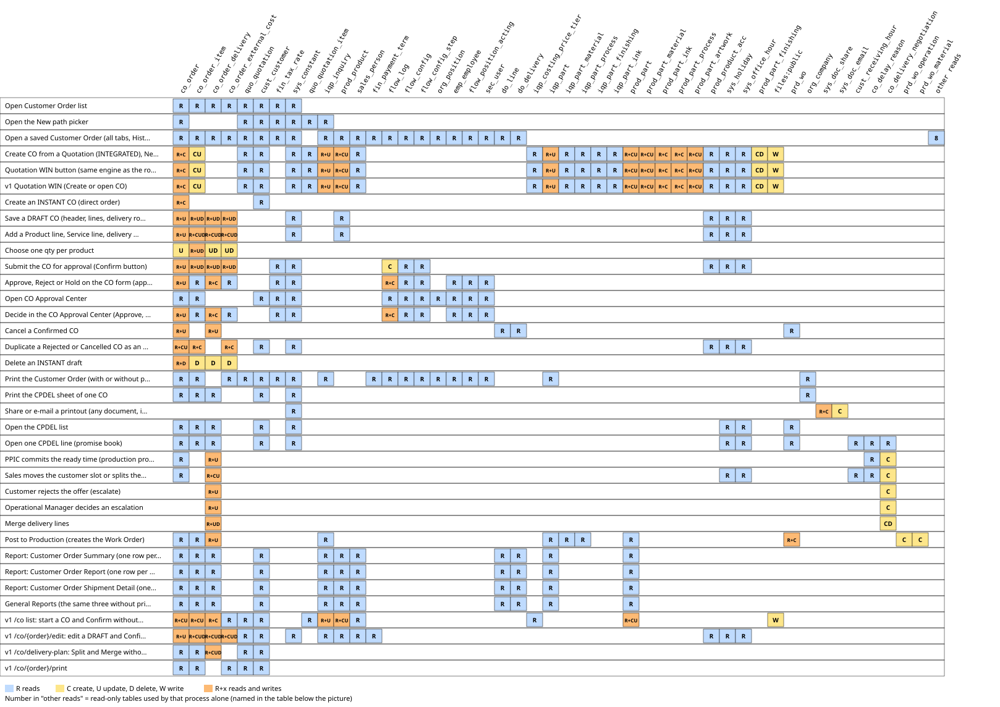
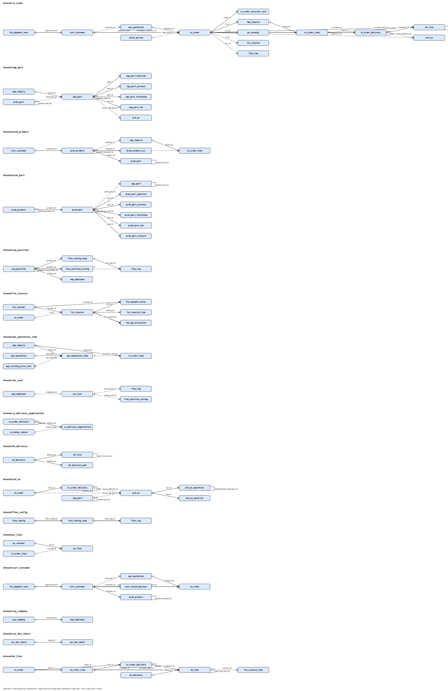

# Sub-module: Order (Customer Order and CPDEL)

> Written 2026-10-16 (group A). This page only summarizes and links; table/column facts are in the cards.

- **Module**: Sales > Order (`SALES_ORDGRP`). Menu (FACT, `sys_app_menu` mockup, active): Customer Order (`v2:customer-order`), Customer Plan Delivery (`v2:cpdel`), CO Approval Center (`v2:approval-co`), Report group (Customer Order Summary, Customer Order Report, Customer Order Shipment Detail), General Report group (the same three reports without prices, `GENERAL_*`). The v1 items `grid_so.php`, `rpt_sales.php`, `grid_monitoring_order.php` are inactive.
- **Purpose**: turn a winning quotation (or a direct order) into an approved Customer Order, then into a delivery schedule (CPDEL) that is the basis for the Work Order and Delivery Order.
- **Frozen zone**: the CO and CPDEL document flow (the rule that freezes all flows). Read: `docs/claude_vital_flows.md` (Quotation and Customer Order sections), `docs/ENGINE-ATTENTION.md` (no items for CO/CPDEL).
- **Rules**: A.1 Quotation must be integrated; A.2 CO may be direct (INSTANT); A.4 1 Quotation = 1 CO; A.10 CO due date; A.11 CO approval; A.13 snapshot; A.15 one qty per product; A.16 Post to Production; A.20 confirmation flags.

## Relations
- **source**: Quotation `PUBLISHED` (Inquiry & Quotation; cards by other authors), Master Product and Customer, product ACC Digital, ProCost tier (tolerance only).
- **used_by**: Delivery (Delivery Order pulls CPDEL schedules that are already Posted), Production (WO from CPDEL lines), Material Planning (CO Confirmed = firm), Customer Invoice, CRM (Customer 360, Complaint).
- **flags**: `co_order.doc_status` and `stat_cancel` (not `stat_confirm`); see the Status card.

## Cards and engines in this sub-module
| Type | File | Content |
|---|---|---|
| Concept | `10_card_customer-order.md` | `co_order`, `co_order_item`, status, due date, tolerance, approval, cancel |
| Concept | `11_card_cpdel.md` | `co_order_delivery`, `co_delivery_negotiation`, split/merge/post |
| Concept | `12_card_document-status.md` | status of all Sales documents, A.20 flags, `doc_state_log` (does not exist) |
| Concept | `13_card_snapshot.md` | map of master freezing in Sales (A.13) |
| ENGINE | `20_engine_co-order-builder.md` | WIN -> CO, direct CO, submit/confirm (CPDEL), cancel |
| ENGINE | `21_engine_cpdel-promise.md` | two promises: customer slot vs ready for production, due-date colors |
| ENGINE | not written yet | `CoDueDate` (covered in the CoOrderBuilder engine card), `FlowEngineService` (approval, owned by the Flow module) |

## Diagram
Not made yet (a text twin is in the "Flow" section of the engine cards).

## Existing User's Guide (UG)
`docs/guides/sales/04_quotation_order_cpdel.md`. The TG does not repeat its content.

## Cross-card findings (summary; details in the cards)
CO2600021 is CONFIRMED and also `stat_cancel=1`, with its schedule still shown in CPDEL; the v1 `confirm` path skips approval; A.10 (PHYSICAL proof) conflicts with the code (ACC Digital); `sales_person_id` is empty in all COs; ESCALATED loses to LATE in the promise engine; merging lines deletes the negotiation log.

## Read/Write map

 Click the picture to open it full size.
Every process of the Order sub-module (Customer Order, CPDEL, CO Approval Center, CO reports) with the tables it reads and writes (C create, U update, D delete), checked in code on 2026-10-18 against the dummy DBs (ddtsdi, ddtmst, ddtsys, ddtprd, ddtpur, ddtacc: all table names exist; no DB triggers in ddtsdi, ddtmst, ddtsys, ddtprd). Stops at the hand-over: `do_*` tables are listed only where an Order screen reads them (they belong to Delivery), and the Work Order tables only where Post to Production writes them (they belong to Manufacture).

| Process | Trigger | Reads | Writes | Evidence |
|---|---|---|---|---|
| Open Customer Order list | Customer Order screen without id, GET v2.screen customer-order | `co_order`, `co_order_item`, `co_order_delivery`, `co_order_external_cost`, `quo_quotation`, `cust_customer`, `fin_tax_rate`, `sys_constant` | - | `routes/v2.php:186-200`, `resources/views/v2/screens/customer-order.blade.php:28-30`, `app/Support/V2/Grid/Sales/CustomerOrderListGrid.php:33`, `app/Support/V2/Data/CustomerOrder.php:40-61`, `app/Models/Sdi/CoOrder.php:193-230` |
| Open the New path picker | Customer Order screen with ?new=1 | `co_order`, `quo_quotation`, `quo_quotation_item`, `iqp_inquiry`, `cust_customer`, `fin_tax_rate`, `sys_constant` | - | `resources/views/v2/screens/customer-order.blade.php:31-55`, `app/Support/V2/Data/CustomerOrder.php:64-79` |
| Open a saved Customer Order (all tabs, History, Billing) | Customer Order screen with ?id=, GET v2.screen customer-order | `co_order`, `cust_customer`, `quo_quotation`, `co_order_item`, `iqp_inquiry`, `prod_product`, `co_order_delivery`, `co_order_external_cost`, `sales_person`, `fin_payment_term`, `fin_tax_rate`, `sys_constant`, `flow_log`, `flow_config`, `flow_config_step`, `org_position`, `emp_employee`, `flow_position_acting`, `sec_user`, `pv_receipt`, `pv_line`, `fin_invoice`, `fin_invoice_line`, `fin_voucher`, `fin_payment_alloc`, `fin_dp_allocation`, `do_line`, `do_delivery`, `do_delivery_pod` | - | `resources/views/v2/screens/customer-order.blade.php:17-20`, `resources/views/v2/screens/customer-order.blade.php:60-86`, `resources/views/v2/screens/customer-order.blade.php:114-120`, `resources/views/v2/screens/customer-order.blade.php:154`, `resources/views/v2/screens/customer-order.blade.php:169`, `app/Support/V2/Data/CustomerOrder.php:195-205`, `app/Support/V2/Data/Concerns/FlowDocument.php:14-24`, `app/Support/V2/Data/Concerns/FlowDocument.php:48-71`, `app/Support/V2/Data/ApprovalSetting.php:45-49`, `app/Support/V2/Data/PurchaseReceive.php:50-60`, `app/Support/V2/Data/CustomerInvoice.php:257-281`, `app/Services/Acc/CustomerInvoiceService.php:617-634`, `app/Services/Acc/CustomerInvoiceService.php:646-693` |
| Create CO from a Quotation (INTEGRATED), New picker | Customer Order New, Create from Quotation, POST v2.co.create mode=INTEGRATED | `quo_quotation`, `quo_quotation_item`, `iqp_inquiry`, `co_order`, `iqp_costing_price_tier`, `sales_person`, `cust_customer`, `iqp_part`, `iqp_part_material`, `iqp_part_process`, `iqp_part_finishing`, `iqp_part_ink`, `prod_product`, `prod_part`, `prod_part_material`, `prod_part_ink`, `prod_part_process`, `prod_part_artwork`, `prod_product_acc`, `sys_constant`, `sys_holiday`, `sys_office_hour` | `co_order` (C), `co_order_item` (CU), `iqp_inquiry` (U), `prod_product` (CU), `prod_part` (CU), `prod_part_finishing` (CD), `prod_part_material` (CU), `prod_part_ink` (C), `prod_part_process` (C), `prod_part_artwork` (CU), `iqp_part` (U), `files:public` | `routes/v2.php:1193-1200`, `app/Support/V2/Data/CustomerOrder.php:81-84`, `app/Services/Sales/CoOrderBuilder.php:27-113`, `app/Services/Sales/CoOrderBuilder.php:117-124`, `app/Services/Sales/CoOrderBuilder.php:289-298`, `app/Models/Sdi/CoOrder.php:150-162`, `app/Models/Sdi/CoOrderItem.php:56-76`, `app/Models/Sdi/CoOrderItem.php:107-111`, `app/Services/Sales/CoDueDate.php:30-35`, `app/Services/Sales/ProductMasterSync.php:22-59`, `app/Services/Sales/ProductMasterSync.php:61-101`, `app/Services/Sales/ProductMasterSync.php:111-177`, `app/Models/Sdi/IqpInquiry.php:132-152` |
| Quotation WIN button (same engine as the row above) | Quotation form, WIN, POST v2.quotation.win | `quo_quotation`, `quo_quotation_item`, `iqp_inquiry`, `co_order`, `iqp_costing_price_tier`, `sales_person`, `cust_customer`, `iqp_part`, `iqp_part_material`, `iqp_part_process`, `iqp_part_finishing`, `iqp_part_ink`, `prod_product`, `prod_part`, `prod_part_material`, `prod_part_ink`, `prod_part_process`, `prod_part_artwork`, `prod_product_acc`, `sys_constant`, `sys_holiday`, `sys_office_hour` | `co_order` (C), `co_order_item` (CU), `iqp_inquiry` (U), `prod_product` (CU), `prod_part` (CU), `prod_part_finishing` (CD), `prod_part_material` (CU), `prod_part_ink` (C), `prod_part_process` (C), `prod_part_artwork` (CU), `iqp_part` (U), `files:public` | `routes/v2.php:586-591`, `app/Support/V2/Data/Quotation.php:280-285`, `app/Services/Sales/CoOrderBuilder.php:27-113` |
| v1 Quotation WIN (Create or open CO) | Old page /quotation/{quotation}/edit (pages::quotation.entry), Create or open CO | `quo_quotation`, `quo_quotation_item`, `iqp_inquiry`, `co_order`, `iqp_costing_price_tier`, `sales_person`, `cust_customer`, `iqp_part`, `iqp_part_material`, `iqp_part_process`, `iqp_part_finishing`, `iqp_part_ink`, `prod_product`, `prod_part`, `prod_part_material`, `prod_part_ink`, `prod_part_process`, `prod_part_artwork`, `prod_product_acc`, `sys_constant`, `sys_holiday`, `sys_office_hour` | `co_order` (C), `co_order_item` (CU), `iqp_inquiry` (U), `prod_product` (CU), `prod_part` (CU), `prod_part_finishing` (CD), `prod_part_material` (CU), `prod_part_ink` (C), `prod_part_process` (C), `prod_part_artwork` (CU), `iqp_part` (U), `files:public` | `routes/web.php:156`, `resources/views/pages/quotation/entry.blade.php:506-519`, `app/Services/Sales/CoOrderBuilder.php:27-113` |
| Create an INSTANT CO (direct order) | Customer Order New, Create Instant, POST v2.co.create mode=INSTANT | `cust_customer`, `co_order` | `co_order` (C) | `routes/v2.php:1193-1200`, `app/Support/V2/Data/CustomerOrder.php:86-90`, `app/Services/Sales/CoOrderBuilder.php:130-149`, `app/Models/Sdi/CoOrder.php:150-162` |
| Save a DRAFT CO (header, lines, delivery rows, external costs, ship-to) | Customer Order form, Save, POST v2.co.save action=save | `co_order`, `co_order_item`, `co_order_delivery`, `co_order_external_cost`, `prod_product`, `prod_product_acc`, `sys_constant`, `sys_holiday`, `sys_office_hour` | `co_order` (U), `co_order_item` (UD), `co_order_delivery` (UD), `co_order_external_cost` (UD) | `routes/v2.php:1224-1226`, `routes/v2.php:1256`, `app/Support/V2/Data/CustomerOrder.php:92-150`, `app/Support/V2/Data/CustomerOrder.php:282-300`, `resources/views/pages/co/entry.blade.php:96-111`, `resources/views/pages/co/entry.blade.php:113-127`, `resources/views/pages/co/entry.blade.php:210-241`, `resources/views/pages/co/entry.blade.php:243-253`, `resources/views/pages/co/entry.blade.php:255-307`, `resources/views/pages/co/entry.blade.php:329-354`, `resources/views/pages/co/entry.blade.php:375-400`, `app/Models/Sdi/CoOrderItem.php:56-76` |
| Add a Product line, Service line, delivery schedule row or external cost | Customer Order form, + buttons, POST v2.co.save action=add_product, add_service, add_delivery_N or add_cost (Save runs first) | `co_order`, `co_order_item`, `co_order_delivery`, `co_order_external_cost`, `prod_product`, `prod_product_acc`, `sys_constant`, `sys_holiday`, `sys_office_hour` | `co_order` (U), `co_order_item` (CUD), `co_order_delivery` (CUD), `co_order_external_cost` (CUD) | `routes/v2.php:1229-1243`, `app/Support/V2/Data/CustomerOrder.php:152-158`, `app/Support/V2/Data/CustomerOrder.php:174-187`, `resources/views/pages/co/entry.blade.php:133-157`, `resources/views/pages/co/entry.blade.php:210-241`, `resources/views/pages/co/entry.blade.php:309-327`, `resources/views/pages/co/entry.blade.php:356-373`, `app/Services/Sales/CoOrderBuilder.php:154-181` |
| Choose one qty per product | Customer Order form, Choose, POST v2.co.save action=pick_qty_N (Save runs first) | `co_order_item` | `co_order` (U), `co_order_item` (UD), `co_order_delivery` (UD), `co_order_external_cost` (UD) | `routes/v2.php:1244-1247`, `app/Support/V2/Data/CustomerOrder.php:161-172`, `app/Models/Sdi/CoOrder.php:121-125` |
| Submit the CO for approval (Confirm button) | Customer Order form, Confirm, POST v2.co.save action=confirm (Save runs first) | `co_order`, `co_order_item`, `co_order_delivery`, `co_order_external_cost`, `prod_product_acc`, `sys_constant`, `sys_holiday`, `sys_office_hour`, `fin_tax_rate`, `flow_config`, `flow_config_step` | `co_order` (U), `co_order_item` (UD), `co_order_delivery` (UD), `co_order_external_cost` (UD), `flow_log` (C) | `routes/v2.php:1248-1254`, `app/Support/V2/Data/CustomerOrder.php:190-193`, `app/Services/Sales/CoOrderBuilder.php:190-215`, `app/Services/Sales/CoDueDate.php:43-49`, `app/Models/Sdi/CoOrder.php:121-132`, `app/Services/Flow/FlowEngineService.php:23-96`, `app/Services/Flow/FlowEngineService.php:112-122` |
| Approve, Reject or Hold on the CO form (approver) | Customer Order form, Approval buttons, POST v2.co.save action=approve, reject or hold | `co_order`, `co_order_item`, `co_order_delivery`, `co_order_external_cost`, `fin_tax_rate`, `sys_constant`, `flow_log`, `flow_config`, `flow_config_step`, `flow_position_acting`, `emp_employee`, `sec_user` | `flow_log` (C), `co_order` (U), `co_order_delivery` (C) | `routes/v2.php:1209-1213`, `app/Support/V2/Data/CustomerOrder.php:195-198`, `app/Support/V2/Data/CustomerOrder.php:207-234`, `app/Services/Flow/FlowEngineService.php:138-168`, `app/Services/Flow/FlowEngineService.php:174-251`, `app/Services/Flow/FlowEngineService.php:255-285`, `app/Services/Flow/FlowEngineService.php:291-321`, `app/Services/Sales/CoOrderBuilder.php:217-250` |
| Open CO Approval Center | Menu CO Approval Center, GET v2.screen approval-co | `flow_log`, `flow_position_acting`, `emp_employee`, `sec_user`, `flow_config`, `flow_config_step`, `org_position`, `co_order`, `co_order_item`, `cust_customer`, `fin_tax_rate`, `sys_constant` | - | `resources/views/v2/screens/approval-co.blade.php:10`, `resources/views/v2/partials/approval-center.blade.php:18-21`, `app/Support/V2/Data/ApprovalCenter.php:62-72`, `app/Support/V2/Data/ApprovalCenter.php:160-177`, `app/Support/V2/Data/ApprovalCenter.php:182-186`, `app/Support/V2/Data/ApprovalCenter.php:248-270`, `app/Services/Flow/FlowEngineService.php:138-168` |
| Decide in the CO Approval Center (Approve, Reject, Hold) | CO Approval Center, POST v2.approval.decide screen=co | `co_order`, `co_order_item`, `co_order_delivery`, `co_order_external_cost`, `fin_tax_rate`, `sys_constant`, `flow_log`, `flow_config`, `flow_config_step`, `flow_position_acting`, `emp_employee`, `sec_user` | `flow_log` (C), `co_order` (U), `co_order_delivery` (C) | `routes/v2.php:1267-1276`, `app/Support/V2/Data/ApprovalCenter.php:195-210`, `app/Support/V2/Data/CustomerOrder.php:207-234`, `app/Services/Sales/CoOrderBuilder.php:217-250` |
| Cancel a Confirmed CO | Customer Order form, Cancel, POST v2.co.save action=cancel | `co_order`, `co_order_delivery`, `prd_wo`, `do_line`, `do_delivery` | `co_order` (U), `co_order_delivery` (U) | `routes/v2.php:1219-1223`, `app/Support/V2/Data/CustomerOrder.php:265-268`, `app/Services/Sales/CoOrderBuilder.php:253-287` |
| Duplicate a Rejected or Cancelled CO as an INSTANT draft | Customer Order form, Duplicate, POST v2.co.save action=duplicate | `co_order`, `co_order_item`, `co_order_external_cost`, `cust_customer`, `prod_product_acc`, `sys_constant`, `sys_holiday`, `sys_office_hour` | `co_order` (CU), `co_order_item` (C), `co_order_external_cost` (C) | `routes/v2.php:1214-1218`, `app/Support/V2/Data/CustomerOrder.php:238-256`, `app/Services/Sales/CoOrderBuilder.php:130-149`, `app/Models/Sdi/CoOrderItem.php:56-76` |
| Delete an INSTANT draft | Customer Order form, Delete, POST v2.co.save action=delete or POST v2.co.delete | `co_order` | `co_order_delivery` (D), `co_order_external_cost` (D), `co_order_item` (D), `co_order` (D) | `routes/v2.php:1204-1208`, `routes/v2.php:1258-1263`, `app/Support/V2/Data/CustomerOrder.php:271-280` |
| Print the Customer Order (with or without prices) | Customer Order form, Print, GET v2.print type=customer-order (?prices=0) | `co_order`, `cust_customer`, `quo_quotation`, `fin_payment_term`, `co_order_external_cost`, `co_order_item`, `iqp_inquiry`, `iqp_part`, `fin_tax_rate`, `sys_constant`, `flow_log`, `flow_config`, `flow_config_step`, `org_position`, `emp_employee`, `flow_position_acting`, `sec_user`, `org_company` | - | `routes/v2.php:204-213`, `app/Support/V2/Print/PrintDocs.php:27`, `app/Support/V2/Print/PrintDocs.php:106-124`, `app/Support/V2/Print/PrintDocs.php:146-157`, `app/Support/V2/Print/CustomerOrderPrint.php:51-74` |
| Print the CPDEL sheet of one CO | Customer Plan Delivery form, Print, GET v2.print type=cpdel | `co_order`, `cust_customer`, `co_order_delivery`, `co_order_item`, `org_company`, `sys_constant` | - | `routes/v2.php:204-213`, `app/Support/V2/Print/PrintDocs.php:28`, `app/Support/V2/Print/CpdelPrint.php:53-70` |
| Share or e-mail a printout (any document, including CO and CPDEL) | Print and Email dialog, POST v2.docshare.store then POST v2.docshare.email | `sys_doc_share`, `sys_constant` | `sys_doc_share` (C), `sys_doc_email` (C) | `routes/v2.php:1908-1936`, `app/Services/Docs/DocShareService.php:23-36`, `app/Services/Docs/DocShareService.php:38-59` |
| Open the CPDEL list | Menu Customer Plan Delivery, GET v2.screen cpdel | `co_order_delivery`, `co_order`, `co_order_item`, `cust_customer`, `prd_wo`, `sys_constant`, `sys_holiday`, `sys_office_hour` | - | `resources/views/v2/screens/cpdel.blade.php:23-27`, `app/Support/V2/Grid/Sales/CpdelListGrid.php:34`, `app/Support/V2/Data/Cpdel.php:40-74`, `app/Services/Sales/CpdelPromiseService.php:38-76`, `app/Support/WorkCalendar.php:17-23` |
| Open one CPDEL line (promise book) | CPDEL list, open a row, GET v2.screen cpdel with ?id= | `co_order_delivery`, `co_order`, `co_order_item`, `cust_customer`, `cust_receiving_hour`, `prd_wo`, `co_delay_reason`, `co_delivery_negotiation`, `sys_office_hour`, `sys_holiday`, `sys_constant` | - | `resources/views/v2/screens/cpdel.blade.php:15-17`, `resources/views/v2/screens/cpdel.blade.php:28-31`, `app/Support/V2/Data/Cpdel.php:153-219`, `app/Services/Sales/CpdelPromiseService.php:100-128`, `app/Services/Sales/DeliveryPromiseService.php:56-62`, `app/Models/Master/SysHoliday.php:32-35` |
| PPIC commits the ready time (production promise) | CPDEL line, PPIC block, POST v2.cpdel.ready | `co_order_delivery`, `co_order`, `co_delay_reason` | `co_order_delivery` (U), `co_delivery_negotiation` (C) | `routes/v2.php:1757-1762`, `app/Services/Sales/CpdelPromiseService.php:131-146`, `app/Services/Sales/CpdelPromiseService.php:242-253` |
| Sales moves the customer slot or splits the shipment | CPDEL line, Sales block, POST v2.cpdel.reschedule | `co_order_delivery`, `co_order`, `co_delay_reason`, `sys_office_hour`, `sys_holiday`, `cust_receiving_hour` | `co_order_delivery` (CU), `co_delivery_negotiation` (C) | `routes/v2.php:1763-1768`, `app/Services/Sales/CpdelPromiseService.php:149-200`, `app/Support/V2/Data/Cpdel.php:113-125`, `resources/views/pages/co/delivery-plan.blade.php:111-154` |
| Customer rejects the offer (escalate) | CPDEL line, Customer refuses, POST v2.cpdel.reject | `co_order_delivery` | `co_order_delivery` (U), `co_delivery_negotiation` (C) | `routes/v2.php:1769-1774`, `app/Services/Sales/CpdelPromiseService.php:203-212` |
| Operational Manager decides an escalation | CPDEL line, Decision block, POST v2.cpdel.decide | `co_order_delivery` | `co_order_delivery` (U), `co_delivery_negotiation` (C) | `routes/v2.php:1775-1780`, `app/Services/Sales/CpdelPromiseService.php:215-224` |
| Merge delivery lines | CPDEL line, Join lines, POST v2.cpdel.merge | `co_order_delivery` | `co_order_delivery` (UD), `co_delivery_negotiation` (CD) | `routes/v2.php:1781-1788`, `app/Support/V2/Data/Cpdel.php:127-137`, `app/Services/Sales/CpdelPromiseService.php:226-240`, `resources/views/pages/co/delivery-plan.blade.php:175-207` |
| Post to Production (creates the Work Order) | CPDEL line, Post to Production, POST v2.cpdel.post | `co_order_delivery`, `co_order`, `co_order_item`, `prd_wo`, `iqp_inquiry`, `iqp_part`, `iqp_part_process`, `iqp_part_material`, `prod_part` | `prd_wo` (C), `prd_wo_operation` (C), `prd_wo_material` (C), `co_order_delivery` (U) | `routes/v2.php:1790-1795`, `app/Support/V2/Data/Cpdel.php:78-103`, `app/Services/Scheduling/WoGenerationService.php:55-80`, `app/Services/Scheduling/WoGenerationService.php:86-100`, `app/Services/Scheduling/WoGenerationService.php:104-148`, `app/Services/Scheduling/WoGenerationService.php:336-362`, `app/Services/Scheduling/WoGenerationService.php:378-399`, `app/Services/Scheduling/Plan/PlanEvents.php:17-28` |
| Report: Customer Order Summary (one row per CO) | Menu Report, Customer Order Summary, GET v2.screen co-rpt-summary | `co_order`, `cust_customer`, `sales_person`, `co_order_item`, `prod_product`, `do_line`, `do_delivery`, `co_order_delivery`, `iqp_inquiry`, `iqp_part`, `prod_part` | - | `app/Support/V2/Grid/Grids.php:74`, `app/Support/V2/Grid/Sales/CoSummaryReport.php:32-46`, `app/Support/V2/Grid/Sales/CoReportGrid.php:66-69`, `app/Support/V2/Grid/Sales/CoReportGrid.php:118-147`, `app/Support/V2/Grid/DbGrid.php:359-370` |
| Report: Customer Order Report (one row per CO item) | Menu Report, Customer Order Report, GET v2.screen co-rpt-order | `co_order_item`, `co_order`, `cust_customer`, `sales_person`, `prod_product`, `co_order_delivery`, `do_line`, `do_delivery`, `iqp_inquiry`, `iqp_part`, `prod_part` | - | `app/Support/V2/Grid/Grids.php:75`, `app/Support/V2/Grid/Sales/CoReportGrid.php:98-115`, `app/Support/V2/Grid/Sales/CoReportGrid.php:134-147`, `app/Support/V2/Grid/DbGrid.php:359-370` |
| Report: Customer Order Shipment Detail (one row per schedule) | Menu Report, Customer Order Shipment Detail, GET v2.screen co-rpt-ship-det | `co_order_delivery`, `co_order_item`, `co_order`, `cust_customer`, `sales_person`, `prod_product`, `do_line`, `do_delivery`, `iqp_inquiry`, `iqp_part`, `prod_part` | - | `app/Support/V2/Grid/Grids.php:76`, `app/Support/V2/Grid/Sales/CoShipDetailReport.php:22-33`, `app/Support/V2/Grid/Sales/CoReportGrid.php:105-115`, `app/Support/V2/Grid/DbGrid.php:359-370` |
| General Reports (the same three without prices, open to all users) | Menu General Report, GET v2.screen gen-co-rpt-summary, gen-co-rpt-order, gen-co-rpt-ship-det | `co_order`, `co_order_item`, `co_order_delivery`, `cust_customer`, `sales_person`, `prod_product`, `do_line`, `do_delivery`, `iqp_inquiry`, `iqp_part`, `prod_part` | - | `app/Support/V2/Grid/Grids.php:77-79`, `app/Support/V2/Grid/Sales/GeneralCoReport.php:12-42`, `app/Support/V2/Grid/Sales/GeneralCoOrderReport.php:8` |
| v1 /co list: start a CO and Confirm without approval | Old page /co (pages::co.list), Start INTEGRATED, Start INSTANT, Confirm icon | `co_order`, `co_order_item`, `co_order_delivery`, `co_order_external_cost`, `quo_quotation`, `quo_quotation_item`, `iqp_inquiry`, `iqp_costing_price_tier`, `sales_person`, `cust_customer`, `prod_product`, `prod_part` | `co_order` (CU), `co_order_item` (CU), `iqp_inquiry` (U), `prod_product` (CU), `prod_part` (CU), `co_order_delivery` (C), `files:public` | `routes/web.php:159`, `resources/views/pages/co/list.blade.php:146-163`, `resources/views/pages/co/list.blade.php:174-184`, `app/Services/Sales/CoOrderBuilder.php:217-250` |
| v1 /co/{order}/edit: edit a DRAFT and Confirm without approval | Old page /co/{order}/edit (pages::co.entry), field edits, Confirm | `co_order`, `cust_customer`, `sales_person`, `quo_quotation`, `co_order_item`, `iqp_inquiry`, `co_order_delivery`, `co_order_external_cost`, `prod_product`, `fin_payment_term`, `prod_product_acc`, `sys_constant`, `sys_holiday`, `sys_office_hour` | `co_order` (U), `co_order_item` (CUD), `co_order_delivery` (CUD), `co_order_external_cost` (CUD) | `routes/web.php:160`, `resources/views/pages/co/entry.blade.php:96-127`, `resources/views/pages/co/entry.blade.php:133-157`, `resources/views/pages/co/entry.blade.php:210-400`, `resources/views/pages/co/entry.blade.php:412-416`, `app/Services/Sales/CoOrderBuilder.php:217-250` |
| v1 /co/delivery-plan: Split and Merge without the CPDEL promise rules | Old page /co/delivery-plan (pages::co.delivery-plan), Split, Merge | `co_order_delivery`, `co_order`, `co_order_item`, `quo_quotation`, `cust_customer` | `co_order_delivery` (CUD) | `routes/web.php:162`, `resources/views/pages/co/delivery-plan.blade.php:45-61`, `resources/views/pages/co/delivery-plan.blade.php:111-154`, `resources/views/pages/co/delivery-plan.blade.php:175-207` |
| v1 /co/{order}/print | Old page /co/{order}/print (pages::co.print) | `co_order`, `co_order_item`, `quo_quotation`, `cust_customer`, `co_order_external_cost` | - | `routes/web.php:161`, `resources/views/pages/co/print.blade.php:18-36` |

Notes for debugging
- Save is not atomic. `CustomerOrder::save` calls the v1 component one field at a time (only fields whose value differs from the database), every call is its own autocommit statement and returns silently when the CO is not DRAFT (`app/Support/V2/Data/CustomerOrder.php:92-150`, `resources/views/pages/co/entry.blade.php:115-117`), so a failure in the middle keeps the earlier fields. Save runs BEFORE add, Choose qty and Confirm in the same POST (`routes/v2.php:1226`, `routes/v2.php:1229-1254`): edits are stored even when Confirm is then refused. The remove tick deletes only lines without `quotation_item_id` (`resources/views/pages/co/entry.blade.php:251`): ticking a Quotation line does nothing and shows no message; those lines leave only through Choose qty (`app/Support/V2/Data/CustomerOrder.php:161-172`). Deleting an item cascades its delivery rows, while `do_line` points to the CO, item and delivery with RESTRICT (read from information_schema), so a CO with a DO line cannot lose them.
- Due date and Confirm: the `CoOrderItem` saving hook runs on every Eloquent save of a PRODUCT line with a product and may rewrite `due_date` and `due_source` unless the line is MANUAL (`app/Models/Sdi/CoOrderItem.php:56-76`); the bulk update that fills `product_id` at WIN bypasses it (`app/Services/Sales/CoOrderBuilder.php:108`). `submit` first re-saves all ACC lines (`app/Services/Sales/CoDueDate.php:43-49`), before the checks and outside any transaction (`app/Services/Sales/CoOrderBuilder.php:193-196`), so a refused Confirm can still have changed due dates. The tolerance lookup takes the first `iqp_costing_price_tier` row with the line's `tier_id` and has no ORDER BY (`app/Services/Sales/CoOrderBuilder.php:68-70`); today 25 rows carry 16 distinct tier ids, so the id is not unique (query today).
- Approval spans two databases. The tm2sdi transaction around submit and decide does not cover `flow_log` (tm2mst, autocommit): when the tm2sdi part throws, the `flow_log` rows stay (`app/Support/V2/Data/CustomerOrder.php:219-232`, `app/Services/Sales/CoOrderBuilder.php:209-212`). FROM CODE, not run: `FlowEngineService::submit` returns null without error when no step matches (`app/Services/Flow/FlowEngineService.php:42-44`) and `CoOrderBuilder::submit` ignores the return, leaving a SUBMITTED CO with no `flow_log` row and in nobody's queue; the same for the last approval, which ignores the false that `confirm` returns when `isConfirmable` fails (`app/Services/Sales/CoOrderBuilder.php:222-224`): `flow_log` says approved, the CO stays SUBMITTED and no `co_order_delivery` rows exist. The queue is the latest `flow_log` row per document with action SUBMITTED or HOLD at the user's position (`app/Services/Flow/FlowEngineService.php:155-167`). Reject writes `cancel_reason` and doc_status REJECTED, not `stat_cancel`. Mockup today: flow CO has 2 APPROVAL steps (amount from 0, no upper limit); 11 CONFIRMED COs have no APPROVED row and 17 distinct `doc_id` in `flow_log` CO match no `co_order` (seeders and the v1 path write status directly).
- WIN spans two databases. The tm2sdi transaction (`app/Services/Sales/CoOrderBuilder.php:42-112`) encloses `ProductMasterSync`, which commits its own tm2mst transaction and copies artwork files to the public disk (`app/Services/Sales/ProductMasterSync.php:27`, `app/Services/Sales/ProductMasterSync.php:169-170`). If a later step throws, the CO, items and inquiry update roll back but the master rows and copied files stay. FROM CODE, not run: for an inquiry that still has no `product_id`, `ensureDraftProduct` creates product code DRAFT-<inquiry id> in tm2mst before that transaction (`app/Models/Sdi/IqpInquiry.php:139-149`), its `iqp_inquiry` update rolls back, and a second WIN would hit the unique index uq_product_code on the product code. `nextCoNo` takes `lockForUpdate` (`app/Models/Sdi/CoOrder.php:150-162`), which only helps inside a transaction: WIN has one, `createInstant` has none (`app/Services/Sales/CoOrderBuilder.php:130-149`), so two parallel INSTANT creations can hit the unique `co_no`.
- Cancel and CPDEL: Cancel needs CONFIRMED and no live WO or DO line, then writes `co_order` and every schedule row in one transaction (`app/Services/Sales/CoOrderBuilder.php:253-287`); it does not touch `quo_quotation`, `iqp_inquiry` or `prod_product`. CO2600021 is CONFIRMED with `stat_cancel=1` in ddtsdi today, so another writer made it; CPDEL still lists it (`app/Support/V2/Data/Cpdel.php:42`) while the reports show CANCELLED (`app/Support/V2/Grid/Sales/CoReportGrid.php:149-152`). All CPDEL promise actions run in a tm2sdi transaction, and a split error from the v1 component is turned into an exception inside it so `original_date` rolls back too (`app/Services/Sales/CpdelPromiseService.php:173-199`), but Merge has no transaction: winner updated, other rows deleted (their negotiation log cascades), the MERGED log written afterwards (`app/Services/Sales/CpdelPromiseService.php:226-240`). The posted lock on date and qty exists only in the v2 wrappers (`app/Support/V2/Data/Cpdel.php:115-117`, `app/Support/V2/Data/Cpdel.php:129-131`); the v1 /co/delivery-plan page has no lock and writes no `co_delivery_negotiation`.
- Post to Production writes in this order: WO in tm2prd (own transaction), then `posted_at` in tm2sdi, then the re-plan, whose errors are only logged (`app/Support/V2/Data/Cpdel.php:91-100`, `app/Services/Scheduling/Plan/PlanEvents.php:17-28`). If the line update fails after the WO exists, a retry sees the live WO and only marks the line (`app/Support/V2/Data/Cpdel.php:90-97`). Lists and reports are capped: CO list 500 rows, CPDEL list 1000 (`app/Support/V2/Data/CustomerOrder.php:42`, `app/Support/V2/Data/Cpdel.php:49`), reports 5000 (`app/Support/V2/Grid/DbGrid.php:38`), and the General reports keep only CONFIRMED and CLOSED rows after that cap (`app/Support/V2/Grid/Sales/GeneralCoReport.php:39-42`). Price columns are removed on the server only in the reports and the print (`app/Support/V2/Grid/DbGrid.php:427-428`, `app/Support/V2/Print/CustomerOrderPrint.php:55`); `canViewSalesPrice` is not called in `CustomerOrder.php` or `ApprovalCenter.php` (grep).
- Not checked or not in this map: the Work Order scheduling written inside Post to Production beyond `prd_wo`, `prd_wo_operation` and `prd_wo_material` (the backward scheduler and the AutoPlanRunner re-plan tables); the product picker and Ship-to area picker lookups (the picker reads the geo view v_geo_full_address, a view, not drawn); the Billing and Customer Material tabs are listed from the calls seen, not traced table by table; screen chrome (menu, QC bar, dictionary) and access checks (`canAccessModule`, `accessibleModules`) are not mapped; the grid Print report route for these grids was not traced; the writers of `sys_doc_share.doc_type` and `doc_id` for CO were not seen; `ensureShareToken` and `revokeShareToken` in `app/Models/Sdi/CoOrder.php:169-185` have no caller in app, routes or resources (grep), so `co_order.share_token` is not written by any screen; seeders, migrations and console commands that write `co_order*` directly (for example the dummy builders) are not mapped; `DispatchService::markShipped` sets `co_order_delivery.status` to SHIPPED but belongs to Delivery.

## Table relations

Relations of the tables this sub-module uses. Solid line = real foreign key (verified in `information_schema`, mockup databases ddtsdi, ddtmst, ddtsys, ddtprd, ddtpur, ddtacc). Dashed line = logical link without foreign key (cross-database or matched in code). `flow_log.doc_id` is shared by all documents and only means a CO when `module_code` is CO. `quo_quotation_item.tier_id` really points to `iqp_tier` (outside this map); the code reads `iqp_costing_price_tier` on that id, so it is drawn N:M.

 Click the picture to open it full size.

| Parent | Child | Cardinality | Column | Link |
|---|---|---|---|---|
| `quo_quotation` | `co_order` | 1:1 | `quotation_id` | FK |
| `co_order` | `co_order_item` | 1:N | `order_id` | FK |
| `co_order` | `co_order_delivery` | 1:N | `order_id` | FK |
| `co_order` | `co_order_external_cost` | 1:N | `order_id` | FK |
| `co_order_item` | `co_order_delivery` | 1:N | `item_id` | FK |
| `co_order_delivery` | `co_order_delivery` | 1:N | `split_from_id` | FK |
| `co_order_delivery` | `co_delivery_negotiation` | 1:N | `delivery_id` | FK |
| `iqp_inquiry` | `co_order_item` | 1:N | `inquiry_id` | FK |
| `co_order` | `iqp_inquiry` | 1:N | `co_id` | FK |
| `quo_quotation` | `quo_quotation_item` | 1:N | `quotation_id` | FK |
| `iqp_inquiry` | `quo_quotation_item` | 1:N | `inquiry_id` | FK |
| `iqp_inquiry` | `iqp_part` | 1:N | `inquiry_id` | FK |
| `iqp_part` | `iqp_part` | 1:N | `parent_part_id` | FK |
| `iqp_part` | `iqp_part_material` | 1:N | `part_id` | FK |
| `iqp_part` | `iqp_part_process` | 1:N | `part_id` | FK |
| `iqp_part` | `iqp_part_finishing` | 1:N | `part_id` | FK |
| `iqp_part` | `iqp_part_ink` | 1:N | `part_id` | FK |
| `co_order` | `do_line` | 1:N | `co_order_id` | FK |
| `co_order_item` | `do_line` | 1:N | `co_order_item_id` | FK |
| `co_order_delivery` | `do_line` | 1:N | `co_delivery_id` | FK |
| `do_delivery` | `do_line` | 1:N | `delivery_id` | FK |
| `do_line` | `do_line` | 1:N | `split_from_line_id` | FK |
| `do_delivery` | `do_delivery_pod` | 1:N | `delivery_id` | FK |
| `prd_wo` | `prd_wo_operation` | 1:N | `wo_id` | FK |
| `prd_wo` | `prd_wo_material` | 1:N | `wo_id` | FK |
| `prd_wo_operation` | `prd_wo_operation` | 1:N | `batched_with_operation_id` | FK |
| `cust_customer` | `cust_receiving_hour` | 1:N | `customer_id` | FK |
| `cust_customer` | `prod_product` | 1:N | `customer_id` | FK |
| `fin_payment_term` | `cust_customer` | 1:N | `payment_term` | FK |
| `prod_product` | `prod_product` | 1:N | `parent_product_id` | FK |
| `prod_product` | `prod_product_acc` | 1:N | `product_id` | FK |
| `prod_product` | `prod_part` | 1:N | `product_id` | FK |
| `prod_part` | `prod_part` | 1:N | `parent_part_id` | FK |
| `prod_part` | `prod_part_material` | 1:N | `part_id` | FK |
| `prod_part` | `prod_part_process` | 1:N | `part_id` | FK |
| `prod_part` | `prod_part_finishing` | 1:N | `part_id` | FK |
| `prod_part` | `prod_part_ink` | 1:N | `part_id` | FK |
| `prod_part` | `prod_part_artwork` | 1:N | `part_id` | FK |
| `flow_config` | `flow_config_step` | 1:N | `flow_config_id` | FK |
| `flow_config` | `flow_log` | 1:N | `flow_config_id` | FK |
| `flow_config_step` | `flow_log` | 1:N | `flow_step_id` | FK |
| `org_position` | `flow_config_step` | 1:N | `position_id` | FK |
| `org_position` | `flow_position_acting` | 1:N | `position_id` | FK |
| `org_position` | `emp_employee` | 1:N | `position_id` | FK |
| `org_position` | `org_position` | 1:N | `reports_to_position_id` | FK |
| `org_company` | `emp_employee` | 1:N | `company_id` | FK |
| `pv_receipt` | `pv_line` | 1:N | `pv_id` | FK |
| `fin_invoice` | `fin_invoice_line` | 1:N | `invoice_id` | FK |
| `fin_invoice` | `fin_payment_alloc` | 1:N | `invoice_id` | FK |
| `fin_invoice` | `fin_dp_allocation` | 1:N | `dp_invoice_id` | FK |
| `fin_invoice` | `fin_dp_allocation` | 1:N | `final_invoice_id` | FK |
| `fin_voucher` | `fin_invoice` | 1:N | `voucher_id` | FK |
| `fin_voucher` | `fin_payment_alloc` | 1:N | `voucher_id` | FK |
| `sys_doc_share` | `sys_doc_email` | 1:N | `share_id` | FK |
| `cust_customer` | `co_order` | 1:N | `customer_id` | logical |
| `sales_person` | `co_order` | 1:N | `sales_person_id` | logical |
| `fin_payment_term` | `co_order` | 1:N | `payment_term` | logical |
| `cust_customer` | `co_order` | 1:N | `recipient_customer_id` | logical |
| `cust_customer` | `co_order` | 1:N | `shipper_customer_id` | logical |
| `cust_customer` | `co_order` | 1:N | `forwarder_customer_id` | logical |
| `cust_customer` | `quo_quotation` | 1:N | `customer_id` | logical |
| `prod_product` | `co_order_item` | 1:N | `product_id` | logical |
| `quo_quotation_item` | `co_order_item` | 1:N | `quotation_item_id` | logical |
| `iqp_costing_price_tier` | `quo_quotation_item` | N:M | `tier_id` | logical |
| `prod_product` | `iqp_inquiry` | 1:N | `product_id` | logical |
| `prod_part` | `iqp_part` | 1:N | `prod_part_id` | logical |
| `co_delay_reason` | `co_delivery_negotiation` | 1:N | `reason_code` | logical |
| `co_order` | `prd_wo` | 1:N | `source_co_id` | logical |
| `co_order_delivery` | `prd_wo` | 1:N | `source_delivery_id` | logical |
| `iqp_part` | `prd_wo` | 1:N | `source_iqp_part_id` | logical |
| `co_order` | `pv_receipt` | 1:N | `i_co_id` | logical |
| `co_order_item` | `pv_line` | 1:N | `i_co_line_id` | logical |
| `co_order` | `fin_invoice` | 1:N | `co_id` | logical |
| `do_line` | `fin_invoice_line` | 1:N | `do_line_id` | logical |
| `co_order` | `flow_log` | 1:N | `doc_id` | logical |
| `org_position` | `flow_log` | 1:N | `actor_position_id` | logical |
| `sec_user` | `flow_log` | 1:N | `actual_user_id` | logical |
| `sec_user` | `flow_position_acting` | 1:N | `acting_user_id` | logical |
| `emp_employee` | `sec_user` | 1:1 | `employee_id` | logical |

- Re-checked 2026-10-18 after the `routes/web.php` edit (v1 `/self-service` route replaced by a redirect to `v2.profile`, rule D.25); the block keeps its 4 lines so every cited line number is unchanged, content still true.

- Re-checked 2026-10-18 after the duplicate-module cleanup (v1 Scheduling Board, Rule Library and Master Crew removed): `Grids.php` line numbers moved up by 1 (one class line removed above) and corrected (75, 76, 77, 78-80); the `routes/web.php` lines cited here (156-162) are before the removed routes and unchanged.

- Re-checked 2026-10-18 after the `routes/web.php` edit (v1 `/finance/coa` route replaced by a one-line redirect to `/v2/s/acc-coa`, rule D.25); the block keeps its line count so every cited line number is unchanged, content still true.
- Re-checked 2026-10-18 after the `routes/web.php` edit (v1 `/finance/journals` route replaced by a one-line redirect to `/v2/s/acc-journal`, rule D.25); the block keeps its line count so every cited line number is unchanged, content still true.
- Re-checked 2026-10-18 after the `routes/web.php` edit (v1 `/finance/cash-bank` route replaced by a one-line redirect to `/v2/s/acc-cash-bank`, rule D.25); the block keeps its line count so every cited line number is unchanged, content still true.
- Re-checked 2026-10-18 after the `routes/web.php` edit (v1 `/finance/payables` route replaced by a one-line redirect to `/v2/s/acc-payables`, rule D.25); the block keeps its line count so every cited line number is unchanged, content still true.
- Re-checked 2026-10-18 after the `routes/web.php` edit (v1 `/finance/assets` route replaced by a one-line redirect to `/v2/s/acc-fixed-asset`, rule D.25); the block keeps its line count so every cited line number is unchanged, content still true.
- Re-checked 2026-10-18 after the `routes/web.php` edit (v1 `/finance/amortization` route replaced by a one-line redirect to `/v2/s/acc-amortization`, rule D.25); the block keeps its line count so every cited line number is unchanged, content still true.
- Re-checked 2026-10-18 after the `routes/web.php` edit (v1 `/master/customer` route replaced by a one-line redirect to `/v2/s/md-customer`, and `routes/v2_master.php` required on the same line as `v2_finance.php`, rule D.25); no line was added or removed so every cited line number is unchanged, content still true.
- Re-checked 2026-10-18 after the `routes/web.php` edit (v1 `/master/supplier` route replaced by a one-line redirect to `/v2/s/md-supplier`, rule D.25); the block keeps its line count so every cited line number is unchanged, content still true.
- Re-checked 2026-10-18 after Master Raw Material moved to the v2 form `md-raw-form` (rule D.25): `routes/web.php` replaced the three v1 raw-material routes by redirects on the same lines (no line added or removed), `routes/v2_master.php` gained the raw-material block at its end, `app/Support/V2/Screens.php` gained one group entry far below line 65 and only the text of its line 16 changed, `app/Support/Menu/MenuRoutes.php` lost the three raw-material entries; this card does not depend on the removed lines and its content is still true.
- Re-checked 2026-10-19 after the Master Warehouse v1 pages were removed (rule D.25): `routes/web.php` replaced the four v1 warehouse routes by redirects on the same lines (no line added or removed), `app/Support/V2/Grid/Grids.php` lost the `WarehouseGrid` entry (a line cited after line 37 moved up by one and the citations in this card were shifted accordingly), `app/Support/Menu/MenuRoutes.php` lost the `MD_WH` and `INV_REF_WH` entries; this card does not depend on the removed lines and its content is still true.
- Re-checked 2026-10-19 after the Master Shift v1 page was removed (rule D.25): `routes/web.php` replaced the v1 `/master/shift` route by a one-line redirect on the same line (no line added or removed), `routes/v2_master.php` gained the shift block at its end, `app/Support/V2/Screens.php` gained one group entry far below line 65, `app/Support/Menu/MenuRoutes.php` lost the `MD_SHIFT` entry; this card does not depend on the removed lines and its content is still true.
