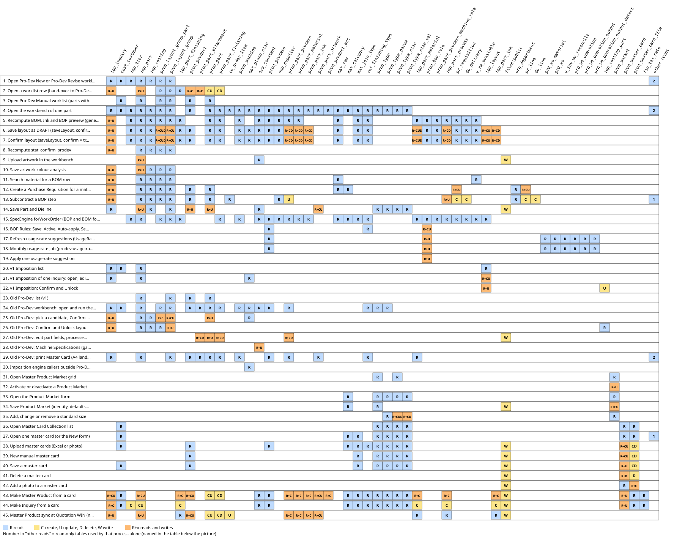
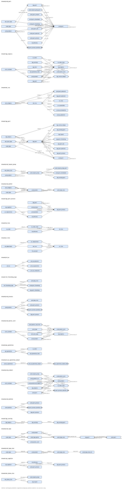

# Sub-module: Pro-Dev (Product Development)

> DRAFT GROUP C (2026-10-16). The sub-module page only summarises and links; facts are in the cards. Menu (FACT, `sys_app_menu` mockup, parent `SALES_PRODEVGRP` under Inquiry & Quotation): Pro-Dev New (`v2:prodev-new`), Pro-Dev Revise (`v2:prodev-revise`), Pro-Dev Manual (`v2:prodev`).

- **Module**: Sales > Inquiry & Quotation > Pro-Dev.
- **Purpose**: from the Inquiry, derive the production layout (plano, UP), BOP, BOM, Ink Configuration and Master Card; the officer decides (A.7). The result is the basis for Pro-Cost, then WO.
- **Frozen zone**: ProDev flow/data. Read: `docs/claude_vital_flows.md`, `docs/ENGINE-ATTENTION.md`.
- **Auto imposition (2026-10-18, Jo)**: on open, `workbench.js` runs `autoNest` in the browser (no DB write until Save/Confirm); the blank mask is kept at 1 px = 0.1 mm up to `MASK_MAX` 1100 px, and `autoNest` refuses a downscaled mask. If the default plano (65x100) does not fit the canvas and the officer has not touched the plano dropdown, `autoNest` calls `pickBestPlano()` (most economical plano, no DB write until Save/Confirm; stored as `plano_size_id` in `prod_layout_group`/`iqp_layout`).

## Relations
- **source**: Inquiry Product (part, finishing, material, qty tier, `stat_confirm_sales`), master `prod_type` (dieline), rules `prod_bop_rule`.
- **used_by**: Pro-Cost (CONFIRMED layout via `ProCostContextService`), Material Planning (UP from layout), WO creation (BOP/BOM).
- **flags**: `stat_confirm_prodev` in `iqp_inquiry` (A.20), recomputed after Save/Confirm layout.

## Engines in this sub-module
| Engine | Card | Short trigger |
|---|---|---|
| Imposition Engine | `10_engine_imposition.md` | v1 Imposition screen per Inquiry, Form WO (preview), Costing Advisor; the active ProDev does NOT use it |
| Spec Engine (BOP, BOM, Ink) | `20_engine_spec.md` | ProDev buttons/actions (generate, Save), WO creation and re-arrangement |
| Usage Rate Engine | `30_engine_usage-rate.md` | monthly schedule on day 1 at 02:00, button on the BOP Rule screen |
| Routing Template Engine | NOT written | not connected to ProDev according to the code; see `../90_findings_engine-group-c.md` |
| Inquiry <-> ProDev interface (concept card, other group) | `10_card_prodev-interface.md` | button Kirim ke ProDev, Save/Confirm layout |
| Dieline Engine | `../inquiry-product/20_engine_dieline.md` | Part & Dieline display (Inquiry and ProDev) |

## Diagram
`../img/imposition.svg`, `../img/spec-engine.svg` (text twin in each card, section "Flow").

## User's Guide (UG)
`docs/guides/sales/02_prodev.md` (FACT: file exists; content not read). TG does not repeat its content.

> Checked 2026-10-16 after the SpecEngine / MaterialPlanningEngine change (Jo agreed): this card only names or links the changed cards; nothing in it needs to change.

> Checked 2026-10-16 after the ProCost BOM panel change (Jo agreed): this card only names or links the changed cards; nothing in it needs to change.

> Checked 2026-10-16 after the ProCost Book button (Jo agreed): this card only names or links the changed cards; nothing in it needs to change.

## Read/Write map

 Click the picture to open it full size.
Every process of the Pro-Dev sub-module (menu: Pro-Dev New, Pro-Dev Revise, Pro-Dev Manual, Master Product Market, Master Card Collection) with the tables it reads and writes (C create, U update, D delete), checked in code on 2026-10-18 against the dummy DBs (ddtsdi, ddtmst, ddtsys, ddtprd, ddtinv, ddtpur, ddtacc: all table names exist). Rows 1-14 are the active v2 workbench. Rows 15-19 are the engine inputs and the usage-rate learning. Rows 20-22 are the v1 Imposition screen, rows 23-30 are the archived old Pro-Dev screens whose routes are still active, rows 31-35 are Product Market, rows 36-45 are Master Card Collection and the Master Product sync.

| Process | Trigger | Reads | Writes | Evidence |
|---|---|---|---|---|
| 1. Open Pro-Dev New or Pro-Dev Revise worklist | Menu Pro-Dev New (v2:prodev-new) or Pro-Dev Revise (v2:prodev-revise), one row = one Sales-confirmed inquiry | `iqp_inquiry`, `cust_customer`, `iqp_tier`, `iqp_part`, `iqp_costing`, `quo_quotation`, `quo_quotation_item`, `prod_layout_group_part`, `prod_layout_group` | - | `app/Support/V2/Grid/Sales/ProdevNewGrid.php:9-12`, `app/Support/V2/Grid/Sales/ProdevNewGrid.php:39-42`, `app/Support/V2/Grid/Sales/ProdevReviseGrid.php:6`, `app/Support/V2/Grid/Sales/InquiryDeskGrid.php:63-72`, `app/Support/V2/Data/Sales.php:229-301`, `app/Support/V2/Data/Sales.php:318-332`, `app/Services/Sales/InquiryStage.php:23-33`, `app/Services/Sales/QuotationBuilder.php:46-57`, `app/Support/V2/Grid/Grids.php:67-68` |
| 2. Open a worklist row (hand-over to Pro-Dev, sendToProDev) | Click a row of the worklist in row 1 (GET v2.prodev.open) | `iqp_inquiry`, `iqp_part`, `iqp_part_finishing`, `prod_product`, `prod_part_attachment`, `prod_layout_group_part`, `prod_layout_group` | `prod_product` (C), `iqp_inquiry` (U), `prod_part` (CU), `iqp_part` (U), `prod_part_finishing` (CD), `prod_part_attachment` (C) | `routes/v2.php:1800-1807`, `app/Services/Sales/InquiryStage.php:73-87`, `app/Services/Sales/InquiryWriter.php:105-175`, `app/Models/Sdi/IqpInquiry.php:132-152` |
| 3. Open Pro-Dev Manual worklist (parts without Inquiry) | Menu Pro-Dev Manual (v2:prodev, no ?part) | `iqp_part`, `prod_part`, `prod_product`, `cust_customer`, `prod_layout_group`, `prod_layout_group_part` | - | `resources/views/v2/screens/prodev.blade.php:60-84`, `app/Support/V2/Data/Prodev.php:36-59` |
| 4. Open the workbench of one part | GET v2.screen prodev?part=ID from rows 2 or 3 | `prod_part`, `prod_product`, `iqp_part`, `iqp_inquiry`, `cust_customer`, `iqp_costing`, `iqp_tier`, `iqp_revise_change`, `co_order_item`, `co_order`, `prod_layout_group`, `prod_layout_group_part`, `prod_machine`, `mat_plano_size`, `sys_constant`, `prod_process`, `sup_supplier`, `prod_part_process`, `prod_part_material`, `prod_part_ink`, `prod_part_finishing`, `prod_part_artwork`, `prod_product_acc`, `mat_raw`, `mat_category`, `mat_join_type`, `ref_finishing_type`, `prod_type`, `prod_type_param`, `prod_type_size`, `prod_type_size_val` | - | `resources/views/v2/screens/prodev.blade.php:14-18`, `resources/views/v2/screens/prodev.blade.php:23-53`, `app/Support/V2/Data/Prodev.php:62-102`, `app/Support/V2/Data/Prodev.php:106-136`, `resources/views/pages/production/prodev.blade.php:415-431`, `resources/views/pages/production/prodev.blade.php:487-581`, `resources/views/pages/production/prodev.blade.php:592-683`, `app/Services/ProDev/SpecEngine.php:966-1024`, `app/Support/V2/Data/ProductMaster.php:55-79`, `app/Support/V2/Data/ProductMaster.php:86-115`, `app/Services/ProDev/ProcurementBridge.php:116-133`, `app/Support/V2/Data/Sales.php:112-127` |
| 5. Recompute BOM, Ink and BOP preview (generateSpec) | Workbench JS call generateSpec after every canvas or override change (POST v2.prodev.call) | `prod_part`, `iqp_part`, `iqp_part_finishing`, `prod_part_finishing`, `ref_finishing_type`, `iqp_part_material`, `prod_part_material`, `mat_raw`, `prod_bop_rule`, `prod_process`, `iqp_tier`, `mat_join_type`, `prod_machine`, `prod_part_process_machine_rate`, `iqp_part_process`, `prod_part_process`, `sup_supplier`, `pr_requisition`, `do_delivery`, `v_rm_available`, `sys_constant`, `iqp_inquiry`, `prod_layout_group_part`, `prod_layout_group`, `iqp_costing` | `iqp_inquiry` (U) | `routes/v2.php:1811-1819`, `resources/views/pages/production/prodev.blade.php:337-348`, `resources/views/pages/production/prodev.blade.php:458-475`, `app/Services/ProDev/SpecEngine.php:60-134`, `app/Services/ProDev/SpecEngine.php:138-152`, `app/Services/ProDev/SpecEngine.php:156-227`, `app/Services/ProDev/SpecEngine.php:311-344`, `app/Services/ProDev/SpecEngine.php:395-444`, `app/Services/ProDev/SpecEngine.php:694-722`, `app/Services/ProDev/SpecEngine.php:758-779`, `app/Services/ProDev/SpecEngine.php:800-845`, `app/Services/Sales/InquiryStage.php:37-57` |
| 6. Save layout as DRAFT (saveLayout, confirm = false) | Workbench Save button (POST v2.prodev.call), or the v1 Livewire page /production/prodev/{part} | `prod_part`, `prod_product`, `mat_plano_size`, `prod_layout_group`, `prod_layout_group_part`, `iqp_part`, `iqp_layout`, `iqp_inquiry`, `sys_constant`, `iqp_part_finishing`, `prod_part_finishing`, `ref_finishing_type`, `iqp_part_material`, `prod_part_material`, `mat_raw`, `prod_bop_rule`, `prod_process`, `iqp_tier`, `mat_join_type`, `prod_machine`, `prod_part_process_machine_rate`, `iqp_part_process`, `prod_part_process`, `iqp_part_ink`, `prod_part_ink`, `sup_supplier`, `pr_requisition`, `do_delivery`, `v_rm_available`, `iqp_costing` | `prod_layout_group` (CU), `prod_layout_group_part` (CUD), `iqp_layout` (CU), `prod_part_process` (CD), `prod_part_material` (CD), `prod_part_ink` (CD), `iqp_part_process` (CD), `iqp_part_material` (CUD), `iqp_part_ink` (CD), `iqp_inquiry` (U) | `routes/v2.php:1811-1819`, `resources/views/pages/production/prodev.blade.php:181-259`, `resources/views/pages/production/prodev.blade.php:264-308`, `resources/views/pages/production/prodev.blade.php:316-320`, `app/Services/ProDev/SpecEngine.php:1133-1168`, `app/Services/ProDev/SpecEngine.php:1183-1208`, `app/Services/ProDev/SpecEngine.php:1210-1258`, `app/Services/ProDev/SpecEngine.php:1260-1277`, `app/Services/Sales/InquiryStage.php:99-105` |
| 7. Confirm layout (saveLayout, confirm = true) | Workbench Confirm button (POST v2.prodev.call); the browser then goes to the costing URL returned | `prod_part`, `prod_product`, `mat_plano_size`, `prod_layout_group`, `prod_layout_group_part`, `iqp_part`, `iqp_layout`, `iqp_inquiry`, `sys_constant`, `iqp_part_finishing`, `prod_part_finishing`, `ref_finishing_type`, `iqp_part_material`, `prod_part_material`, `mat_raw`, `prod_bop_rule`, `prod_process`, `iqp_tier`, `mat_join_type`, `prod_machine`, `prod_part_process_machine_rate`, `iqp_part_process`, `prod_part_process`, `iqp_part_ink`, `prod_part_ink`, `sup_supplier`, `pr_requisition`, `do_delivery`, `v_rm_available`, `iqp_costing` | `prod_layout_group` (CU), `prod_layout_group_part` (CUD), `iqp_layout` (CU), `prod_part_process` (CD), `prod_part_material` (CD), `prod_part_ink` (CD), `iqp_part_process` (CD), `iqp_part_material` (CUD), `iqp_part_ink` (CD), `iqp_inquiry` (U) (status CONFIRMED and stat_confirm = 1 are updates inside the same tables) | `routes/v2.php:1811-1819`, `resources/views/pages/production/prodev.blade.php:299-312`, `packages/mockup-parts/resources/assets/js/components/prodev/workbench.js:215-260`, `app/Services/Sales/InquiryStage.php:37-50` |
| 8. Recompute stat_confirm_prodev | Model event ProdLayoutGroup saved (any caller) and after every POST v2.prodev.call | `iqp_part`, `prod_layout_group_part`, `prod_layout_group`, `iqp_inquiry`, `iqp_costing` | `iqp_inquiry` (U) | `app/Services/Sales/InquiryStage.php:23-57`, `app/Services/Sales/InquiryStage.php:89-96`, `app/Services/Sales/InquiryStage.php:99-105`, `app/Providers/AppServiceProvider.php:75`, `routes/v2.php:1816` |
| 9. Upload artwork in the workbench | Workbench artwork button (POST v2.prodev.artwork) | `iqp_part`, `sys_constant` | `iqp_part` (U), `files:public` | `routes/v2.php:1820-1824`, `app/Support/V2/Data/Prodev.php:146-167`, `resources/views/pages/production/prodev.blade.php:95-174`, `app/Services/ProDev/ArtworkAnalyzer.php:56-62` |
| 10. Save artwork colour analysis | Workbench JS call saveArtworkColors (POST v2.prodev.call) | `iqp_part`, `iqp_inquiry`, `prod_layout_group_part`, `prod_layout_group`, `iqp_costing` | `iqp_part` (U), `iqp_inquiry` (U) | `routes/v2.php:1811-1819`, `resources/views/pages/production/prodev.blade.php:436-456`, `app/Services/Sales/InquiryStage.php:37-57` |
| 11. Search material for a BOM row | Workbench JS call searchMaterials (POST v2.prodev.call) | `mat_raw`, `v_rm_available`, `iqp_part`, `iqp_inquiry`, `prod_layout_group_part`, `prod_layout_group`, `iqp_costing` | `iqp_inquiry` (U) | `routes/v2.php:1811-1819`, `resources/views/pages/production/prodev.blade.php:359-384`, `app/Services/ProDev/SpecEngine.php:800-822` |
| 12. Create a Purchase Requisition for a material shortage | Workbench JS call createPurchase (POST v2.prodev.call) | `prod_part`, `prod_product`, `iqp_part`, `iqp_inquiry`, `mat_raw`, `mat_category`, `org_department`, `pr_requisition`, `pr_line`, `prod_layout_group_part`, `prod_layout_group`, `iqp_costing` | `pr_requisition` (CU), `pr_line` (CU), `iqp_inquiry` (U) | `routes/v2.php:1811-1819`, `resources/views/pages/production/prodev.blade.php:386-397`, `app/Services/ProDev/ProcurementBridge.php:42-113` |
| 13. Subcontract a BOP step | Workbench JS call subcontract (POST v2.prodev.call) | `prod_part`, `prod_product`, `iqp_part`, `iqp_inquiry`, `sup_supplier`, `iqp_part_process`, `co_order_item`, `org_department`, `fin_account`, `prod_layout_group_part`, `prod_layout_group`, `iqp_costing` | `pr_requisition` (C), `pr_line` (C), `do_delivery` (C), `do_line` (C), `iqp_part_process` (U), `prod_part_process` (U), `iqp_inquiry` (U) | `routes/v2.php:1811-1819`, `resources/views/pages/production/prodev.blade.php:399-412`, `app/Services/ProDev/ProcurementBridge.php:138-215`, `app/Services/ProDev/ProcurementBridge.php:217-262`, `app/Services/ProDev/ProcurementBridge.php:264-273` |
| 14. Save Part and Dieline | Workbench tab Part and Dieline, Save (POST v2.prodev.dieline) | `iqp_part`, `prod_part`, `prod_product`, `prod_type`, `prod_type_param`, `prod_type_size`, `prod_type_size_val`, `prod_part_artwork`, `iqp_inquiry`, `iqp_costing`, `prod_layout_group`, `sys_constant` | `iqp_part` (U), `prod_part` (U), `prod_product` (U), `prod_part_artwork` (CU), `files:public` | `routes/v2.php:1826-1835`, `app/Services/ProDev/PartDieline.php:28-72`, `app/Support/V2/Data/Prodev.php:106-136`, `app/Support/V2/Data/Prodev.php:146-167`, `app/Services/Sales/InquiryWriter.php:91-102`, `app/Services/Sales/ProductMasterSync.php:105-109`, `app/Services/Sales/ProductMasterSync.php:159-177` |
| 15. SpecEngine forWorkOrder (BOP and BOM for a WO quantity, read path) | WO creation and the PROCESS or regenerate actions in PPIC (WoGenerationService), and the ProCost context | `iqp_layout`, `prod_layout_group`, `prod_layout_group_part`, `prod_part_process`, `prod_process`, `prod_machine`, `prod_part_material`, `mat_raw`, `mat_category`, `prod_part_ink`, `prod_bop_rule`, `iqp_part`, `iqp_part_finishing`, `prod_part_finishing`, `ref_finishing_type`, `iqp_part_material`, `iqp_tier`, `mat_join_type`, `prod_part_process_machine_rate`, `iqp_part_process`, `sup_supplier`, `pr_requisition`, `do_delivery`, `v_rm_available`, `sys_constant` | - | `app/Services/ProDev/SpecEngine.php:1037-1061`, `app/Services/ProDev/SpecEngine.php:1072-1123`, `app/Services/Scheduling/WoGenerationService.php:105`, `app/Services/Scheduling/WoGenerationService.php:190`, `app/Services/Scheduling/WoGenerationService.php:263`, `app/Services/Scheduling/WoGenerationService.php:279`, `app/Services/Costing/ProCostContextService.php:66` |
| 16. BOP Rules: Save, Active, Auto-apply, Seq (admin only) | BOP Rule grid opens the v2 form `prod-bop-form` (moved from the v1 screen on 2026-10-19; the up/down arrows became the Seq field) | `prod_bop_rule`, `prod_process`, `ref_finishing_type` | `prod_bop_rule` (CU) | `routes/web.php:322`, `app/Support/V2/Grid/Prod/BopRuleGrid.php:37-50`, `routes/v2_production.php:62-86`, `app/Services/Production/BopRuleEntryService.php:61-117`, `app/Services/Production/BopRuleEntryService.php:119-124` |
| 17. Refresh usage-rate suggestions (UsageRateEngine, button) | BOP Rule form button "Refresh suggestions", last 3 months, apply = true | `prod_bop_rule`, `prod_process`, `prd_wo_material`, `prd_wo`, `v_inv_wo_reconcile`, `prd_wo_operation`, `prd_wo_operation_output`, `prd_wo_operation_output_defect` | `prod_bop_rule` (U) | `app/Services/Production/BopRuleEntryService.php:138-144`, `app/Services/ProDev/UsageRateEngine.php:33-109`, `app/Services/ProDev/UsageRateEngine.php:116-149`, `app/Services/ProDev/UsageRateEngine.php:156-195` |
| 18. Monthly usage-rate job (prodev:usage-rates) | Schedule on day 1 at 02:00, or php artisan prodev:usage-rates by hand | `prod_bop_rule`, `prod_process`, `prd_wo_material`, `prd_wo`, `v_inv_wo_reconcile`, `prd_wo_operation`, `prd_wo_operation_output`, `prd_wo_operation_output_defect` | `prod_bop_rule` (U) | `routes/console.php:18`, `app/Console/Commands/RefreshUsageRates.php:19-42`, `app/Services/ProDev/UsageRateEngine.php:33-109` |
| 19. Apply one usage-rate suggestion | BOP Rule form, tab Usage suggestions, button Apply suggestion | `prod_bop_rule` | `prod_bop_rule` (U) | `app/Services/Production/BopRuleEntryService.php:126-136` |
| 20. v1 Imposition list | v1 page /inquiry/imposition | `iqp_inquiry`, `cust_customer`, `iqp_part`, `iqp_layout` | - | `routes/web.php:149`, `resources/views/pages/inquiry/imposition-list.blade.php:61-77` |
| 21. v1 Imposition of one inquiry: open, edit size, pick plano | v1 page /inquiry/{inquiry}/imposition (the open itself creates the layout row) | `iqp_inquiry`, `iqp_part`, `iqp_layout`, `mat_plano_size` | `iqp_layout` (CU) | `routes/web.php:150`, `resources/views/pages/inquiry/imposition.blade.php:20-83`, `resources/views/pages/inquiry/imposition.blade.php:171-211` |
| 22. v1 Imposition: Confirm and Unlock | v1 page buttons | `iqp_layout` | `iqp_layout` (U), `iqp_costing_part` (U) | `resources/views/pages/inquiry/imposition.blade.php:213-247` |
| 23. Old Pro-Dev list (v1) | v1 pages /production/prodev-list and /production/old-prodev-list | `prod_part`, `prod_product`, `prod_layout_group`, `iqp_part` | - | `routes/web.php:331`, `routes/web.php:337`, `resources/views/pages/production/prodev-list.blade.php:40-66`, `resources/views/pages/production/old_prodev_list.blade.php:31-58` |
| 24. Old Pro-Dev workbench: open and run the engine tiers (calculation only) | v1 page /production/old-prodev/{part} | `prod_part`, `prod_product`, `prod_part_process`, `prod_process`, `prod_machine`, `prod_part_finishing`, `ref_finishing_type`, `prod_part_attachment`, `prod_layout_group`, `prod_layout_group_part`, `mat_plano_size`, `iqp_part`, `iqp_inquiry`, `cust_customer`, `prod_type`, `prod_type_param`, `sys_constant` | - | `routes/web.php:338`, `resources/views/pages/production/old_prodev.blade.php:73-110`, `resources/views/pages/production/old_prodev.blade.php:395-478`, `resources/views/pages/production/old_prodev.blade.php:599-750` |
| 25. Old Pro-Dev: pick a candidate, Confirm combined layout | Old workbench buttons | `prod_part`, `mat_plano_size`, `prod_layout_group`, `prod_layout_group_part`, `iqp_part`, `iqp_inquiry`, `iqp_costing` | `prod_layout_group` (CU), `prod_layout_group_part` (C), `prod_part` (U), `iqp_inquiry` (U) | `resources/views/pages/production/old_prodev.blade.php:751-816`, `resources/views/pages/production/old_prodev.blade.php:866-925`, `app/Services/Sales/InquiryStage.php:99-105` |
| 26. Old Pro-Dev: Confirm and Unlock layout | Old workbench buttons | `prod_layout_group`, `iqp_costing_part`, `prod_layout_group_part`, `iqp_part`, `iqp_inquiry`, `iqp_costing` | `prod_layout_group` (U), `iqp_inquiry` (U) | `resources/views/pages/production/old_prodev.blade.php:927-962`, `app/Services/Sales/InquiryStage.php:99-105` |
| 27. Old Pro-Dev: edit part fields, processes, finishings, attachments | Old workbench inline edits | `prod_part`, `prod_part_process`, `prod_part_finishing`, `prod_part_attachment` | `prod_part` (U), `prod_part_process` (CD), `prod_part_finishing` (CD), `prod_part_attachment` (CD), `files:public` | `resources/views/pages/production/old_prodev.blade.php:562-593`, `resources/views/pages/production/old_prodev.blade.php:964-1053` |
| 28. Old Pro-Dev: Machine Specifications (gap, gripper, margin) | Old workbench edit panel (same permission as Constants) | `sys_constant` | `sys_constant` (U) | `resources/views/pages/production/old_prodev.blade.php:513-560` |
| 29. Old Pro-Dev: print Master Card (A4 landscape) | v1 page /production/old-prodev/{part}/print | `prod_part`, `prod_product`, `prod_part_process`, `prod_process`, `prod_machine`, `prod_part_finishing`, `ref_finishing_type`, `prod_part_attachment`, `prod_layout_group`, `iqp_part`, `iqp_inquiry`, `iqp_part_material`, `prod_part_artwork`, `org_company`, `prod_mastercard_signoff` | - | `routes/web.php:339`, `resources/views/pages/production/old_prodev_print.blade.php:27-95`, `resources/views/pages/production/old_prodev_print.blade.php:136-155` |
| 30. Imposition engine callers outside Pro-Dev screens | Costing Advisor and Form WO preview (calculation only) | `mat_plano_size` | - | `app/Services/Costing/CostingAdvisor.php:264-276`, `resources/views/pages/production/wo-entry.blade.php:449` |
| 31. Open Master Product Market grid | Menu Master Product Market (v2:sales-product-market) | `prod_market`, `prod_type`, `prod_type_size` | - | `app/Support/V2/Grid/Sales/ProductMarketGrid.php:66-91`, `app/Support/V2/Grid/Grids.php:65` |
| 32. Activate or deactivate a Product Market | Form Activate / Deactivate (POST v2.sales.market.save) or grid toggle (POST v2.grid.toggle, flips `activate`) | `prod_market` | `prod_market` (U) | `routes/v2_master.php:210-228`, `app/Services/Master/MarketMasterService.php:127-130`, `app/Support/V2/Grid/DbGrid.php:375-390` |
| 33. Open the Product Market form | Grid New or row open (GET v2.screen sales-market-form ?id or ?new=1; old v1 URLs /lookup/product-market* redirect here) | `prod_market`, `prod_type_size`, `prod_type_size_val`, `mat_category`, `prod_type`, `prod_type_param` | - | `app/Support/V2/Grid/Sales/ProductMarketGrid.php:51-59`, `resources/views/v2/screens/sales-market-form.blade.php:16-33`, `routes/web.php:333-335` |
| 34. Save Product Market (identity, defaults, materials, photo) | Form Save (POST v2.sales.market.save, multipart) | `prod_market`, `prod_type`, `mat_category` | `prod_market` (CU), `files:public` | `routes/v2_master.php:207-228`, `app/Services/Master/MarketMasterService.php:42-89`, `app/Services/Master/MarketMasterService.php:92-113` |
| 35. Add, change or remove a standard size | Form tab Standard sizes, dialog Save / Remove size (POST v2.sales.market.size, size.delete) | `prod_market`, `prod_type_param`, `prod_type_size`, `prod_type_size_val` | `prod_type_size` (CUD), `prod_type_size_val` (CD) | `routes/v2_master.php:230-239`, `app/Services/Master/MarketMasterService.php:140-178` |
| 36. Open Master Card Collection list | Menu Master Card Collection (v2:master-card-collection) | `prod_master_card`, `prod_master_card_file`, `cust_customer`, `prod_type`, `prod_type_param`, `prod_type_size`, `prod_type_size_val` | - | `resources/views/v2/screens/master-card-collection.blade.php:39`, `app/Support/V2/Data/MasterCardCollection.php:14-39`, `app/Support/V2/Data/Sales.php:112-127` |
| 37. Open one master card (or the New form) | List row, or New Record (?id or ?new=1) | `prod_master_card`, `prod_master_card_file`, `cust_customer`, `prod_type`, `prod_type_param`, `prod_type_size`, `prod_type_size_val`, `mat_category`, `mat_join_type`, `sales_person` | - | `resources/views/v2/screens/master-card-collection.blade.php:21`, `resources/views/v2/screens/master-card-collection.blade.php:60-76`, `resources/views/v2/screens/master-card-collection.blade.php:117-121`, `resources/views/v2/screens/master-card-collection.blade.php:158`, `resources/views/v2/screens/master-card-collection.blade.php:221`, `app/Support/V2/Data/MasterCardCollection.php:43-67` |
| 38. Upload master cards (Excel or photo) | Upload card (POST v2.mcard.upload) | `prod_master_card`, `cust_customer`, `mat_join_type`, `mat_category`, `prod_process`, `ref_finishing_type`, `prod_product`, `prod_type`, `prod_type_param`, `prod_type_size`, `prod_type_size_val` | `prod_master_card` (CU), `prod_master_card_file` (CD), `files:public` | `routes/v2_master_card.php:16-25`, `app/Services/MasterCard/MasterCardService.php:55-116`, `app/Services/MasterCard/MasterCardService.php:118-132`, `app/Services/MasterCard/MasterCardService.php:135-157`, `app/Services/MasterCard/MasterCardService.php:235-244` |
| 39. New manual master card | New Record, Save (POST v2.mcard.new) | `prod_master_card`, `mat_join_type`, `prod_product`, `prod_type`, `prod_type_param`, `prod_type_size`, `prod_type_size_val` | `prod_master_card` (CU), `prod_master_card_file` (CD), `files:public` | `routes/v2_master_card.php:28-35`, `app/Services/MasterCard/MasterCardService.php:71-116`, `app/Services/MasterCard/MasterCardService.php:161-201` |
| 40. Save a master card | Card form, Save (POST v2.mcard.save) | `prod_master_card`, `cust_customer`, `mat_join_type`, `prod_product`, `prod_type`, `prod_type_param`, `prod_type_size`, `prod_type_size_val` | `prod_master_card` (U), `prod_master_card_file` (CD), `files:public` | `routes/v2_master_card.php:37-49`, `app/Services/MasterCard/MasterCardService.php:161-201`, `app/Services/MasterCard/MasterCardService.php:135-157` |
| 41. Delete a master card | Card form, Delete (POST v2.mcard.save with _action = delete) | `prod_master_card` | `prod_master_card` (D), `prod_master_card_file` (D), `files:public` | `routes/v2_master_card.php:37-43`, `app/Services/MasterCard/MasterCardService.php:203-208` |
| 42. Add a photo to a master card | Card form, Add photo (POST v2.mcard.photo) | `prod_master_card`, `prod_master_card_file` | `prod_master_card_file` (C), `files:public` | `routes/v2_master_card.php:51-58`, `app/Services/MasterCard/MasterCardService.php:118-126` |
| 43. Make Master Product from a card | Card form, Make Master Product (POST v2.mcard.convert target = product) | `prod_master_card`, `prod_master_card_file`, `cust_customer`, `mat_join_type`, `mat_category`, `prod_process`, `ref_finishing_type`, `prod_product`, `iqp_inquiry`, `iqp_part`, `iqp_part_material`, `iqp_part_process`, `iqp_part_finishing`, `iqp_part_ink`, `prod_part_material`, `prod_part_ink`, `prod_part_process`, `prod_part_artwork`, `prod_product_acc`, `prod_type`, `prod_type_param`, `prod_type_size`, `prod_type_size_val`, `sys_constant`, `fin_tax_rate` | `iqp_inquiry` (CU), `iqp_part` (CU), `iqp_part_material` (C), `iqp_part_ink` (C), `iqp_part_finishing` (C), `iqp_part_process` (C), `prod_product` (CU), `prod_part` (CU), `prod_part_finishing` (CD), `prod_part_material` (C), `prod_part_ink` (C), `prod_part_process` (C), `prod_part_artwork` (CU), `prod_product_acc` (C), `prod_master_card` (U), `files:public` | `routes/v2_master_card.php:60-75`, `app/Services/MasterCard/MasterCardService.php:259-283`, `app/Services/MasterCard/MasterCardService.php:331-402`, `app/Services/MasterCard/MasterCardService.php:404-416`, `app/Services/Sales/ProductMasterSync.php:22-59`, `app/Models/Sdi/IqpInquiry.php:132-152` |
| 44. Make Inquiry from a card | Card form, Make Inquiry (POST v2.mcard.convert target = inquiry); a product that already exists only redirects to Inquiry Recalc | `prod_master_card`, `prod_master_card_file`, `cust_customer`, `mat_join_type`, `mat_category`, `prod_process`, `ref_finishing_type`, `iqp_inquiry`, `sys_constant`, `fin_tax_rate`, `prod_type`, `prod_type_param`, `prod_type_size`, `prod_type_size_val` | `iqp_inquiry` (C), `iqp_tier` (C), `iqp_part` (CU), `iqp_part_material` (C), `iqp_part_ink` (C), `iqp_part_finishing` (C), `iqp_part_process` (C), `prod_master_card` (U), `files:public` | `routes/v2_master_card.php:60-75`, `app/Services/MasterCard/MasterCardService.php:286-303`, `app/Services/MasterCard/MasterCardService.php:331-402`, `app/Models/Sdi/IqpInquiry.php:163-174` |
| 45. Master Product sync at Quotation WIN (not called from Pro-Dev) | Quotation WIN creates the CO, then CoOrderBuilder syncs every inquiry | `iqp_inquiry`, `iqp_part`, `iqp_part_material`, `iqp_part_process`, `iqp_part_finishing`, `iqp_part_ink`, `prod_product`, `prod_part_material`, `prod_part_ink`, `prod_part_process`, `prod_part_artwork` | `prod_product` (CU), `prod_part` (CU), `iqp_part` (U), `iqp_inquiry` (U), `prod_part_finishing` (CD), `prod_part_material` (C), `prod_part_ink` (C), `prod_part_process` (C), `prod_part_artwork` (CU), `co_order_item` (U), `files:public` | `app/Services/Sales/CoOrderBuilder.php:104-109`, `app/Services/Sales/ProductMasterSync.php:22-177`, `app/Models/Sdi/IqpInquiry.php:132-152` |

Notes for debugging
- Save and Confirm layout (rows 6-7): the layout part has NO transaction. `prod_layout_group` is created or updated, the pivot is synced, `iqp_layout` is saved and the group is set to CONFIRMED one write at a time (`resources/views/pages/production/prodev.blade.php:246-259`, `resources/views/pages/production/prodev.blade.php:305`, `resources/views/pages/production/prodev.blade.php:311`) BEFORE `SpecEngine::persist` runs (`resources/views/pages/production/prodev.blade.php:316-320`). Inside persist each section (bop, bom, inks) has its own tm2mst plus tm2sdi transaction pair (`app/Services/ProDev/SpecEngine.php:1158-1164`), so an error in the BOM section leaves a CONFIRMED layout with the new BOP and the old BOM and ink. The browser then shows the error and does not open the costing URL, but the group already is CONFIRMED.
- Saving again after Confirm: a CONFIRMED group is never changed, the next Save inserts a NEW DRAFT group for the same part (`resources/views/pages/production/prodev.blade.php:246-254`). The latest group id wins everywhere: `InquiryStage::partStatuses` reads the highest id (`app/Services/Sales/InquiryStage.php:27-32`), so `stat_confirm_prodev` drops back to 0 while no `iqp_costing` exists yet (`app/Services/Sales/InquiryStage.php:47`), and `forWorkOrder` also takes the highest group id (`app/Services/ProDev/SpecEngine.php:1077-1081`). The snapshot `iqp_layout` is updated in place and keeps stat_confirm = 1 (`resources/views/pages/production/prodev.blade.php:274-305`). The v2 workbench has no unlock; the old screen has Unlock with a guard on `iqp_costing_part.prod_layout_group_id` (`resources/views/pages/production/old_prodev.blade.php:952`). Confirm on the v1 Imposition screen only sets `iqp_layout.stat_confirm` and fills `iqp_costing_part`, it never touches `prod_layout_group`, so it does not set the flag (`resources/views/pages/inquiry/imposition.blade.php:213-237`). In ddtmst no part has more than one layout group today (query), so the re-save behaviour is read from code, not seen in data.
- What persist rewrites: for the master tables it deletes ALL rows of the part and inserts again with new ids (`app/Services/ProDev/SpecEngine.php:1193`, `app/Services/ProDev/SpecEngine.php:1212`, `app/Services/ProDev/SpecEngine.php:1268`), so an officer OVERRIDE also removes MANUAL and INQUIRY rows of that section in the master. An ENGINE write is skipped (reported in specSkipped) when any non-ENGINE row exists (`app/Services/ProDev/SpecEngine.php:1152`). In the Inquiry copy, `iqp_part_material` keeps MANUAL rows and updates them in place by order, other rows are deleted and inserted (`app/Services/ProDev/SpecEngine.php:1229-1257`), while `iqp_part_process` and `iqp_part_ink` are deleted and inserted fully (`app/Services/ProDev/SpecEngine.php:1200`, `app/Services/ProDev/SpecEngine.php:1274`). Subcontract PR and DO ids survive only if the same process id is still a BOP step after the rewrite (`app/Services/ProDev/SpecEngine.php:429-444`). Usage rates: `prodev:usage-rates --dry` still writes the suggestion columns, only the apply part is skipped (`app/Services/ProDev/UsageRateEngine.php:73-89`), and the job and the button do not check the admin right that the screen checks (`app/Services/Production/BopRuleEntryService.php:56-66`, `canEdit` and `guard`; the screen moved from the v1 page to the v2 form `prod-bop-form` on 2026-10-19).
- Hand-over and flag: `openInProdev` and `sendToProDev` have no transaction and write tm2mst and tm2sdi separately (`app/Services/Sales/InquiryStage.php:73-87`, `app/Services/Sales/InquiryWriter.php:105-175`); `ensureDraftProduct` creates product `DRAFT-<id>` and updates the inquiry first (`app/Models/Sdi/IqpInquiry.php:139-149`), the link `iqp_part.prod_part_id` is written only after the `prod_part` insert (`app/Services/Sales/InquiryWriter.php:117-128`). Every POST to v2.prodev.call (all six methods, also searchMaterials) ends with the flag sync, but only when the call did not throw (`routes/v2.php:1814-1816`); the sync uses the query builder, so `updated_at` and `updated_by` of the inquiry are not touched (`app/Services/Sales/InquiryStage.php:89-96`). The saved event of the first group insert fires before the pivot row exists, the following `mastercard_code` update fires it again with the pivot present (`resources/views/pages/production/prodev.blade.php:253-259`, `app/Services/Sales/InquiryStage.php:101-103`). After Confirm the browser opens the v1 costing page /inquiry/{id}/costing returned by the server, not the v2 procost URL given in the page data (`resources/views/pages/production/prodev.blade.php:307`, `routes/web.php:179`).
- Cross-database writes that can leave debris: Make Master Product runs inside a tm2sdi transaction, but `ProductMasterSync::fromInquiry` has its own tm2mst transaction that commits by itself, and the card update, the ACC rows and the part and product origin updates run outside any tm2mst transaction (`app/Services/MasterCard/MasterCardService.php:266-282`, `app/Services/Sales/ProductMasterSync.php:27`), so a late failure rolls back the inquiry but leaves the ACTIVE product, its parts and the copied artwork files. The generated inquiry is Confirmed by Sales with stat_confirm_prodev = 0, so by the worklist rule it is listed in Pro-Dev New as To Do (`app/Services/MasterCard/MasterCardService.php:344`, `app/Support/V2/Data/Sales.php:327`; not run live). New manual card and the later Save are two separate commits (`routes/v2_master_card.php:31-32`). Subcontract commits the PR (tm2pur) first, then the DO (tm2sdi), then updates `iqp_part_process` and `prod_part_process` with no transaction (`app/Services/ProDev/ProcurementBridge.php:170-215`, `app/Services/ProDev/ProcurementBridge.php:218-254`, `app/Services/ProDev/ProcurementBridge.php:264-273`). Product Market Save is one tm2mst transaction, but the photo file is stored inside it and a rollback does not delete it (`app/Services/Master/MarketMasterService.php:63-88`; the photo is stored at line 81). Latent error in the artwork versioning: the version number is counted per side (`app/Services/Sales/ProductMasterSync.php:165`, `app/Services/Sales/ProductMasterSync.php:169`), but the unique key uq_art_ver of `prod_part_artwork` is only (part_id, version_no) in ddtmst and tm2mst (information_schema), so the first INNER artwork of a part that already has OUTER v1 would insert version 1 again and fail with a duplicate key. It would stop Save Part and Dieline (row 14, no transaction, the previous version is already deactivated) and the WIN sync (row 45). Not seen in data yet: no inquiry part has an inner artwork and `prod_part_artwork` has only OUTER rows.
- Not checked: the Print and Email panel of the workbench (Email uses the doc-share dialog, whether it writes a log was not traced); the Customer ACC card under the workbench and the Make Master Product ACC fields beyond `app/Services/MasterCard/MasterCardService.php:404-416`; the Master Card dummy engine (Setup, other sub-module; it calls openInProdev and saveLayout, so its writes equal rows 2, 6 and 7); middleware and access checks (module:PROD, module:SALES, canAccessModule) and menu chrome; v1 reads of the old Pro-Dev screens were taken from model imports and queries seen, not fully traced; the Riwayat tab (no write to doc_state_log was found in these classes); ProCost screens that read the layout (other sub-module).

## Table relations

Relations of the tables this sub-module uses. Solid line = real foreign key (read from information_schema of ddtsdi, ddtmst, ddtpur, ddtprd, ddtacc). Dashed line = logical link without foreign key (cross-database, JSON key, or simply no constraint, matched in code). Facts: foreign keys and unique keys read from information_schema; the logical links from the columns and the code cited in the Read/Write map. 1:1 is written only where a unique key exists on the child column (`iqp_layout.part_id`, `iqp_costing.inquiry_id`). `prod_layout_group_part` carries a payload column (`qty_up_in_group`), so it is not a plain link table and has no N:M row. Tables with no relation here: `sys_constant`, `fin_tax_rate`, `org_company`, `sales_person` (`iqp_inquiry.pic_sales` is free text).

 Click the picture to open it full size.

| Parent | Child | Cardinality | Column | Link |
|---|---|---|---|---|
| `quo_quotation` | `co_order` | 1:N | `quotation_id` | FK |
| `co_order` | `co_order_item` | 1:N | `order_id` | FK |
| `iqp_inquiry` | `co_order_item` | 1:N | `inquiry_id` | FK |
| `co_order` | `do_line` | 1:N | `co_order_id` | FK |
| `co_order_item` | `do_line` | 1:N | `co_order_item_id` | FK |
| `do_delivery` | `do_line` | 1:N | `delivery_id` | FK |
| `iqp_inquiry` | `iqp_costing` | 1:1 | `inquiry_id` | FK |
| `iqp_costing` | `iqp_costing_part` | 1:N | `costing_id` | FK |
| `iqp_part` | `iqp_costing_part` | 1:N | `part_id` | FK |
| `co_order` | `iqp_inquiry` | 1:N | `co_id` | FK |
| `iqp_inquiry` | `iqp_part` | 1:N | `inquiry_id` | FK |
| `iqp_part` | `iqp_part` | 1:N | `parent_part_id` | FK |
| `iqp_part` | `iqp_layout` | 1:1 | `part_id` | FK |
| `iqp_part` | `iqp_part_finishing` | 1:N | `part_id` | FK |
| `iqp_part` | `iqp_part_ink` | 1:N | `part_id` | FK |
| `iqp_part` | `iqp_part_material` | 1:N | `part_id` | FK |
| `iqp_part` | `iqp_part_process` | 1:N | `part_id` | FK |
| `iqp_inquiry` | `iqp_revise_change` | 1:N | `inquiry_id` | FK |
| `iqp_part` | `iqp_revise_change` | 1:N | `part_id` | FK |
| `iqp_inquiry` | `iqp_tier` | 1:N | `inquiry_id` | FK |
| `quo_quotation` | `quo_quotation_item` | 1:N | `quotation_id` | FK |
| `iqp_inquiry` | `quo_quotation_item` | 1:N | `inquiry_id` | FK |
| `mat_category` | `mat_category` | 1:N | `parent_id` | FK |
| `mat_category` | `mat_raw` | 1:N | `prefix5_id` | FK |
| `pr_requisition` | `pr_line` | 1:N | `pr_id` | FK |
| `prd_wo` | `prd_wo_material` | 1:N | `wo_id` | FK |
| `prd_wo` | `prd_wo_operation` | 1:N | `wo_id` | FK |
| `prd_wo_operation` | `prd_wo_operation_output` | 1:N | `operation_id` | FK |
| `prd_wo_operation_output` | `prd_wo_operation_output_defect` | 1:N | `output_id` | FK |
| `ref_finishing_type` | `prod_bop_rule` | 1:N | `finishing_type_id` | FK |
| `prod_process` | `prod_bop_rule` | 1:N | `process_id` | FK |
| `mat_plano_size` | `prod_layout_group` | 1:N | `plano_size_id` | FK |
| `prod_product` | `prod_layout_group` | 1:N | `product_id` | FK |
| `prod_layout_group` | `prod_layout_group_part` | 1:N | `id_layout_group` | FK |
| `prod_part` | `prod_layout_group_part` | 1:N | `part_id` | FK |
| `mat_category` | `prod_market` | 1:N | `paper_category_id` | FK |
| `mat_category` | `prod_market` | 1:N | `sheet_category_id` | FK |
| `prod_market` | `prod_market` | 1:N | `parent_id` | FK |
| `prod_type` | `prod_market` | 1:N | `type_code` | FK |
| `prod_market` | `prod_type_size` | 1:N | `market_id` | FK |
| `prod_type` | `prod_type_size` | 1:N | `type_code` | FK |
| `prod_master_card` | `prod_master_card_file` | 1:N | `master_card_id` | FK |
| `cust_customer` | `prod_product` | 1:N | `customer_id` | FK |
| `prod_product` | `prod_product` | 1:N | `parent_product_id` | FK |
| `prod_product` | `prod_product_acc` | 1:N | `product_id` | FK |
| `prod_product` | `prod_mastercard_signoff` | 1:N | `product_id` | FK |
| `prod_product` | `prod_part` | 1:N | `product_id` | FK |
| `mat_join_type` | `prod_part` | 1:N | `join_type_id` | FK |
| `prod_part` | `prod_part` | 1:N | `parent_part_id` | FK |
| `prod_part` | `prod_part_artwork` | 1:N | `part_id` | FK |
| `prod_part` | `prod_part_attachment` | 1:N | `part_id` | FK |
| `prod_layout_group` | `prod_part_attachment` | 1:N | `id_layout_group` | FK |
| `prod_part` | `prod_part_finishing` | 1:N | `part_id` | FK |
| `ref_finishing_type` | `prod_part_finishing` | 1:N | `finishing_type_id` | FK |
| `prod_part` | `prod_part_ink` | 1:N | `part_id` | FK |
| `prod_part` | `prod_part_material` | 1:N | `part_id` | FK |
| `mat_category` | `prod_part_material` | 1:N | `category_id` | FK |
| `mat_raw` | `prod_part_material` | 1:N | `material_id` | FK |
| `prod_part` | `prod_part_process` | 1:N | `part_id` | FK |
| `prod_machine` | `prod_part_process` | 1:N | `machine_id` | FK |
| `prod_process` | `prod_part_process` | 1:N | `process_id` | FK |
| `prod_product` | `prod_part_process_machine_rate` | 1:N | `product_id` | FK |
| `prod_machine` | `prod_part_process_machine_rate` | 1:N | `machine_id` | FK |
| `prod_process` | `prod_part_process_machine_rate` | 1:N | `process_id` | FK |
| `cust_customer` | `iqp_inquiry` | 1:N | `customer_id` | logical |
| `prod_product` | `iqp_inquiry` | 1:N | `product_id` | logical |
| `iqp_inquiry` | `iqp_inquiry` | 1:N | `parent_inquiry_id` | logical |
| `iqp_inquiry` | `prod_product` | 1:N | `source_inquiry_id` | logical |
| `prod_part` | `iqp_part` | 1:N | `prod_part_id` | logical |
| `iqp_part` | `prod_part` | 1:N | `source_iqp_part_id` | logical |
| `mat_join_type` | `iqp_part` | 1:N | `join_type_id` | logical |
| `prod_type` | `iqp_part` | 1:N | `dieline_spec.type_code` | logical |
| `prod_type` | `prod_part` | 1:N | `dieline_spec.type_code` | logical |
| `prod_type` | `prod_type_param` | 1:N | `type_code` | logical |
| `prod_type_size` | `prod_type_size_val` | 1:N | `type_size_id` | logical |
| `mat_raw` | `iqp_part_material` | 1:N | `rawmat_id` | logical |
| `mat_category` | `iqp_part_material` | 1:N | `category_id` | logical |
| `ref_finishing_type` | `iqp_part_finishing` | 1:N | `finishing_type_id` | logical |
| `prod_process` | `iqp_part_process` | 1:N | `process_id` | logical |
| `prod_machine` | `iqp_part_process` | 1:N | `machine_id` | logical |
| `sup_supplier` | `iqp_part_process` | 1:N | `subcon_supplier_id` | logical |
| `pr_requisition` | `iqp_part_process` | 1:N | `subcon_pr_id` | logical |
| `do_delivery` | `iqp_part_process` | 1:N | `subcon_do_id` | logical |
| `sup_supplier` | `prod_part_process` | 1:N | `subcon_supplier_id` | logical |
| `mat_plano_size` | `iqp_layout` | 1:N | `plano_size_id` | logical |
| `prod_layout_group` | `iqp_costing_part` | 1:N | `prod_layout_group_id` | logical |
| `prod_part` | `prod_part_process_machine_rate` | 1:N | `part_code` | logical |
| `prod_product` | `co_order_item` | 1:N | `product_id` | logical |
| `pr_requisition` | `do_delivery` | 1:N | `pr_id` | logical |
| `sup_supplier` | `do_delivery` | 1:N | `supplier_id` | logical |
| `prod_part` | `do_delivery` | 1:N | `ref_part_id` | logical |
| `mat_raw` | `pr_line` | 1:N | `item_id` | logical |
| `org_department` | `pr_requisition` | 1:N | `i_department_id` | logical |
| `org_department` | `pr_line` | 1:N | `i_department_id` | logical |
| `fin_account` | `pr_line` | 1:N | `i_coa_account_id` | logical |
| `mat_raw` | `v_rm_available` | 1:N | `material_id` | logical |
| `mat_raw` | `v_inv_wo_reconcile` | 1:N | `material_id` | logical |
| `prd_wo` | `v_inv_wo_reconcile` | 1:N | `wo_id` | logical |
| `mat_raw` | `prd_wo_material` | 1:N | `material_id` | logical |
| `cust_customer` | `prod_master_card` | 1:N | `customer_id` | logical |
| `prod_type` | `prod_master_card` | 1:N | `type_code` | logical |
| `mat_join_type` | `prod_master_card` | 1:N | `join_type_id` | logical |
| `prod_product` | `prod_master_card` | 1:N | `product_id` | logical |
| `iqp_inquiry` | `prod_master_card` | 1:N | `inquiry_id` | logical |

- Re-checked 2026-10-18 after the `routes/web.php` edit (v1 `/self-service` route replaced by a redirect to `v2.profile`, rule D.25); the block keeps its 4 lines so every cited line number is unchanged, content still true.

- Re-checked 2026-10-18 after the duplicate-module cleanup (v1 Scheduling Board, Rule Library and Master Crew removed): corrected `Grids.php` (now 68-69 and 66), `wo-entry.blade.php` (now 449) and `routes/web.php` lines after the 3 removed route lines (BOP rule 322, prodev-list 331, old-prodev-list 337, old-prodev 338, print 339, product-market 333 and 334-335); `routes/web.php` lines before 314 are unchanged.
> Label pass 2026-10-18 (Jo): the visible texts of the screens this card cites (labels, columns, tabs, buttons, messages) are English now. Tables, fields, flow and stored values are unchanged, so nothing else in this card changed. Verified: 2026-10-18.

- Re-checked 2026-10-18 after the `routes/web.php` edit (v1 `/finance/coa` route replaced by a one-line redirect to `/v2/s/acc-coa`, rule D.25); the block keeps its line count so every cited line number is unchanged, content still true.
- Re-checked 2026-10-18 after the `routes/web.php` edit (v1 `/finance/journals` route replaced by a one-line redirect to `/v2/s/acc-journal`, rule D.25); the block keeps its line count so every cited line number is unchanged, content still true.
- Re-checked 2026-10-18 after the `routes/web.php` edit (v1 `/finance/cash-bank` route replaced by a one-line redirect to `/v2/s/acc-cash-bank`, rule D.25); the block keeps its line count so every cited line number is unchanged, content still true.
- Re-checked 2026-10-18 after the `routes/web.php` edit (v1 `/finance/payables` route replaced by a one-line redirect to `/v2/s/acc-payables`, rule D.25); the block keeps its line count so every cited line number is unchanged, content still true.
- Re-checked 2026-10-18 after the `routes/web.php` edit (v1 `/finance/assets` route replaced by a one-line redirect to `/v2/s/acc-fixed-asset`, rule D.25); the block keeps its line count so every cited line number is unchanged, content still true.
- Re-checked 2026-10-18 after the `routes/web.php` edit (v1 `/finance/amortization` route replaced by a one-line redirect to `/v2/s/acc-amortization`, rule D.25); the block keeps its line count so every cited line number is unchanged, content still true.
- Re-checked 2026-10-18 after the `routes/web.php` edit (v1 `/master/customer` route replaced by a one-line redirect to `/v2/s/md-customer`, and `routes/v2_master.php` required on the same line as `v2_finance.php`, rule D.25); no line was added or removed so every cited line number is unchanged, content still true.
- Re-checked 2026-10-18 after the `routes/web.php` edit (v1 `/master/supplier` route replaced by a one-line redirect to `/v2/s/md-supplier`, rule D.25); the block keeps its line count so every cited line number is unchanged, content still true.
- Re-checked 2026-10-18 after Master Raw Material moved to the v2 form `md-raw-form` (rule D.25): `routes/web.php` replaced the three v1 raw-material routes by redirects on the same lines (no line added or removed), `routes/v2_master.php` gained the raw-material block at its end, `app/Support/V2/Screens.php` gained one group entry far below line 65 and only the text of its line 16 changed, `app/Support/Menu/MenuRoutes.php` lost the three raw-material entries; this card does not depend on the removed lines and its content is still true.
- Re-checked 2026-10-19 after the Master Warehouse v1 pages were removed (rule D.25): `routes/web.php` replaced the four v1 warehouse routes by redirects on the same lines (no line added or removed), `app/Support/V2/Grid/Grids.php` lost the `WarehouseGrid` entry (a line cited after line 37 moved up by one and the citations in this card were shifted accordingly), `app/Support/Menu/MenuRoutes.php` lost the `MD_WH` and `INV_REF_WH` entries; this card does not depend on the removed lines and its content is still true.
- Re-checked 2026-10-19 after the Master Shift v1 page was removed (rule D.25): `routes/web.php` replaced the v1 `/master/shift` route by a one-line redirect on the same line (no line added or removed), `routes/v2_master.php` gained the shift block at its end, `app/Support/V2/Screens.php` gained one group entry far below line 65, `app/Support/Menu/MenuRoutes.php` lost the `MD_SHIFT` entry; this card does not depend on the removed lines and its content is still true.
- Re-checked 2026-10-19 after Stock In moved to the v2 form `inv-stock-in-form` (rule D.25, Master T5): `routes/web.php` replaced the v1 `/inventory/stock-in/{category}` route by a redirect on the same line (no line added or removed) and now also requires `routes/v2_stockdocs.php` on the line that requires `v2_finance.php`, `app/Support/V2/Screens.php` gained one group entry far below line 65, `app/Support/Menu/MenuRoutes.php` lost the three Stock In entries, `app/Support/V2/Lookups.php` gained the stock lookups and a REMARK block (cited lines shifted by 10 and corrected in the cards that cite them) and `app/Support/V2/Grid/Inv/StockDocGrid.php` gained the v2 form hook (cited lines corrected); this card does not depend on the changed lines and its content is still true.
- Re-checked 2026-10-19 after Stock Out moved to the v2 form and the Stock In form became the shared stock document form `inv-stock-doc-form` (rule D.25, Master T5): `routes/web.php` replaced the v1 `/inventory/stock-out/{category}` route by a redirect on the same line (no line added or removed), `routes/v2_stockdocs.php` was rewritten around `v2.inv.stockdoc.*`, `app/Support/V2/Screens.php` renamed one entry far below line 65, `app/Support/Menu/MenuRoutes.php` lost the two Stock Out entries and `app/Support/V2/Grid/Inv/StockDocGrid.php` now opens the form for Stock In and Stock Out (cited lines corrected in the cards that cite them); this card does not depend on the changed lines and its content is still true.
- Re-checked 2026-10-19 after Return from Production moved to the v2 form `inv-stock-doc-form` (rule D.25, Master T5c): `routes/web.php` replaced the v1 `/inventory/stock-return/{category}` route by a redirect on the same line (no line added or removed), `app/Support/Menu/MenuRoutes.php` lost the two Return entries, `app/Support/V2/Lookups.php` gained the `stock_return_bin` lookup (lines after 68 moved by two), `app/Services/Inventory/StockPostingService.php` gained the `addReturned` call on an existing line and one method at the end of the file, and `routes/v2_stockdocs.php`, `StockDocGrid.php` and the screen got the Return kind; this card does not depend on the changed lines and its content is still true.
- Re-checked 2026-10-19 after Stock Adjustment and Opname moved to the v2 form `inv-stock-adj-form` (rule D.25, Master T5d): `routes/web.php` replaced the v1 `/inventory/stock-adjustment/{category}/{doc?}` route by a redirect on the same line (no line added or removed), `app/Support/Menu/MenuRoutes.php` lost the three Adjustment entries, `app/Support/V2/Screens.php` got one item appended on an existing line, `app/Support/V2/Grid/Inv/StockDocGrid.php` and `app/Support/V2/Data/ApprovalCenter.php` changed in the inventory and approval parts, and `routes/v2_stockdocs.php` got a second route group at the end; this card does not depend on the changed lines and its content is still true.
- Re-checked 2026-10-19 after Purchase Return moved to the v2 form `pur-return-form` (rule D.25, Master T6): `routes/web.php` replaced the v1 `/purchasing/prt` and `/purchasing/prt/{prt}/edit` routes by redirects on the same lines and now also requires `routes/v2_purchase_return.php` on the line that requires `v2_finance.php`, `app/Support/Menu/MenuRoutes.php` lost `PROC_RET`, `app/Support/V2/Screens.php` got one item appended on an existing line, and `app/Support/V2/Data/ApprovalCenter.php` and `PurchaseReturnGrid.php` changed in the Purchase Return parts; this card does not depend on the changed lines and its content is still true.
- Re-checked 2026-10-19 after Purchase Return moved to the v2 form `pur-return-form` (rule D.25, Master T6): `routes/web.php` replaced the v1 `/purchasing/prt` and `/purchasing/prt/{prt}/edit` routes by redirects on the same lines and now also requires `routes/v2_purchase_return.php` on the line that requires `v2_finance.php`, `app/Support/Menu/MenuRoutes.php` lost `PROC_RET`, `app/Support/V2/Screens.php` got one item appended on an existing line, and `app/Support/V2/Data/ApprovalCenter.php` and `PurchaseReturnGrid.php` changed in the Purchase Return parts; this card does not depend on the changed lines and its content is still true.
- Re-checked 2026-10-19 after Routing Template moved to the v2 form `prod-routing-form` (rule D.25, Master T6b): `routes/web.php` replaced the v1 `/production/routing-template` route by a redirect on the same line (no line added or removed), `app/Support/Menu/MenuRoutes.php` lost `PROD_ROUTING_TPL`, `app/Support/V2/Screens.php` got one item appended on an existing line, `app/Support/V2/Lookups.php` gained the `prod_process` and `prod_machine` lookups after the stock lookups (cited lines before them did not move), and `routes/v2_production.php` and `RoutingTemplateGrid.php` serve the new form; this card does not depend on the changed lines and its content is still true.
- Re-checked 2026-10-19 after the BOP Rule screen moved to the v2 form `prod-bop-form` (rule D.25, Master T6b): `routes/web.php` replaced the v1 `/production/bop-rule` route by a redirect on the same line, `MenuRoutes.php` lost `PROD_MST_BOP_RULE`, and rows 16, 17 and 19 above now point to `BopRuleEntryService`, `BopRuleGrid` and `routes/v2_production.php`. The engine itself (`SpecEngine`, `UsageRateEngine`) was not changed.
- Re-checked 2026-10-19 after Master Process moved to the v2 form `prod-process-form` (rule D.25, Master T6b): `routes/web.php` replaced the v1 `/production/master-process` route by a redirect on the same line (no line added or removed), `app/Support/Menu/MenuRoutes.php` lost `PRE_MD_PROCESS` and `PROD_MST_PROCESS`, `app/Support/V2/Lookups.php` gained the `prod_machine_proc` lookup, `app/Support/V2/Screens.php` got one item appended on an existing line, and `routes/v2_production.php` got the `v2.prod.process.save` group at the end of the file; this card does not depend on the changed lines and its content is still true.
- Re-checked 2026-10-19 after Master Machine moved to the v2 form `prod-machine-form` (rule D.25, Master T6b): `routes/web.php` replaced the v1 `/master/machine` route by a redirect on the same line (no line added or removed), `app/Support/Menu/MenuRoutes.php` lost `PRE_MD_MACHINE` and `MD_MACHINE`, `app/Support/V2/Lookups.php` gained the `prod_process_machine_side` and `prod_machine_model` lookups (lines after 74 moved by five), `app/Support/V2/Screens.php` got one item appended on an existing line, `routes/v2_production.php` got the `v2.prod.machine.save` group at the end of the file, and the Process Form got `row-lock` on its machine table; this card does not depend on the changed lines and its content is still true.
