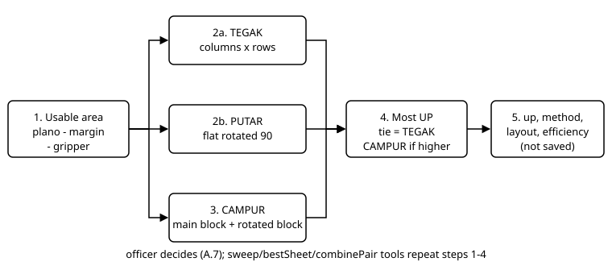

# ENGINE card: Imposition Engine

> DRAFT GROUP C (2026-10-16), awaiting Jo's approval. Source: `app/Services/Imposition/ImpositionEngine.php` read in full (472 lines); test `ImpositionEngineProDevToolsTest` was run (7 passed, 19 asserts). The example numbers were computed myself via tinker (`--env=mockup`, without writing to the DB) and hand-checked.

- **Canonical name**: Imposition Engine. **Class**: `App\Services\Imposition\ImpositionEngine`. **Registry**: key `imposition`, mode `suggest`, group Pro-Dev. **Module/sub-module**: Sales > Inquiry & Quotation > Pro-Dev.
- **Frozen status**: ProDev = frozen zone (flow/data). This engine is pure calculation, it does not write the DB itself (FACT: no `DB::`/`save` in the file).
- **Synonyms**: UP, nesting, plano layout, print layout, TEGAK/PUTAR/CAMPUR.
- **NOT the same as**: manual nesting on the new ProDev screen (drawn in JS `prodev.blade.php`, not by this engine; see Finding 1). **NOT** `ProCostContextService::layoutGeometry` (that maps the layout result to the costing boxes).

## Trigger (no background / schedule)
Searched in `routes/console.php` (none), `app/Jobs` (none), Observers (none), all of `app/`, `resources/views`, `packages`. FACT, all callers of `new ImpositionEngine` / `app(ImpositionEngine::class)`:
| Trigger | Method | File:line | Note |
|---|---|---|---|
| v1 Imposition screen per Inquiry opened / size changed | `run`, `cells` | `resources/views/pages/inquiry/imposition.blade.php:67` (recompute), `:118` (suggestion for all active planos) | route `inquiry.imposition` (`routes/web.php:150`); incoming link from v1 form `form.blade.php:2621`. Menu v2 `SALES_IMPO` points to `v2:prodev`, not this screen. |
| Substitute material preview in Form WO | `run` | `resources/views/pages/production/wo-entry.blade.php:449` | display only, does not save |
| Costing Advisor, when no ProDev layout exists yet | `run` | `app/Services/Costing/CostingAdvisor.php:276` | read-only, marked ESTIMATE (see the Costing Advisor card) |
| Compute "effective cut" of a multi-part group | `applyFlap` | `app/Models/Master/ProdLayoutGroup.php:88` (from `ProCostContextService.php:139`, `costing.blade.php:268`) | flat size only, not `run` |
| OLD ProDev (archived) | all tools (`run`, `sweepFlap` line 622, `sweepInterlock` 673, `bestSheet` 726, `dieRuleMeterLari` 771, `combinePair` 854, `cells`, `applyFlap`) | `resources/views/pages/production/old_prodev.blade.php` | route `production.old-prodev` (`routes/web.php:338`) is alive, but the comment in `MenuRoutes.php` and the content of mockup `sys_app_menu` do not link it |

**Does not call this engine** (FACT, grep): the active ProDev screen `pages::production.prodev` (menu `v2:prodev`, `v2:prodev-new`, `v2:prodev-revise`): nesting is drawn and computed in JS on the client, the Save button only stores the result (`saveLayout`). `CostingEngine` does not call it either.

## Flow (text twin of diagram `../img/imposition.svg`)

1. `run(plano, flat, gap, gripper, margin)` computes the usable area = plano minus margin and gripper.
2. Compute the TEGAK arrangement (flat as is) and PUTAR (flat rotated 90 degrees); the one with more UP wins (tie = TEGAK).
3. Try CAMPUR: main block TEGAK, then the remaining width is filled with a PUTAR block; used only if the total UP is higher AND the rotated block is not empty.
4. Compute efficiency and waste; return `up`, `method`, `layout` (columns, rows, size per block).
5. `cells` turns `layout` into the coordinates of each cell (mm from the top-left of the plano) for drawing.
6. Extra tools (all call `run` repeatedly): `sweepFlap` (flap length variation), `sweepInterlock` (flap + shift "69"), `bestSheet` (all active planos), `combinePair` (two parts at once), `dieRuleMeterLari` (knife running metres).
7. The result is a suggestion; the officer decides (A.7). The engine does not save.

## Input / Output
- **Input**: method arguments (no DB reads), in mm: `planoW, planoH, flatW, flatH, gap, gripper, margin`; sweep: `flapMin, flapMax, step, flapSide` (TOP/BOTTOM/LEFT/RIGHT); `bestSheet`: collection `mat_plano_size` (given by the caller; the engine itself does not query). Screen defaults: `sys_constant` `PRODEV_GAP_MM`=3, `PRODEV_GRIPPER_MM`=12, `PRODEV_MARGIN_MM`=8, `PRODEV_FLAP_MIN_MM`=20 (FACT, mockup DB), but the engine does not read them itself.
- **Output (return values only)**: `up`, `method` (TEGAK/PUTAR/CAMPUR), `efficiency_pct`, `waste_pct`, `layout`, `area_w`, `area_h`; sweep adds `flap_length_mm`, `shift_offset_mm`, `flat_w`, `flat_h`; `bestSheet` adds `plano_size_id`, `plano_name`, `cost_metric`, `gross_sheets`; `combinePair` gives `recommend` (COMBINED/SEPARATE/NONE), `combined`, `separate`, `saving_pct`.
- **Who writes the result**: the caller. The v1 screen writes `iqp_layout` (`imposition.blade.php:75-82`: `method`, `up_count`, `efficiency_pct`, `waste_pct`, `layout_detail`), only when `stat_confirm` is not yet 1 (`:63`). The active ProDev writes `prod_layout_group` and `iqp_layout` from its own JS result.

## FORMULA
Unit: mm, except `up` (pieces per sheet) and percent. No rounding unless stated.
1. `areaW = planoW - 2*margin`; `areaH = planoH - gripper - 2*margin` (lines 11-12).
2. `fit(avail, item, gap) = max(0, floor((avail + gap) / (item + gap)))` (line 458); `n = fit(areaW, itemW) * fit(areaH, itemH)` (lines 461-471). An item with a side <= 0 gives n = 0.
3. TEGAK = `n(flatW, flatH)`; PUTAR = `n(flatH, flatW)`; `up` = the larger, TEGAK if equal (line 17).
4. CAMPUR: `mainCols = fit(areaW, flatW)`, `usedW = mainCols*(flatW+gap) - gap`, `restW = areaW - usedW - gap`, `mainRows = fit(areaH, flatH)`; `rotCols = fit(restW, flatH)`, `rotRows = fit(areaH, flatW)`; total = `mainCols*mainRows + rotCols*rotRows`; replaces the previous result when `total > up` AND `rotCols*rotRows > 0` (lines 27-46).
5. `efficiency = up * flatW * flatH / (areaW * areaH) * 100`, clamped to 0-100 and rounded to 2 decimals; `waste = 100 - efficiency` clamped the same way (lines 48-56). Note: the efficiency base = usable area (not the whole plano).
6. `applyFlap`: LEFT/RIGHT adds the flap to the width, otherwise to the height (lines 166-172).
7. `sweepFlap`: for `flap = flapMin ... flapMax` (multiples of `step`, tolerance +0.0001) compute `run` on the `applyFlap` flat size; sort UP descending then efficiency descending; take `topN` (default 5). `flapMax < flapMin` or `step <= 0` gives an empty list.
8. `sweepInterlock`: the same, but for each `flap` try `shift = 0 ... flap` (multiples of `shiftStep`) and the effective flat size uses `flap - shift` (line 206). The code author states that this model is an approximation, not a precise specification (comment lines 181-189); shift 0 = the `sweepFlap` result.
9. `bestSheet`: per plano take the top `sweepFlap` result (UP >= 1). "Cheapest" metric: if `targetQty > 0`: `ceil(targetQty/up) * (planoW*planoH)`; otherwise: `planoW*planoH / up`. Sorted ascending (lines 264-279). Material price is not used (assumes the same material on all planos).
10. `combinePair`: the area is split into two vertical columns, column A of width `x` (shifted by `splitStep`, default 5), B the rest; `upA`/`upB` = maximum of the two orientations; `sets = min(upA/qtyPerSkuA, upB/qtyPerSkuB)`; keep the `x` with the largest `sets`. `area_per_set = planoArea / sets`. Separate comparison: `planoArea/soloUpA*qtyA + planoArea/soloUpB*qtyB`. `saving_pct = (1 - gabung/pisah)*100` (lines 309-391). `recommend` = COMBINED only when combined < separate; NONE when no `x` holds both.
11. `dieRuleMeterLari`: cut = `(cols+1)*gridH + (rows+1)*gridW` (shared knife between cells), with `gridW = cols*iw + (cols-1)*gap`, etc.; for CAMPUR the two grids are added. Fold = `up * panjangGarisLipat` (body width when the flap is TOP/BOTTOM, height when LEFT/RIGHT). Perforation = 0 (comment: no data source yet). Result = `(potong+lipat)/1000` metres, 4 decimals.

**Worked example (computed and hand-checked, plano 79x109 = 790x1090, gap 3, gripper 12, margin 8)**
| Flat (mm) | `run` result | Hand check |
|---|---|---|
| 300 x 200 | 10 UP, TEGAK, efficiency 72.99% | areaW 774, areaH 1062; columns floor(777/303)=2, rows floor(1065/203)=5 = 10; 10*60,000/821,988 = 72.99% |
| 250 x 100 | 30 UP, TEGAK, 91.24% | 3 columns x 10 rows; 750,000/821,988 |
| 128 x 102 | 58 UP, CAMPUR, 92.12% | TEGAK 5x10 = 50, PUTAR 7x8 = 56; mixed 5x10 + 1x8 = 58 > 56; `offX` 655 |
| 780 x 300 | 2 UP, PUTAR, 56.94% | (engine result, not hand-checked) |
| 2000 x 2000 | 0 UP, TEGAK, 0% | does not fit |
- `sweepFlap`, body 200x150, flap TOP 20-50 step 5, top 3: flap 40 = 20 UP PUTAR 92.46%; flap 35 = 20 UP 90.03%; flap 30 = 20 UP 87.59%. Hand check flap 40: flat 200x190, PUTAR 4 columns x 5 rows = 20, 20*38,000/821,988 = 92.46%. The other two were not hand-checked.
- `combinePair` (plano 790x1090; A 300x200 qty 1, B 150x100 qty 1; step 10): COMBINED, `x` 610, 10 UP A + 10 UP B, 10 sets per sheet, saving 16.67% (engine result; the test asserts only COMBINED and saving > 0).
- `dieRuleMeterLari` grid 2x3, 100x80, 6 UP, gap 3, flap TOP, body 100x80 = 2.15 m (same as the test).

## Edge cases
- Flat 0 or larger than the plano: `up` 0, efficiency 0, `method` stays TEGAK (FACT, executed). The caller must check `up < 1`.
- Negative `restW`: `fit` gives 0, no rotated block.
- The result does not consider grain direction, press size, or minimum bite other than the `gripper` given by the caller.
- Ties between flaps are sorted stably by order of appearance (PHP `usort` is stable).

## Used by (relations)
- **source**: `prod_part` / `iqp_part` (flat, flap), `mat_plano_size` (plano). **used_by**: v1 Imposition screen, Form WO (preview), Costing Advisor, OLD ProDev. **downstream**: `iqp_layout`, `prod_layout_group` (filled by the caller); Costing reads `up_count`/layout via `ProCostContextService`. Related concepts: Product type, `../inquiry-product/20_engine_dieline.md` (source of the flat size).

## Open items
`docs/ENGINE-ATTENTION.md` has no item for this engine (read in full; status stays there, not copied).

## Findings (recorded, not fixed)
1. The registry lists the user "Pro-Dev workbench (Imposition tab)" (`EngineRegistry.php:160`). FACT: the active ProDev screen does not call the engine; only the old ProDev does, which is not linked from the menu. The registry text is misleading.
2. The registry lists the user "Costing Engine (flat area per part)". FACT: `CostingEngine` does not call this engine. The comment `ImpositionEngine.php:164` refers to `IqpCostingPart::allocateProportionalCost()` which does not exist (grep); what exists is `ProdLayoutGroup::effectiveCutFor` (uses `applyFlap`).
3. The values gap 3 / gripper 12 / margin 8 are written literally in `imposition.blade.php:45-50` and `CostingAdvisor.php:276` (and `old_prodev` via constants), although constants `PRODEV_GAP_MM`, `PRODEV_GRIPPER_MM`, `PRODEV_MARGIN_MM` exist (same values now). If the constants are changed, three callers do not follow.
4. Tests do not cover `run` (the TEGAK/PUTAR/CAMPUR basis), `sweepFlap`, `sweepInterlock`, `cells`, `applyFlap` directly (only three tools: `dieRuleMeterLari`, `bestSheet`, `combinePair`).
5. Each sweep tool is only called from the old ProDev; if the old ProDev is dropped, five methods have no caller. Jo's decision.

## Tests
`tests/Unit/ImpositionEngineProDevToolsTest.php` (7 tests; `dieRuleMeterLari` x2, `bestSheet` x2, `combinePair` x3).

> Checked 2026-10-16 after the ProCost BOM panel change (`ProCostContextService`, `costing.blade.php`; Jo agreed): the content of this card is not affected; cited line numbers of those two files may be about 30 lines lower. Only the cited items were re-read, not the whole card.

> Checked 2026-10-16 after the ProCost Book button (costing.blade.php; Jo agreed): the content of this card is not affected; cited line numbers of costing.blade.php may be about 70 lines lower. Only the cited items were re-read.

> Checked 2026-10-16 after adding the Technical Guide diagram route (`routes/web.php`: one `require` appended to an existing line, no line numbers moved; `routes/web.php:150` and `:339` re-read and still correct). Content of this card is not affected.

> Checked 2026-10-16 after the ProCost Book button (costing.blade.php; Jo agreed): the content of this card is not affected; cited line numbers of costing.blade.php may be about 70 lines lower. Only the cited items were re-read.

> Re-checked 2026-10-17 against `EngineRegistry.php` and `engines.json`: key `paper-price` (Procurement) was added after the lines cited here; nothing in this card changed.

> Re-checked 2026-10-17 against `EngineRegistry.php` and `engines.json`: the `paper-price` entry text now names the Tax Rate screen (`fin_tax_rate`) for PPN; nothing in this card changed.

> Re-checked 2026-10-17 against `EngineRegistry.php` and `engines.json`: key `single-face-price` (Procurement) was added after the lines cited here; nothing in this card changed.

> Re-checked 2026-10-17 against `EngineRegistry.php` and `engines.json`: keys `duplex-price` and `corrugated-sheet-price` (Procurement) were added after the lines cited here; nothing in this card changed.

- Re-checked 2026-10-18 after the `routes/web.php` edit (v1 `/self-service` route replaced by a redirect to `v2.profile`, rule D.25); the block keeps its 4 lines so every cited line number is unchanged, content still true.

- Re-checked 2026-10-18 after the duplicate-module cleanup (v1 Scheduling Board, Rule Library and Master Crew removed): corrected `EngineRegistry.php` (user text now line 160), `wo-entry.blade.php` (the `ImpositionEngine::run` call is now line 449; REMARK block added) and the route `production.old-prodev` (now `routes/web.php:338`); `routes/web.php:150` is unchanged. `MenuRoutes.php` is cited without a line number and its old-prodev comment still exists. Content of this card is not affected.

- Re-checked 2026-10-18 after the `routes/web.php` edit (v1 `/finance/coa` route replaced by a one-line redirect to `/v2/s/acc-coa`, rule D.25); the block keeps its line count so every cited line number is unchanged, content still true.
- Re-checked 2026-10-18 after `app/Support/Menu/MenuRoutes.php` lost the `ACC_COA` entry (Master of Accounts is v2 only, rule D.25); content of this card is not affected.
- Re-checked 2026-10-18 after the `routes/web.php` edit (v1 `/finance/journals` route replaced by a one-line redirect to `/v2/s/acc-journal`, rule D.25); the block keeps its line count so every cited line number is unchanged, content still true.
- Re-checked 2026-10-18 after `app/Support/Menu/MenuRoutes.php` lost the `ACC_JRN` entry (Journal Entries is v2 only, rule D.25); content of this card is not affected.
- Re-checked 2026-10-18 after the `routes/web.php` edit (v1 `/finance/cash-bank` route replaced by a one-line redirect to `/v2/s/acc-cash-bank`, rule D.25); the block keeps its line count so every cited line number is unchanged, content still true.
- Re-checked 2026-10-18 after `app/Support/Menu/MenuRoutes.php` lost the `FIN_CASH` entry (Cash & Bank is v2 only, rule D.25); content of this card is not affected.
- Re-checked 2026-10-18 after the `routes/web.php` edit (v1 `/finance/payables` route replaced by a one-line redirect to `/v2/s/acc-payables`, rule D.25); the block keeps its line count so every cited line number is unchanged, content still true.
- Re-checked 2026-10-18 after `app/Support/Menu/MenuRoutes.php` lost the `FIN_AP` entry (Procure to Pay is v2 only, rule D.25); content of this card is not affected.
- Re-checked 2026-10-18 after the `routes/web.php` edit (v1 `/finance/assets` route replaced by a one-line redirect to `/v2/s/acc-fixed-asset`, rule D.25); the block keeps its line count so every cited line number is unchanged, content still true.
- Re-checked 2026-10-18 after `app/Support/Menu/MenuRoutes.php` lost the `ACC_FIXEDASSET` entry (Fixed Assets is v2 only, rule D.25); content of this card is not affected.
- Re-checked 2026-10-18 after the `routes/web.php` edit (v1 `/finance/amortization` route replaced by a one-line redirect to `/v2/s/acc-amortization`, rule D.25); the block keeps its line count so every cited line number is unchanged, content still true.
- Re-checked 2026-10-18 after `app/Support/Menu/MenuRoutes.php` lost the `ACC_AMORT` entry (Amortization is v2 only, rule D.25); content of this card is not affected.
- Re-checked 2026-10-18 after the `routes/web.php` edit (v1 `/master/customer` route replaced by a one-line redirect to `/v2/s/md-customer`, and `routes/v2_master.php` required on the same line as `v2_finance.php`, rule D.25); no line was added or removed so every cited line number is unchanged, content still true.
- Re-checked 2026-10-18 after `app/Support/Menu/MenuRoutes.php` lost the `MD_CUST` and `PRE_MD_CUST` entries (Master Customer is v2 only, rule D.25); content of this card is not affected.
- Re-checked 2026-10-18 after the `routes/web.php` edit (v1 `/master/supplier` route replaced by a one-line redirect to `/v2/s/md-supplier`, rule D.25); the block keeps its line count so every cited line number is unchanged, content still true.
- Re-checked 2026-10-18 after `app/Support/Menu/MenuRoutes.php` lost the `MD_SUPP` entry (Master Supplier is v2 only, rule D.25); content of this card is not affected.
- Re-checked 2026-10-18 after Master Raw Material moved to the v2 form `md-raw-form` (rule D.25): `routes/web.php` replaced the three v1 raw-material routes by redirects on the same lines (no line added or removed), `routes/v2_master.php` gained the raw-material block at its end, `app/Support/V2/Screens.php` gained one group entry far below line 65 and only the text of its line 16 changed, `app/Support/Menu/MenuRoutes.php` lost the three raw-material entries; this card does not depend on the removed lines and its content is still true.
- Re-checked 2026-10-19 after the Master Warehouse v1 pages were removed (rule D.25): `routes/web.php` replaced the four v1 warehouse routes by redirects on the same lines (no line added or removed), `app/Support/V2/Grid/Grids.php` lost the `WarehouseGrid` entry (a line cited after line 37 moved up by one and the citations in this card were shifted accordingly), `app/Support/Menu/MenuRoutes.php` lost the `MD_WH` and `INV_REF_WH` entries; this card does not depend on the removed lines and its content is still true.
- Re-checked 2026-10-19 after the Master Shift v1 page was removed (rule D.25): `routes/web.php` replaced the v1 `/master/shift` route by a one-line redirect on the same line (no line added or removed), `routes/v2_master.php` gained the shift block at its end, `app/Support/V2/Screens.php` gained one group entry far below line 65, `app/Support/Menu/MenuRoutes.php` lost the `MD_SHIFT` entry; this card does not depend on the removed lines and its content is still true.
- Re-checked 2026-10-19 after Master Product Market moved to the v2 form `sales-market-form` (rule D.25): `routes/web.php` replaced the three v1 `/lookup/product-market*` routes by redirects on the same lines (no line added or removed), `routes/v2_master.php` gained the product-market block at its end, `app/Support/V2/Screens.php` gained one group entry after the Sales Flow group (lines 40, 42 and 65 are unchanged), `app/Support/Menu/MenuRoutes.php` lost the `SALES_PMKT` entry; this card does not depend on the removed lines and its content is still true.
- Re-checked 2026-10-19 after Stock In moved to the v2 form `inv-stock-in-form` (rule D.25, Master T5): `routes/web.php` replaced the v1 `/inventory/stock-in/{category}` route by a redirect on the same line (no line added or removed) and now also requires `routes/v2_stockdocs.php` on the line that requires `v2_finance.php`, `app/Support/V2/Screens.php` gained one group entry far below line 65, `app/Support/Menu/MenuRoutes.php` lost the three Stock In entries, `app/Support/V2/Lookups.php` gained the stock lookups and a REMARK block (cited lines shifted by 10 and corrected in the cards that cite them) and `app/Support/V2/Grid/Inv/StockDocGrid.php` gained the v2 form hook (cited lines corrected); this card does not depend on the changed lines and its content is still true.
- Re-checked 2026-10-19 after Stock Out moved to the v2 form and the Stock In form became the shared stock document form `inv-stock-doc-form` (rule D.25, Master T5): `routes/web.php` replaced the v1 `/inventory/stock-out/{category}` route by a redirect on the same line (no line added or removed), `routes/v2_stockdocs.php` was rewritten around `v2.inv.stockdoc.*`, `app/Support/V2/Screens.php` renamed one entry far below line 65, `app/Support/Menu/MenuRoutes.php` lost the two Stock Out entries and `app/Support/V2/Grid/Inv/StockDocGrid.php` now opens the form for Stock In and Stock Out (cited lines corrected in the cards that cite them); this card does not depend on the changed lines and its content is still true.
- Re-checked 2026-10-19 after Return from Production moved to the v2 form `inv-stock-doc-form` (rule D.25, Master T5c): `routes/web.php` replaced the v1 `/inventory/stock-return/{category}` route by a redirect on the same line (no line added or removed), `app/Support/Menu/MenuRoutes.php` lost the two Return entries, `app/Support/V2/Lookups.php` gained the `stock_return_bin` lookup (lines after 68 moved by two), `app/Services/Inventory/StockPostingService.php` gained the `addReturned` call on an existing line and one method at the end of the file, and `routes/v2_stockdocs.php`, `StockDocGrid.php` and the screen got the Return kind; this card does not depend on the changed lines and its content is still true.
- Re-checked 2026-10-19 after Stock Adjustment and Opname moved to the v2 form `inv-stock-adj-form` (rule D.25, Master T5d): `routes/web.php` replaced the v1 `/inventory/stock-adjustment/{category}/{doc?}` route by a redirect on the same line (no line added or removed), `app/Support/Menu/MenuRoutes.php` lost the three Adjustment entries, `app/Support/V2/Screens.php` got one item appended on an existing line, `app/Support/V2/Grid/Inv/StockDocGrid.php` and `app/Support/V2/Data/ApprovalCenter.php` changed in the inventory and approval parts, and `routes/v2_stockdocs.php` got a second route group at the end; this card does not depend on the changed lines and its content is still true.
- Re-checked 2026-10-19 after Purchase Return moved to the v2 form `pur-return-form` (rule D.25, Master T6): `routes/web.php` replaced the v1 `/purchasing/prt` and `/purchasing/prt/{prt}/edit` routes by redirects on the same lines and now also requires `routes/v2_purchase_return.php` on the line that requires `v2_finance.php`, `app/Support/Menu/MenuRoutes.php` lost `PROC_RET`, `app/Support/V2/Screens.php` got one item appended on an existing line, and `app/Support/V2/Data/ApprovalCenter.php` and `PurchaseReturnGrid.php` changed in the Purchase Return parts; this card does not depend on the changed lines and its content is still true.
- Re-checked 2026-10-19 after Purchase Return moved to the v2 form `pur-return-form` (rule D.25, Master T6): `routes/web.php` replaced the v1 `/purchasing/prt` and `/purchasing/prt/{prt}/edit` routes by redirects on the same lines and now also requires `routes/v2_purchase_return.php` on the line that requires `v2_finance.php`, `app/Support/Menu/MenuRoutes.php` lost `PROC_RET`, `app/Support/V2/Screens.php` got one item appended on an existing line, and `app/Support/V2/Data/ApprovalCenter.php` and `PurchaseReturnGrid.php` changed in the Purchase Return parts; this card does not depend on the changed lines and its content is still true.
- Re-checked 2026-10-19 after Routing Template moved to the v2 form `prod-routing-form` (rule D.25, Master T6b): `routes/web.php` replaced the v1 `/production/routing-template` route by a redirect on the same line (no line added or removed), `app/Support/Menu/MenuRoutes.php` lost `PROD_ROUTING_TPL`, `app/Support/V2/Screens.php` got one item appended on an existing line, `app/Support/V2/Lookups.php` gained the `prod_process` and `prod_machine` lookups after the stock lookups (cited lines before them did not move), and `routes/v2_production.php` and `RoutingTemplateGrid.php` serve the new form; this card does not depend on the changed lines and its content is still true.
- Re-checked 2026-10-19 after BOP Rule moved to the v2 form `prod-bop-form` (rule D.25, Master T6b): `routes/web.php` replaced the v1 `/production/bop-rule` route by a redirect on the same line (no line added or removed), `app/Support/Menu/MenuRoutes.php` lost `PROD_MST_BOP_RULE`, `app/Support/V2/Screens.php` got one item appended on an existing line, and `routes/v2_production.php` and `BopRuleGrid.php` serve the new form; this card does not depend on the changed lines and its content is still true.
- Re-checked 2026-10-19 after Master Process moved to the v2 form `prod-process-form` (rule D.25, Master T6b): `routes/web.php` replaced the v1 `/production/master-process` route by a redirect on the same line (no line added or removed), `app/Support/Menu/MenuRoutes.php` lost `PRE_MD_PROCESS` and `PROD_MST_PROCESS`, `app/Support/V2/Lookups.php` gained the `prod_machine_proc` lookup, `app/Support/V2/Screens.php` got one item appended on an existing line, and `routes/v2_production.php` got the `v2.prod.process.save` group at the end of the file; this card does not depend on the changed lines and its content is still true.
- Re-checked 2026-10-19 after Master Machine moved to the v2 form `prod-machine-form` (rule D.25, Master T6b): `routes/web.php` replaced the v1 `/master/machine` route by a redirect on the same line (no line added or removed), `app/Support/Menu/MenuRoutes.php` lost `PRE_MD_MACHINE` and `MD_MACHINE`, `app/Support/V2/Lookups.php` gained the `prod_process_machine_side` and `prod_machine_model` lookups (lines after 74 moved by five), `app/Support/V2/Screens.php` got one item appended on an existing line, `routes/v2_production.php` got the `v2.prod.machine.save` group at the end of the file, and the Process Form got `row-lock` on its machine table; this card does not depend on the changed lines and its content is still true.
- Re-checked 2026-10-19 after GPS Location Approval moved to the v2 form `hrm-gps-form` (rule D.25, T7 HRM): `routes/web.php` replaced the v1 `/hrm/gps-approval` route by a redirect on the same line (no line added or removed) and `v2_hrm.php` is loaded on the same line as the other v2 route files, `app/Support/Menu/MenuRoutes.php` lost `HRM_GPS_APPROVAL`, and `app/Support/V2/Screens.php` got one item appended on an existing line; this card does not depend on the changed lines and its content is still true.
- Re-checked 2026-10-19 after Employee Bank moved into the Master Employee form (rule D.25, T7b HRM): `routes/web.php` replaced the v1 `/hrm/payroll/employee-bank` route by a redirect on the same line (no line added or removed) and `app/Support/Menu/MenuRoutes.php` lost `HRM_PAYROLL_BANK`; this card does not depend on the changed lines and its content is still true.
- Re-checked 2026-10-19 after Employee Data Correction moved to the v2 form `hrm-correction-form` (rule D.25, T7c HRM): `routes/web.php` replaced the v1 `/hrm/correction-requests` route by a redirect on the same line (no line added or removed), `app/Support/Menu/MenuRoutes.php` lost `HRM_CORRECTION`, `app/Support/V2/Screens.php` got one item appended on an existing line, and `routes/v2_hrm.php` got the `v2.hrm.correction.decide` group at the end of the file; this card does not depend on the changed lines and its content is still true.
- Re-checked 2026-10-19 after Leave / Sick / Permit Approval moved to the v2 form `hrm-leave-form` (rule D.25, T7d HRM): `routes/web.php` replaced the v1 `/hrm/leave-requests` route by a redirect on the same line (no line added or removed), `app/Support/Menu/MenuRoutes.php` lost `HRM_LEAVE_APPROVAL`, `app/Support/V2/Screens.php` got one item appended on an existing line, and `routes/v2_hrm.php` got the `v2.hrm.leave.decide` group at the end of the file; this card does not depend on the changed lines and its content is still true.
- Re-checked 2026-10-19 after Daily Attendance moved to the v2 form `hrm-attendance-form` (rule D.25, T7e HRM): `routes/web.php` replaced the v1 `/hrm/attendance-daily` route by a redirect on the same line (no line added or removed), `app/Support/Menu/MenuRoutes.php` lost `HRM_ATTENDANCE`, `app/Support/V2/Screens.php` got one item appended on an existing line, and `routes/v2_hrm.php` got the `v2.hrm.attendance.*` group at the end of the file; this card does not depend on the changed lines and its content is still true.
- Re-checked 2026-10-19 after SOP Documents moved to the v2 form `hrm-sop-form` (rule D.25, T7f HRM): `routes/web.php` replaced the v1 `/hrm/sop` route by a redirect on the same line (no line added or removed), `app/Support/Menu/MenuRoutes.php` lost `HRM_SOP`, `app/Support/V2/Screens.php` got one item appended on an existing line, `routes/v2_hrm.php` got the `v2.hrm.sop.save` group at the end of the file, and `routes/v2_maintenance.php` now calls `MntDocumentService` in the document route (rules unchanged); this card does not depend on the changed lines and its content is still true.
- Re-checked 2026-10-19 after Recruitment Vacancy moved to the v2 form `hrm-rcr-vacancy-form` (rule D.25, T7g HRM): `routes/web.php` replaced the v1 `/hrm/recruitment/vacancy` route by a redirect on the same line (no line added or removed), `app/Support/Menu/MenuRoutes.php` lost `HRM_RCR_VACANCY`, `app/Support/V2/Lookups.php` gained the `rcr_requisition_approved` lookup, `app/Support/V2/Screens.php` got one item appended on an existing line, and `routes/v2_hrm.php` got the `v2.hrm.vacancy.save` group at the end of the file; this card does not depend on the changed lines and its content is still true.
- Re-checked 2026-10-19 after Recruitment Talent Pool moved to the v2 form `rcr-talent-pool-form` (rule D.25, T7h HRM): `routes/web.php` replaced the v1 `/hrm/recruitment/talent-pool` route by a redirect on the same line (no line added or removed), `app/Support/Menu/MenuRoutes.php` lost `HRM_RCR_TALENTPOOL`, `app/Support/V2/Lookups.php` gained the `rcr_vacancy_open` lookup, `app/Support/V2/Screens.php` got one item appended on an existing line, and `routes/v2_hrm.php` got the `v2.hrm.talentpool.invite` group at the end of the file; this card does not depend on the changed lines and its content is still true.
- Re-checked 2026-10-19 after Recruitment Assessment Result moved to the v2 form `hrm-rcr-assessment-form` (rule D.25, T7i HRM): `routes/web.php` replaced the v1 `/hrm/recruitment/assessment-result` route by a redirect on the same line (no line added or removed), `app/Support/Menu/MenuRoutes.php` lost `HRM_RCR_ASSESSMENT`, `app/Support/V2/Lookups.php` gained the `rcr_assessment_awaiting` lookup, `app/Support/V2/Screens.php` got one item appended on an existing line, and `routes/v2_hrm.php` got the `v2.hrm.assessment.save` group at the end of the file; this card does not depend on the changed lines and its content is still true.
- Re-checked 2026-10-19 after Recruitment Provision moved to the v2 form `hrm-rcr-provision-form` (rule D.25, T7j HRM): `routes/web.php` replaced the v1 `/hrm/recruitment/hire-provision` route by a redirect on the same line (no line added or removed), `app/Support/Menu/MenuRoutes.php` lost `HRM_RCR_PROVISION`, `app/Support/V2/Screens.php` got one item appended on an existing line, and `routes/v2_hrm.php` got the `v2.hrm.provision.save` group at the end of the file; this card does not depend on the changed lines and its content is still true.
- Re-checked 2026-10-19 after Recruitment Interview Schedule moved to the v2 form `hrm-rcr-interview-form` (rule D.25, T7k HRM): `routes/web.php` replaced the v1 `/hrm/recruitment/interview-schedule` route by a redirect on the same line (no line added or removed), `app/Support/Menu/MenuRoutes.php` lost `HRM_RCR_INTERVIEW`, `app/Support/V2/Lookups.php` gained the `rcr_interview_awaiting` lookup, `app/Support/V2/Screens.php` got one item appended on an existing line, and `routes/v2_hrm.php` got the `v2.hrm.interview.save` group at the end of the file; this card does not depend on the changed lines and its content is still true.
- Re-checked 2026-10-20 after Recruitment Manpower Requisition moved to the v2 form `hrm-rcr-requisition-form` (rule D.25, T7l HRM): `routes/web.php` replaced the two v1 `/hrm/recruitment/requisition` routes (list, entry) by redirects on the same lines (no line added or removed), `app/Support/Menu/MenuRoutes.php` lost `HRM_RCR_REQUISITION`, `app/Support/V2/Screens.php` got one item appended on an existing line, and `routes/v2_hrm.php` got the `v2.hrm.requisition.save` group at the end of the file; this card does not depend on the changed lines and its content is still true.
- Re-checked 2026-10-20 after Recruitment Offering moved to the v2 form `hrm-rcr-offer-form` (rule D.25, T7m HRM): `routes/web.php` replaced the two v1 `/hrm/recruitment/offer` routes (list, entry) by redirects on the same lines (no line added or removed), `app/Support/Menu/MenuRoutes.php` lost `HRM_RCR_OFFER`, `app/Support/V2/Screens.php` got one item appended on an existing line, and `routes/v2_hrm.php` got the `v2.hrm.offer.save` group at the end of the file; this card does not depend on the changed lines and its content is still true.
- Re-checked 2026-10-20 after Recruitment Candidate Review moved to the v2 form `hrm-rcr-review-form` (rule D.25, T7n HRM): `routes/web.php` replaced the v1 candidate-review routes (list, detail) and the v1 `pipeline-board` route by redirects on the same lines (no line added or removed), `app/Support/Menu/MenuRoutes.php` lost `HRM_RCR_REVIEW` and `HRM_RCR_PIPELINE`, and `app/Support/V2/Screens.php` got one item appended on an existing line; this card does not depend on the changed lines and its content is still true.
- Re-checked 2026-10-20 after Payroll Salary & Tax moved to the v2 form `hrm-salary-form` (rule D.25, T8 Payroll): `routes/web.php` replaced the v1 `/hrm/payroll/employee-salary` route by a redirect on the same line (no line added or removed), `app/Support/Menu/MenuRoutes.php` lost `HRM_PAYROLL_SALARY`, `app/Support/V2/Screens.php` got one item appended on an existing line, and `routes/v2_hrm.php` got the `v2.hrm.salary.save` group at the end of the file; this card does not depend on the changed lines and its content is still true.
- Re-checked 2026-10-20 after Payroll Calculation (batch run) moved to the v2 form `hrm-payroll-run-form` (rule D.25, T8 Payroll): `routes/web.php` replaced the v1 `/hrm/payroll/batch-run` route by a redirect on the same line (no line added or removed), `app/Support/Menu/MenuRoutes.php` lost `HRM_PAYROLL_CALC`, `app/Support/V2/Screens.php` got one item appended on an existing line, and `routes/v2_hrm.php` got the `v2.hrm.payrollrun.save` group at the end of the file; this card does not depend on the changed lines and its content is still true.
- Re-checked 2026-10-20 after Payroll Payslip moved to the v2 form `hrm-payslip-form` and the `payslip` print document (rule D.25, T8 Payroll): `routes/web.php` replaced the three v1 payslip routes (list, print, print-all) by redirects on the same lines (no line added or removed), `app/Support/Menu/MenuRoutes.php` lost `HRM_PAYROLL_PAYSLIP`, `app/Support/V2/Screens.php` got one item appended on an existing line, and `routes/v2_hrm.php` got the `v2.hrm.payslip.*` group at the end of the file; this card does not depend on the changed lines and its content is still true.
- Re-checked 2026-10-20 after Setup Security Account and Group moved to the v2 forms `security-account-form` and `security-group-form` (rule D.25, T8 Setup): `routes/web.php` replaced the v1 `/security` route by a redirect on the same line and appended `require __DIR__.'/v2_setup.php';` to the existing `require` line (no line added or removed), `app/Support/Menu/MenuRoutes.php` now maps `SET_USER`, `SET_GROUP`, `SET_PERM` and `SET_MIGRATION` to v2 screens, and `app/Support/V2/Screens.php` got two items appended on an existing line; this card does not depend on the changed lines and its content is still true.
- Re-checked 2026-10-20 after Setup Support Tickets moved to the v2 form `support-ticket-form` (rule D.25, T8 Setup): `routes/web.php` replaced the v1 `/setup/support-tickets` route by a redirect on the same line (no line added or removed), `app/Support/Menu/MenuRoutes.php` now maps `SET_TICKETS` to the v2 grid, and `app/Support/V2/Screens.php` got one item appended on an existing line; this card does not depend on the changed lines and its content is still true.
- Re-checked 2026-10-20 after the leading comment of `app/Support/V2/Print/PrintDocs.php` and `app/Support/V2/Screens.php` was rewritten as a REMARK block (same number of lines, code untouched): every cited line number of both files is unchanged and this card's content is still true.
- Re-checked 2026-10-20 after the v1 duplicate pass (rule D.25, Jo decision T9): `routes/web.php` replaced the v1 list/print/entry routes of Purchase, Delivery, Win-Rate, Org Chart, Bank Transfer, Setup, Help and the dead frozen-zone lists (Inquiry hub/recalc/revise, Quotation list, CO list, ProDev list) by redirects on the same lines (no line added or removed); `app/Support/Menu/MenuRoutes.php` and `app/Support/V2/Screens.php` changed values on the same lines (no line shift), `ProcurementBridge` links to the v2 PR screen with its leading comment rewritten as a REMARK of the same length. Every cited line number is unchanged and this card's content is still true. 
- Re-checked 2026-10-20 after the Management Reports moved to v2 (rule D.25, T9): `routes/web.php` replaced the eight v1 `/laporan/*` routes by redirects on the same lines (no line added or removed), `app/Support/Menu/MenuRoutes.php` maps `MGMT_*` to the v2 screens on the same lines and `app/Support/V2/Screens.php` gained the `mgmt-*` items on the existing `mgmt-executive` line (no line shift). Every cited line number is unchanged and this card's content is still true.
- Re-checked 2026-10-20 after Notification Center and Localization moved to v2 (rule D.25, T9): `routes/web.php` replaced the v1 `/notifications` and `/setup/localization` routes by redirects on the same lines (no line added or removed), `app/Support/Menu/MenuRoutes.php` maps `SET_LOCALIZATION` to the v2 screen on the same line, `app/Support/V2/Grid/Grids.php` lists `LocalizationLookup` on the existing `LanguageLookup` line and `app/Support/V2/Grid/DbLookup.php` gained the method `addRows()` after the last method (props() only passes it on). Every cited line number is unchanged and this card's content is still true.
- Re-checked 2026-10-20 after the roster print, the Work Order print and Process Rate moved to v2 (rule D.25, T9): `routes/web.php` replaced the v1 `/hrm/shift-roster/print`, `/production/wo/{wo}/print` and `/production/process-rate` routes by redirects on the same lines (no line added or removed), `app/Support/Menu/MenuRoutes.php` maps `PROD_PROCESS_RATE` to the v2 screen on the same line, `app/Support/V2/Grid/Grids.php` and `app/Support/V2/Screens.php` list the new rate sheets and the `production-process-rate` screen on existing lines, `routes/v2_hrm.php` and `routes/v2_production.php` gained one route each at the end of the file, and the v2 Work Order screen shows a Print button on the same line as Back (no line shift). Every cited line number is unchanged and this card's content is still true.
