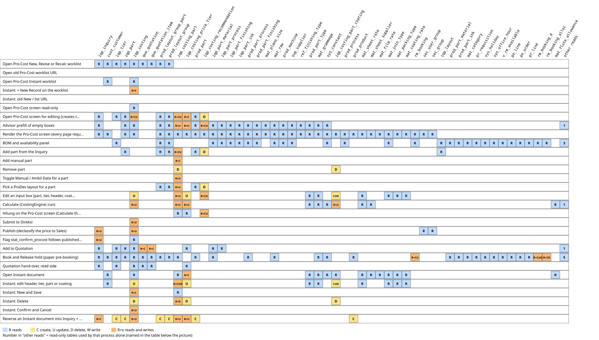
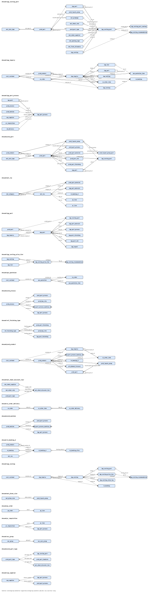

# Sub-module: Product Costing (Pro-Cost)

> The sub-module page only summarizes and links; table/column facts are in the cards. Updated 2026-10-16 (Phase 2).

- **Module**: Sales > Inquiry & Quotation > Pro-Cost. Menu (FACT, `sys_app_menu` mockup): Pro-Cost New, Revise, Recalc, Instant (`v2:sales-procost*`).
- **Purpose**: calculate HPP and selling price per qty tier from Inquiry + ProDev; costing is confidential (A.8-A.9), publish = declassification to Sales.
- **Frozen zone**: ProCost flow/data. Read: `docs/claude_vital_flows.md`, `docs/ENGINE-ATTENTION.md`.

## Relations
- **source**: Inquiry Product (BOM, part, `stat_confirm_sales`), ProDev (layout, BOP waste, `stat_confirm_prodev`), rate masters (`prod_part_template`, `mat_grammage`), COSTING constants.
- **used_by**: Quotation (published price, must be integrated A.1), then Customer Order.
- **flags**: `stat_confirm_procost` in `iqp_inquiry` (A.20).

## Cards and engines
| Content | File |
|---|---|
| ProCost interface (Sales side) | `11_card_procost-interface.md` |
| Costing Advisor | `10_engine_costing-advisor.md` |
| Costing Engine (price formula) | `20_engine_costing-engine.md` |
| Reverse Costing | `30_engine_reverse-costing.md` |
| Quotation (price recipient) | `../quotation/10_card_quotation.md` |

## Diagram
`../img/costing-advisor.svg`, `../img/costing-engine.svg` (text twin is in the cards, section "Flow").

## Existing User's Guide (UG)
`docs/guides/sales/03_procost.md` (section guide). The TG does not repeat its content.

> Checked 2026-10-16 after the SpecEngine / MaterialPlanningEngine change (Jo agreed): this card only names or links the changed cards; nothing in it needs to change.

> Checked 2026-10-16 after the ProCost BOM panel change (Jo agreed): this card only names or links the changed cards; nothing in it needs to change.

> Checked 2026-10-16 after the ProCost Book button (Jo agreed): this card only names or links the changed cards; nothing in it needs to change.

## Read/Write map

 Click the picture to open it full size.
Every process of the Pro-Cost sub-module with the tables it reads and writes (C create, U update, D delete), checked in code on 2026-10-18 against the dummy DBs (ddtsdi, ddtmst, ddtsys, ddtinv, ddtpur, ddtprd: all table names exist, `v_rm_available` and `v_fg_onhand` are views; no DB triggers in ddtsdi, ddtmst or ddtinv). Menu (FACT, `sys_app_menu` mockup, group 1162 Pro-Cost): Pro-Cost New (`v2:sales-procost`), Revise (`v2:sales-procost-revise`), Recalc (`v2:sales-procost-recalc`), Instant (`v2:sales-procost-instant`). The three New/Revise/Recalc worklists and the Instant worklist are v2 grids; every row opens an old Livewire page (`pages::inquiry.costing` for an Inquiry, `pages::inquiry.costing-instant` for an Instant document), so most processes below live in those two files.

| Process | Trigger | Reads | Writes | Evidence |
|---|---|---|---|---|
| Open Pro-Cost New, Revise or Recalc worklist | Menu Pro-Cost New / Revise / Recalc, GET v2.screen (grids CostingListGrid, CostingReviseGrid, CostingRecalcGrid) | `iqp_inquiry`, `cust_customer`, `iqp_tier`, `iqp_part`, `iqp_costing`, `quo_quotation`, `quo_quotation_item`, `prod_layout_group_part`, `prod_layout_group` | - | `app/Support/V2/Grid/Sales/CostingListGrid.php:38-41`, `app/Support/V2/Grid/Sales/CostingListGrid.php:48-56`, `app/Support/V2/Grid/Sales/InquiryDeskGrid.php:63-72`, `app/Support/V2/Data/Sales.php:229-301`, `app/Support/V2/Data/Sales.php:318-332`, `app/Services/Sales/QuotationBuilder.php:46-57`, `app/Services/Sales/InquiryStage.php:23-33`, `app/Support/V2/Grid/Grids.php:69-71` |
| Open old Pro-Cost worklist | Old page /inquiry/costing (pages::inquiry.costing-list, route inquiry.costing.list) | `iqp_inquiry`, `cust_customer`, `iqp_costing`, `iqp_part` | - | `routes/web.php:178`, `resources/views/pages/inquiry/costing-list.blade.php:63-77` |
| Open Pro-Cost Instant worklist | Menu Pro-Cost Instant, GET v2.screen (grid CostingInstantGrid) | `iqp_costing`, `cust_customer` | - | `app/Support/V2/Grid/Sales/CostingInstantGrid.php:61-64`, `app/Support/V2/Grid/Sales/CostingInstantGrid.php:93-96` |
| Instant: + New Record on the worklist | Pro-Cost Instant grid, New Record (GET v2 procost-instant.new, module COSTING) | `iqp_costing` | `iqp_costing` (C) | `routes/v2.php:1279-1286`, `app/Support/V2/Grid/Sales/CostingInstantGrid.php:98-101` |
| Instant: New on the old list | Old page /costing/instant (route inquiry.costing.instant.list), New button | `iqp_costing`, `cust_customer` | `iqp_costing` (C) | `routes/web.php:184`, `resources/views/pages/inquiry/costing-instant-list.blade.php:25-36`, `resources/views/pages/inquiry/costing-instant-list.blade.php:55-70` |
| Open Pro-Cost screen read-only | Pro-Cost screen with ?view=1 (wizard bar links), route inquiry.costing | `iqp_costing` | - | `routes/web.php:179`, `resources/views/pages/inquiry/costing.blade.php:76-85` |
| Open Pro-Cost screen for editing (creates the costing) | Click a worklist row, GET /inquiry/{id}/costing, mount() | `iqp_inquiry`, `iqp_part`, `iqp_tier`, `iqp_costing`, `iqp_costing_part`, `iqp_costing_price_tier`, `prod_part`, `prod_layout_group`, `prod_layout_group_part` | `iqp_costing` (CU), `iqp_costing_price_tier` (C), `iqp_costing_part` (CU), `iqp_costing_recommendation` (D) | `resources/views/pages/inquiry/costing.blade.php:76-135`, `resources/views/pages/inquiry/costing.blade.php:260-300`, `app/Services/Costing/ProCostContextService.php:155-190` |
| Advisor prefill of empty boxes | mount() while the status is DRAFT or CALCULATED; also after Add from Inquiry, Pick layout, and after the part name or type is typed | `iqp_costing`, `iqp_costing_part`, `iqp_costing_price_tier`, `iqp_costing_recommendation`, `iqp_inquiry`, `iqp_part`, `iqp_part_material`, `iqp_part_process`, `iqp_part_finishing`, `iqp_part_ink`, `prod_part`, `prod_part_process`, `prod_part_finishing`, `prod_layout_group`, `prod_layout_group_part`, `mat_plano_size`, `mat_raw`, `prod_machine`, `sup_supplier`, `ref_finishing_type`, `prod_part_template`, `prod_part_type`, `mat_grammage`, `sys_constant` | `iqp_costing_part` (U), `iqp_costing_price_tier` (U), `iqp_costing_recommendation` (CU) | `app/Services/Costing/CostingAdvisor.php:65-134`, `app/Services/Costing/CostingAdvisor.php:136-171`, `app/Services/Costing/CostingAdvisor.php:204-244`, `app/Services/Costing/CostingAdvisor.php:267-309`, `app/Services/Costing/CostingAdvisor.php:312-345`, `resources/views/pages/inquiry/costing.blade.php:130-132`, `resources/views/pages/inquiry/costing.blade.php:231-235`, `resources/views/pages/inquiry/costing.blade.php:507-509` |
| Render the Pro-Cost screen (every Livewire request) | Any request of pages::inquiry.costing | `iqp_costing`, `iqp_costing_part`, `iqp_costing_part_coating`, `iqp_costing_price_tier`, `iqp_inquiry`, `cust_customer`, `iqp_part`, `iqp_part_material`, `iqp_part_process`, `iqp_part_finishing`, `iqp_part_ink`, `iqp_costing_recommendation`, `prod_part`, `prod_part_process`, `prod_part_finishing`, `prod_process`, `prod_layout_group`, `prod_layout_group_part`, `prod_product`, `mat_plano_size`, `mat_raw`, `prod_machine`, `sup_supplier`, `ref_finishing_type`, `prod_part_type`, `mat_grammage`, `mat_sheet_rate`, `mat_sheet_supplier`, `mat_film_rate`, `mat_join_type`, `mat_packing_type`, `mat_coating_rate`, `rm_booking`, `sys_constant`, `sec_user_group`, `sec_group` | - | `resources/views/pages/inquiry/costing.blade.php:138-223`, `resources/views/pages/inquiry/costing.blade.php:354-359`, `resources/views/pages/inquiry/costing.blade.php:620-626`, `resources/views/pages/inquiry/costing.blade.php:667-673`, `resources/views/pages/inquiry/costing.blade.php:755-775`, `resources/views/pages/inquiry/costing.blade.php:777-788`, `app/Services/Costing/ProCostContextService.php:37-62`, `app/Services/Costing/ProCostContextService.php:89-153`, `app/Services/Costing/CostingAdvisor.php:246-256`, `app/Services/Costing/CostingAdvisor.php:430-433`, `app/Services/Costing/CostingAdvisor.php:504-515`, `app/Support/Costing/FormulaAccess.php:16-26`, `app/Models/Sys/SecUser.php:243-250` |
| BOM and availability panel | Render when the part is linked to ProDev and a tier qty exists; Recalculate button (refreshBom) | `iqp_layout`, `prod_layout_group`, `prod_layout_group_part`, `prod_part_process`, `prod_part_material`, `prod_part_ink`, `prod_part_finishing`, `prod_bop_rule`, `prod_part_process_machine_rate`, `prod_process`, `prod_machine`, `mat_raw`, `mat_category`, `mat_join_type`, `iqp_part_material`, `iqp_part_process`, `iqp_part_ink`, `iqp_part_finishing`, `iqp_tier`, `sup_supplier`, `pr_requisition`, `do_delivery`, `sys_constant`, `sys_holiday`, `sys_office_hour`, `v_rm_available`, `po_line`, `po_order`, `pr_line`, `rm_booking`, `rm_booking_d`, `rm_booking_alloc` | - | `app/Services/Costing/ProCostContextService.php:64-87`, `app/Services/ProDev/SpecEngine.php:1072-1128`, `app/Services/Planning/MaterialPlanningEngine.php:67-72`, `app/Services/Planning/MaterialPlanningEngine.php:695-708`, `app/Services/Planning/MaterialPlanningEngine.php:710-777`, `app/Services/Planning/MaterialPlanningEngine.php:785-798`, `resources/views/pages/inquiry/costing.blade.php:397-400`, `resources/views/pages/inquiry/costing.blade.php:1134` |
| Add part from the Inquiry | Pro-Cost screen, select an Inquiry part, Add (addPartFromInquiry); then runs Advisor prefill and Hitung | `iqp_part`, `prod_part`, `prod_layout_group`, `prod_layout_group_part`, `iqp_layout`, `iqp_costing_part` | `iqp_costing_part` (CU), `iqp_costing_recommendation` (D) | `resources/views/pages/inquiry/costing.blade.php:320-340`, `resources/views/pages/inquiry/costing.blade.php:260-300`, `resources/views/pages/inquiry/costing.blade.php:1007` |
| Add manual part | Pro-Cost screen, Part Manual button (addPart) | `iqp_costing_part` | `iqp_costing_part` (C) | `resources/views/pages/inquiry/costing.blade.php:302-318`, `resources/views/pages/inquiry/costing.blade.php:1009` |
| Remove part | Pro-Cost screen, Hapus part ini (removePart) | - | `iqp_costing_part_coating` (D), `iqp_costing_part` (D) | `resources/views/pages/inquiry/costing.blade.php:435-445`, `resources/views/pages/inquiry/costing.blade.php:1011` |
| Toggle Manual / Ambil Data for a part | Pro-Cost screen, data source button (toggleDataSource) | `iqp_costing_part` | `iqp_costing_part` (U) | `resources/views/pages/inquiry/costing.blade.php:404-409`, `resources/views/pages/inquiry/costing.blade.php:1023` |
| Pick a ProDev layout for a part | Pro-Cost screen, layout select (pickLayoutGroup); then runs Advisor prefill and Hitung | `iqp_costing_part`, `prod_layout_group`, `prod_layout_group_part`, `prod_part` | `iqp_costing_part` (U), `iqp_costing_recommendation` (D) | `resources/views/pages/inquiry/costing.blade.php:413-433`, `resources/views/pages/inquiry/costing.blade.php:273-300`, `resources/views/pages/inquiry/costing.blade.php:1026` |
| Edit an input box (part, tier, header, coating, paper index) | Pro-Cost screen, change of a box (updatePart, updateTier, updateHeader, updateCoating, addCoating, removeCoating, setPaperIndex); Memang tidak dipakai button (acceptZero) | `iqp_costing_part`, `iqp_costing_recommendation`, `prod_part_type`, `mat_grammage`, `mat_sheet_rate`, `mat_join_type`, `mat_packing_type`, `mat_coating_rate` | `iqp_costing` (U), `iqp_costing_price_tier` (U), `iqp_costing_part` (U), `iqp_costing_part_coating` (CUD), `iqp_costing_recommendation` (CU) | `resources/views/pages/inquiry/costing.blade.php:447-510`, `resources/views/pages/inquiry/costing.blade.php:512-547`, `resources/views/pages/inquiry/costing.blade.php:549-579`, `resources/views/pages/inquiry/costing.blade.php:582-588`, `resources/views/pages/inquiry/costing.blade.php:238-247`, `app/Services/Costing/CostingAdvisor.php:366-391` |
| Calculate (CostingEngine::run) | Called by Hitung on the Pro-Cost screen and by every edit, Confirm and Save on the Instant screen | `iqp_costing`, `iqp_costing_part`, `iqp_costing_part_coating`, `iqp_costing_price_tier`, `mat_grammage`, `mat_sheet_rate`, `mat_sheet_supplier`, `mat_sheet_discount_tier`, `mat_flute_allowance`, `prod_part_type`, `sys_constant` | `iqp_costing_part` (U), `iqp_costing_part_coating` (U), `iqp_costing` (U), `iqp_costing_price_tier` (U) | `app/Services/Costing/CostingEngine.php:38-64`, `app/Services/Costing/CostingEngine.php:74-201`, `app/Services/Costing/CostingEngine.php:204-247`, `app/Services/Costing/CostingEngine.php:261-400`, `app/Services/Costing/CostingEngine.php:411-431`, `app/Services/Costing/CostingEngine.php:443-495` |
| Hitung on the Pro-Cost screen (Calculate then learn) | Pro-Cost screen, Hitung button (hitung); also called after Add from Inquiry, Pick layout and setPaperIndex | `iqp_costing_part`, `iqp_costing_price_tier`, `iqp_costing_recommendation` | `iqp_costing_recommendation` (CU) | `resources/views/pages/inquiry/costing.blade.php:590-603`, `resources/views/pages/inquiry/costing.blade.php:877`, `app/Services/Costing/CostingAdvisor.php:393-428` |
| Submit to Direksi | Pro-Cost screen, Submit ke Direksi (status must be CALCULATED) | `iqp_costing` | `iqp_costing` (U) | `resources/views/pages/inquiry/costing.blade.php:605-613`, `resources/views/pages/inquiry/costing.blade.php:878` |
| Publish (declassify the price to Sales) | Pro-Cost screen, Publish (Direksi) button; admin or group DIREKSI; status must be PENDING_APPROVAL | `iqp_costing`, `iqp_inquiry`, `sec_user_group`, `sec_group` | `iqp_costing` (U), `iqp_inquiry` (U) | `resources/views/pages/inquiry/costing.blade.php:620-645`, `resources/views/pages/inquiry/costing.blade.php:880`, `app/Models/Sys/SecUser.php:243-250` |
| Flag stat_confirm_procost follows published_flag | Event IqpCosting saved (model save or update: mount, Calculate, Submit, Publish, Reverse, Instant Confirm and Cancel) | `iqp_inquiry`, `iqp_costing` | `iqp_inquiry` (U) | `app/Services/Sales/InquiryStage.php:59-69`, `app/Services/Sales/InquiryStage.php:89-96`, `app/Services/Sales/InquiryStage.php:99-105`, `app/Providers/AppServiceProvider.php:77` |
| Add to Quotation | Pro-Cost screen, Quotation button (addToQuotation) | `iqp_inquiry`, `iqp_costing`, `iqp_costing_price_tier`, `iqp_tier`, `iqp_part`, `iqp_part_material`, `iqp_part_process`, `iqp_tooling`, `quo_quotation`, `quo_quotation_item` | `quo_quotation` (C), `quo_quotation_item` (C) | `resources/views/pages/inquiry/costing.blade.php:647-658`, `resources/views/pages/inquiry/costing.blade.php:884`, `app/Services/Sales/QuotationBuilder.php:21-40`, `app/Services/Sales/QuotationBuilder.php:138-193`, `app/Services/Sales/QuotationBuilder.php:195-233`, `app/Services/Sales/QuotationBuilder.php:235-248`, `app/Models/Sdi/QuoQuotation.php:113-125`, `app/Services/Inquiry/TierPricingResolver.php:13-40` |
| Book and Release hold (paper pre-booking) | Pro-Cost screen, BOM panel, Book / Release hold (after Publish) | `iqp_costing`, `iqp_costing_part`, `iqp_inquiry`, `iqp_tier`, `iqp_part`, `iqp_part_material`, `quo_quotation`, `quo_quotation_item`, `co_order`, `co_order_item`, `co_order_delivery`, `cust_customer`, `prod_product`, `prod_part`, `prod_part_material`, `prod_part_process`, `prod_part_ink`, `prod_layout_group`, `prod_layout_group_part`, `mat_raw`, `mat_category`, `mat_grammage`, `prd_demand_forecast`, `sys_constant`, `sys_holiday`, `sys_office_hour`, `v_rm_available`, `v_fg_onhand`, `po_line`, `po_order`, `pr_line`, `pr_requisition`, `rm_booking`, `rm_booking_d`, `rm_booking_alloc` | `rm_booking` (CU), `rm_booking_d` (CUD), `rm_booking_alloc` (CD) | `resources/views/pages/inquiry/costing.blade.php:362-394`, `resources/views/pages/inquiry/costing.blade.php:1127-1132`, `app/Support/V2/Data/MaterialPlanning.php:110-113`, `app/Support/V2/Data/MaterialPlanning.php:246-250`, `app/Services/Planning/MaterialPlanningEngine.php:85-110`, `app/Services/Planning/MaterialPlanningEngine.php:226-262`, `app/Services/Planning/MaterialPlanningEngine.php:356-391`, `app/Services/Planning/MaterialPlanningEngine.php:453-477`, `app/Services/Planning/MaterialPlanningEngine.php:947-972` |
| Quotation hand-over, read side | Quotation Choose inquiry, Inquiry Nota and Quotation print read the published costing | `iqp_inquiry`, `iqp_costing`, `iqp_costing_price_tier`, `iqp_tier`, `quo_quotation`, `quo_quotation_item` | - | `app/Services/Sales/QuotationBuilder.php:46-57`, `app/Services/Sales/QuotationBuilder.php:149-154`, `app/Services/Inquiry/TierPricingResolver.php:13-40`, `app/Support/V2/Print/QuotationPrint.php:131-144`, `resources/views/pages/inquiry/nota.blade.php:54-71` |
| Open Instant document | Click an Instant worklist row, GET /costing/instant/{id}, mount() | `iqp_costing`, `iqp_costing_part`, `iqp_costing_part_coating`, `iqp_costing_price_tier`, `cust_customer`, `prod_part_type`, `mat_grammage`, `mat_sheet_rate`, `mat_sheet_supplier`, `mat_film_rate`, `mat_join_type`, `mat_packing_type`, `mat_flute_allowance`, `mat_coating_rate`, `sys_constant` | `iqp_costing_price_tier` (C) | `routes/web.php:185`, `resources/views/pages/inquiry/costing-instant.blade.php:47-56`, `resources/views/pages/inquiry/costing-instant.blade.php:59-110` |
| Instant: edit header, tier, part or coating | Instant screen, change of a box (updateHeader, updateTier, addPart, removePart, updatePart, addCoating, updateCoating, removeCoating); each ends with Calculate | `iqp_costing_part`, `cust_customer`, `prod_part_type`, `mat_grammage`, `mat_sheet_rate`, `mat_join_type`, `mat_packing_type`, `mat_coating_rate` | `iqp_costing` (U), `iqp_costing_price_tier` (U), `iqp_costing_part` (CUD), `iqp_costing_part_coating` (CUD) | `resources/views/pages/inquiry/costing-instant.blade.php:158-186`, `resources/views/pages/inquiry/costing-instant.blade.php:257-382` |
| Instant: New and Save | Instant screen, New button (newDoc) and Save button (saveDoc) | `iqp_costing`, `iqp_costing_part` | `iqp_costing` (C) | `resources/views/pages/inquiry/costing-instant.blade.php:188-199`, `resources/views/pages/inquiry/costing-instant.blade.php:139-156` |
| Instant: Delete | Instant screen, Delete (deleteDoc; blocked when PENDING_APPROVAL, PUBLISHED or CANCELLED) | `iqp_costing_part` | `iqp_costing_part_coating` (D), `iqp_costing_part` (D), `iqp_costing_price_tier` (D), `iqp_costing` (D) | `resources/views/pages/inquiry/costing-instant.blade.php:201-214`, `resources/views/pages/inquiry/costing-instant.blade.php:123-132` |
| Instant: Confirm and Cancel | Instant screen, Confirm (confirmDoc) and Cancel (cancelDoc) | `iqp_costing` | `iqp_costing` (U) | `resources/views/pages/inquiry/costing-instant.blade.php:216-235` |
| Reverse an Instant document into Inquiry + ProDev | Instant screen, Reverse button (ReverseCostingService::reverse) | `iqp_costing_part`, `iqp_costing_price_tier`, `iqp_inquiry`, `iqp_costing` | `prod_product` (C), `iqp_inquiry` (C), `prod_part` (C), `prod_layout_group` (C), `prod_layout_group_part` (C), `iqp_part` (C), `iqp_tier` (C), `iqp_costing_part` (U), `iqp_costing_price_tier` (U), `iqp_costing` (U) | `resources/views/pages/inquiry/costing-instant.blade.php:237-249`, `app/Services/Costing/ReverseCostingService.php:44-197`, `app/Models/Sdi/IqpInquiry.php:96-104` |

Notes for debugging
- Transactions: only Calculate has one. `CostingEngine::run` writes parts, coatings, header and every tier inside ONE tm2sdi transaction (`app/Services/Costing/CostingEngine.php:40-61`), so an engine error (unknown part type, discount outside the supplier limit) rolls all of that back; on the Pro-Cost screen the error is caught in `hitung()` (`resources/views/pages/inquiry/costing.blade.php:595-600`) and shown as engineError, and `learn` is skipped because it sits after `run` in the same try block. Everything else (mount, all edits, Advisor `fill`, Submit, Publish, Add to Quotation, Delete on Instant) has NO transaction: `fill` saves the model first and the `iqp_costing_recommendation` row second (`app/Services/Costing/CostingAdvisor.php:160-168`), so a crash between them leaves a value without its marker. Reverse uses two connections and commits tm2mst first (`app/Services/Costing/ReverseCostingService.php:187-188`); rows created in tm2mst stay if the tm2sdi commit then fails (also in the Reverse card).
- Opening creates data: a normal open of a worklist row runs `mount()`, which firstOrCreates the `iqp_costing` row (unique index on `inquiry_id`), copies the Inquiry tiers into `iqp_costing_price_tier` (one default tier when the Inquiry has none), creates one `iqp_costing_part` per Inquiry part that already has a ProDev layout, and runs the Advisor, all without any Save click (`resources/views/pages/inquiry/costing.blade.php:88-132`). Only `?view=1` avoids this (lines 80-85). The `iqp_costing.doc_no` is never assigned by any code found (21 of 21 rows NULL in ddtsdi, a unique index exists); `doc_date` comes from the DB default.
- What is blocked after Submit / Publish: `readOnly` (PENDING_APPROVAL, PUBLISHED, CANCELLED) makes only `updatePart`, `updateHeader`, `addPart`, `removePart` and `addPartFromInquiry` refuse (`editable()`, `resources/views/pages/inquiry/costing.blade.php:254-257`). NOT guarded in the component: `updateTier`, `updateCoating`, `removeCoating`, `toggleDataSource`, `pickLayoutGroup`, `hitung` (the HTML inputs and buttons are disabled, a direct Livewire call is not blocked, not tested). `CostingEngine::run` always writes `doc_status = CALCULATED` (`app/Services/Costing/CostingEngine.php:59`) but never touches `published_flag`, so a Hitung on a PUBLISHED costing would change the stored price columns and the status while `stat_confirm_procost` and Quotation availability (both follow `published_flag`) stay on. There is no reject or back-to-draft path out of PENDING_APPROVAL in the code, and Publish exists only on the Inquiry screen, so an Instant document confirmed to PENDING_APPROVAL has no publish route unless it was reversed before.
- State log and history: `iqp_costing_state_log` has 0 rows in ddtsdi and no code writes it (only the relation `IqpCosting::stateLogs` exists, `app/Models/Sdi/IqpCosting.php:109-112`, with no caller); Pro-Cost does not write `doc_state_log` either. The only trace of Publish is `approved_by` / `approved_at` on `iqp_costing`; Submit to Direksi writes no actor (`resources/views/pages/inquiry/costing.blade.php:611`, `updated_by` not set). The listener behind `stat_confirm_procost` fires for model saves only; the query-builder updates of `ppn_pct`, `ppn_mode` and `calc_notes` (`resources/views/pages/inquiry/costing.blade.php:577`) do not fire it, which is harmless because only `published_flag` matters.
- What is deleted when: Remove part deletes the coatings and the part but NOT its `iqp_costing_recommendation` rows, and that table has no foreign key (0 orphans in ddtsdi now; the Advisor history ignores costings that no longer exist, `app/Services/Costing/CostingAdvisor.php:335-346`). Applying a ProDev layout deletes the ESTIMATE recommendation rows of that part (`resources/views/pages/inquiry/costing.blade.php:286`). Deleting an Inquiry cascades `iqp_costing` and its parts, coatings, tiers and state log (foreign keys verified), but not `iqp_costing_recommendation`. The Instant Delete removes coatings, parts, tiers and the costing row one by one without a transaction. Add to Quotation on a costing that is not published still creates (or reuses) an empty DRAFT quotation, adds no line because the prices are null, and redirects; quotation number and draft lookup run outside a transaction, so the `lockForUpdate` in `QuoQuotation::nextQuotationNo` does not hold (`app/Models/Sdi/QuoQuotation.php:113-125`, `app/Services/Sales/QuotationBuilder.php:21-40`).
- Book: `persistPre` deletes and re-creates the pre-booking lines and allocations inside one tm2inv transaction (`app/Services/Planning/MaterialPlanningEngine.php:369-391`), and `hold` is a second transaction, so when hold refuses (for example the booking is already locked) the rewrite is already committed and only `bookMsg` shows the reason. Release hold re-runs `persistPre`. Not checked: the full call path of `plan()` for the Book reads (the table list comes from the table names used in `MaterialPlanningEngine` and `FgAvailability`, not from tracing every branch), the internals of `SpecEngine::generate` (table list taken from the file), the dummy builders that call `CostingEngine` (`app/Support/Dummy/StageBuilder.php:300`, migration `2026_09_18_000007_seed_procost_dummy_data`), access checks (module:COSTING middleware), the Costing Flow report (`/v2/flow/COSTING`, a menu item of another group), and the nightly command that ends held bookings (inventory:booking-maintain).

## Table relations

Relations of the tables this sub-module uses. Solid line = real foreign key (databases `tm2sdi`, `tm2mst`, `tm2inv`, `tm2pur`, `tm2sys`; a foreign key never crosses databases). Dashed line = logical link without foreign key (cross-database, same-database code match, or JSON key, matched in code). Facts: foreign keys read from `information_schema` in the mockup databases; the logical links from the columns, the models and the code paths of section 1 (every logical column was checked to exist).

 Click the picture to open it full size.

| Parent | Child | Cardinality | Column | Link |
|---|---|---|---|---|
| `iqp_inquiry` | `iqp_costing` | 1:1 | `inquiry_id` | FK |
| `iqp_costing` | `iqp_costing_part` | 1:N | `costing_id` | FK |
| `iqp_costing` | `iqp_costing_price_tier` | 1:N | `costing_id` | FK |
| `iqp_costing` | `iqp_costing_state_log` | 1:N | `costing_id` | FK |
| `iqp_costing_part` | `iqp_costing_part_coating` | 1:N | `costing_part_id` | FK |
| `iqp_part` | `iqp_costing_part` | 1:N | `part_id` | FK |
| `iqp_inquiry` | `iqp_tier` | 1:N | `inquiry_id` | FK |
| `iqp_inquiry` | `iqp_part` | 1:N | `inquiry_id` | FK |
| `iqp_inquiry` | `iqp_tooling` | 1:N | `inquiry_id` | FK |
| `iqp_part` | `iqp_part` | 1:N | `parent_part_id` | FK |
| `iqp_part` | `iqp_part_material` | 1:N | `part_id` | FK |
| `iqp_part` | `iqp_part_process` | 1:N | `part_id` | FK |
| `iqp_part` | `iqp_part_finishing` | 1:N | `part_id` | FK |
| `iqp_part` | `iqp_part_ink` | 1:N | `part_id` | FK |
| `iqp_part` | `iqp_layout` | 1:N | `part_id` | FK |
| `co_order` | `iqp_inquiry` | 1:N | `co_id` | FK |
| `iqp_inquiry` | `co_order_item` | 1:N | `inquiry_id` | FK |
| `co_order` | `co_order_item` | 1:N | `order_id` | FK |
| `co_order` | `co_order_delivery` | 1:N | `order_id` | FK |
| `co_order_item` | `co_order_delivery` | 1:N | `item_id` | FK |
| `quo_quotation` | `co_order` | 1:N | `quotation_id` | FK |
| `quo_quotation` | `quo_quotation_item` | 1:N | `quotation_id` | FK |
| `iqp_inquiry` | `quo_quotation_item` | 1:N | `inquiry_id` | FK |
| `cust_customer` | `prod_product` | 1:N | `customer_id` | FK |
| `prod_product` | `prod_product` | 1:N | `parent_product_id` | FK |
| `prod_product` | `prod_part` | 1:N | `product_id` | FK |
| `prod_product` | `prod_layout_group` | 1:N | `product_id` | FK |
| `prod_part` | `prod_part` | 1:N | `parent_part_id` | FK |
| `prod_layout_group` | `prod_layout_group_part` | 1:N | `id_layout_group` | FK |
| `prod_part` | `prod_layout_group_part` | 1:N | `part_id` | FK |
| `prod_part` | `prod_layout_group` | N:M | `via prod_layout_group_part` | FK |
| `mat_plano_size` | `prod_layout_group` | 1:N | `plano_size_id` | FK |
| `mat_join_type` | `prod_part` | 1:N | `join_type_id` | FK |
| `prod_part` | `prod_part_process` | 1:N | `part_id` | FK |
| `prod_part` | `prod_part_material` | 1:N | `part_id` | FK |
| `prod_part` | `prod_part_ink` | 1:N | `part_id` | FK |
| `prod_part` | `prod_part_finishing` | 1:N | `part_id` | FK |
| `prod_process` | `prod_part_process` | 1:N | `process_id` | FK |
| `prod_machine` | `prod_part_process` | 1:N | `machine_id` | FK |
| `mat_raw` | `prod_part_material` | 1:N | `material_id` | FK |
| `mat_category` | `prod_part_material` | 1:N | `category_id` | FK |
| `ref_finishing_type` | `prod_part_finishing` | 1:N | `finishing_type_id` | FK |
| `mat_category` | `mat_category` | 1:N | `parent_id` | FK |
| `mat_category` | `mat_raw` | 1:N | `prefix5_id` | FK |
| `prod_process` | `prod_bop_rule` | 1:N | `process_id` | FK |
| `ref_finishing_type` | `prod_bop_rule` | 1:N | `finishing_type_id` | FK |
| `prod_product` | `prod_part_process_machine_rate` | 1:N | `product_id` | FK |
| `prod_process` | `prod_part_process_machine_rate` | 1:N | `process_id` | FK |
| `prod_machine` | `prod_part_process_machine_rate` | 1:N | `machine_id` | FK |
| `rm_booking` | `rm_booking_d` | 1:N | `booking_id` | FK |
| `rm_booking_d` | `rm_booking_alloc` | 1:N | `booking_detail_id` | FK |
| `po_order` | `po_line` | 1:N | `po_id` | FK |
| `pr_requisition` | `pr_line` | 1:N | `pr_id` | FK |
| `sec_group` | `sec_user_group` | 1:N | `group_id` | FK |
| `cust_customer` | `iqp_costing` | 1:N | `customer_id` | logical |
| `cust_customer` | `iqp_inquiry` | 1:N | `customer_id` | logical |
| `prod_product` | `iqp_inquiry` | 1:N | `product_id` | logical |
| `iqp_inquiry` | `iqp_inquiry` | 1:N | `parent_inquiry_id` | logical |
| `prod_part` | `iqp_part` | 1:N | `prod_part_id` | logical |
| `iqp_tier` | `iqp_costing_price_tier` | 1:N | `tier_id` | logical |
| `iqp_tier` | `quo_quotation_item` | 1:N | `tier_id` | logical |
| `cust_customer` | `quo_quotation` | 1:N | `customer_id` | logical |
| `iqp_costing` | `iqp_costing_recommendation` | 1:N | `costing_id` | logical |
| `iqp_costing_part` | `iqp_costing_recommendation` | 1:N | `costing_part_id` | logical |
| `iqp_costing_price_tier` | `iqp_costing_recommendation` | 1:N | `tier_id` | logical |
| `mat_grammage` | `iqp_costing_part` | 1:N | `grammage_id` | logical |
| `mat_sheet_rate` | `iqp_costing_part` | 1:N | `sheet_rate_id` | logical |
| `mat_sheet_rate` | `iqp_costing_part` | 1:N | `sf_ef_rate_id` | logical |
| `prod_layout_group` | `iqp_costing_part` | 1:N | `prod_layout_group_id` | logical |
| `prod_part` | `iqp_costing_part` | 1:N | `prodev_part_id` | logical |
| `prod_part_type` | `iqp_costing_part` | 1:N | `part_type_code` | logical |
| `mat_sheet_supplier` | `iqp_costing_part` | 1:N | `supplier_sheet_code` | logical |
| `mat_join_type` | `iqp_costing_part` | 1:N | `join_type_code` | logical |
| `mat_packing_type` | `iqp_costing_part` | 1:N | `packing_type_code` | logical |
| `mat_flute_allowance` | `iqp_costing_part` | 1:N | `flute_type` | logical |
| `prod_part_type` | `prod_part_template` | 1:N | `part_type_code` | logical |
| `mat_sheet_supplier` | `mat_sheet_discount_tier` | 1:N | `supplier_code` | logical |
| `mat_sheet_rate` | `mat_sheet_discount_tier` | 1:N | `sheet_rate_id` | logical |
| `prod_part_type` | `mat_sheet_discount_tier` | 1:N | `part_type_code` | logical |
| `mat_raw` | `iqp_part_material` | 1:N | `rawmat_id` | logical |
| `mat_category` | `iqp_part_material` | 1:N | `category_id` | logical |
| `prod_process` | `iqp_part_process` | 1:N | `process_id` | logical |
| `prod_machine` | `iqp_part_process` | 1:N | `machine_id` | logical |
| `sup_supplier` | `iqp_part_process` | 1:N | `subcon_supplier_id` | logical |
| `pr_requisition` | `iqp_part_process` | 1:N | `subcon_pr_id` | logical |
| `do_delivery` | `iqp_part_process` | 1:N | `subcon_do_id` | logical |
| `sup_supplier` | `prod_part_process` | 1:N | `subcon_supplier_id` | logical |
| `ref_finishing_type` | `iqp_part_finishing` | 1:N | `finishing_type_id` | logical |
| `iqp_costing` | `rm_booking` | 1:N | `costing_id` | logical |
| `iqp_inquiry` | `rm_booking` | 1:N | `inquiry_id` | logical |
| `co_order` | `rm_booking` | 1:N | `co_id` | logical |
| `mat_raw` | `rm_booking_d` | 1:N | `material_id` | logical |
| `prod_product` | `rm_booking_d` | 1:N | `product_id` | logical |
| `mat_raw` | `po_line` | 1:N | `item_id` | logical |
| `mat_raw` | `pr_line` | 1:N | `item_id` | logical |
| `cust_customer` | `co_order` | 1:N | `customer_id` | logical |
| `prod_product` | `co_order_item` | 1:N | `product_id` | logical |
| `prod_product` | `prd_demand_forecast` | 1:N | `product_id` | logical |
| `cust_customer` | `prd_demand_forecast` | 1:N | `customer_id` | logical |

- Re-checked 2026-10-18 after the `routes/web.php` edit (v1 `/self-service` route replaced by a redirect to `v2.profile`, rule D.25); the block keeps its 4 lines so every cited line number is unchanged, content still true.

- Re-checked 2026-10-18 after the duplicate-module cleanup (v1 Scheduling Board, Rule Library and Master Crew removed): line numbers corrected for `SecUser.php` (now 243-250), `StageBuilder.php` (now 300) and `Grids.php` (now 70-72); the `routes/web.php` lines cited here (178, 179, 184, 185) are before the removed routes and unchanged.
- Re-checked 2026-10-18 after the SOP register merge (sop_document folded into mnt_document): citations of `app/Models/Sys/SecUser.php` (comment only, lines unchanged) still correct.

- Re-checked 2026-10-18 after the `routes/web.php` edit (v1 `/finance/coa` route replaced by a one-line redirect to `/v2/s/acc-coa`, rule D.25); the block keeps its line count so every cited line number is unchanged, content still true.
- Re-checked 2026-10-18 after the `routes/web.php` edit (v1 `/finance/journals` route replaced by a one-line redirect to `/v2/s/acc-journal`, rule D.25); the block keeps its line count so every cited line number is unchanged, content still true.
- Re-checked 2026-10-18 after the `routes/web.php` edit (v1 `/finance/cash-bank` route replaced by a one-line redirect to `/v2/s/acc-cash-bank`, rule D.25); the block keeps its line count so every cited line number is unchanged, content still true.
- Re-checked 2026-10-18 after the `routes/web.php` edit (v1 `/finance/payables` route replaced by a one-line redirect to `/v2/s/acc-payables`, rule D.25); the block keeps its line count so every cited line number is unchanged, content still true.
- Re-checked 2026-10-18 after the `routes/web.php` edit (v1 `/finance/assets` route replaced by a one-line redirect to `/v2/s/acc-fixed-asset`, rule D.25); the block keeps its line count so every cited line number is unchanged, content still true.
- Re-checked 2026-10-18 after the `routes/web.php` edit (v1 `/finance/amortization` route replaced by a one-line redirect to `/v2/s/acc-amortization`, rule D.25); the block keeps its line count so every cited line number is unchanged, content still true.
- Re-checked 2026-10-18 after the `routes/web.php` edit (v1 `/master/customer` route replaced by a one-line redirect to `/v2/s/md-customer`, and `routes/v2_master.php` required on the same line as `v2_finance.php`, rule D.25); no line was added or removed so every cited line number is unchanged, content still true.
- Re-checked 2026-10-18 after the `routes/web.php` edit (v1 `/master/supplier` route replaced by a one-line redirect to `/v2/s/md-supplier`, rule D.25); the block keeps its line count so every cited line number is unchanged, content still true.
- Re-checked 2026-10-18 after Master Raw Material moved to the v2 form `md-raw-form` (rule D.25): `routes/web.php` replaced the three v1 raw-material routes by redirects on the same lines (no line added or removed), `routes/v2_master.php` gained the raw-material block at its end, `app/Support/V2/Screens.php` gained one group entry far below line 65 and only the text of its line 16 changed, `app/Support/Menu/MenuRoutes.php` lost the three raw-material entries; this card does not depend on the removed lines and its content is still true.
- Re-checked 2026-10-19 after the Master Warehouse v1 pages were removed (rule D.25): `routes/web.php` replaced the four v1 warehouse routes by redirects on the same lines (no line added or removed), `app/Support/V2/Grid/Grids.php` lost the `WarehouseGrid` entry (a line cited after line 37 moved up by one and the citations in this card were shifted accordingly), `app/Support/Menu/MenuRoutes.php` lost the `MD_WH` and `INV_REF_WH` entries; this card does not depend on the removed lines and its content is still true.
- Re-checked 2026-10-19 after the Master Shift v1 page was removed (rule D.25): `routes/web.php` replaced the v1 `/master/shift` route by a one-line redirect on the same line (no line added or removed), `routes/v2_master.php` gained the shift block at its end, `app/Support/V2/Screens.php` gained one group entry far below line 65, `app/Support/Menu/MenuRoutes.php` lost the `MD_SHIFT` entry; this card does not depend on the removed lines and its content is still true.
- Re-checked 2026-10-19 after Master Product Market moved to the v2 form `sales-market-form` (rule D.25): `routes/web.php` replaced the three v1 `/lookup/product-market*` routes by redirects on the same lines (no line added or removed), `routes/v2_master.php` gained the product-market block at its end, `app/Support/V2/Screens.php` gained one group entry after the Sales Flow group (lines 40, 42 and 65 are unchanged), `app/Support/Menu/MenuRoutes.php` lost the `SALES_PMKT` entry; this card does not depend on the removed lines and its content is still true.
- Re-checked 2026-10-19 after Stock In moved to the v2 form `inv-stock-in-form` (rule D.25, Master T5): `routes/web.php` replaced the v1 `/inventory/stock-in/{category}` route by a redirect on the same line (no line added or removed) and now also requires `routes/v2_stockdocs.php` on the line that requires `v2_finance.php`, `app/Support/V2/Screens.php` gained one group entry far below line 65, `app/Support/Menu/MenuRoutes.php` lost the three Stock In entries, `app/Support/V2/Lookups.php` gained the stock lookups and a REMARK block (cited lines shifted by 10 and corrected in the cards that cite them) and `app/Support/V2/Grid/Inv/StockDocGrid.php` gained the v2 form hook (cited lines corrected); this card does not depend on the changed lines and its content is still true.
- Re-checked 2026-10-19 after Stock Out moved to the v2 form and the Stock In form became the shared stock document form `inv-stock-doc-form` (rule D.25, Master T5): `routes/web.php` replaced the v1 `/inventory/stock-out/{category}` route by a redirect on the same line (no line added or removed), `routes/v2_stockdocs.php` was rewritten around `v2.inv.stockdoc.*`, `app/Support/V2/Screens.php` renamed one entry far below line 65, `app/Support/Menu/MenuRoutes.php` lost the two Stock Out entries and `app/Support/V2/Grid/Inv/StockDocGrid.php` now opens the form for Stock In and Stock Out (cited lines corrected in the cards that cite them); this card does not depend on the changed lines and its content is still true.
- Re-checked 2026-10-19 after Return from Production moved to the v2 form `inv-stock-doc-form` (rule D.25, Master T5c): `routes/web.php` replaced the v1 `/inventory/stock-return/{category}` route by a redirect on the same line (no line added or removed), `app/Support/Menu/MenuRoutes.php` lost the two Return entries, `app/Support/V2/Lookups.php` gained the `stock_return_bin` lookup (lines after 68 moved by two), `app/Services/Inventory/StockPostingService.php` gained the `addReturned` call on an existing line and one method at the end of the file, and `routes/v2_stockdocs.php`, `StockDocGrid.php` and the screen got the Return kind; this card does not depend on the changed lines and its content is still true.
- Re-checked 2026-10-19 after Stock Adjustment and Opname moved to the v2 form `inv-stock-adj-form` (rule D.25, Master T5d): `routes/web.php` replaced the v1 `/inventory/stock-adjustment/{category}/{doc?}` route by a redirect on the same line (no line added or removed), `app/Support/Menu/MenuRoutes.php` lost the three Adjustment entries, `app/Support/V2/Screens.php` got one item appended on an existing line, `app/Support/V2/Grid/Inv/StockDocGrid.php` and `app/Support/V2/Data/ApprovalCenter.php` changed in the inventory and approval parts, and `routes/v2_stockdocs.php` got a second route group at the end; this card does not depend on the changed lines and its content is still true.
- Re-checked 2026-10-19 after Purchase Return moved to the v2 form `pur-return-form` (rule D.25, Master T6): `routes/web.php` replaced the v1 `/purchasing/prt` and `/purchasing/prt/{prt}/edit` routes by redirects on the same lines and now also requires `routes/v2_purchase_return.php` on the line that requires `v2_finance.php`, `app/Support/Menu/MenuRoutes.php` lost `PROC_RET`, `app/Support/V2/Screens.php` got one item appended on an existing line, and `app/Support/V2/Data/ApprovalCenter.php` and `PurchaseReturnGrid.php` changed in the Purchase Return parts; this card does not depend on the changed lines and its content is still true.
- Re-checked 2026-10-19 after Purchase Return moved to the v2 form `pur-return-form` (rule D.25, Master T6): `routes/web.php` replaced the v1 `/purchasing/prt` and `/purchasing/prt/{prt}/edit` routes by redirects on the same lines and now also requires `routes/v2_purchase_return.php` on the line that requires `v2_finance.php`, `app/Support/Menu/MenuRoutes.php` lost `PROC_RET`, `app/Support/V2/Screens.php` got one item appended on an existing line, and `app/Support/V2/Data/ApprovalCenter.php` and `PurchaseReturnGrid.php` changed in the Purchase Return parts; this card does not depend on the changed lines and its content is still true.
- Re-checked 2026-10-19 after Routing Template moved to the v2 form `prod-routing-form` (rule D.25, Master T6b): `routes/web.php` replaced the v1 `/production/routing-template` route by a redirect on the same line (no line added or removed), `app/Support/Menu/MenuRoutes.php` lost `PROD_ROUTING_TPL`, `app/Support/V2/Screens.php` got one item appended on an existing line, `app/Support/V2/Lookups.php` gained the `prod_process` and `prod_machine` lookups after the stock lookups (cited lines before them did not move), and `routes/v2_production.php` and `RoutingTemplateGrid.php` serve the new form; this card does not depend on the changed lines and its content is still true.
- Re-checked 2026-10-19 after BOP Rule moved to the v2 form `prod-bop-form` (rule D.25, Master T6b): `routes/web.php` replaced the v1 `/production/bop-rule` route by a redirect on the same line (no line added or removed), `app/Support/Menu/MenuRoutes.php` lost `PROD_MST_BOP_RULE`, `app/Support/V2/Screens.php` got one item appended on an existing line, and `routes/v2_production.php` and `BopRuleGrid.php` serve the new form; this card does not depend on the changed lines and its content is still true.
- Re-checked 2026-10-19 after Master Process moved to the v2 form `prod-process-form` (rule D.25, Master T6b): `routes/web.php` replaced the v1 `/production/master-process` route by a redirect on the same line (no line added or removed), `app/Support/Menu/MenuRoutes.php` lost `PRE_MD_PROCESS` and `PROD_MST_PROCESS`, `app/Support/V2/Lookups.php` gained the `prod_machine_proc` lookup, `app/Support/V2/Screens.php` got one item appended on an existing line, and `routes/v2_production.php` got the `v2.prod.process.save` group at the end of the file; this card does not depend on the changed lines and its content is still true.
- Re-checked 2026-10-19 after Master Machine moved to the v2 form `prod-machine-form` (rule D.25, Master T6b): `routes/web.php` replaced the v1 `/master/machine` route by a redirect on the same line (no line added or removed), `app/Support/Menu/MenuRoutes.php` lost `PRE_MD_MACHINE` and `MD_MACHINE`, `app/Support/V2/Lookups.php` gained the `prod_process_machine_side` and `prod_machine_model` lookups (lines after 74 moved by five), `app/Support/V2/Screens.php` got one item appended on an existing line, `routes/v2_production.php` got the `v2.prod.machine.save` group at the end of the file, and the Process Form got `row-lock` on its machine table; this card does not depend on the changed lines and its content is still true.
- Re-checked 2026-10-19 after GPS Location Approval moved to the v2 form `hrm-gps-form` (rule D.25, T7 HRM): `routes/web.php` replaced the v1 `/hrm/gps-approval` route by a redirect on the same line (no line added or removed) and `v2_hrm.php` is loaded on the same line as the other v2 route files, `app/Support/Menu/MenuRoutes.php` lost `HRM_GPS_APPROVAL`, and `app/Support/V2/Screens.php` got one item appended on an existing line; this card does not depend on the changed lines and its content is still true.
- Re-checked 2026-10-19 after Employee Bank moved into the Master Employee form (rule D.25, T7b HRM): `routes/web.php` replaced the v1 `/hrm/payroll/employee-bank` route by a redirect on the same line (no line added or removed) and `app/Support/Menu/MenuRoutes.php` lost `HRM_PAYROLL_BANK`; this card does not depend on the changed lines and its content is still true.
- Re-checked 2026-10-19 after Employee Data Correction moved to the v2 form `hrm-correction-form` (rule D.25, T7c HRM): `routes/web.php` replaced the v1 `/hrm/correction-requests` route by a redirect on the same line (no line added or removed), `app/Support/Menu/MenuRoutes.php` lost `HRM_CORRECTION`, `app/Support/V2/Screens.php` got one item appended on an existing line, and `routes/v2_hrm.php` got the `v2.hrm.correction.decide` group at the end of the file; this card does not depend on the changed lines and its content is still true.
- Re-checked 2026-10-19 after Leave / Sick / Permit Approval moved to the v2 form `hrm-leave-form` (rule D.25, T7d HRM): `routes/web.php` replaced the v1 `/hrm/leave-requests` route by a redirect on the same line (no line added or removed), `app/Support/Menu/MenuRoutes.php` lost `HRM_LEAVE_APPROVAL`, `app/Support/V2/Screens.php` got one item appended on an existing line, and `routes/v2_hrm.php` got the `v2.hrm.leave.decide` group at the end of the file; this card does not depend on the changed lines and its content is still true.
- Re-checked 2026-10-19 after Daily Attendance moved to the v2 form `hrm-attendance-form` (rule D.25, T7e HRM): `routes/web.php` replaced the v1 `/hrm/attendance-daily` route by a redirect on the same line (no line added or removed), `app/Support/Menu/MenuRoutes.php` lost `HRM_ATTENDANCE`, `app/Support/V2/Screens.php` got one item appended on an existing line, and `routes/v2_hrm.php` got the `v2.hrm.attendance.*` group at the end of the file; this card does not depend on the changed lines and its content is still true.
- Re-checked 2026-10-19 after SOP Documents moved to the v2 form `hrm-sop-form` (rule D.25, T7f HRM): `routes/web.php` replaced the v1 `/hrm/sop` route by a redirect on the same line (no line added or removed), `app/Support/Menu/MenuRoutes.php` lost `HRM_SOP`, `app/Support/V2/Screens.php` got one item appended on an existing line, `routes/v2_hrm.php` got the `v2.hrm.sop.save` group at the end of the file, and `routes/v2_maintenance.php` now calls `MntDocumentService` in the document route (rules unchanged); this card does not depend on the changed lines and its content is still true.
- Re-checked 2026-10-19 after Recruitment Vacancy moved to the v2 form `hrm-rcr-vacancy-form` (rule D.25, T7g HRM): `routes/web.php` replaced the v1 `/hrm/recruitment/vacancy` route by a redirect on the same line (no line added or removed), `app/Support/Menu/MenuRoutes.php` lost `HRM_RCR_VACANCY`, `app/Support/V2/Lookups.php` gained the `rcr_requisition_approved` lookup, `app/Support/V2/Screens.php` got one item appended on an existing line, and `routes/v2_hrm.php` got the `v2.hrm.vacancy.save` group at the end of the file; this card does not depend on the changed lines and its content is still true.
- Re-checked 2026-10-19 after Recruitment Talent Pool moved to the v2 form `rcr-talent-pool-form` (rule D.25, T7h HRM): `routes/web.php` replaced the v1 `/hrm/recruitment/talent-pool` route by a redirect on the same line (no line added or removed), `app/Support/Menu/MenuRoutes.php` lost `HRM_RCR_TALENTPOOL`, `app/Support/V2/Lookups.php` gained the `rcr_vacancy_open` lookup, `app/Support/V2/Screens.php` got one item appended on an existing line, and `routes/v2_hrm.php` got the `v2.hrm.talentpool.invite` group at the end of the file; this card does not depend on the changed lines and its content is still true.
- Re-checked 2026-10-19 after Recruitment Assessment Result moved to the v2 form `hrm-rcr-assessment-form` (rule D.25, T7i HRM): `routes/web.php` replaced the v1 `/hrm/recruitment/assessment-result` route by a redirect on the same line (no line added or removed), `app/Support/Menu/MenuRoutes.php` lost `HRM_RCR_ASSESSMENT`, `app/Support/V2/Lookups.php` gained the `rcr_assessment_awaiting` lookup, `app/Support/V2/Screens.php` got one item appended on an existing line, and `routes/v2_hrm.php` got the `v2.hrm.assessment.save` group at the end of the file; this card does not depend on the changed lines and its content is still true.
- Re-checked 2026-10-19 after Recruitment Provision moved to the v2 form `hrm-rcr-provision-form` (rule D.25, T7j HRM): `routes/web.php` replaced the v1 `/hrm/recruitment/hire-provision` route by a redirect on the same line (no line added or removed), `app/Support/Menu/MenuRoutes.php` lost `HRM_RCR_PROVISION`, `app/Support/V2/Screens.php` got one item appended on an existing line, and `routes/v2_hrm.php` got the `v2.hrm.provision.save` group at the end of the file; this card does not depend on the changed lines and its content is still true.
- Re-checked 2026-10-19 after Recruitment Interview Schedule moved to the v2 form `hrm-rcr-interview-form` (rule D.25, T7k HRM): `routes/web.php` replaced the v1 `/hrm/recruitment/interview-schedule` route by a redirect on the same line (no line added or removed), `app/Support/Menu/MenuRoutes.php` lost `HRM_RCR_INTERVIEW`, `app/Support/V2/Lookups.php` gained the `rcr_interview_awaiting` lookup, `app/Support/V2/Screens.php` got one item appended on an existing line, and `routes/v2_hrm.php` got the `v2.hrm.interview.save` group at the end of the file; this card does not depend on the changed lines and its content is still true.
- Re-checked 2026-10-20 after Recruitment Manpower Requisition moved to the v2 form `hrm-rcr-requisition-form` (rule D.25, T7l HRM): `routes/web.php` replaced the two v1 `/hrm/recruitment/requisition` routes (list, entry) by redirects on the same lines (no line added or removed), `app/Support/Menu/MenuRoutes.php` lost `HRM_RCR_REQUISITION`, `app/Support/V2/Screens.php` got one item appended on an existing line, and `routes/v2_hrm.php` got the `v2.hrm.requisition.save` group at the end of the file; this card does not depend on the changed lines and its content is still true.
- Re-checked 2026-10-20 after Recruitment Offering moved to the v2 form `hrm-rcr-offer-form` (rule D.25, T7m HRM): `routes/web.php` replaced the two v1 `/hrm/recruitment/offer` routes (list, entry) by redirects on the same lines (no line added or removed), `app/Support/Menu/MenuRoutes.php` lost `HRM_RCR_OFFER`, `app/Support/V2/Screens.php` got one item appended on an existing line, and `routes/v2_hrm.php` got the `v2.hrm.offer.save` group at the end of the file; this card does not depend on the changed lines and its content is still true.
- Re-checked 2026-10-20 after Recruitment Candidate Review moved to the v2 form `hrm-rcr-review-form` (rule D.25, T7n HRM): `routes/web.php` replaced the v1 candidate-review routes (list, detail) and the v1 `pipeline-board` route by redirects on the same lines (no line added or removed), `app/Support/Menu/MenuRoutes.php` lost `HRM_RCR_REVIEW` and `HRM_RCR_PIPELINE`, and `app/Support/V2/Screens.php` got one item appended on an existing line; this card does not depend on the changed lines and its content is still true.
- Re-checked 2026-10-20 after Payroll Salary & Tax moved to the v2 form `hrm-salary-form` (rule D.25, T8 Payroll): `routes/web.php` replaced the v1 `/hrm/payroll/employee-salary` route by a redirect on the same line (no line added or removed), `app/Support/Menu/MenuRoutes.php` lost `HRM_PAYROLL_SALARY`, `app/Support/V2/Screens.php` got one item appended on an existing line, and `routes/v2_hrm.php` got the `v2.hrm.salary.save` group at the end of the file; this card does not depend on the changed lines and its content is still true.
- Re-checked 2026-10-20 after Payroll Calculation (batch run) moved to the v2 form `hrm-payroll-run-form` (rule D.25, T8 Payroll): `routes/web.php` replaced the v1 `/hrm/payroll/batch-run` route by a redirect on the same line (no line added or removed), `app/Support/Menu/MenuRoutes.php` lost `HRM_PAYROLL_CALC`, `app/Support/V2/Screens.php` got one item appended on an existing line, and `routes/v2_hrm.php` got the `v2.hrm.payrollrun.save` group at the end of the file; this card does not depend on the changed lines and its content is still true.
- Re-checked 2026-10-20 after Payroll Payslip moved to the v2 form `hrm-payslip-form` and the `payslip` print document (rule D.25, T8 Payroll): `routes/web.php` replaced the three v1 payslip routes (list, print, print-all) by redirects on the same lines (no line added or removed), `app/Support/Menu/MenuRoutes.php` lost `HRM_PAYROLL_PAYSLIP`, `app/Support/V2/Screens.php` got one item appended on an existing line, and `routes/v2_hrm.php` got the `v2.hrm.payslip.*` group at the end of the file; this card does not depend on the changed lines and its content is still true.
- Re-checked 2026-10-20 after Setup Security Account and Group moved to the v2 forms `security-account-form` and `security-group-form` (rule D.25, T8 Setup): `routes/web.php` replaced the v1 `/security` route by a redirect on the same line and appended `require __DIR__.'/v2_setup.php';` to the existing `require` line (no line added or removed), `app/Support/Menu/MenuRoutes.php` now maps `SET_USER`, `SET_GROUP`, `SET_PERM` and `SET_MIGRATION` to v2 screens, and `app/Support/V2/Screens.php` got two items appended on an existing line; this card does not depend on the changed lines and its content is still true.
- Re-checked 2026-10-20 after Setup Support Tickets moved to the v2 form `support-ticket-form` (rule D.25, T8 Setup): `routes/web.php` replaced the v1 `/setup/support-tickets` route by a redirect on the same line (no line added or removed), `app/Support/Menu/MenuRoutes.php` now maps `SET_TICKETS` to the v2 grid, and `app/Support/V2/Screens.php` got one item appended on an existing line; this card does not depend on the changed lines and its content is still true.
- Re-checked 2026-10-20 after the leading comment of `app/Support/V2/Print/PrintDocs.php` and `app/Support/V2/Screens.php` was rewritten as a REMARK block (same number of lines, code untouched): every cited line number of both files is unchanged and this card's content is still true.
- Re-checked 2026-10-20 after the v1 duplicate pass (rule D.25, Jo decision T9): `routes/web.php` replaced the v1 list/print/entry routes of Purchase, Delivery, Win-Rate, Org Chart, Bank Transfer, Setup, Help and the dead frozen-zone lists (Inquiry hub/recalc/revise, Quotation list, CO list, ProDev list) by redirects on the same lines (no line added or removed); `app/Support/Menu/MenuRoutes.php` and `app/Support/V2/Screens.php` changed values on the same lines (no line shift), `ProcurementBridge` links to the v2 PR screen with its leading comment rewritten as a REMARK of the same length. Every cited line number is unchanged and this card's content is still true. 
- Re-checked 2026-10-20 after the Management Reports moved to v2 (rule D.25, T9): `routes/web.php` replaced the eight v1 `/laporan/*` routes by redirects on the same lines (no line added or removed), `app/Support/Menu/MenuRoutes.php` maps `MGMT_*` to the v2 screens on the same lines and `app/Support/V2/Screens.php` gained the `mgmt-*` items on the existing `mgmt-executive` line (no line shift). Every cited line number is unchanged and this card's content is still true.
- Re-checked 2026-10-20 after Notification Center and Localization moved to v2 (rule D.25, T9): `routes/web.php` replaced the v1 `/notifications` and `/setup/localization` routes by redirects on the same lines (no line added or removed), `app/Support/Menu/MenuRoutes.php` maps `SET_LOCALIZATION` to the v2 screen on the same line, `app/Support/V2/Grid/Grids.php` lists `LocalizationLookup` on the existing `LanguageLookup` line and `app/Support/V2/Grid/DbLookup.php` gained the method `addRows()` after the last method (props() only passes it on). Every cited line number is unchanged and this card's content is still true.
- Re-checked 2026-10-20 after the roster print, the Work Order print and Process Rate moved to v2 (rule D.25, T9): `routes/web.php` replaced the v1 `/hrm/shift-roster/print`, `/production/wo/{wo}/print` and `/production/process-rate` routes by redirects on the same lines (no line added or removed), `app/Support/Menu/MenuRoutes.php` maps `PROD_PROCESS_RATE` to the v2 screen on the same line, `app/Support/V2/Grid/Grids.php` and `app/Support/V2/Screens.php` list the new rate sheets and the `production-process-rate` screen on existing lines, `routes/v2_hrm.php` and `routes/v2_production.php` gained one route each at the end of the file, and the v2 Work Order screen shows a Print button on the same line as Back (no line shift). Every cited line number is unchanged and this card's content is still true.
- Re-checked 2026-10-20 after the Work Order execution moved to v2 (rule D.25, T9): `routes/web.php` replaced the v1 `/production/wo`, `/production/wo/new` and `/production/wo/{wo}` routes by redirects on the same lines (no line added or removed), `app/Support/Menu/MenuRoutes.php` maps `PROD_WO_LIST` and `PROD_OUTPUT` to the v2 screen on the same lines, `app/Support/V2/Lookups.php` registers two lookups on the existing `material` line and two private helpers after the last method, `routes/v2_production.php` gained the execution routes at the end of the file and the v2 Work Order screen includes two partials (QC / breakdown / subcontract card and material substitution card; the card line numbers of the screen are unchanged). The v1 component `pages::production.wo-entry` no longer exists: its rules now live in `WoQcGateService`, `WoBreakdownService` and `WoMaterialSubstitutionService`. Every cited line number is unchanged and this card's content is still true.
- Re-checked 2026-10-20 after the Quotation and Customer Order entry rules moved from the v1 components to services (rule D.25, T10): `routes/web.php` replaced the v1 routes `/quotation/new`, `/quotation/{quotation}/edit`, `/quotation/{quotation}/print`, `/co/{order}/edit` and `/co/{order}/print` by redirects on the same lines (no line added or removed), `routes/v2.php` changed only two comment lines, `app/Support/V2/Screens.php` changed the description text of the `quotation` and `customer-order` rows on the same lines, and `app/Support/V2/Data/Quotation.php` and `CustomerOrder.php` now call `QuotationEntryService` and `CoEntryService` instead of the v1 Livewire components (the `component()` helper is gone; cards that cite lines of those two files were remapped from the diff). The v1 pages `pages::quotation.entry`, `pages::co.entry` and the two v1 prints are archived in `tmerp_unused/`. Every other cited line number is unchanged and this card's content is still true.
