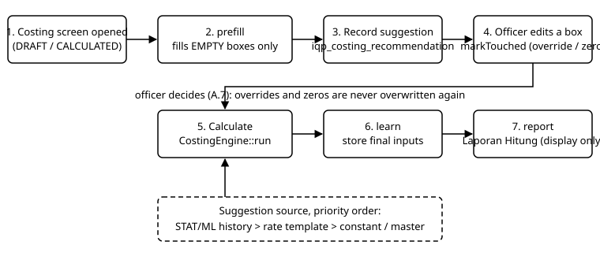

# ENGINE card: Costing Advisor

> PHASE 1 EXAMPLE (2026-10-16), awaiting Jo's approval. Source: `app/Services/Costing/CostingAdvisor.php` read in full; test `CostingAdvisorTest` run (5 passed, 24 asserts). The part after the johiwan-only marker = confidential figures/formulas (A.8-A.9).

- **Canonical name**: Costing Advisor. **Class**: `App\Services\Costing\CostingAdvisor`. **Registry**: key `costing-advisor`, mode `suggest`. **Module/sub-module**: Sales > Inquiry & Quotation > Pro-Cost.
- **Frozen status**: ProCost = frozen zone (flow/data). This engine only suggests (A.7).

## Trigger (no background / schedule)
Searched in `routes/console.php` (none), Jobs (no folder), Observers (only 2 others), and all callers. FACT: only from the Pro-Cost v2 screen, through `CostingEntryService` (`app/Services/Costing/CostingEntryService.php:136` prefill on open, `:145` advise after an edit, `:432` learn after Calculate):
| Trigger | Method | Line |
|---|---|---|
| DRAFT/CALCULATED document opened | `prefill` | 118 |
| Button/action "advise" | `prefill` | 220 |
| Officer changes an input | `markTouched`, `valueToRestore` | 415-505 |
| Calculate button | `CostingEngine::run` then `learn` | 536 |
| Screen renders (only for those allowed to see formulas) | `report`, `recsFor`, `missing` | 171, 163, 766 |

## Flow (text twin of diagram `../img/costing-advisor.svg`)

1. Costing document opened -> `prefill` -> for each **empty box**:
   - grammage: Inquiry BOM; if empty, template; then the nearest ACTIVE grammage in the master.
   - geometry (plano, UP, print size): if a ProDev layout exists, it is used as-is; otherwise a simulation by `ImpositionEngine` (read only) over all active planos, marked ESTIMATE.
   - rates (`TARIF`): priority order = history (STAT/ML) > rate template > constant/master.
   - margin & tolerance per tier: history > constant.
2. Each filled value is recorded in `iqp_costing_recommendation` (source, method, sample count).
3. Officer changes a box -> `markTouched` -> `is_override`; value 0 = `zero_intent`. Overrides and zeros are deliberately NOT overwritten again.
4. A box accidentally emptied -> `valueToRestore` returns the suggested value.
5. Calculate -> `CostingEngine` calculates -> `learn` stores the final inputs (+ qty, part type) as learning material.
6. `report` builds the Laporan Hitung; the formula steps are hidden when the trace does not equal the stored result.

**Officer decision points (A.7)**: every suggestion can be changed; the engine does not overwrite overrides.

## Input / Output
- **Input**: `iqp_costing` + `iqp_costing_part` + `iqp_costing_price_tier`; `iqp_costing_recommendation` (history); `prod_part_template`, `mat_grammage`, `mat_plano_size`, `prod_part_type`; `sys_constant` group COSTING (`MARGIN_DEFAULT_PCT`, `TOLERANCE_DEFAULT_PCT`, `ADVISOR_MIN_SAMPLE_STAT`, `ADVISOR_MIN_SAMPLE_ML`, `FILM_*`, `PLATE_PER_COLOR`, `KNIFE_FACTOR_DEFAULT`, `PPN_INPUT_MATERIAL_DIVISOR`); Inquiry/ProDev context via `ProCostContextService`.
- **Output (writes to DB)**: `iqp_costing_part`, `iqp_costing_price_tier` (empty boxes only), `iqp_costing_recommendation` (one row per box).
- **Display only**: the Laporan Hitung array (steps, comparisons, notes, simulation).

## Statistics / ML thresholds (FACT from code, lines 312-332)
- < `ADVISOR_MIN_SAMPLE_STAT` (default 5) similar history (same part type, other costings): no history suggestion.
- >= 5: median of the officer's final values -> source `STAT`.
- >= `ADVISOR_MIN_SAMPLE_ML` (default 30) and qty > 0: nearest neighbors per qty (k = 3..7), used only when the leave-one-out error is smaller than the median -> source `ML`.
- Decided by: the officer.

## Edge cases
- A suggestion with value 0 -> the box is left empty without a marker.
- A tooling rate of 0 in the template = "use the constant default", not "no tooling".
- Without a part type, history is empty (no STAT/ML suggestion).
- Only the DC family (`DC`, `DC+SF`, `DC+SHEET`, `KRAFT`) gets automatic grammage/geometry.

## Used by
screen `procost` (Mode 1; the box source marker is drawn by `ProCostFields` + `procost.blade.php`, the old components `x-costing.src` and `x-costing.field` were archived 2026-10-21). Instant mode: FROM DOCUMENT (code REMARK: "costing-instant belum disambung"), not rechecked.

## Open items
See `docs/ENGINE-ATTENTION.md` (status stays there, not copied). New finding: the REMARK writes Mode #2 as "belum disambung", while the registry text says Mode 2 is "typed by the officer"; one of them is outdated.

## Tests
`tests/Feature/CostingAdvisorTest.php` (5 tests), `CostingAdvisorScreenTest.php`.

<!-- johiwan-only -->

## Worked example (confidential; verified via `CostingAdvisorTest`, 5/5 passed 2026-10-16)
All figures below are test asserts, not guesses.
1. **Default**: new costing type DC, qty 1.000: margin 18 (`MARGIN_DEFAULT_PCT`), tolerance 5 (`TOLERANCE_DEFAULT_PCT`), Ongkos Cetak/RIM 750.000 and QC/PC 50 (template KALENDER), `i_film_faktor` 0,25 (constant, because the template marks 0 = default), `i_dc_persen_override` 5,3 (grammage Duplex 250). Test: `test_prefill_fills_empty_boxes_with_margin_default_and_template_rates`.
2. **Statistics**: 5 old costings (KRAFT) with final margins 20, 22, 24, 26, 28 -> median 24 -> the new costing gets margin 24, source `STAT`, `sample_count` 5. Test: `test_statistics_replace_default_after_enough_history_then_ml_threshold`.
3. **Override**: the officer changes margin 18 -> 22 and zeroes Ongkos Cetak/RIM; a repeated `prefill` changes neither; `valueToRestore` for the zeroed one = null. Test: `test_officer_override_and_zero_are_never_overwritten`.
4. **Restore**: the Ongkos Cetak/RIM box is emptied -> restored to 750.000; Hot Print (template 0) -> null. Test: `test_blank_box_is_restored_to_suggested_value`.

### Price chain formula (copy of `CostingEngine::calculateTier` in `chain()`, lines 517-550; explained so the report can explain)
Per part: `gross = c_total_part_cost_pc x qty_per_set + c_tooling_cost_order / qty`; if PPN: `net = gross - inputBahan x credit`, `credit = 1 - 1/PPN_INPUT_MATERIAL_DIVISOR`; tolerance `tt` = % of the part or tier: normal part `tolNet += net + gross x tt`, SHEET part `tolNet += net / (1 - tt)`. Base = rounding (`rounding_mode`, `rounding_step`) of `tolNet`; `dpp = dasar / (1 - margin)`; final price = `dpp x (1 + ppn%)` if PPN.
Chain worked example from ddt* data: NOT written yet (needs one new test case; proposed for Phase 4, awaiting Jo's approval).

> Checked 2026-10-16 after the ProCost BOM panel change (`ProCostContextService`, `tmerp_unused/inquiry_costing_v1_2026-10-21.blade.php`; Jo agreed): the content of this card is not affected; cited line numbers of those two files may be about 30 lines lower. Only the cited items were re-read, not the whole card.

> Checked 2026-10-16 after the ProCost Book button (tmerp_unused/inquiry_costing_v1_2026-10-21.blade.php; Jo agreed): the content of this card is not affected; cited line numbers of tmerp_unused/inquiry_costing_v1_2026-10-21.blade.php may be about 70 lines lower. Only the cited items were re-read.
- Re-checked 2026-10-21 after the Inquiry form moved off v1 (rule D.25, T10 stage 4): `routes/web.php` replaced the v1 route `/inquiry/new` by a redirect to `/v2/s/inquiry-new` on the same line and loads `routes/v2_inquiry.php` on the existing `require` line (no line added or removed); `routes/v2.php` changed one validation line of the Inquiry save route in place (`InquiryPayload::rules($old)`); `app/Support/V2/Screens.php` and `app/Support/Menu/MenuRoutes.php` changed one text each on the same line; `InquiryWriter.php` only got a different header comment of the same length and the new method `removeArtwork` appended at the end of the class; `InquiryPayload.php` changed the `rules()` signature, the customer rule and three header values in place; `inquiry-new.blade.php` changed three REMARK lines and the Customer field lines in place; the tests `CostingAdvisorScreenTest` and `CostingEngineTest` now create their Inquiry through `tests/Support/InquiryDriver.php`. The v1 page `pages::inquiry.form` is archived in `tmerp_unused/`. Every other cited line number is unchanged and this card's content is still true.
- Re-checked 2026-10-21 after ProDev moved off v1 (rule D.25 and D.26, T10 stage 5): `routes/web.php` replaced the four v1 routes `/production/prodev/{part?}`, `/production/old-prodev-list`, `/production/old-prodev/{part?}` and `/production/old-prodev/{part}/print` by redirects to `/v2/s/prodev` on the same lines (no line added or removed); `routes/v2.php` changed one comment line; `app/Support/V2/Screens.php` changed the text of two rows on the same lines; `app/Support/V2/Data/Prodev.php` keeps its line numbers except the last method `uploadArtwork` (now `:145-153`), because `component()` became `service()` of the same length; `StageBuilder.php` and `MasterCardDummyEngine.php` only renamed that call in place. The workbench rules moved unchanged from the v1 component `pages::production.prodev` to `app/Services/ProDev/ProdevWorkbenchService.php`; the v1 pages (`prodev`, `old_prodev`, `old_prodev_print`, `old_prodev_list`) and `x-prodev.wizard-bar` are archived in `tmerp_unused/arsip_v1_2026-10-21.zip`. Every other cited line number is unchanged and this card's content is still true.
- Re-checked 2026-10-21 after the auth pages and the v1 Pipeline Board moved off v1 (rule D.25 and D.26, T10 stage 6a and 6d): `routes/web.php` replaced the Livewire routes `/login`, `/register`, `/forgot-password`, `/password/change` and `/security/setup` by controller routes on the same lines (the guest group now also has the `locale` middleware; no line added or removed); `tests/Feature/PurchaseReturnServiceTest.php` only checks the archived v1 file inside the ZIP (`assertArchived`). The pages are now DevLib objects (`x-dl::login-box`, `x-dl::register-box`, `x-mp::auth.box` inside `x-dl::frame`) with the rules in `app/Services/Auth/*` and `app/Http/Controllers/Auth/*`; the v1 pages, `AuthText`, the guest layout, the v1 Pipeline Board and the Filament `PipelineBoard` page are archived in `tmerp_unused/arsip_v1_2026-10-21.zip`. Every other cited line number is unchanged and this card's content is still true.
- Re-checked 2026-10-21 after the careers portal moved to v2 (rule D.25, Master T10 stage 6b): `routes/web.php` replaced the 26-line careers route block by 26 lines (controller routes plus comments; no line before or after it moved), and the cited lines of this card are unchanged; this card does not depend on the careers routes and its content is still true.
- Re-checked 2026-10-21 after the v1 shell was archived (rule D.25, Master T10 stage 6c): `routes/web.php` replaced the 4-line /menu block by 4 lines and `routes/v2.php` changed one comment line (no line before or after them moved), `app/Support/Menu/MenuRoutes.php` and `app/Support/V2/AppMenu.php` lost only v1 entries and comments (this card cites them by file, not by line), and `resources/js/app.js` lost two imports; this card does not depend on the changed lines and its content is still true.
- Re-checked 2026-10-21 after the Filament admin panel was removed (rule D.25, Master T10 stage 6e): `routes/web.php` only gained a redirect for `/admin/*` appended after its last line (no line before it moved); this card does not depend on it and its content is still true.
- Re-checked 2026-10-22 after the entry rules of PR, PO, receipt, Delivery Order and CPDEL moved from the v1 pages to services (rule D.25 and D.26, Master T10 stage 7a-7c): `routes/v2.php` and `app/Support/V2/Screens.php` only had comment and description text changed on their existing lines (no line added or removed), and `app/Support/V2/Data/DeliveryOrder.php` and `MaterialPlanning.php` changed in the lines their cards do not cite or were remapped from the diff; this card's content is still true.
