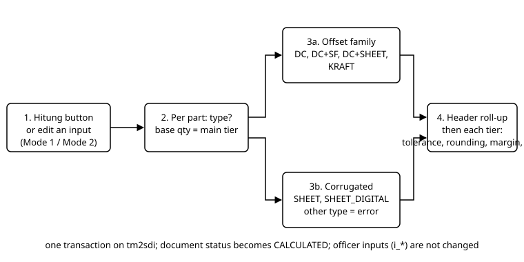

# ENGINE card: Costing Engine (HPP formula and price per tier)

> DRAFT GROUP C (2026-10-16), awaiting Jo's approval. Source: `app/Services/Costing/CostingEngine.php` read in full (496 lines). Tests run this session: `CostingEngineTest` (3 passed, 38 asserts), `CostingExcelParityTest` (7 passed, 47 asserts), `CostingLegacyParityTest` (4 passed, 21 asserts), `CostingInstantModeTest` (2 passed, 14 asserts). The part after the johiwan-only marker = confidential figures/formulas (A.8-A.9). The upper part is the flow only.

- **Canonical name**: Costing Engine (Pro-Cost). **Class**: `App\Services\Costing\CostingEngine`. **Registry**: key `costing`, mode `calc`, group Pro-Cost. **Module/sub-module**: Sales > Inquiry & Quotation > Pro-Cost.
- **Frozen status**: ProCost = frozen zone (flow/data). The two input paths (Mode 1 Integrasi, Mode 2 Instant) deliberately use the SAME engine (`docs/claude_vital_flows.md`).
- **Synonyms**: calculate HPP, Hitung, price ladder, price tier, `CostingEngine::run`.
- **NOT the same as**: Costing Advisor (fills the boxes, card `10_engine_costing-advisor.md`); Reverse Costing (`30_engine_reverse-costing.md`).

## Trigger (no background / schedule)
None in `routes/console.php`, Jobs, Observers. FACT, all callers of `new CostingEngine`:
| Trigger | File:line |
|---|---|
| Mode 1 (Integrasi): the **Hitung** button | `app/Services/Costing/CostingEntryService.php:427-438` (`hitung()`, `run` at `:431`), button Calculate in `resources/views/v2/screens/procost.blade.php` (action hitung in `routes/v2_procost.php`); `hitung()` is also called automatically after a part is added from a layout (`:227-246`), after a layout change (`:260-284`) and `setPaperIndex` (`:419-425`). After `run`, `CostingAdvisor::learn` is called (`:432`). |
| Mode 2 (Instant): every input change calls `recalc()` | `app/Services/Costing/InstantCostingService.php:71-85` (`recalc`, called by updateHeader, updateTier, addPart, removePart, updatePart, the coating methods and confirm, plus the Save action of `routes/v2_procost.php`); does not call `learn`. Does not run when there is no part. |
| Dummy data filler at migration time | `database/migrations/2026_09_18_000007_seed_procost_dummy_data.php:127,180` |
Not called by the Advisor, Quotation, or Reverse (FACT, grep).

## Flow (text twin of diagram `../img/costing-engine.svg`)

1. Take the main tier qty (`is_primary`, if none: the first tier) as the base qty.
2. For each part, choose the rule by part type: DC, DC+SF, DC+SHEET, KRAFT = offset family; SHEET, SHEET_DIGITAL = corrugated; any other type throws the error `part_type_code '...' belum diimplementasi CostingEngine`.
3. Offset: paper, base processes (print, die-cut, glue, others), coating per layer, lamination/SF EF (only DC+SF and DC+SHEET), tooling per order (film, plate, knife).
4. Corrugated: sheet geometry (manual or derived from dimensions + flute + machine width), sheet price with discount/surcharge per supplier, process cost.
5. Roll-up to the document header, weighted by qty per set.
6. For each price tier: tooling divided by tier qty, tolerance (rule differs per part type), rounding, margin, PPN.
7. All in one transaction on `tm2sdi`; the document status becomes CALCULATED.
**Officer decision points (A.7)**: the engine does not change inputs; it only calculates from the boxes filled by the officer or the Advisor.

## Input / Output
- **Input**: `iqp_costing`, `iqp_costing_part` (+ `iqp_costing_part_coating`), `iqp_costing_price_tier`; masters `mat_grammage`, `mat_sheet_rate`, `mat_sheet_discount_tier`, `mat_sheet_supplier`, `mat_flute_allowance`, `prod_part_type`; `sys_constant` group Costing (names only: `RIM_SHEETS`, `PLANO_REF_AREA`, `CUT_PER_PLANO_DEFAULT`, `PCS_PER_LB_DEFAULT`, `FILM_FACTOR_DEFAULT`, `FILM_RATE_DEFAULT`, `PLATE_PER_COLOR`, `KNIFE_RATE_DC`, `KNIFE_RATE_KRAFT`, `KNIFE_FACTOR_DEFAULT`, `PPN_INPUT_MATERIAL_DIVISOR`, `SHEET_MACHINE_WIDTH_CM`, `SHEET_TRIM_GAP_CM`, `SHEET_DISCOUNT_MIN_/MAX_<supplier>`, `OB_DISCOUNT_RM_MIN/MAX`).
- **Output (writes DB)**: `iqp_costing_part` (columns `c_*` and `description_calc`), `iqp_costing_part_coating` (`c_cost_per_lc`, `c_cost_per_pc`), `iqp_costing` (header totals and `doc_status`), `iqp_costing_price_tier` (columns `c_*` and `price_per_pcs`). The registry does not mention `iqp_costing_part_coating` and reads `mat_coating_rate`, which the code does not read (see Finding 2).
- **Who may overwrite**: every Hitung overwrites all `c_*` columns; the `i_*` columns (officer inputs) are not changed.

## Edge cases
- Unknown part type: `RuntimeException`; the screen shows it as `engineError` (test `test_engine_rejects_unimplemented_part_type`).
- Sheet discount/surcharge outside the supplier limits: an error with the limit message (`guardDiscount`).
- No sheet discount tier for the running meter: an error, the officer fills it manually.
- Tier `qty_pcs` 0 is used as a minimum of 0,0001 (avoids division by zero).
- KRAFT does not calculate coating; only DC+SF/DC+SHEET calculate lamination and SF EF.
- There is no status guard: `run` always writes `doc_status = 'CALCULATED'` (line 59), even if the document was PUBLISHED before. The guard exists only on the button (`@disabled($ro)`); `hitung()` itself does not check. Not yet tested whether a direct call can lower a PUBLISHED status (see Finding 3).

## Used by (relations)
- **source**: Inquiry (BOM, part), ProDev (layout, via `ProCostContextService`), Advisor (filled boxes), rate/material masters, Costing constants.
- **used_by**: costing screens Mode 1 and Mode 2, Quotation (published price), Customer Order (quotation item snapshot). The price ladder in `iqp_costing_price_tier` is read by the Advisor for the Laporan Hitung.
- **flows**: flag `stat_confirm_procost` in `iqp_inquiry` (A.20).

## Open items
See `docs/ENGINE-ATTENTION.md` (no item specific to the Costing Engine; read in full). Local note: no test compares Mode 1 and Mode 2 for the same geometry (the claim "HPP harus sama" in the registry/vital flows is held only because both use this engine).

## Findings (recorded, not fixed)
1. Registry `methods` is only `run` (correct: the other methods are `protected`/`private`).
2. Registry `reads` includes `mat_coating_rate`; the code does not read it (grep `CostingEngine.php`): the coating index is taken from `iqp_costing_part_coating.index_coating`. The write column `iqp_costing_part_coating` is not in `writes`.
3. `run` does not check `doc_status` and writes `CALCULATED` unconditionally; `hitung()` (Mode 1) and `recalc()` (Mode 2) do not call `editable()` like `updateHeader`. Risk of status downgrade; NOT yet tested.
4. The comments of migrations `2026_09_02_000028` and `000029` mention `CostingEngine::calculateDcSheetPart()`; that method no longer exists (now `calculateOffsetPart`). Comment only.
5. The test `test_engine_rejects_unimplemented_part_type` uses a BOGUS code; the official part types in the master `prod_part_type` have NOT been compared with the `match` in `run` (SHEET_DIGITAL is in the ddt* data in 1 row; KRAFT, DC+SHEET, SHEET do not appear in the ddt* data, only in tests).

## Tests
`tests/Feature/CostingEngineTest.php`, `CostingExcelParityTest.php`, `CostingLegacyParityTest.php`, `CostingInstantModeTest.php` (all clean up their own data).

<!-- johiwan-only -->

## CONFIDENTIAL: formulas and figures (Costing and Direksi only)

### Offset part formula (`calculateOffsetPart`, lines 74-201)
Unit: Rp per PC unless stated; `rim = RIM_SHEETS` (500), `planoRef = PLANO_REF_AREA` (8611).
- `cut` = `i_cut_per_plano` if > 0, otherwise `CUT_PER_PLANO_DEFAULT` (1). `isi` = `i_isi_per_lb` if > 0, otherwise `PCS_PER_LB_DEFAULT` (1). (Meaning: cut = print sheets per plano; isi = UP per print sheet.)
- `areaPlano = panjang_plano_cm * lebar_plano_cm`. `areaCetak = uk_cetak_p * uk_cetak_l` if both > 0; otherwise `areaPlano/cut` and flag `UK_FALLBACK`.
- **Duplex paper** (duplex list price > 0 or `paper_kind = DUPLEX`): `harga = override bila > 0 sebaliknya duplex_price_list`; `dcf = 1 + (i_dc_persen_override bila > 0, kalau tidak duplex_dc_pct)`; `kertas = (areaPlano/planoRef) * harga * dcf / rim / cut / isi`. **Paper per kg** (ivory/kraft): `(areaPlano/10000) * harga * (gramatur/1000) / cut / isi`. Without grammage or price <= 0: paper 0 and flag `PAPER_GAGAL`.
- `cetak = ongkos_cetak_rim / rim / cut / isi`; `plong = ongkos_plong_lb / isi`; `lem = ongkos_lem_pc`; `lain = hotprint + kupas + qc_pack + kirim + packing` (all per PC).
- **Coating** (not KRAFT): each layer `perLc = areaCetak * index_coating`, `perPc = perLc/isi` (not divided by cut); `coating = jumlah perPc`.
- **Lamination (DC+SF, DC+SHEET)**: `J36 = pakai_laminasi * lam_sheet_flat_pc`; `sfRate = override bila > 0 kalau tidak index_substance dari sheet rate`; `J37 = (sfRate>0) * (areaCetak/10000) * sfRate / isi`; `ukLam = luas sheet bila i_lam_pakai_ukuran_sf dan luas > 0 kalau tidak areaCetak`; `J38 = bila ada tarif cm2: pakai_laminasi*ukLam*rateSh/isi + sfAktif*ukLam*rateSf/isi, kalau tidak i_ongkos_laminasi_pc`.
- **Tooling per order**: `film = faktorFilm^2 * areaCetak * rateFilm` (default factor 0,25; default rate 55); `plate = (ongkos plate bila > 0 kalau PLATE_PER_COLOR) * jumlah_warna`; `pisau = faktorPisau * rate` (rate: override, then `prod_part_type.pisau_rate_rp`, then `KNIFE_RATE_DC` or `KNIFE_RATE_KRAFT`; default factor 0,25); `tooling = film + plate + pisau`.
- `proses = cetak + plong + lem + lain + J36 + J37 + J38`; `total_part_pc = kertas + proses + coating`; `jumlah_cetak_lc = qty/(cut*isi)`.

### Corrugated part formula (`calculateSheetPart`, 204-246; geometry 261-342)
- `proses = print*2 + diecut + slitter + slotter + join + partisi + layer + pisau + kupas + qc + kirim + packing`; `total = biaya_lembar + proses`; tooling 0.
- Automatic geometry (SHEET_DIGITAL): `panjang = ((P+L)*2 + total_panjang_flute + lidah_lem)/10`; `lebar = (L+T+total_lebar_flute+3)/10`; `isiTrim = max(floor((lebarMesin - gap)/lebar), 1)`; `trim = ceil((lebar*isiTrim + gap)/5)*5`; running meter `rm = (qty/isiPerLb)/isiTrim*(panjang/100)`; `biaya_lembar = (trim*panjang/10000) * index_substansi / isiTrim * (1 - diskon)`. Manual: `trim`, `isiTrim`, `panjang` are typed.
- Discount = the officer's input if the supplier is the same, otherwise a tier lookup (`MatSheetDiscountTier::lookup`), guarded by the limits `SHEET_DISCOUNT_MIN/MAX_<supplier>` (fallback `OB_DISCOUNT_RM_MIN/MAX`).

### Header roll-up (413-429)
`bahan = (kertas + biaya_lembar) * qty_per_set`; `proses = proses_part * qty_per_set`; `finishing = coating * qty_per_set`; `tooling = jumlah tooling order`.

### Ladder per tier (`calculateTier`, lines 443-495)
Per part: `toolPc = tooling_order/qty`; `kotor = total_part_pc*qty_per_set + toolPc`; `bahanMasuk = (kertas+biaya_lembar+J36+J37)*qty_per_set`; `bersih = kotor - bahanMasuk*kredit` if PPN, credit = `1 - 1/PPN_INPUT_MATERIAL_DIVISOR`, if NON_PPN `bersih = kotor`; `t = min(tol part ?? tol tier, 99,9999)/100`.
- Offset part: `tolKotor += kotor*(1+t)`; `tolBersih += bersih + kotor*t`. SHEET/SHEET_DIGITAL part: `tolKotor += kotor/(1-t)`; `tolBersih += bersih/(1-t)`.
- Rounding `round(v)`: `UP/CEILING` = `ceil(v/step)*step`; `DOWN/FLOOR`; `NEAREST`; otherwise (NONE) no rounding; `step <= 0` no rounding.
- `m = min(margin_pct, 99,9999)/100`; `mPpn = min(margin_ppn_pct ?? margin_pct, 99,9999)/100`.
- `setelahMargin = round(tolKotor)/(1-m)`; `dpp = bila PPN: round(tolBersih)/(1-mPpn), kalau tidak setelahMargin`; `harga_per_pcs = dpp`; `harga_incl_ppn = dpp*(1+ppn_pct/100)` if PPN.
- Stored: `c_tooling_pc`, `c_hpp_pc` (= kotor), `c_ppn_input_credit_pc`, `c_after_tolerance_pc`, `c_after_round_pc`, `c_after_margin_pc`, `c_after_ppn_pc`, `price_per_pcs`.

### Constant values (mockup DB, read 2026-10-16)
`RIM_SHEETS` 500; `PLANO_REF_AREA` 8611; `CUT_PER_PLANO_DEFAULT` 1; `PCS_PER_LB_DEFAULT` 1; `FILM_FACTOR_DEFAULT` 0,25; `FILM_RATE_DEFAULT` 55; `PLATE_PER_COLOR` 90.000; `KNIFE_RATE_DC` 900.000; `KNIFE_RATE_KRAFT` 1.500.000; `KNIFE_FACTOR_DEFAULT` 0,25; `PPN_INPUT_MATERIAL_DIVISOR` 1,1; `SHEET_MACHINE_WIDTH_CM` 180; `SHEET_TRIM_GAP_CM` 2.

### Worked example (recalculated from the asserts of `CostingEngineTest::test_engine_calculates_dc_part_and_price_ladder`, 3/3 passed 2026-10-16)
Case: 1 DC part, grammage Duplex 300gsm (list price 12.500 as in the test assert), plano 65 x 100 cm, cut 2, isi 4, 4 colors, print cost/rim 200.000, die-cut/lb 5.000, glue 300, knife factor 0,5, one Water Base coating (index 0,035), print size empty; tier qty 1.000, tolerance 5%, margin 20%, rounding NEAREST step 100, PPN 11%.
- `areaPlano` 6.500; `areaCetak` 3.250 (fallback = 6.500/2); `dcf` 6,3 (1 + 5,3).
- paper = 6.500/8.611 * 12.500 * 6,3 / 500 / 2 / 4 = **14,8611**; print 200.000/500/2/4 = **50**; die-cut 5.000/4 = **1.250**; glue **300**; coating 3.250*0,035/4 = **28,4375**.
- film = 0,25^2 * 3.250 * 55 = **11.171,875**; plate = 90.000*4 = **360.000**; knife = 0,5*900.000 = **450.000**; order tooling **821.171,875**; per PC (qty 1.000) **821,1719**.
- part total per PC = 14,8611 + 50 + 1.250 + 300 + 28,4375 = **1.643,2986**; HPP/PC (add tooling) = **2.464,4705**.
- additive tolerance then rounding: `round(2.464,4705*1,05/100)*100` = **2.600**; after margin: 2.600/0,8 = **3.250**.
- PPN path: net = 2.464,4705 - 14,8611*(1 - 1/1,1) = **2.463,1194**; `dpp = round((2.463,1194 + 2.464,4705*0,05)/100)*100/0,8` = **3.250**; incl. PPN = 3.250*1,11 = **3.607,50**.
Other cases guarded by tests (figures from the tests, not recalculated here): `CostingInstantModeTest` reproduces the DC+SF HPP/PC 1.487,4648 (tolerance 0,0005) and that figure stays the same after Reverse. Excel/legacy parity: see the Parity tests.

> Checked 2026-10-16 after the SpecEngine / MaterialPlanningEngine change (Jo agreed): this card only names or links the changed cards; nothing in it needs to change.

> Checked 2026-10-16 after the ProCost BOM panel change (`ProCostContextService`, `tmerp_unused/inquiry_costing_v1_2026-10-21.blade.php`; Jo agreed): the content of this card is not affected; cited line numbers of those two files may be about 30 lines lower. Only the cited items were re-read, not the whole card.

> Checked 2026-10-16 after the ProCost Book button (tmerp_unused/inquiry_costing_v1_2026-10-21.blade.php; Jo agreed): the content of this card is not affected; cited line numbers of tmerp_unused/inquiry_costing_v1_2026-10-21.blade.php may be about 70 lines lower. Only the cited items were re-read.
- Re-checked 2026-10-21 after the Inquiry form moved off v1 (rule D.25, T10 stage 4): `routes/web.php` replaced the v1 route `/inquiry/new` by a redirect to `/v2/s/inquiry-new` on the same line and loads `routes/v2_inquiry.php` on the existing `require` line (no line added or removed); `routes/v2.php` changed one validation line of the Inquiry save route in place (`InquiryPayload::rules($old)`); `app/Support/V2/Screens.php` and `app/Support/Menu/MenuRoutes.php` changed one text each on the same line; `InquiryWriter.php` only got a different header comment of the same length and the new method `removeArtwork` appended at the end of the class; `InquiryPayload.php` changed the `rules()` signature, the customer rule and three header values in place; `inquiry-new.blade.php` changed three REMARK lines and the Customer field lines in place; the tests `CostingAdvisorScreenTest` and `CostingEngineTest` now create their Inquiry through `tests/Support/InquiryDriver.php`. The v1 page `pages::inquiry.form` is archived in `tmerp_unused/`. Every other cited line number is unchanged and this card's content is still true.
- Re-checked 2026-10-21 after ProDev moved off v1 (rule D.25 and D.26, T10 stage 5): `routes/web.php` replaced the four v1 routes `/production/prodev/{part?}`, `/production/old-prodev-list`, `/production/old-prodev/{part?}` and `/production/old-prodev/{part}/print` by redirects to `/v2/s/prodev` on the same lines (no line added or removed); `routes/v2.php` changed one comment line; `app/Support/V2/Screens.php` changed the text of two rows on the same lines; `app/Support/V2/Data/Prodev.php` keeps its line numbers except the last method `uploadArtwork` (now `:145-153`), because `component()` became `service()` of the same length; `StageBuilder.php` and `MasterCardDummyEngine.php` only renamed that call in place. The workbench rules moved unchanged from the v1 component `pages::production.prodev` to `app/Services/ProDev/ProdevWorkbenchService.php`; the v1 pages (`prodev`, `old_prodev`, `old_prodev_print`, `old_prodev_list`) and `x-prodev.wizard-bar` are archived in `tmerp_unused/arsip_v1_2026-10-21.zip`. Every other cited line number is unchanged and this card's content is still true.
- Re-checked 2026-10-21 after the auth pages and the v1 Pipeline Board moved off v1 (rule D.25 and D.26, T10 stage 6a and 6d): `routes/web.php` replaced the Livewire routes `/login`, `/register`, `/forgot-password`, `/password/change` and `/security/setup` by controller routes on the same lines (the guest group now also has the `locale` middleware; no line added or removed); `tests/Feature/PurchaseReturnServiceTest.php` only checks the archived v1 file inside the ZIP (`assertArchived`). The pages are now DevLib objects (`x-dl::login-box`, `x-dl::register-box`, `x-mp::auth.box` inside `x-dl::frame`) with the rules in `app/Services/Auth/*` and `app/Http/Controllers/Auth/*`; the v1 pages, `AuthText`, the guest layout, the v1 Pipeline Board and the Filament `PipelineBoard` page are archived in `tmerp_unused/arsip_v1_2026-10-21.zip`. Every other cited line number is unchanged and this card's content is still true.
- Re-checked 2026-10-21 after the careers portal moved to v2 (rule D.25, Master T10 stage 6b): `routes/web.php` replaced the 26-line careers route block by 26 lines (controller routes plus comments; no line before or after it moved), and the cited lines of this card are unchanged; this card does not depend on the careers routes and its content is still true.
- Re-checked 2026-10-21 after the v1 shell was archived (rule D.25, Master T10 stage 6c): `routes/web.php` replaced the 4-line /menu block by 4 lines and `routes/v2.php` changed one comment line (no line before or after them moved), `app/Support/Menu/MenuRoutes.php` and `app/Support/V2/AppMenu.php` lost only v1 entries and comments (this card cites them by file, not by line), and `resources/js/app.js` lost two imports; this card does not depend on the changed lines and its content is still true.
- Re-checked 2026-10-21 after the Filament admin panel was removed (rule D.25, Master T10 stage 6e): `routes/web.php` only gained a redirect for `/admin/*` appended after its last line (no line before it moved); this card does not depend on it and its content is still true.
- Re-checked 2026-10-22 after the entry rules of PR, PO, receipt, Delivery Order and CPDEL moved from the v1 pages to services (rule D.25 and D.26, Master T10 stage 7a-7c): `routes/v2.php` and `app/Support/V2/Screens.php` only had comment and description text changed on their existing lines (no line added or removed), and `app/Support/V2/Data/DeliveryOrder.php` and `MaterialPlanning.php` changed in the lines their cards do not cite or were remapped from the diff; this card's content is still true.
