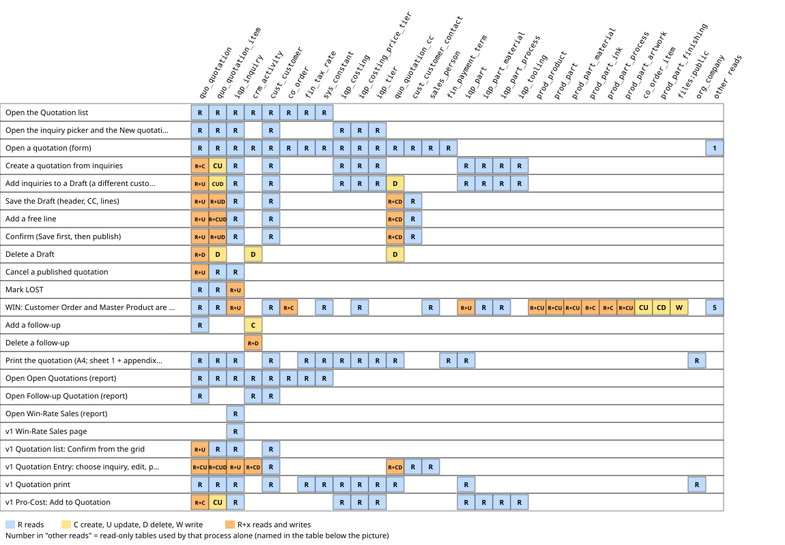
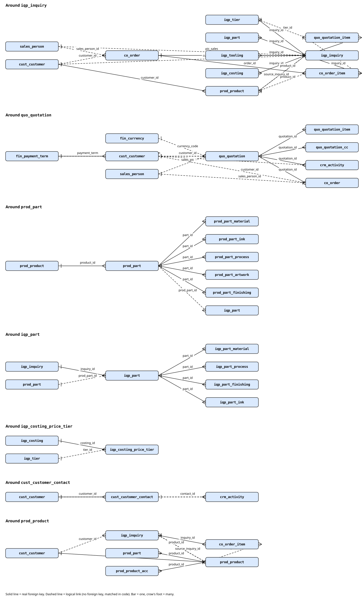

# Sub-module: Quotation

> Group B, 2026-10-16. The sub-module page only summarizes and links. FACT = menu `sys_app_menu` mockup and code with lines.

- **Module**: Sales > Inquiry & Quotation. Menu (FACT): item `Quotation` (`v2:quotation`, id 113) directly under the group "Inquiry & Quotation" (not a group of its own); group Report (id 1089): Open Quotations (`v2:quotation-outstanding`), Follow-up Quotation (`v2:quotation-followup`), Win-Rate Sales (`v2:sales-win-rate`; the same item also exists in Sales > CRM > Report, id 1194). Item "Inquiry Note" (id 931) is inactive.
- **Purpose**: Sales picks priced inquiries (costing PUBLISHED) of one customer, builds the offer, publishes it (PUBLISHED), follows up (follow-up), then WIN (CO is born) or LOST.
- **Hard rules**: Quotation MUST be integrated (A.1); 1 Quotation = 1 CO (A.4/A.10, unique index in the DB); CO may be direct (INSTANT) without Quotation (A.2); price only for those entitled (A.8-A.9).
- **Frozen zone**: Quotation is part of the vital flow (`docs/claude_vital_flows.md`).

## Relations
- **source**: Inquiry with costing PUBLISHED (card `../product-costing/11_card_procost-interface.md`), customer, Sales PIC.
- **used_by**: Customer Order (WIN; the CO card belongs to another group), Master Product (born at WIN), Win-Rate, Follow-up (`crm_activity`).
- **flags**: Quotation has no `stat_confirm_*`; its status is `doc_status` DRAFT/PUBLISHED/CANCELLED, WON/LOST are derived from the inquiry status.

## Concept cards in this sub-module
| Card | Content |
|---|---|
| `10_card_quotation.md` | Quotation (table, status, must be integrated, 1 Quotation = 1 CO, price visibility; the confidential price part is after the johiwan-only marker) |
| `../master-data/10_card_customer.md`, `../master-data/11_card_sales-pic.md` | Customer and Sales PIC used by the Quotation header |

## Engines in this sub-module
No engine belongs to this sub-module. Line builder: `QuotationBuilder` (an ordinary service; registration in `EngineRegistry` NOT checked). Downstream WIN: `../order/20_engine_co-order-builder.md`, card `../order/10_card_customer-order.md` and `../order/12_card_document-status.md` (another group).

## Cross-card findings (summary)
- The server does not enforce "must be integrated": a freeform line (FREEFORM) can create a quotation without an inquiry; 5 PUBLISHED quotations in the data have no line at all.
- Quotation does not use the price filter `canViewSalesPrice` (only the SALES module gate).
- Outdated source label `quo_activity` (the real table is `crm_activity`).

## Diagram
Not yet made. Text flow: Inquiry (costing PUBLISHED) -> `QuotationBuilder::createFromInquiries` -> DRAFT -> Confirm (PUBLISHED) -> WIN: `CoOrderBuilder::findOrCreateFromQuotation` -> CO + Master Product; or LOST/Cancel.

## Existing user guides (UG)
`docs/guides/sales/04_quotation_order_cpdel.md` (FROM DOCUMENT, not opened this session).

## Read/Write map

 Click the picture to open it full size.
Every process of the Quotation sub-module (menu Quotation, the reports Open Quotations, Follow-up Quotation and Win-Rate Sales, and the v1 pages that still have a route) with the tables it reads and writes (C create, U update, D delete), checked in code on 2026-10-18 against the dummy DBs (ddtsdi, ddtmst, ddtsys: all table names exist; no DB triggers found in ddtsdi, ddtmst, ddtsys). The v2 form does not hold its own rules: `Quotation::save` calls the methods of the v1 component `pages::quotation.entry` one field at a time (`app/Support/V2/Data/Quotation.php:203-239`), so the v1 file is evidence for the v2 writes too. WIN is shared with the Order and Master Product sub-modules; only the part that WIN itself runs is mapped here. No price values are written in this page.

| Process | Trigger | Reads | Writes | Evidence |
|---|---|---|---|---|
| Open the Quotation list | Menu Quotation, GET v2.screen quotation (no id, no pick) | `quo_quotation`, `quo_quotation_item`, `iqp_inquiry`, `crm_activity`, `cust_customer`, `co_order`, `fin_tax_rate`, `sys_constant` | - | `resources/views/v2/screens/quotation.blade.php:32`, `app/Support/V2/Grid/Sales/QuotationListGrid.php:26-29`, `app/Support/V2/Data/Quotation.php:44-84`, `app/Models/Sdi/QuoQuotation.php:94-110`, `app/Support/Finance/TaxRate.php:26-31` |
| Open the inquiry picker and the New quotation step | Quotation list, + New Record (?pick=1), then a row (?inq=) | `iqp_inquiry`, `iqp_costing`, `iqp_costing_price_tier`, `iqp_tier`, `quo_quotation`, `quo_quotation_item`, `cust_customer` | - | `resources/views/v2/screens/quotation.blade.php:35`, `resources/views/v2/screens/quotation.blade.php:49-50`, `app/Support/V2/Data/Quotation.php:166-188`, `app/Services/Sales/QuotationBuilder.php:46-57` |
| Open a quotation (form) | Quotation list, open a row (GET v2.screen quotation ?id) | `quo_quotation`, `cust_customer`, `quo_quotation_cc`, `quo_quotation_item`, `iqp_inquiry`, `crm_activity`, `co_order`, `cust_customer_contact`, `sales_person`, `fin_currency`, `fin_payment_term`, `fin_tax_rate`, `sys_constant`, `iqp_costing`, `iqp_costing_price_tier`, `iqp_tier` | - | `resources/views/v2/screens/quotation.blade.php:20`, `resources/views/v2/screens/quotation.blade.php:72-78`, `resources/views/v2/screens/quotation.blade.php:129-130`, `resources/views/pages/quotation/entry.blade.php:101-133`, `resources/views/pages/quotation/entry.blade.php:136-151`, `app/Support/V2/Data/Quotation.php:26-32` |
| Create a quotation from inquiries | Picker, Create Quotation (POST v2.quotation.create) | `iqp_inquiry`, `cust_customer`, `quo_quotation`, `iqp_costing`, `iqp_costing_price_tier`, `iqp_tier`, `iqp_part`, `iqp_part_material`, `iqp_part_process`, `iqp_tooling` | `quo_quotation` (C), `quo_quotation_item` (CU) | `routes/v2.php:523-532`, `app/Support/V2/Data/Quotation.php:190-193`, `app/Services/Sales/QuotationBuilder.php:61-74`, `app/Services/Sales/QuotationBuilder.php:77-102`, `app/Services/Sales/QuotationBuilder.php:138-190`, `app/Services/Sales/QuotationBuilder.php:195-233`, `app/Models/Sdi/QuoQuotation.php:113-125`, `app/Services/Inquiry/TierPricingResolver.php:13-27` |
| Add inquiries to a Draft (a different customer replaces everything) | Quotation form, + Add Inquiry (POST v2.quotation.add-inquiry) | `quo_quotation`, `iqp_inquiry`, `cust_customer`, `iqp_costing`, `iqp_costing_price_tier`, `iqp_tier`, `iqp_part`, `iqp_part_material`, `iqp_part_process`, `iqp_tooling` | `quo_quotation` (U), `quo_quotation_item` (CUD), `quo_quotation_cc` (D) | `routes/v2.php:562-567`, `app/Support/V2/Data/Quotation.php:195-199`, `app/Services/Sales/QuotationBuilder.php:106-123` |
| Save the Draft (header, CC, lines) | Quotation form, Save (POST v2.quotation.save, action=save) | `quo_quotation`, `quo_quotation_item`, `quo_quotation_cc`, `cust_customer`, `cust_customer_contact`, `iqp_inquiry` | `quo_quotation` (U), `quo_quotation_cc` (CD), `quo_quotation_item` (UD) | `routes/v2.php:535-561`, `app/Support/V2/Data/Quotation.php:203-239`, `resources/views/pages/quotation/entry.blade.php:278-306`, `resources/views/pages/quotation/entry.blade.php:309-324`, `resources/views/pages/quotation/entry.blade.php:356-379` |
| Add a free line | Quotation form, + Add Row (POST v2.quotation.save, action=add_line) | `quo_quotation`, `quo_quotation_item`, `quo_quotation_cc`, `cust_customer`, `cust_customer_contact`, `iqp_inquiry` | `quo_quotation` (U), `quo_quotation_cc` (CD), `quo_quotation_item` (CUD) | `routes/v2.php:550-553`, `app/Support/V2/Data/Quotation.php:241-244`, `resources/views/pages/quotation/entry.blade.php:333-354` |
| Confirm (Save first, then publish) | Quotation form, Confirm (POST v2.quotation.save, action=confirm) | `quo_quotation`, `quo_quotation_item`, `quo_quotation_cc`, `cust_customer`, `cust_customer_contact`, `iqp_inquiry` | `quo_quotation` (U), `quo_quotation_cc` (CD), `quo_quotation_item` (UD) | `routes/v2.php:554-558`, `app/Support/V2/Data/Quotation.php:246-251`, `resources/views/pages/quotation/entry.blade.php:381-389` |
| Delete a Draft | Quotation form, Delete (POST v2.quotation.delete or save action=delete) | `quo_quotation` | `quo_quotation_item` (D), `quo_quotation_cc` (D), `crm_activity` (D), `quo_quotation` (D) | `routes/v2.php:536-542`, `routes/v2.php:568-573`, `app/Support/V2/Data/Quotation.php:254-263` |
| Cancel a published quotation | Quotation form, Cancel with reason (POST v2.quotation.cancel) | `quo_quotation`, `quo_quotation_item`, `iqp_inquiry` | `quo_quotation` (U) | `routes/v2.php:574-579`, `app/Support/V2/Data/Quotation.php:35-42`, `app/Support/V2/Data/Quotation.php:265-269`, `app/Models/Sdi/QuoQuotation.php:81-90` |
| Mark LOST | Quotation form, LOST with reason (POST v2.quotation.lost) | `quo_quotation`, `quo_quotation_item`, `iqp_inquiry` | `iqp_inquiry` (U) | `routes/v2.php:580-585`, `app/Support/V2/Data/Quotation.php:271-277`, `resources/views/pages/quotation/entry.blade.php:424-440` |
| WIN: Customer Order and Master Product are born | Quotation form, WIN (POST v2.quotation.win); also v1 Quotation Entry (createOrOpenCo), v1 CO list (startIntegrated), v2 Customer Order (createIntegrated) | `quo_quotation`, `quo_quotation_item`, `iqp_inquiry`, `iqp_costing_price_tier`, `sales_person`, `cust_customer`, `co_order`, `iqp_part`, `iqp_part_material`, `iqp_part_process`, `iqp_part_finishing`, `iqp_part_ink`, `prod_product`, `prod_part`, `prod_part_material`, `prod_part_ink`, `prod_part_process`, `prod_part_artwork`, `prod_product_acc`, `sys_holiday`, `sys_office_hour`, `sys_constant` | `co_order` (C), `co_order_item` (CU), `iqp_inquiry` (U), `prod_product` (CU), `prod_part` (CU), `iqp_part` (U), `prod_part_finishing` (CD), `prod_part_material` (CU), `prod_part_ink` (C), `prod_part_process` (C), `prod_part_artwork` (CU), `files:public` | `routes/v2.php:586-591`, `app/Support/V2/Data/Quotation.php:279-285`, `app/Services/Sales/CoOrderBuilder.php:27-113`, `app/Models/Sdi/CoOrderItem.php:56-75`, `app/Services/Sales/CoDueDate.php:24-40`, `app/Services/Sales/ProductMasterSync.php:22-59`, `app/Services/Sales/ProductMasterSync.php:61-101`, `app/Services/Sales/ProductMasterSync.php:111-118`, `app/Services/Sales/ProductMasterSync.php:121-155`, `app/Services/Sales/ProductMasterSync.php:159-177`, `app/Models/Sdi/IqpInquiry.php:132-152`, `resources/views/pages/quotation/entry.blade.php:506-519`, `resources/views/pages/co/list.blade.php:146-155`, `app/Support/V2/Data/CustomerOrder.php:81-84` |
| Add a follow-up | Quotation form, + Add Follow-up (POST v2.quotation.activity) | `quo_quotation` | `crm_activity` (C) | `routes/v2.php:592-596`, `app/Support/V2/Data/Quotation.php:287-292`, `resources/views/pages/quotation/entry.blade.php:473-497`, `app/Models/Sdi/CrmActivity.php:36-40` |
| Delete a follow-up | Quotation form, follow-up delete (POST v2.quotation.activity.delete) | `crm_activity` | `crm_activity` (D) | `routes/v2.php:597-601`, `app/Support/V2/Data/Quotation.php:294-297`, `resources/views/pages/quotation/entry.blade.php:499-503` |
| Print the quotation | Quotation form, Print (GET v2.print type quotation) | `quo_quotation`, `cust_customer`, `quo_quotation_cc`, `quo_quotation_item`, `iqp_inquiry`, `fin_payment_term`, `fin_tax_rate`, `sys_constant`, `org_company` | - | `routes/v2.php:204-213`, `app/Support/V2/Print/PrintDocs.php:26`, `app/Support/V2/Print/QuotationPrint.php:49-70`, `app/Support/V2/Print/PrintDocs.php:106-109`, `app/Support/V2/Print/PrintDocs.php:121-124` |
| Open Open Quotations (report) | Menu Report > Open Quotations, GET v2.screen quotation-outstanding | `quo_quotation`, `quo_quotation_item`, `iqp_inquiry`, `crm_activity`, `cust_customer`, `co_order`, `fin_tax_rate`, `sys_constant` | - | `resources/views/v2/screens/quotation-outstanding.blade.php:15`, `app/Support/V2/Data/Quotation.php:89-96`, `app/Support/V2/Data/Quotation.php:120-163` |
| Open Follow-up Quotation (report) | Menu Report > Follow-up Quotation, GET v2.screen quotation-followup | `crm_activity`, `quo_quotation`, `cust_customer` | - | `resources/views/v2/screens/quotation-followup.blade.php:14`, `app/Support/V2/Data/Quotation.php:98-118` |
| Open Win-Rate Sales (report) | Menu Report > Win-Rate Sales, GET v2.screen sales-win-rate | `iqp_inquiry` | - | `app/Support/V2/Grid/Sales/WinRateGrid.php:48-50` |
| v1 Win-Rate Sales page | Old page /sales/win-rate (pages::sales.win-rate) | `iqp_inquiry` | - | `routes/web.php:152`, `resources/views/pages/sales/win-rate.blade.php:20-26` |
| v1 Quotation list: Confirm from the grid | Old page /quotation (pages::quotation.list), Confirm on a row | `quo_quotation`, `quo_quotation_item`, `cust_customer`, `iqp_inquiry` | `quo_quotation` (U) | `routes/web.php:154`, `resources/views/pages/quotation/list.blade.php:30-43`, `resources/views/pages/quotation/list.blade.php:58-71` |
| v1 Quotation Entry: choose inquiry, edit, publish, lost, follow-up | Old page /quotation/new and /quotation/{id}/edit (pages::quotation.entry) | `quo_quotation`, `quo_quotation_item`, `quo_quotation_cc`, `iqp_inquiry`, `cust_customer`, `cust_customer_contact`, `sales_person`, `crm_activity` | `quo_quotation` (CU), `quo_quotation_cc` (CD), `quo_quotation_item` (CUD), `iqp_inquiry` (U), `crm_activity` (CD) | `routes/web.php:155-156`, `resources/views/pages/quotation/entry.blade.php:175-205`, `resources/views/pages/quotation/entry.blade.php:248-269`, `resources/views/pages/quotation/entry.blade.php:278-389`, `resources/views/pages/quotation/entry.blade.php:424-440`, `resources/views/pages/quotation/entry.blade.php:473-503` |
| v1 Quotation print | Old page /quotation/{id}/print (pages::quotation.print) | `quo_quotation`, `cust_customer`, `quo_quotation_cc`, `quo_quotation_item`, `iqp_inquiry`, `iqp_tier`, `iqp_costing`, `iqp_costing_price_tier`, `iqp_part`, `org_company`, `fin_tax_rate`, `sys_constant` | - | `routes/web.php:157`, `resources/views/pages/quotation/print.blade.php:20-52`, `resources/views/pages/quotation/print.blade.php:63-80`, `resources/views/pages/quotation/print.blade.php:83-110` |
| v1 Pro-Cost: Add to Quotation | Old page /inquiry/{id}/costing (pages::inquiry.costing), Add to Quotation | `quo_quotation`, `iqp_inquiry`, `iqp_costing`, `iqp_costing_price_tier`, `iqp_tier`, `iqp_part`, `iqp_part_material`, `iqp_part_process`, `iqp_tooling` | `quo_quotation` (C), `quo_quotation_item` (CU) | `routes/web.php:179`, `resources/views/pages/inquiry/costing.blade.php:647-658`, `app/Services/Sales/QuotationBuilder.php:21-42`, `app/Services/Sales/QuotationBuilder.php:138-190` |

Notes for debugging
- The v2 Save is NOT atomic. `Quotation::save` replays the form through the v1 component, one statement per field, per CC change and per line, with no transaction around it (`app/Support/V2/Data/Quotation.php:203-239`); an error half way leaves a partly saved Draft. Add free line and Confirm run this same Save first and then add the line or publish as a separate step (`routes/v2.php:535-558`), so a refused Confirm still keeps the saved Draft. Confirm only checks status DRAFT and that lines exist (`app/Support/V2/Data/Quotation.php:246-251`); nothing checks that a line has an inquiry (a free line has `source_type` FREEFORM, `resources/views/pages/quotation/entry.blade.php:342`).
- What locks: after PUBLISHED, Save, Add inquiry, Delete and Confirm are refused with 422 (`app/Support/V2/Data/Quotation.php:197`, `app/Support/V2/Data/Quotation.php:205`, `app/Support/V2/Data/Quotation.php:248`, `app/Support/V2/Data/Quotation.php:256`); the v1 component methods silently return instead (`resources/views/pages/quotation/entry.blade.php:282`, `resources/views/pages/quotation/entry.blade.php:383`). Cancel, LOST and WIN are only allowed on a published quotation that has no outcome yet (`app/Support/V2/Data/Quotation.php:267`, `app/Support/V2/Data/Quotation.php:273`, `app/Support/V2/Data/Quotation.php:282`).
- Status is not stored except DRAFT, PUBLISHED and CANCELLED in `quo_quotation.doc_status`. WON and LOST are derived from `iqp_inquiry.sub_state` of the quotation lines (`app/Models/Sdi/QuoQuotation.php:81-90`), so Mark LOST writes only `iqp_inquiry` and only for inquiries not yet CANCELLED, CONVERTED or LOST (`resources/views/pages/quotation/entry.blade.php:434-436`); `quo_quotation.updated_at` is not touched and the screen's "closed" date for LOST is read from `updated_at` (`app/Support/V2/Data/Quotation.php:59`). No code was found that sets an inquiry back from LOST.
- Delete of a Draft runs in ONE tm2sdi transaction: lines, CC, follow-ups, then the header (`app/Support/V2/Data/Quotation.php:257-262`). The foreign keys agree: lines, CC and `crm_activity` CASCADE from `quo_quotation`, and `co_order.quotation_id` is RESTRICT (checked in ddtsdi), so a quotation that already has a Customer Order cannot be deleted. Deleting an inquiry sets `quo_quotation_item.inquiry_id` to NULL (SET NULL). Inquiries come back to the picker when the Draft is deleted or the quotation is Cancelled (`app/Services/Sales/QuotationBuilder.php:48-51`).
- Create and Add inquiry: `createFromInquiries` and `applyInquiries` each run in ONE tm2sdi transaction, including the number `QUOyyNNNNN` (`lockForUpdate`, `app/Models/Sdi/QuoQuotation.php:113-125`). When the added inquiry belongs to another customer, ALL lines and CC of the Draft are deleted and the header is overwritten from the new customer (`app/Services/Sales/QuotationBuilder.php:112-117`). Tooling lines are created only the first time an inquiry is added to the quotation (`app/Services/Sales/QuotationBuilder.php:185-187`). A line is created only for a tier that has a price in a PUBLISHED costing (`app/Services/Sales/QuotationBuilder.php:154`).
- WIN is one tm2sdi transaction (`app/Services/Sales/CoOrderBuilder.php:42`) that calls `ProductMasterSync`, whose writes go to tm2mst in a SECOND transaction on another connection (`app/Services/Sales/ProductMasterSync.php:27`). The draft product (`ensureDraftProduct`, `app/Models/Sdi/IqpInquiry.php:132-152`) is created before that transaction and the artwork file copy (`app/Services/Sales/ProductMasterSync.php:170`) is on disk. A rollback of the tm2sdi transaction leaves the tm2mst rows and the copied files behind. The step is idempotent: an existing CO for the quotation is returned and nothing is written (`app/Services/Sales/CoOrderBuilder.php:33-37`); only PUBLISHED quotations pass (`app/Services/Sales/CoOrderBuilder.php:29-31`). The final `CoOrderItem::where(...)->update(['product_id' => ...])` is a mass update, so the model `saving` hook (due date) does not run for it (`app/Services/Sales/CoOrderBuilder.php:108`, `app/Models/Sdi/CoOrderItem.php:56-75`); what that means for `due_date` of lines whose inquiry had no product yet was not traced.
- The Follow-up Quotation report lists every row of `crm_activity`, not only those with a quotation: `QuoActivity` has no scope and the query has no `quotation_id` filter (`app/Support/V2/Data/Quotation.php:100`, `app/Models/Sdi/QuoActivity.php:11-24`). In ddtsdi 9 of 15 rows have no quotation (query 2026-10-18), so those rows show an empty quotation number. The delete of a follow-up from the Quotation form silently does nothing for a row created by someone else (`resources/views/pages/quotation/entry.blade.php:501`).
- Not checked: the Email button of the form (only the Print route was read; no mail code opened); `x-dl::form` and `x-dl::lines` components; the price columns (not read on purpose); access beyond the route group `module:SALES` (`routes/v2.php:521`); the v1 chooser window markup; the v2 Customer Order and v1 CO entry beyond the call into WIN; the Order and Master Product sub-modules' own processes; dummy builders (`app/Support/Dummy/StageBuilder.php:337-339` call Confirm and WIN, their other writes are not mapped); the stale label quo_activity in the report sources (text only, `resources/views/v2/screens/quotation-followup.blade.php:15`).

## Table relations

Relations of the tables this sub-module uses. Solid line = real foreign key (databases `tm2sdi` and `tm2mst`). Dashed line = logical link without foreign key (cross-database, matched in code, or a name matched as text). Facts: foreign keys read from `information_schema` of ddtsdi and ddtmst in the mockup database; the logical links from the columns and the code read for this page (the target table of a logical link is taken from the code, for example `app/Services/Sales/CoOrderBuilder.php:289-298` for the sales person). No foreign key crosses a database (checked in every `ddt*` schema). The two links to `sales_person` are by name text, not by id: `quo_quotation.sales_pic` and `iqp_inquiry.pic_sales` hold `sales_person.sales_name`.

 Click the picture to open it full size.

| Parent | Child | Cardinality | Column | Link |
|---|---|---|---|---|
| `quo_quotation` | `quo_quotation_item` | 1:N | `quotation_id` | FK |
| `quo_quotation` | `quo_quotation_cc` | 1:N | `quotation_id` | FK |
| `quo_quotation` | `crm_activity` | 1:N | `quotation_id` | FK |
| `quo_quotation` | `co_order` | 1:1 | `quotation_id` | FK |
| `iqp_inquiry` | `quo_quotation_item` | 1:N | `inquiry_id` | FK |
| `co_order` | `co_order_item` | 1:N | `order_id` | FK |
| `iqp_inquiry` | `co_order_item` | 1:N | `inquiry_id` | FK |
| `co_order` | `iqp_inquiry` | 1:N | `co_id` | FK |
| `iqp_inquiry` | `iqp_tier` | 1:N | `inquiry_id` | FK |
| `iqp_inquiry` | `iqp_part` | 1:N | `inquiry_id` | FK |
| `iqp_inquiry` | `iqp_tooling` | 1:N | `inquiry_id` | FK |
| `iqp_inquiry` | `iqp_costing` | 1:N | `inquiry_id` | FK |
| `iqp_costing` | `iqp_costing_price_tier` | 1:N | `costing_id` | FK |
| `iqp_part` | `iqp_part_material` | 1:N | `part_id` | FK |
| `iqp_part` | `iqp_part_process` | 1:N | `part_id` | FK |
| `iqp_part` | `iqp_part_finishing` | 1:N | `part_id` | FK |
| `iqp_part` | `iqp_part_ink` | 1:N | `part_id` | FK |
| `cust_customer` | `cust_customer_contact` | 1:N | `customer_id` | FK |
| `fin_payment_term` | `cust_customer` | 1:N | `payment_term` | FK |
| `cust_customer` | `prod_product` | 1:N | `customer_id` | FK |
| `prod_product` | `prod_part` | 1:N | `product_id` | FK |
| `prod_product` | `prod_product_acc` | 1:N | `product_id` | FK |
| `prod_part` | `prod_part_material` | 1:N | `part_id` | FK |
| `prod_part` | `prod_part_ink` | 1:N | `part_id` | FK |
| `prod_part` | `prod_part_process` | 1:N | `part_id` | FK |
| `prod_part` | `prod_part_artwork` | 1:N | `part_id` | FK |
| `prod_part` | `prod_part_finishing` | 1:N | `part_id` | FK |
| `cust_customer` | `quo_quotation` | 1:N | `customer_id` | logical |
| `cust_customer` | `iqp_inquiry` | 1:N | `customer_id` | logical |
| `cust_customer` | `co_order` | 1:N | `customer_id` | logical |
| `cust_customer` | `crm_activity` | 1:N | `customer_id` | logical |
| `cust_customer_contact` | `crm_activity` | 1:N | `contact_id` | logical |
| `sales_person` | `quo_quotation` | 1:N | `sales_pic` | logical |
| `sales_person` | `iqp_inquiry` | 1:N | `pic_sales` | logical |
| `sales_person` | `co_order` | 1:N | `sales_person_id` | logical |
| `fin_payment_term` | `quo_quotation` | 1:N | `payment_term` | logical |
| `fin_currency` | `quo_quotation` | 1:N | `currency_code` | logical |
| `iqp_tier` | `quo_quotation_item` | 1:N | `tier_id` | logical |
| `iqp_tier` | `iqp_costing_price_tier` | 1:N | `tier_id` | logical |
| `quo_quotation_item` | `co_order_item` | 1:N | `quotation_item_id` | logical |
| `prod_product` | `iqp_inquiry` | 1:N | `product_id` | logical |
| `prod_product` | `co_order_item` | 1:N | `product_id` | logical |
| `iqp_inquiry` | `prod_product` | 1:N | `source_inquiry_id` | logical |
| `prod_part` | `iqp_part` | 1:N | `prod_part_id` | logical |

- Re-checked 2026-10-18 after the `routes/web.php` edit (v1 `/self-service` route replaced by a redirect to `v2.profile`, rule D.25); the block keeps its 4 lines so every cited line number is unchanged, content still true.

- Re-checked 2026-10-18 after the duplicate-module cleanup (v1 Scheduling Board, Rule Library and Master Crew removed): `StageBuilder.php` line numbers moved by the new REMARK block (Confirm and WIN calls now 337-339); the `routes/web.php` lines cited here (152-157, 179) are before the removed routes and unchanged.

- Re-checked 2026-10-18 after the `routes/web.php` edit (v1 `/finance/coa` route replaced by a one-line redirect to `/v2/s/acc-coa`, rule D.25); the block keeps its line count so every cited line number is unchanged, content still true.
- Re-checked 2026-10-18 after the `routes/web.php` edit (v1 `/finance/journals` route replaced by a one-line redirect to `/v2/s/acc-journal`, rule D.25); the block keeps its line count so every cited line number is unchanged, content still true.
- Re-checked 2026-10-18 after the `routes/web.php` edit (v1 `/finance/cash-bank` route replaced by a one-line redirect to `/v2/s/acc-cash-bank`, rule D.25); the block keeps its line count so every cited line number is unchanged, content still true.
- Re-checked 2026-10-18 after the `routes/web.php` edit (v1 `/finance/payables` route replaced by a one-line redirect to `/v2/s/acc-payables`, rule D.25); the block keeps its line count so every cited line number is unchanged, content still true.
- Re-checked 2026-10-18 after the `routes/web.php` edit (v1 `/finance/assets` route replaced by a one-line redirect to `/v2/s/acc-fixed-asset`, rule D.25); the block keeps its line count so every cited line number is unchanged, content still true.
- Re-checked 2026-10-18 after the `routes/web.php` edit (v1 `/finance/amortization` route replaced by a one-line redirect to `/v2/s/acc-amortization`, rule D.25); the block keeps its line count so every cited line number is unchanged, content still true.
- Re-checked 2026-10-18 after the `routes/web.php` edit (v1 `/master/customer` route replaced by a one-line redirect to `/v2/s/md-customer`, and `routes/v2_master.php` required on the same line as `v2_finance.php`, rule D.25); no line was added or removed so every cited line number is unchanged, content still true.
- Re-checked 2026-10-18 after the `routes/web.php` edit (v1 `/master/supplier` route replaced by a one-line redirect to `/v2/s/md-supplier`, rule D.25); the block keeps its line count so every cited line number is unchanged, content still true.

- Re-checked 2026-10-18 after Master Raw Material moved to the v2 form `md-raw-form` (rule D.25): `routes/web.php` replaced the three v1 raw-material routes by redirects on the same lines (no line added or removed), `routes/v2_master.php` gained the raw-material block at its end, `app/Support/V2/Screens.php` gained one group entry far below line 65 and only the text of its line 16 changed, `app/Support/Menu/MenuRoutes.php` lost the three raw-material entries; this card does not depend on the removed lines and its content is still true.
- Re-checked 2026-10-19 after the Master Warehouse v1 pages were removed (rule D.25): `routes/web.php` replaced the four v1 warehouse routes by redirects on the same lines (no line added or removed), `app/Support/V2/Grid/Grids.php` lost the `WarehouseGrid` entry (a line cited after line 37 moved up by one and the citations in this card were shifted accordingly), `app/Support/Menu/MenuRoutes.php` lost the `MD_WH` and `INV_REF_WH` entries; this card does not depend on the removed lines and its content is still true.
- Re-checked 2026-10-19 after the Master Shift v1 page was removed (rule D.25): `routes/web.php` replaced the v1 `/master/shift` route by a one-line redirect on the same line (no line added or removed), `routes/v2_master.php` gained the shift block at its end, `app/Support/V2/Screens.php` gained one group entry far below line 65, `app/Support/Menu/MenuRoutes.php` lost the `MD_SHIFT` entry; this card does not depend on the removed lines and its content is still true.
- Re-checked 2026-10-19 after Master Product Market moved to the v2 form `sales-market-form` (rule D.25): `routes/web.php` replaced the three v1 `/lookup/product-market*` routes by redirects on the same lines (no line added or removed), `routes/v2_master.php` gained the product-market block at its end, `app/Support/V2/Screens.php` gained one group entry after the Sales Flow group (lines 40, 42 and 65 are unchanged), `app/Support/Menu/MenuRoutes.php` lost the `SALES_PMKT` entry; this card does not depend on the removed lines and its content is still true.
- Re-checked 2026-10-19 after Stock In moved to the v2 form `inv-stock-in-form` (rule D.25, Master T5): `routes/web.php` replaced the v1 `/inventory/stock-in/{category}` route by a redirect on the same line (no line added or removed) and now also requires `routes/v2_stockdocs.php` on the line that requires `v2_finance.php`, `app/Support/V2/Screens.php` gained one group entry far below line 65, `app/Support/Menu/MenuRoutes.php` lost the three Stock In entries, `app/Support/V2/Lookups.php` gained the stock lookups and a REMARK block (cited lines shifted by 10 and corrected in the cards that cite them) and `app/Support/V2/Grid/Inv/StockDocGrid.php` gained the v2 form hook (cited lines corrected); this card does not depend on the changed lines and its content is still true.
- Re-checked 2026-10-19 after Stock Out moved to the v2 form and the Stock In form became the shared stock document form `inv-stock-doc-form` (rule D.25, Master T5): `routes/web.php` replaced the v1 `/inventory/stock-out/{category}` route by a redirect on the same line (no line added or removed), `routes/v2_stockdocs.php` was rewritten around `v2.inv.stockdoc.*`, `app/Support/V2/Screens.php` renamed one entry far below line 65, `app/Support/Menu/MenuRoutes.php` lost the two Stock Out entries and `app/Support/V2/Grid/Inv/StockDocGrid.php` now opens the form for Stock In and Stock Out (cited lines corrected in the cards that cite them); this card does not depend on the changed lines and its content is still true.
- Re-checked 2026-10-19 after Return from Production moved to the v2 form `inv-stock-doc-form` (rule D.25, Master T5c): `routes/web.php` replaced the v1 `/inventory/stock-return/{category}` route by a redirect on the same line (no line added or removed), `app/Support/Menu/MenuRoutes.php` lost the two Return entries, `app/Support/V2/Lookups.php` gained the `stock_return_bin` lookup (lines after 68 moved by two), `app/Services/Inventory/StockPostingService.php` gained the `addReturned` call on an existing line and one method at the end of the file, and `routes/v2_stockdocs.php`, `StockDocGrid.php` and the screen got the Return kind; this card does not depend on the changed lines and its content is still true.
- Re-checked 2026-10-19 after Stock Adjustment and Opname moved to the v2 form `inv-stock-adj-form` (rule D.25, Master T5d): `routes/web.php` replaced the v1 `/inventory/stock-adjustment/{category}/{doc?}` route by a redirect on the same line (no line added or removed), `app/Support/Menu/MenuRoutes.php` lost the three Adjustment entries, `app/Support/V2/Screens.php` got one item appended on an existing line, `app/Support/V2/Grid/Inv/StockDocGrid.php` and `app/Support/V2/Data/ApprovalCenter.php` changed in the inventory and approval parts, and `routes/v2_stockdocs.php` got a second route group at the end; this card does not depend on the changed lines and its content is still true.
- Re-checked 2026-10-19 after Purchase Return moved to the v2 form `pur-return-form` (rule D.25, Master T6): `routes/web.php` replaced the v1 `/purchasing/prt` and `/purchasing/prt/{prt}/edit` routes by redirects on the same lines and now also requires `routes/v2_purchase_return.php` on the line that requires `v2_finance.php`, `app/Support/Menu/MenuRoutes.php` lost `PROC_RET`, `app/Support/V2/Screens.php` got one item appended on an existing line, and `app/Support/V2/Data/ApprovalCenter.php` and `PurchaseReturnGrid.php` changed in the Purchase Return parts; this card does not depend on the changed lines and its content is still true.
- Re-checked 2026-10-19 after Purchase Return moved to the v2 form `pur-return-form` (rule D.25, Master T6): `routes/web.php` replaced the v1 `/purchasing/prt` and `/purchasing/prt/{prt}/edit` routes by redirects on the same lines and now also requires `routes/v2_purchase_return.php` on the line that requires `v2_finance.php`, `app/Support/Menu/MenuRoutes.php` lost `PROC_RET`, `app/Support/V2/Screens.php` got one item appended on an existing line, and `app/Support/V2/Data/ApprovalCenter.php` and `PurchaseReturnGrid.php` changed in the Purchase Return parts; this card does not depend on the changed lines and its content is still true.
- Re-checked 2026-10-19 after Routing Template moved to the v2 form `prod-routing-form` (rule D.25, Master T6b): `routes/web.php` replaced the v1 `/production/routing-template` route by a redirect on the same line (no line added or removed), `app/Support/Menu/MenuRoutes.php` lost `PROD_ROUTING_TPL`, `app/Support/V2/Screens.php` got one item appended on an existing line, `app/Support/V2/Lookups.php` gained the `prod_process` and `prod_machine` lookups after the stock lookups (cited lines before them did not move), and `routes/v2_production.php` and `RoutingTemplateGrid.php` serve the new form; this card does not depend on the changed lines and its content is still true.
- Re-checked 2026-10-19 after BOP Rule moved to the v2 form `prod-bop-form` (rule D.25, Master T6b): `routes/web.php` replaced the v1 `/production/bop-rule` route by a redirect on the same line (no line added or removed), `app/Support/Menu/MenuRoutes.php` lost `PROD_MST_BOP_RULE`, `app/Support/V2/Screens.php` got one item appended on an existing line, and `routes/v2_production.php` and `BopRuleGrid.php` serve the new form; this card does not depend on the changed lines and its content is still true.
- Re-checked 2026-10-19 after Master Process moved to the v2 form `prod-process-form` (rule D.25, Master T6b): `routes/web.php` replaced the v1 `/production/master-process` route by a redirect on the same line (no line added or removed), `app/Support/Menu/MenuRoutes.php` lost `PRE_MD_PROCESS` and `PROD_MST_PROCESS`, `app/Support/V2/Lookups.php` gained the `prod_machine_proc` lookup, `app/Support/V2/Screens.php` got one item appended on an existing line, and `routes/v2_production.php` got the `v2.prod.process.save` group at the end of the file; this card does not depend on the changed lines and its content is still true.
- Re-checked 2026-10-19 after Master Machine moved to the v2 form `prod-machine-form` (rule D.25, Master T6b): `routes/web.php` replaced the v1 `/master/machine` route by a redirect on the same line (no line added or removed), `app/Support/Menu/MenuRoutes.php` lost `PRE_MD_MACHINE` and `MD_MACHINE`, `app/Support/V2/Lookups.php` gained the `prod_process_machine_side` and `prod_machine_model` lookups (lines after 74 moved by five), `app/Support/V2/Screens.php` got one item appended on an existing line, `routes/v2_production.php` got the `v2.prod.machine.save` group at the end of the file, and the Process Form got `row-lock` on its machine table; this card does not depend on the changed lines and its content is still true.
- Re-checked 2026-10-19 after GPS Location Approval moved to the v2 form `hrm-gps-form` (rule D.25, T7 HRM): `routes/web.php` replaced the v1 `/hrm/gps-approval` route by a redirect on the same line (no line added or removed) and `v2_hrm.php` is loaded on the same line as the other v2 route files, `app/Support/Menu/MenuRoutes.php` lost `HRM_GPS_APPROVAL`, and `app/Support/V2/Screens.php` got one item appended on an existing line; this card does not depend on the changed lines and its content is still true.
